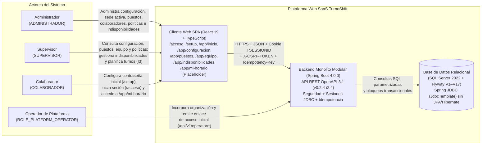
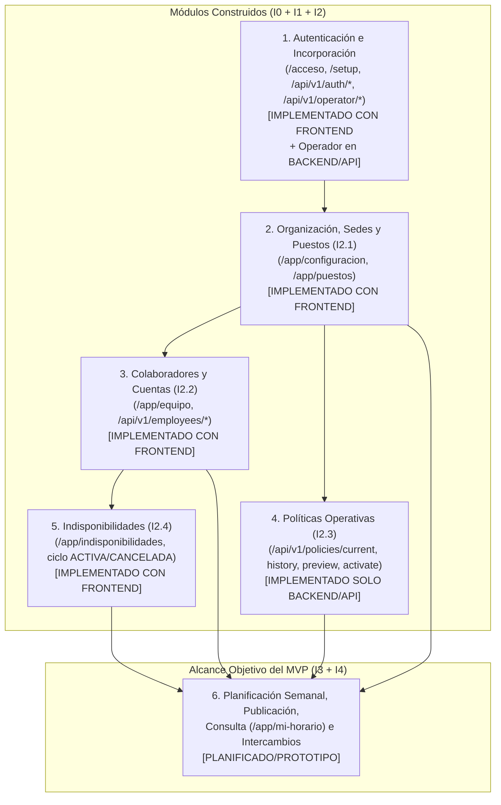
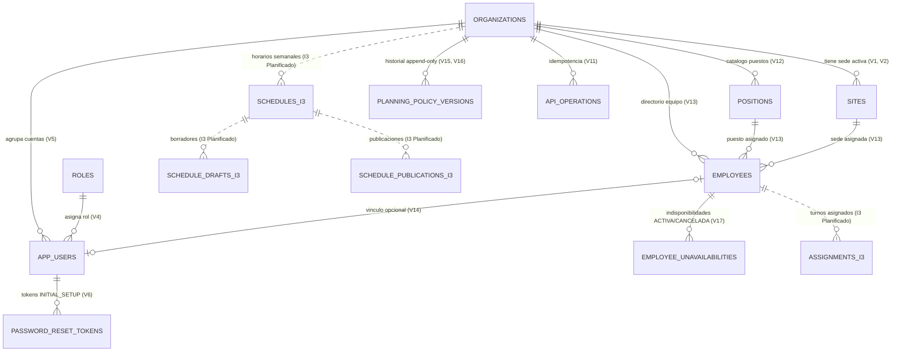

# 3. Diseño de la solución

El presente capítulo desarrolla el **Diseño de la Solución** para **TurnoShift**, la plataforma web bajo modelo **SaaS (Software as a Service) multiempresa (`multi-tenant`)** seleccionada en el capítulo anterior ([`docs/deliverables/02 - Planteamiento de Alternativas de Solución.md`](file:///d:/Proyectos/TurnoShift/docs/deliverables/02%20-%20Planteamiento%20de%20Alternativas%20de%20Soluci%C3%B3n.md)) para resolver la problemática operativa del caso de estudio **Café Andino S.A.C.** ([`docs/planning/01 - Contexto de la Empresa y Caso de Estudio.md`](file:///d:/Proyectos/TurnoShift/docs/planning/01%20-%20Contexto%20de%20la%20Empresa%20y%20Caso%20de%20Estudio.md), [`docs/planning/02 - Problemática y Dolores Operativos.md`](file:///d:/Proyectos/TurnoShift/docs/planning/02%20-%20Problem%C3%A1tica%20y%20Dolores%20Operativos.md)).

De acuerdo con el estado real verificado en [`docs/context/STATE.md`](file:///d:/Proyectos/TurnoShift/docs/context/STATE.md) y [`docs/planning/30 - Auditoría Académica de Entrega 2 a 6.md`](file:///d:/Proyectos/TurnoShift/docs/planning/30%20-%20Auditor%C3%ADa%20Acad%C3%A9mica%20de%20Entrega%202%20a%206.md), cada módulo, flujo, entidad y contrato descrito en este documento se clasifica con total transparencia en una de las siguientes categorías:
- **`IMPLEMENTADO CON FRONTEND`**: Funcionalidad respaldada por migraciones Flyway aplicadas (`V1`–`V17`), lógica de dominio y casos de uso en `backend/`, contrato en [`docs/api/openapi.yaml`](file:///d:/Proyectos/TurnoShift/docs/api/openapi.yaml) (`v0.2.4-i2.4`) y pantalla web demostrable en la SPA React (`frontend/src/`).
- **`IMPLEMENTADO SOLO BACKEND/API`**: Funcionalidad construida y verificable en base de datos, dominio y controladores REST (`backend/` y [`docs/api/openapi.yaml`](file:///d:/Proyectos/TurnoShift/docs/api/openapi.yaml)), pero sin pantalla frontend demostrable en la SPA React.
- **`PLANIFICADO/PROTOTIPO`**: Capacidades pertenecientes al alcance objetivo del MVP que cuentan con documentación de diseño ([`docs/planning/28 - Diseño Técnico I3 - Planificación de Turnos.md`](file:///d:/Proyectos/TurnoShift/docs/planning/28%20-%20Dise%C3%B1o%20T%C3%A9cnico%20I3%20-%20Planificaci%C3%B3n%20de%20Turnos.md), [`docs/planning/29 - Plan de Implementación I3.1-a - Persistencia y Migraciones.md`](file:///d:/Proyectos/TurnoShift/docs/planning/29%20-%20Plan%20de%20Implementaci%C3%B3n%20I3.1-a%20-%20Persistencia%20y%20Migraciones.md)) o vistas placeholder navegables (`/app/mi-horario`), pero aún no implementadas en código productivo.

---

## 3.1 Propósito y alcance de la solución seleccionada

### Propósito del sistema
**TurnoShift** tiene como propósito centralizar y estructurar en una aplicación web multiempresa la incorporación segura de organizaciones y cuentas de acceso, la configuración de la organización y su sede activa, la administración del catálogo de puestos de trabajo, el directorio de colaboradores, las políticas operativas de planificación, el registro y gestión de indisponibilidades del personal y —como alcance objetivo del MVP— la planificación semanal de turnos, su publicación inmutable, la consulta personal de horarios y las solicitudes de intercambio de turno ([`docs/context/STATE.md`](file:///d:/Proyectos/TurnoShift/docs/context/STATE.md), [`docs/planning/04 - Alcance Funcional del MVP y Historias de Usuario.md`](file:///d:/Proyectos/TurnoShift/docs/planning/04%20-%20Alcance%20Funcional%20del%20MVP%20y%20Historias%20de%20Usuario.md)).

### Diagrama de contexto del sistema
El siguiente diagrama representa la frontera de **TurnoShift** y su interacción con los cuatro actores del sistema:



### Alcance cubierto por el diseño de la solución
De acuerdo con [`docs/context/STATE.md`](file:///d:/Proyectos/TurnoShift/docs/context/STATE.md) y [`docs/context/DECISIONS.md`](file:///d:/Proyectos/TurnoShift/docs/context/DECISIONS.md):
1. **Incorporación asistida y autenticación multiempresa (`I0` + `I1` + `F1`):** Alta mono-transaccional de organizaciones (`organizations`) y su sede principal (`sites`), emisión de enlaces de primer acceso de un solo uso (`password_reset_tokens` con propósito `INITIAL_SETUP`), establecimiento de contraseña en `/setup#token=...`, e inicio de sesión empresarial en `/acceso` con sesiones persistidas en SQL Server (`SPRING_SESSION`).
2. **Configuración organizacional, sede activa y puestos de trabajo (`I2.1` + `F2`):** Consulta y actualización del nombre visible de la organización y del nombre de su sede activa en `/app/configuracion` (exponiendo `timezoneId` en modo lectura), y administración completa del catálogo de puestos de trabajo en `/app/puestos` (`positions`).
3. **Directorio de colaboradores y vínculo con cuentas (`I2.2` + `F3`):** Gestión de colaboradores (`employees`) en `/app/equipo`, asignación de puesto activo y sede, activación/desactivación con evaluación previa de bloqueos (`previewDeactivation`) y vínculo con cuentas de usuario (`app_users`).
4. **Políticas operativas versionadas (`I2.3`):** Modelo append-only de versiones de política (`planning_policy_versions` con `minimum_rest_minutes`, `weekly_warning_minutes` y motivo), previsualización de cambio y activación en backend/API (`/api/v1/policies/*`).
5. **Indisponibilidades de personal (`I2.4` + `F4`):** Registro, consulta, actualización y cancelación de indisponibilidades (`employee_unavailabilities`) en `/app/indisponibilidades` con ciclo de vida `ACTIVA` / `CANCELADA`, soporte de intervalos parciales UTC y días completos en la zona horaria organizacional.
6. **Planificación semanal, publicación, consulta e intercambios (`I3` + `I4` — alcance objetivo del MVP):** Diseño de programación semanal de turnos, evaluación de compatibilidad con indisponibilidades y políticas, publicación de horarios, consulta en `/app/mi-horario` e intercambios de turno.

---

## 3.2 Actores y responsabilidades

Conforme a las migraciones `V4__roles.sql` y `V10__platform_operators.sql`, al contrato [`docs/api/openapi.yaml`](file:///d:/Proyectos/TurnoShift/docs/api/openapi.yaml) y al enrutador [`frontend/src/App.tsx`](file:///d:/Proyectos/TurnoShift/frontend/src/App.tsx), la solución define cuatro actores:

| Actor | Rol técnico en código y BD | Frontera de acceso | Responsabilidades verificadas en la solución | Estado actual en el repositorio |
| :--- | :--- | :--- | :--- | :--- |
| **Operador de Plataforma** | `ROLE_PLATFORM_OPERATOR` (`platform_operators`) | Exclusivo API `/api/v1/operator/**` (bloqueado en rutas empresariales con `403 ACCESS_DENIED`) | Autentica su sesión de soporte (`/api/v1/operator/auth/*`), incorpora nuevas organizaciones creando la organización, la sede `PRINCIPAL` y el usuario administrador inicial (`POST /api/v1/operator/setup/organizations`), y emite o reemplaza el enlace de acceso inicial (`POST .../initial-access-link`). | **`IMPLEMENTADO SOLO BACKEND/API`** (`STATE.md` §2) |
| **Administrador** | `ADMINISTRADOR` (`roles.code`) | API `/api/v1/**` y vistas SPA `/app/inicio`, `/app/configuracion`, `/app/puestos`, `/app/equipo`, `/app/indisponibilidades` | Configura su contraseña inicial en `/setup#token=...`, inicia sesión en `/acceso`, edita el nombre de la organización y de la sede activa (`/app/configuracion`), crea/edita/activa/desactiva puestos (`/app/puestos`), crea/edita/activa/desactiva colaboradores (`/app/equipo`), previsualiza y activa políticas operativas vía API (`/api/v1/policies/*`) y crea/edita/cancela indisponibilidades (`/app/indisponibilidades`). | **`IMPLEMENTADO CON FRONTEND`** en `I1`, `I2.1`, `I2.2` e `I2.4`; **`IMPLEMENTADO SOLO BACKEND/API`** en `I2.3` (Políticas); **`PLANIFICADO/PROTOTIPO`** en `I3`/`I4`. |
| **Supervisor** | `SUPERVISOR` (`roles.code`) | API `/api/v1/**` y vistas SPA `/app/inicio`, `/app/puestos` (consulta), `/app/equipo` (consulta), `/app/indisponibilidades` (gestión completa) | Inicia sesión en `/acceso`, consulta puestos en `/app/puestos` y colaboradores en `/app/equipo` en modo de solo lectura (con controles de mutación omitidos del DOM), consulta políticas vigentes vía API (`GET /api/v1/policies/current` y `/history`), y posee permisos completos de creación, actualización y cancelación de indisponibilidades en `/app/indisponibilidades` (`RN-012`, `RN-014`). En el alcance objetivo (`I3`/`I4`), gestiona horarios e intercambios. | **`IMPLEMENTADO CON FRONTEND`** en consulta de puestos/equipo y gestión completa de indisponibilidades (`I2.4`); **`IMPLEMENTADO SOLO BACKEND/API`** en lectura de políticas (`I2.3`); **`PLANIFICADO/PROTOTIPO`** en `I3`/`I4`. |
| **Colaborador** | `COLABORADOR` (`roles.code`) | API `/api/v1/auth/**` y vista SPA `/app/mi-horario` (restringido en rutas administrativas con redirección a `/acceso-restringido`) | Establece su contraseña inicial mediante enlace seguro (`/setup#token=...`), inicia sesión en `/acceso` y es redirigido automáticamente a su página de aterrizaje `/app/mi-horario`. En el alcance objetivo del MVP (`I3`/`I4`), consulta sus turnos publicados y gestiona solicitudes personales. | **`IMPLEMENTADO CON FRONTEND`** en `/setup`, `/acceso` y control de sesión/RBAC; **`PLANIFICADO/PROTOTIPO`** en `/app/mi-horario` ([`PlaceholderPage.tsx`](file:///d:/Proyectos/TurnoShift/frontend/src/pages/placeholders/PlaceholderPage.tsx)) e `I3`/`I4`. |

---

## 3.3 Diseño modular de TurnoShift

El siguiente diagrama representa el flujo general de dependencias entre los módulos que conforman la solución y su clasificación de estado real:



### 1. Módulo de Autenticación e Incorporación (`I1` + `F1`)
- **Clasificación de estado:** **`IMPLEMENTADO CON FRONTEND`** para el acceso empresarial (`/acceso` en [`LoginPage.tsx`](file:///d:/Proyectos/TurnoShift/frontend/src/pages/login/LoginPage.tsx)) y el establecimiento de primera contraseña (`/setup#token=...` en [`SetupPage.tsx`](file:///d:/Proyectos/TurnoShift/frontend/src/pages/setup/SetupPage.tsx)); **`IMPLEMENTADO SOLO BACKEND/API`** para la autenticación de operadores y la incorporación asistida de organizaciones (`/api/v1/operator/**`).
- **Diseño funcional y técnico:**
  - **Incorporación asistida (`IncorporateOrganization`):** Crea de manera mono-transaccional la organización (`organizations`), su sede activa inicial (`sites` con código `PRINCIPAL`) y el primer usuario con rol `ADMINISTRADOR` (`app_users` con `password_hash = NULL`), utilizando bloqueos exclusivos `sp_getapplock` y registro de idempotencia en `api_operations` (`STATE.md` §2).
  - **Enlace de acceso inicial (`EmitInitialAccessLink`):** Genera un secreto aleatorio de 256 bits (43 caracteres Base64 URL-safe) entregado bajo el formato `/setup#token=...` y persiste únicamente su hash `SHA-256` (`BINARY(32)`) en `password_reset_tokens` con propósito `INITIAL_SETUP` y vigencia de 30 minutos.
  - **Establecimiento de contraseña (`/setup`) y Login (`/acceso`):** Valida la contraseña contra la política de longitud (15–128 caracteres), la lista de bloqueo **Have I Been Pwned** mediante *k-anonymity* (`HibpPasswordBlocklist`) y la codifica con **Argon2id** (`Argon2PasswordService`). El inicio de sesión en `/acceso` requiere `organizationCode`, `email` y `password`, rota el ID de sesión (`changeSessionId`), fija un límite absoluto de 8 horas y revalida en cada petición el estado del usuario y de la organización (`SessionRevalidationFilter`).
- **Fuentes internas:** [`docs/context/STATE.md`](file:///d:/Proyectos/TurnoShift/docs/context/STATE.md) (§2), [`frontend/src/App.tsx`](file:///d:/Proyectos/TurnoShift/frontend/src/App.tsx), [`docs/api/openapi.yaml`](file:///d:/Proyectos/TurnoShift/docs/api/openapi.yaml) (`v0.2.4-i2.4`).

### 2. Módulo de Organización, Sedes y Puestos (`I2.1` + `F2`)
- **Clasificación de estado:** **`IMPLEMENTADO CON FRONTEND`** (`/app/configuracion` en [`ConfigurationPage.tsx`](file:///d:/Proyectos/TurnoShift/frontend/src/pages/configuration/ConfigurationPage.tsx) y `/app/puestos` en [`PositionsPage.tsx`](file:///d:/Proyectos/TurnoShift/frontend/src/pages/positions/PositionsPage.tsx)).
- **Diseño funcional y técnico:**
  - **Configuración de organización y sede activa (`HU-05`):** Expone `GET /api/v1/organization/configuration` para consultar el nombre visible de la organización, los datos de su única sede activa (`sites`) y el `timezoneId` IANA (expuesto en modo de solo lectura en `I2.1`). Permite al `ADMINISTRADOR` actualizar de forma independiente e idempotente el nombre visible de la organización (`PATCH /api/v1/organization/configuration/display-name`) y el nombre de la sede activa (`PATCH /api/v1/organization/configuration/active-site/name`) bajo control de concurrencia optimista (`expectedLockVersion`).
  - **Catálogo de puestos de trabajo (`HU-06`):** Persistido en la tabla `positions` (`V12__positions.sql`) con unicidad binaria `(organization_id, code)`. Soporta listado con filtro opcional de estado (`GET /api/v1/positions?active=...`), creación (`POST /api/v1/positions`), actualización de nombre manteniendo el código inmutable (`PUT /api/v1/positions/{positionId}`) y activación/desactivación (`PATCH /api/v1/positions/{positionId}/status`). En `/app/puestos`, el `ADMINISTRADOR` ejecuta mutaciones y el `SUPERVISOR` dispone de modo consulta.
- **Fuentes internas:** [`docs/context/STATE.md`](file:///d:/Proyectos/TurnoShift/docs/context/STATE.md) (§2 *I2.1 — Configuración y puestos* y *Frontend F2*), [`docs/api/openapi.yaml`](file:///d:/Proyectos/TurnoShift/docs/api/openapi.yaml).

### 3. Módulo de Colaboradores y Cuentas (`I2.2` + `F3`)
- **Clasificación de estado:** **`IMPLEMENTADO CON FRONTEND`** (`/app/equipo` en [`EmployeesPage.tsx`](file:///d:/Proyectos/TurnoShift/frontend/src/pages/employees/EmployeesPage.tsx) y `EmployeeController` bajo `/api/v1/employees`).
- **Diseño funcional y técnico:**
  - **Persistencia y vínculo relacional (`V13` y `V14`):** La tabla `employees` almacena los colaboradores de cada organización (`id`, `organization_id`, `code` único en mayúsculas, `display_name`, `position_id`, `site_id`, `is_active`, `lock_version`) con claves foráneas compuestas hacia `positions` y `sites`. La migración `V14__app_users_employee_fk.sql` establece la clave foránea compuesta `fk_app_users_employee` entre `app_users(organization_id, employee_id)` y `employees(organization_id, id)`.
  - **Operaciones de negocio y UI (`/app/equipo`):** Implementa siete operaciones en backend y frontend: listado con filtro de estado (`GET /api/v1/employees`), consulta individual (`GET /api/v1/employees/{employeeId}`), alta validando límite de licencias con `sp_getapplock` y puesto activo (`POST /api/v1/employees`), edición de nombre y puesto (`PUT /api/v1/employees/{employeeId}`), activación (`POST /api/v1/employees/{employeeId}/activate`), evaluación previa de desactivación sin efectos colaterales (`POST /api/v1/employees/{employeeId}/deactivation-preview`) y desactivación (`POST /api/v1/employees/{employeeId}/deactivate`).
- **Fuentes internas:** [`docs/context/STATE.md`](file:///d:/Proyectos/TurnoShift/docs/context/STATE.md) (§2 *I2.2 — Colaboradores y vínculo con cuentas* y *Frontend F3*), [`frontend/src/App.tsx`](file:///d:/Proyectos/TurnoShift/frontend/src/App.tsx) (líneas 116–122).

### 4. Módulo de Políticas Operativas (`I2.3`)
- **Clasificación de estado:** **`IMPLEMENTADO SOLO BACKEND/API`** (`PolicyController` bajo `/api/v1/policies`, migraciones `V15` y `V16`; **no cuenta con pantalla frontend demostrable en `frontend/src/App.tsx`**).
- **Diseño funcional y técnico:**
  - **Modelo append-only (`V15` y `V16`):** La tabla `planning_policy_versions` almacena las versiones históricas de la política operativa de cada organización con umbrales validados por restricciones `CHECK`: descanso mínimo entre turnos en minutos (`minimum_rest_minutes` en `[1..1440]`), umbral de advertencia semanal en minutos (`weekly_warning_minutes` en `[1..10080]`) y motivo de cambio no vacío (`reason`). La tabla `organizations` referencia la versión vigente mediante la clave foránea compuesta `fk_organizations_current_policy_version`.
  - **Endpoints de consulta, previsualización y activación:** Expone lectura de la política vigente (`GET /api/v1/policies/current`) e historial (`GET /api/v1/policies/history`) para `ADMINISTRADOR` y `SUPERVISOR`; y previsualización (`POST /api/v1/policies/preview`, que devuelve el `PolicyDelta` y una huella canónica `validationFingerprint`) junto con activación idempotente (`POST /api/v1/policies/activate`, protegida con `sp_getapplock` por organización) exclusivas para `ADMINISTRADOR`.
- **Fuentes internas:** [`docs/context/STATE.md`](file:///d:/Proyectos/TurnoShift/docs/context/STATE.md) (§2 *I2.3 — Política operativa inicial*), [`docs/api/openapi.yaml`](file:///d:/Proyectos/TurnoShift/docs/api/openapi.yaml).

### 5. Módulo de Indisponibilidades (`I2.4` + `F4`)
- **Clasificación de estado:** **`IMPLEMENTADO CON FRONTEND`** (`/app/indisponibilidades` en [`UnavailabilitiesPage.tsx`](file:///d:/Proyectos/TurnoShift/frontend/src/pages/unavailabilities/UnavailabilitiesPage.tsx) y `UnavailabilityController` bajo `/api/v1/unavailabilities` y `/api/v1/employees/{employeeId}/unavailabilities`).
- **Diseño funcional y técnico:**
  - **Ciclo de vida y modelo de datos (`V17__employee_unavailabilities.sql`):** Las indisponibilidades tienen ciclo de vida **`ACTIVA` / `CANCELADA`** (`chk_employee_unavailabilities_status`). Cada registro pertenece a un colaborador de la organización (`fk_employee_unavailabilities_org_employee`), define un intervalo semiabierto `[starts_at, ends_at)` en UTC (`starts_at < ends_at`), un motivo tipado (`reason_code`: `VACACIONES`, `PERMISO_PERSONAL`, `MEDICO`, `FORMACION`, `OTRO`), una nota restringida opcional (`restricted_note NVARCHAR(500)`), versión de bloqueo optimista (`lock_version`) y campos de auditoría de cancelación (`cancelled_at`, `cancelled_by_user_id`, `cancellation_reason`).
  - **Permisos, superposición y reglas temporales (`RN-012`, `RN-013`, `RN-014`):** Las indisponibilidades se pueden crear (`POST /api/v1/employees/{employeeId}/unavailabilities`), actualizar (`PUT /api/v1/unavailabilities/{unavailabilityId}`) y cancelar (`POST /api/v1/unavailabilities/{unavailabilityId}/cancel`) por usuarios con rol `ADMINISTRADOR` o `SUPERVISOR` según las restricciones temporales del dominio. **Los intervalos superpuestos están permitidos por diseño en `I2.4`; la compatibilidad con la planificación de turnos se evaluará posteriormente en `I3`.** En cuanto a las restricciones temporales (`RN-013`), la **creación permite registrar un intervalo en curso siempre que termine en el futuro (`startsAt <= now` y `endsAt > now`)** y rechaza periodos ya concluidos (`endsAt <= now`); en cambio, **la actualización y la cancelación se bloquean si el periodo existente ya empezó (`startsAt <= now`)**, y la actualización tampoco permite mover el inicio al pasado (`newStartsAt <= now`).
- **Fuentes internas:** [`docs/context/STATE.md`](file:///d:/Proyectos/TurnoShift/docs/context/STATE.md) (§2 *I2.4 — Indisponibilidades* y *Frontend F4*), [`frontend/src/pages/unavailabilities/UnavailabilitiesPage.tsx`](file:///d:/Proyectos/TurnoShift/frontend/src/pages/unavailabilities/UnavailabilitiesPage.tsx), [`docs/api/openapi.yaml`](file:///d:/Proyectos/TurnoShift/docs/api/openapi.yaml).

### 6. Módulo de Planificación Semanal, Publicación, Consulta e Intercambios (`I3` e `I4`)
- **Clasificación de estado:** **`PLANIFICADO/PROTOTIPO`** (Alcance objetivo del MVP y prototipos/documentación de diseño; no implementados todavía).
- **Diseño funcional y técnico proyectado:**
  - **Planificación semanal, validación y publicación (`I3`):** Documentado en [`docs/planning/28 - Diseño Técnico I3 - Planificación de Turnos.md`](file:///d:/Proyectos/TurnoShift/docs/planning/28%20-%20Dise%C3%B1o%20T%C3%A9cnico%20I3%20-%20Planificaci%C3%B3n%20de%20Turnos.md) y [`docs/planning/29 - Plan de Implementación I3.1-a - Persistencia y Migraciones.md`](file:///d:/Proyectos/TurnoShift/docs/planning/29%20-%20Plan%20de%20Implementaci%C3%B3n%20I3.1-a%20-%20Persistencia%20y%20Migraciones.md). Proyecta la creación de horarios semanales en borrador, la asignación de turnos por puesto y colaborador, la evaluación de compatibilidad temporal frente a las indisponibilidades `ACTIVA` registradas en `I2.4` y los umbrales de la política operativa vigente (`I2.3`), y la generación de publicaciones inmutables.
  - **Consulta personal (`/app/mi-horario`) e intercambios de turno (`I4`):** En la SPA actual (`frontend/src/App.tsx`, líneas 132–149), la ruta `/app/mi-horario` está habilitada para el rol `COLABORADOR` (y usuarios con `employeeId`) mostrando el componente [`PlaceholderPage.tsx`](file:///d:/Proyectos/TurnoShift/frontend/src/pages/placeholders/PlaceholderPage.tsx). Los intercambios de turno (`I4`) forman parte del alcance objetivo futuro del MVP ([`docs/planning/04 - Alcance Funcional del MVP y Historias de Usuario.md`](file:///d:/Proyectos/TurnoShift/docs/planning/04%20-%20Alcance%20Funcional%20del%20MVP%20y%20Historias%20de%20Usuario.md)), sin contar todavía con diseño técnico de implementación aprobado.

---

## 3.4 Flujos operativos principales

### 1. Flujo de incorporación inicial (`Bootstrap` de organización y `/setup`) — `[IMPLEMENTADO CON FRONTEND / Operador en BACKEND]`
1. **Incorporación de organización:** El Operador de Plataforma invoca `POST /api/v1/operator/setup/organizations` con cabecera `Idempotency-Key`. El sistema valida el código de organización, adquiere bloqueos `sp_getapplock` y crea en una sola transacción la fila en `organizations`, la sede activa `PRINCIPAL` en `sites` y el usuario `ADMINISTRADOR` inicial en `app_users` (`password_hash = NULL`).
2. **Emisión del enlace inicial:** El operador invoca `POST /api/v1/operator/setup/organizations/{organizationId}/initial-access-link` indicando `expectedVersion`. El backend emite un enlace con fragmento `/setup#token=...`, guardando únicamente el hash `SHA-256` en `password_reset_tokens`.
3. **Configuración de primera contraseña en `/setup`:** El administrador abre `/setup#token=...` en el navegador ([`SetupPage.tsx`](file:///d:/Proyectos/TurnoShift/frontend/src/pages/setup/SetupPage.tsx)). El cliente lee el token exclusivamente de `window.location.hash` y envía `POST /api/v1/auth/password-reset/complete`. El backend verifica el token, comprueba la contraseña contra la política y la lista HIBP (`k-anonymity`), calcula el hash **Argon2id**, consume atómicamente el token e incrementa `auth_version`. El frontend limpia el hash de la URL (`history.replaceState`) y redirige a `/acceso`.

### 2. Flujo de inicio de sesión (`/acceso`) — `[IMPLEMENTADO CON FRONTEND]`
1. En la ruta oficial `/acceso` ([`LoginPage.tsx`](file:///d:/Proyectos/TurnoShift/frontend/src/pages/login/LoginPage.tsx); el alias `/login` redirige automáticamente a `/acceso`), el usuario introduce `organizationCode`, `email` y `password`.
2. `LoginController` aplica limitación de tasa por IP real (`5 req/60s`) y delega en `AuthenticateUser`, que normaliza el correo y verifica el hash Argon2id (utilizando un hash señuelo cuando el candidato no existe para evitar ataques de temporización y enumeración).
3. Tras autenticar, el servidor rota el ID de sesión (`request.changeSessionId()`), almacena la sesión en `SPRING_SESSION` con la cookie `TSESSIONID` (`HttpOnly`, `SameSite=Lax`, `Path=/api`), renueva el token CSRF y el cliente redirige a `/app/inicio` (para `ADMINISTRADOR` y `SUPERVISOR`) o a `/app/mi-horario` (para `COLABORADOR`).

### 3. Flujo de administración de organización y políticas (`/app/configuracion` y `/api/v1/policies/*`) — `[I2.1 IMPLEMENTADO CON FRONTEND / I2.3 IMPLEMENTADO SOLO BACKEND/API]`
1. **Edición de organización y sede activa (`I2.1`):** El `ADMINISTRADOR` ingresa a `/app/configuracion` ([`ConfigurationPage.tsx`](file:///d:/Proyectos/TurnoShift/frontend/src/pages/configuration/ConfigurationPage.tsx)), que carga `GET /api/v1/organization/configuration` mostrando el `timezoneId` en modo lectura y permitiendo actualizar de forma independiente el nombre visible de la organización (`PATCH .../display-name`) y el nombre de la sede activa (`PATCH .../active-site/name`) con `expectedLockVersion` e `Idempotency-Key`.
2. **Previsualización y activación de políticas (`I2.3` — vía API):** El `ADMINISTRADOR` invoca `POST /api/v1/policies/preview` con los nuevos umbrales (`minimumRestMinutes`, `weeklyWarningMinutes`) y `expectedCurrentPolicyVersionId` para obtener el `validationFingerprint`, y luego confirma el cambio con `POST /api/v1/policies/activate` e `Idempotency-Key`, insertando una nueva fila en `planning_policy_versions` y actualizando `organizations.current_policy_version_id`.

### 4. Flujo de gestión de puestos (`/app/puestos`) y colaboradores (`/app/equipo`) — `[IMPLEMENTADO CON FRONTEND]`
1. **Catálogo de puestos (`I2.1`):** En `/app/puestos` ([`PositionsPage.tsx`](file:///d:/Proyectos/TurnoShift/frontend/src/pages/positions/PositionsPage.tsx)), el `ADMINISTRADOR` crea puestos con código normalizado (`POST /api/v1/positions`), actualiza su nombre (`PUT /api/v1/positions/{positionId}`) o conmuta su estado activo/inactivo (`PATCH /api/v1/positions/{positionId}/status`). El `SUPERVISOR` visualiza el catálogo en modo consulta.
2. **Directorio de colaboradores (`I2.2`):** En `/app/equipo` ([`EmployeesPage.tsx`](file:///d:/Proyectos/TurnoShift/frontend/src/pages/employees/EmployeesPage.tsx)), la vista carga coordinadamente con `Promise.all` los colaboradores (`GET /api/v1/employees`), los puestos y la sede activa. El `ADMINISTRADOR` da de alta colaboradores (`POST /api/v1/employees`), edita su nombre o puesto (`PUT /api/v1/employees/{employeeId}`) y gestiona su activación o desactivación en dos pasos consultando primero `POST /api/v1/employees/{employeeId}/deactivation-preview`.

### 5. Flujo de registro, actualización y cancelación de indisponibilidad (`/app/indisponibilidades`) — `[IMPLEMENTADO CON FRONTEND]`
1. **Consulta por ventana temporal:** En `/app/indisponibilidades` ([`UnavailabilitiesPage.tsx`](file:///d:/Proyectos/TurnoShift/frontend/src/pages/unavailabilities/UnavailabilitiesPage.tsx)), los usuarios con rol `ADMINISTRADOR` o `SUPERVISOR` consultan las indisponibilidades de la organización (`GET /api/v1/unavailabilities?from=...&to=...&includeCancelled=...`) en ventanas de 30, 60 o 90 días, filtrando en memoria por colaborador, motivo (`VACACIONES`, `PERMISO_PERSONAL`, `MEDICO`, `FORMACION`, `OTRO`) o búsqueda textual.
2. **Creación (`POST /api/v1/employees/{employeeId}/unavailabilities`):** Mediante `UnavailabilityModal`, el `ADMINISTRADOR` o `SUPERVISOR` selecciona el colaborador, el formato temporal (intervalo parcial UTC o día completo calculado en la zona horaria IANA de la organización), el motivo y opcionalmente una `restrictedNote`. Si el intervalo termina en el futuro (`endsAt > now`), el backend registra la indisponibilidad en estado `ACTIVA` (`lock_version = 0`), permitiendo intervalos en curso y permitiendo intervalos superpuestos.
3. **Actualización (`PUT /api/v1/unavailabilities/{unavailabilityId}`) y Cancelación (`POST /api/v1/unavailabilities/{unavailabilityId}/cancel`):** Para indisponibilidades en estado `ACTIVA` cuyo periodo **aún no ha iniciado (`startsAt > now`)**, el `ADMINISTRADOR` o `SUPERVISOR` puede editar sus datos o cancelarlas indicando un motivo de cancelación (`cancellationReason`) junto con `expectedLockVersion` e `Idempotency-Key`. Si el periodo ya inició (`startsAt <= now`), tanto el cliente como el servidor bloquean la edición y la cancelación (`RN-013`).

### Diagrama de secuencia de una operación sensible con autorización, idempotencia y restricción temporal (`RN-013`)
El siguiente diagrama muestra la ejecución real del flujo de cancelación de una indisponibilidad (`POST /api/v1/unavailabilities/{unavailabilityId}/cancel`):

```mermaid
sequenceDiagram
    actor Actor as Administrador / Supervisor
    participant SPA as SPA React (/app/indisponibilidades)<br/>UnavailabilitiesPage + CancelModal
    participant Sec as SecurityConfig + SessionRevalidationFilter<br/>+ CSRF + RBAC
    participant Ctrl as UnavailabilityController
    participant Idemp as BusinessIdempotentOperationExecutor<br/>(api_operations V11)
    participant UC as CancelUnavailabilityUseCase
    participant DAO as JdbcEmployeeUnavailabilityRepository<br/>(employee_unavailabilities V17)

    Actor->>SPA: Confirma cancelación e ingresa cancellationReason
    SPA->>Sec: POST /api/v1/unavailabilities/{id}/cancel<br/>(Cookie TSESSIONID + X-CSRF-TOKEN + Idempotency-Key + expectedLockVersion)
    Sec->>Sec: Revalida sesión activa (<8h, usuario y org activos),\nverifica CSRF y rol ADMINISTRADOR o SUPERVISOR
    Sec->>Ctrl: Entrega petición con AuthenticatedIdentity (organizationId, userId)
    Ctrl->>Idemp: Ejecuta comando idempotente dentro de transacción (@Transactional)
    Idemp->>UC: cancel(organizationId, actorUserId, unavailabilityId, reason, expectedLockVersion)
    UC->>DAO: Consulta registro por (organization_id, id)
    UC->>UC: Valida estado ACTIVA, lock_version == expectedLockVersion\ny regla RN-013 (starts_at > SYSUTCDATETIME())
    UC->>DAO: UPDATE status = 'CANCELADA', cancelled_at = SYSUTCDATETIME(),\ncancelled_by_user_id, cancellation_reason, lock_version = lock_version + 1
    DAO-->>UC: Entidad actualizada en estado CANCELADA
    UC-->>Idemp: EmployeeUnavailabilityResponse
    Idemp-->>Ctrl: Persiste resultado en api_operations y retorna respuesta
    Ctrl-->>SPA: HTTP 200 OK + Cache-Control: no-store + JSON
    SPA-->>Actor: Actualiza listado mostrando estado CANCELADA
```

### 6. Flujo de planificación semanal y publicación (`I3`) — `[PLANIFICADO/PROTOTIPO]`
Proyectado en [`docs/planning/28 - Diseño Técnico I3 - Planificación de Turnos.md`](file:///d:/Proyectos/TurnoShift/docs/planning/28%20-%20Dise%C3%B1o%20T%C3%A9cnico%20I3%20-%20Planificaci%C3%B3n%20de%20Turnos.md) y [`docs/planning/29 - Plan de Implementación I3.1-a - Persistencia y Migraciones.md`](file:///d:/Proyectos/TurnoShift/docs/planning/29%20-%20Plan%20de%20Implementaci%C3%B3n%20I3.1-a%20-%20Persistencia%20y%20Migraciones.md): el `ADMINISTRADOR` o `SUPERVISOR` creará y editará el borrador semanal de turnos, donde el motor de planificación evaluará las indisponibilidades en estado `ACTIVA` (registradas en `I2.4`) y los umbrales de la política vigente (`I2.3`), exigiendo resolver conflictos bloqueantes y acusar advertencias antes de emitir una publicación semanal inmutable.

### 7. Flujo de consulta personal (`/app/mi-horario`) e intercambio de turnos (`I4`) — `[PLANIFICADO/PROTOTIPO]`
Al iniciar sesión en `/acceso`, el usuario con rol `COLABORADOR` es dirigido a `/app/mi-horario` (actualmente renderizado mediante [`PlaceholderPage.tsx`](file:///d:/Proyectos/TurnoShift/frontend/src/pages/placeholders/PlaceholderPage.tsx)), donde en el alcance objetivo de `I3` consultará sus turnos publicados y en `I4` podrá solicitar intercambios de turno sujetos a validación y aprobación.

---

## 3.5 Reglas de negocio y controles relevantes

De acuerdo con [`docs/context/STATE.md`](file:///d:/Proyectos/TurnoShift/docs/context/STATE.md), [`docs/planning/05 - Reglas de Negocio y Validaciones.md`](file:///d:/Proyectos/TurnoShift/docs/planning/05%20-%20Reglas%20de%20Negocio%20y%20Validaciones.md) y [`docs/api/openapi.yaml`](file:///d:/Proyectos/TurnoShift/docs/api/openapi.yaml), la solución aplica siete controles fundamentales:

1. **Aislamiento multiempresa estricto (`organization_id`):** Todas las tablas de negocio (`sites`, `app_users`, `positions`, `employees`, `planning_policy_versions`, `employee_unavailabilities`, `api_operations`) incluyen `organization_id` con claves candidatas compuestas `(organization_id, id)` y claves foráneas compuestas. El `organizationId` y el `actorUserId` se obtienen exclusivamente de `AuthenticatedIdentity` en el `SecurityContext` de la sesión, nunca de parámetros enviados por el cliente.
2. **Control de acceso basado en roles (`RBAC`) y revalidación continua de sesión:** `SessionRevalidationFilter` verifica en cada petición autenticada contra SQL Server que la sesión no supere el límite absoluto de 8 horas, que el usuario siga activo (`is_active = 1`), que su `auth_version` coincida y que la organización tenga `service_status = 'ACTIVA'`. En el cliente, [`frontend/src/App.tsx`](file:///d:/Proyectos/TurnoShift/frontend/src/App.tsx) restringe el acceso a rutas no permitidas redirigiendo a `/acceso-restringido` ([`ForbiddenPage.tsx`](file:///d:/Proyectos/TurnoShift/frontend/src/pages/forbidden/ForbiddenPage.tsx)).
3. **Confidencialidad de credenciales y notas restringidas (`RN-014`):**
   - Las contraseñas se validan con **Have I Been Pwned k-anonymity** (enviando solo el prefijo de 5 caracteres hexadecimales del SHA-1) y se almacenan con **Argon2id**. Los enlaces iniciales usan el fragmento `#token=` y en base de datos solo se guarda el hash `SHA-256` (`BINARY(32)`).
   - En indisponibilidades (`I2.4`), el campo `restricted_note` (`NVARCHAR(500)`) **jamás se expone en tablas de listado, filtros, búsquedas en memoria ni logs del cliente**; solo se visualiza o edita dentro del modal autorizado para `ADMINISTRADOR` y `SUPERVISOR` (`STATE.md` §5 *F4.2*).
4. **Zona horaria organizacional (`IANA Timezone` + persistencia `UTC`):** Cada organización tiene asignado su `timezoneId` IANA en `organizations` (`America/Lima` para el caso de **Café Andino S.A.C.**). En `I2.4`, el backend (`OrganizationTimezoneAdapter` y `UnavailabilityTemporalParser`) y el frontend convierten las selecciones de día completo (`allDay = true`, `startDate`, `endDate`) a instantes UTC exactos (`[starts_at, ends_at)`) respetando la zona horaria del tenant.
5. **Concurrencia optimista (`lock_version` / `expectedLockVersion`):** Las entidades mutables (`organizations`, `sites`, `app_users`, `positions`, `employees`, `employee_unavailabilities`) mantienen un contador `lock_version BIGINT`. Toda operación de actualización, cambio de estado o cancelación exige `expectedLockVersion` en el cuerpo de la petición y responde `409 CONCURRENT_MODIFICATION` si otro usuario modificó el registro previamente.
6. **Idempotencia empresarial mono-transaccional (`BusinessIdempotentOperationExecutor`):** Toda mutación de negocio exige la cabecera `Idempotency-Key` (`UUID`). El backend calcula la huella canónica de la petición (`BusinessFingerprintCalculator`) y persiste el resultado en `api_operations` (`V11`). Si un cliente reintenta por fallo de red con la misma clave e idéntica huella, el servidor reproduce la respuesta original con la cabecera `Idempotency-Replayed: true`; si reutiliza la clave con datos distintos, rechaza con `409 IDEMPOTENCY_KEY_REUSED`.
7. **Restricciones temporales en indisponibilidades (`RN-013`) y permiso de intervalos superpuestos:**
   - **Creación:** Permite registrar una indisponibilidad cuyo intervalo ya esté en curso (`startsAt <= now`) siempre que su fin sea futuro (`endsAt > now`), y rechaza intervalos ya terminados (`endsAt <= now`).
   - **Actualización y cancelación:** Se bloquean de forma atómica (`starts_at > SYSUTCDATETIME()`) si el periodo existente ya empezó (`startsAt <= now`); además, la actualización prohíbe mover la fecha de inicio al pasado (`newStartsAt <= now`).
   - **Superposición de intervalos:** Los intervalos superpuestos de indisponibilidad para un mismo colaborador están permitidos por diseño en `I2.4`; su impacto y compatibilidad se evalúan aguas abajo durante la planificación semanal de turnos en `I3`.

---

## 3.6 Diseño de datos a alto nivel

El modelo relacional en **Microsoft SQL Server 2022** se estructura en las **17 migraciones Flyway ejecutables (`V1` a `V17`)** verificadas en [`docs/context/STATE.md`](file:///d:/Proyectos/TurnoShift/docs/context/STATE.md) (§3), complementadas a nivel de diseño por las entidades proyectadas para `I3` ([`Nota 28`](file:///d:/Proyectos/TurnoShift/docs/planning/28%20-%20Dise%C3%B1o%20T%C3%A9cnico%20I3%20-%20Planificaci%C3%B3n%20de%20Turnos.md) y [`Nota 29`](file:///d:/Proyectos/TurnoShift/docs/planning/29%20-%20Plan%20de%20Implementaci%C3%B3n%20I3.1-a%20-%20Persistencia%20y%20Migraciones.md)).

### Diagrama Entidad-Relación (DER) de alto nivel (`V1`–`V17` implementadas + `I3` planificado)



### Inventario de tablas implementadas (`V1`–`V17`) vs. proyectadas (`I3` / `I4`)

| Tabla en SQL Server | Migración / Fuente | Descripción y claves de integridad principales | Estado actual |
| :--- | :--- | :--- | :--- |
| `organizations` | `V1`, `V3`, `V16` | Organizaciones clientes (`id`, `code`, `display_name`, `timezone_id`, `service_status`, `current_policy_version_id`, `lock_version`). | **`IMPLEMENTADO`** |
| `sites` | `V2` | Sedes por organización con índice único filtrado para garantizar una única sede activa en el alcance actual (`organization_id`, `code`, `name`, `is_active`, `lock_version`). | **`IMPLEMENTADO`** |
| `roles` | `V4` | Catálogo de roles empresariales: `ADMINISTRADOR`, `SUPERVISOR` y `COLABORADOR`. | **`IMPLEMENTADO`** |
| `app_users` | `V5`, `V7`, `V8`, `V14` | Cuentas de usuario (`organization_id`, `role_code`, `email`, `normalized_email` con collation `BIN2`, `password_hash`, `employee_id`, `auth_version`, `lock_version`, `is_active`). | **`IMPLEMENTADO`** |
| `password_reset_tokens` | `V6` | Tokens de configuración inicial (`token_hash BINARY(32)`, `purpose = 'INITIAL_SETUP'`, `expires_at`, `consumed_at`, `revoked_at`) con FK compuesta `(organization_id, user_id)`. | **`IMPLEMENTADO`** |
| `SPRING_SESSION` y `SPRING_SESSION_ATTRIBUTES` | `V9` | Almacén JDBC de sesiones HTTP (`TSESSIONID`) y atributos serializados (incluyendo token CSRF y `authenticatedAt`). | **`IMPLEMENTADO`** |
| `platform_operators` | `V10` | Operadores de soporte de plataforma aislados de cualquier `organization_id`. | **`IMPLEMENTADO SOLO BACKEND/API`** |
| `api_operations` | `V11` | Registro mono-transaccional de operaciones idempotentes (`Idempotency-Key`, huella SHA-256 `BINARY(32)`, estado y respuesta serializada). | **`IMPLEMENTADO`** |
| `positions` | `V12` | Catálogo de puestos de trabajo por organización (`organization_id`, `code`, `name`, `is_active`, `lock_version`). | **`IMPLEMENTADO CON FRONTEND`** |
| `employees` | `V13`, `V14` | Colaboradores de la organización (`organization_id`, `code`, `display_name`, `position_id`, `site_id`, `is_active`, `lock_version`) con FKs compuestas a `positions` y `sites`. | **`IMPLEMENTADO CON FRONTEND`** |
| `planning_policy_versions` | `V15`, `V16` | Historial inmutable (`append-only`) de versiones de política operativa (`minimum_rest_minutes`, `weekly_warning_minutes`, `reason`). | **`IMPLEMENTADO SOLO BACKEND/API`** |
| `employee_unavailabilities` | `V17` | Indisponibilidades de colaboradores con ciclo de vida `ACTIVA`/`CANCELADA`, intervalo `[starts_at, ends_at)`, `reason_code`, `restricted_note`, auditoría de cancelación y `lock_version`. | **`IMPLEMENTADO CON FRONTEND`** |
| `schedules`, `schedule_drafts`, `assignments`, `assignment_revisions`, `draft_assignments`, `planning_change_sets`, `planning_warning_acknowledgements`, `schedule_publications`, `publication_assignments` | Especificadas en [`Nota 28`](file:///d:/Proyectos/TurnoShift/docs/planning/28%20-%20Dise%C3%B1o%20T%C3%A9cnico%20I3%20-%20Planificaci%C3%B3n%20de%20Turnos.md) y [`Nota 29`](file:///d:/Proyectos/TurnoShift/docs/planning/29%20-%20Plan%20de%20Implementaci%C3%B3n%20I3.1-a%20-%20Persistencia%20y%20Migraciones.md) (`V18`–`V19` proyectadas) | Modelo relacional diseñado para la planificación semanal en borrador, acuse de advertencias y publicación inmutable de horarios. | **`PLANIFICADO/PROTOTIPO`** (`I3` — aún no implementadas) |
| `shift_swap_requests` | Modelo conceptual en [`Nota 07`](file:///d:/Proyectos/TurnoShift/docs/planning/07%20-%20Modelo%20de%20Dominio%20y%20Datos.md) | Entidad conceptual proyectada para las solicitudes de intercambio de turno entre colaboradores. | **`PLANIFICADO/PROTOTIPO`** (`I4` — sin diseño técnico aprobado) |

---

## 3.7 Diseño de integración: SPA React, API REST, contratos OpenAPI y SQL Server

1. **Integración SPA React 19 (`frontend/`) ↔ API REST Spring Boot 4 (`backend/`):**
   - La SPA utiliza un enrutador nativo basado en Web History API ([`frontend/src/components/routing/Router.tsx`](file:///d:/Proyectos/TurnoShift/frontend/src/components/routing/Router.tsx)) y las rutas oficiales verificadas en [`frontend/src/App.tsx`](file:///d:/Proyectos/TurnoShift/frontend/src/App.tsx): `/acceso` (con `/login` como alias que redirige a `/acceso`), `/setup`, `/app/inicio`, `/app/configuracion`, `/app/puestos`, `/app/equipo`, `/app/indisponibilidades`, `/app/mi-horario` y `/acceso-restringido`.
   - El cliente HTTP centralizado ([`frontend/src/api/client.ts`](file:///d:/Proyectos/TurnoShift/frontend/src/api/client.ts)) envía todas las solicitudes con `credentials: 'include'` (cookie `TSESSIONID` `HttpOnly`), administra el token `X-CSRF-TOKEN` exclusivamente en memoria volátil (sin usar `localStorage` ni `sessionStorage`), adjunta `Idempotency-Key` (`crypto.randomUUID()`) en las mutaciones y traduce los errores HTTP a `ApiProblemError` conforme a **RFC 9457 (`Problem Details`)**.
2. **Contrato OpenAPI (`docs/api/openapi.yaml` `v0.2.4-i2.4`):**
   - Validado con Redocly CLI (`0 errores, 0 advertencias` según `STATE.md` §2). Define los esquemas exactos de sesión (`SessionResponse`), incorporación de organizaciones, configuración (`OrganizationConfigurationResponse`), puestos (`PositionResponse`), colaboradores (`EmployeeResponse`, `DeactivationPreviewResponse`), políticas (`PolicyController`) e indisponibilidades (`EmployeeUnavailabilityResponse`).
3. **Integración Backend (`application/` y `domain/`) ↔ SQL Server 2022 (`infrastructure/persistence/jdbc/`):**
   - El backend se conecta a **SQL Server 2022** mediante **HikariCP** y **`Spring JDBC` (`JdbcTemplate` / `NamedParameterJdbcTemplate`)**, implementando el **Patrón DAO** sin ORM (`Spring Data JPA` / Hibernate ausentes). Las migraciones Flyway `V1`–`V17` mantienen el esquema sincronizado y las operaciones críticas se coordinan mediante bloqueos de aplicación `sp_getapplock` y restricciones relacionales compuestas.

---

## 3.8 Matriz de trazabilidad: Requisito → Módulo → Flujo → Estado actual

| Requisito (`1.9` / `1.10`) | Módulo de la solución (`3.3`) | Flujo operativo (`3.4`) | Ruta UI / Endpoint API principal | Estado actual preciso |
| :--- | :--- | :--- | :--- | :--- |
| **RF-01** Autenticación por rol y aislamiento por organización (`organization_id`) | Módulo 1: Autenticación e Incorporación | Flujo 1 (`/setup`) y Flujo 2 (`/acceso`) | `/acceso`, `/setup#token=...` / `POST /api/v1/auth/login`, `GET /api/v1/auth/session`, `POST /api/v1/auth/logout` | **`IMPLEMENTADO CON FRONTEND`** |
| **RF-02 (a)** Configuración de organización y sede activa (`displayName`, `activeSite.name`, `timezoneId` lectura) | Módulo 2: Organización, Sedes y Puestos (`I2.1`) | Flujo 3 (Administración de organización) | `/app/configuracion` / `GET` y `PATCH /api/v1/organization/configuration/*` | **`IMPLEMENTADO CON FRONTEND`** |
| **RF-02 (b)** Versionado append-only, previsualización y activación de Políticas Operativas | Módulo 4: Políticas Operativas (`I2.3`) | Flujo 3 (Administración de políticas vía API) | Sin ruta en `App.tsx` / `GET /api/v1/policies/current`, `/history`, `POST /preview`, `/activate` | **`IMPLEMENTADO SOLO BACKEND/API`** |
| **RF-03** Administración del catálogo de puestos de trabajo | Módulo 2: Organización, Sedes y Puestos (`I2.1`) | Flujo 4 (Gestión de puestos) | `/app/puestos` / `GET`, `POST`, `PUT`, `PATCH /api/v1/positions/*` | **`IMPLEMENTADO CON FRONTEND`** |
| **RF-04** Directorio de colaboradores, puesto asignado, activación/desactivación y vínculo con cuenta | Módulo 3: Colaboradores y Cuentas (`I2.2`) | Flujo 4 (Gestión de colaboradores en `/app/equipo`) | `/app/equipo` / `GET`, `POST`, `PUT /api/v1/employees/*`, `/activate`, `/deactivate`, `/deactivation-preview` | **`IMPLEMENTADO CON FRONTEND`** |
| **RF-05** Registro, consulta, actualización y cancelación de indisponibilidades (`ACTIVA` / `CANCELADA`) bajo reglas `RN-012`, `RN-013` y `RN-014` | Módulo 5: Indisponibilidades (`I2.4`) | Flujo 5 (Gestión de indisponibilidades) | `/app/indisponibilidades` / `GET`, `POST`, `PUT /api/v1/unavailabilities/*` y `/api/v1/employees/{id}/unavailabilities` | **`IMPLEMENTADO CON FRONTEND`** |
| **RF-06, RF-07, RF-08, RF-09** Creación de borrador semanal, asignación de turnos, evaluación de compatibilidad con indisponibilidades/políticas y publicación | Módulo 6: Planificación Semanal y Publicación (`I3`) | Flujo 6 (Planificación semanal y publicación) | Diseño técnico en [`Nota 28`](file:///d:/Proyectos/TurnoShift/docs/planning/28%20-%20Dise%C3%B1o%20T%C3%A9cnico%20I3%20-%20Planificaci%C3%B3n%20de%20Turnos.md) y [`Nota 29`](file:///d:/Proyectos/TurnoShift/docs/planning/29%20-%20Plan%20de%20Implementaci%C3%B3n%20I3.1-a%20-%20Persistencia%20y%20Migraciones.md) (`V18`–`V19`) | **`PLANIFICADO/PROTOTIPO`** |
| **RF-10** Consulta personal del horario semanal publicado | Módulo 6: Consulta de Horario (`I3`) | Flujo 7 (Consulta personal en `/app/mi-horario`) | `/app/mi-horario` ([`PlaceholderPage.tsx`](file:///d:/Proyectos/TurnoShift/frontend/src/pages/placeholders/PlaceholderPage.tsx)) | **`PLANIFICADO/PROTOTIPO`** |
| **RF-11, RF-12** Solicitud de intercambio de turno y aprobación del supervisor | Módulo 6: Intercambios de Turno (`I4`) | Flujo 7 (Intercambio de turnos) | Alcance objetivo del MVP (`Notas 04, 05, 07, 08, 10`) | **`PLANIFICADO/PROTOTIPO`** |
| **RNF-01 a RNF-08** Argon2id, HIBP k-anonymity, sesiones JDBC 8h, CSRF, RBAC, Idempotencia `api_operations`, `lock_version` y RFC 9457 | Transversal a los Módulos 1 al 5 | Todos los flujos implementados (`1` al `5`) | `SecurityConfig.java`, `SessionRevalidationFilter.java`, `BusinessIdempotentOperationExecutor.java` | **`IMPLEMENTADO CON FRONTEND / BACKEND`** |

---

## 3.9 Límites conocidos y honestidad académica

En estricto cumplimiento de la veracidad documental exigida para la memoria académica ([`docs/planning/30 - Auditoría Académica de Entrega 2 a 6.md`](file:///d:/Proyectos/TurnoShift/docs/planning/30%20-%20Auditor%C3%ADa%20Acad%C3%A9mica%20de%20Entrega%202%20a%206.md) y [`docs/context/STATE.md`](file:///d:/Proyectos/TurnoShift/docs/context/STATE.md)), se dejan sentados los siguientes límites reales del sistema:

1. **`I2.3` Políticas Operativas (Backend/API sin pantalla frontend demostrable):**
   - Mientras que **`I2.1` (Configuración y Puestos en `/app/configuracion` y `/app/puestos`), `I2.2` (Colaboradores en `/app/equipo`) e `I2.4` (Indisponibilidades en `/app/indisponibilidades`)** cuentan con backend/API y pantalla frontend demostrable, el submódulo **`I2.3` (Políticas Operativas)** está implementado en persistencia (`V15`, `V16`), dominio y API REST (`/api/v1/policies/*`), pero **no cuenta con pantalla frontend demostrable en [`frontend/src/App.tsx`](file:///d:/Proyectos/TurnoShift/frontend/src/App.tsx)**.
2. **Comportamiento exacto de `I2.4` Indisponibilidades:**
   - Las indisponibilidades tienen ciclo de vida **`ACTIVA` / `CANCELADA`** (no existen estados `APPROVED` ni `REJECTED`). Se pueden crear, actualizar y cancelar por `ADMINISTRADOR` y `SUPERVISOR` según permisos y restricciones temporales (`RN-013`: la creación permite un intervalo en curso si termina en el futuro; la actualización y la cancelación se bloquean si el periodo ya empezó). **Los intervalos superpuestos están permitidos por diseño en `I2.4`; la compatibilidad con la planificación de turnos se evaluará posteriormente en `I3`.**
3. **`I3` Planificación semanal y publicación (Diseño/prototipo, aún no implementado):**
   - La creación de horarios semanales, el motor de evaluación de compatibilidad con indisponibilidades y políticas, la publicación inmutable y la consulta real de turnos en `/app/mi-horario` cuentan con diseño técnico aprobado ([`Nota 28`](file:///d:/Proyectos/TurnoShift/docs/planning/28%20-%20Dise%C3%B1o%20T%C3%A9cnico%20I3%20-%20Planificaci%C3%B3n%20de%20Turnos.md) y [`Nota 29`](file:///d:/Proyectos/TurnoShift/docs/planning/29%20-%20Plan%20de%20Implementaci%C3%B3n%20I3.1-a%20-%20Persistencia%20y%20Migraciones.md)) y con la vista prototipo [`PlaceholderPage.tsx`](file:///d:/Proyectos/TurnoShift/frontend/src/pages/placeholders/PlaceholderPage.tsx) en `/app/mi-horario`, pero **aún no están implementados en código ni migraciones aplicadas**.
4. **`I4` Intercambios de turno (Alcance futuro/prototipo, sin diseño técnico de implementación aprobado):**
   - Las solicitudes de intercambio de turno entre colaboradores corresponden al alcance futuro del MVP y prototipos documentales, sin contar aún con diseño técnico de implementación aprobado ni código en el repositorio.
5. **Capacidades fuera de alcance (`Out of Scope`):**
   - Quedan explícitamente excluidos del sistema el control de asistencia biométrica, reloj marcador, cálculo de nómina/planilla, cálculo de horas reales trabajadas, aplicaciones móviles nativas (iOS/Android) y optimización automática de horarios mediante inteligencia artificial o *solvers*.
