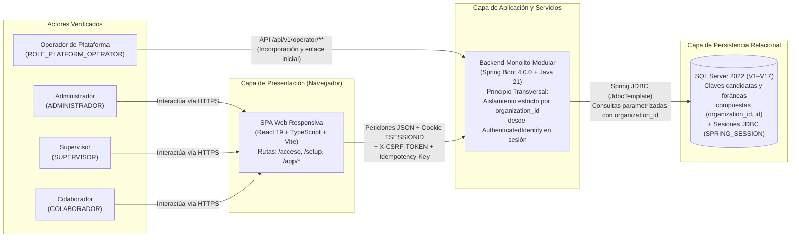
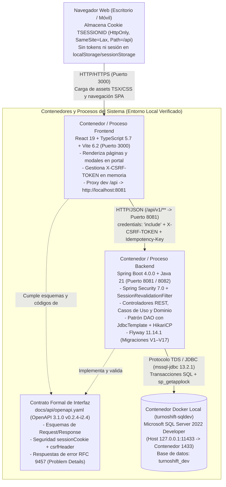
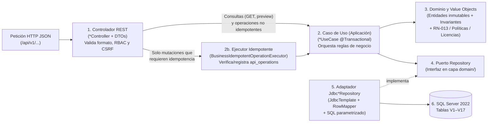
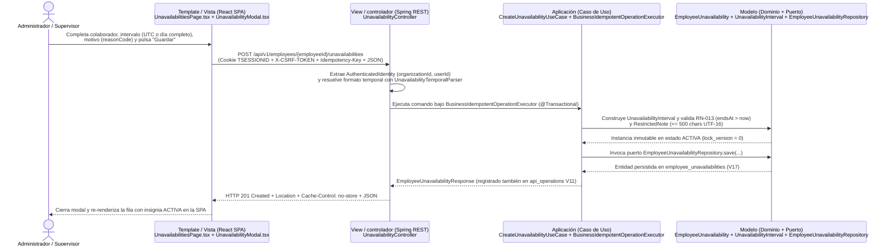
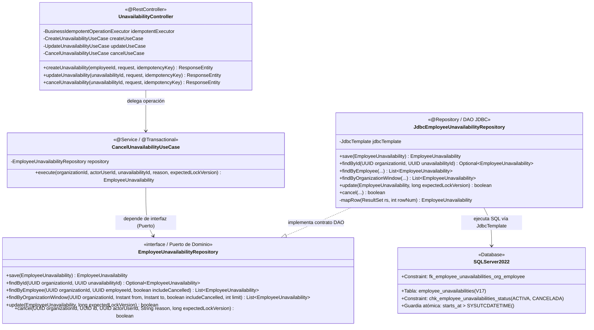

# 6. Diseño arquitectónico

El presente capítulo desarrolla el apartado **6. DISEÑO ARQUITECTÓNICO** (incluyendo los subcapítulos obligatorios **6.1 Patrón MTV** y **6.2 Patrón DAO**) para la plataforma web SaaS multiempresa **TurnoShift**, aplicada al caso de estudio organizacional **Café Andino S.A.C.** ([`docs/planning/30 - Auditoría Académica de Entrega 2 a 6.md`](file:///d:/Proyectos/TurnoShift/docs/planning/30%20-%20Auditor%C3%ADa%20Acad%C3%A9mica%20de%20Entrega%202%20a%206.md), [`docs/deliverables/03 - Diseño de la Solución.md`](file:///d:/Proyectos/TurnoShift/docs/deliverables/03%20-%20Dise%C3%B1o%20de%20la%20Soluci%C3%B3n.md), [`docs/deliverables/04 - Prototipos.md`](file:///d:/Proyectos/TurnoShift/docs/deliverables/04%20-%20Prototipos.md) y [`docs/deliverables/05 - Pantallas Web.md`](file:///d:/Proyectos/TurnoShift/docs/deliverables/05%20-%20Pantallas%20Web.md)).

---

## 6.0.1 Objetivo y alcance del diseño arquitectónico

El objetivo de este capítulo es documentar la arquitectura técnica real y verificable de **TurnoShift** tal como se encuentra construida en el repositorio ([`docs/context/STATE.md`](file:///d:/Proyectos/TurnoShift/docs/context/STATE.md), [`docs/context/DECISIONS.md`](file:///d:/Proyectos/TurnoShift/docs/context/DECISIONS.md), [`backend/pom.xml`](file:///d:/Proyectos/TurnoShift/backend/pom.xml) y [`frontend/package.json`](file:///d:/Proyectos/TurnoShift/frontend/package.json)), explicando la estructura de sus contenedores, el diseño interno en capas del backend, los mecanismos de seguridad y consistencia transaccional, y la materialización en código de los patrones **MTV (`6.1`)** y **DAO (`6.2`)**.

Para garantizar total rigor académico, el alcance arquitectónico descrito establece dos delimitaciones explícitas:
1. **Estado comprobable actual (`I0`, `I1`, `I2.1`–`I2.4` y Frontend `F1`–`F4`):** Todos los mecanismos arquitectónicos, flujos de código y patrones de diseño (`6.1` y `6.2`) se demuestran sobre los componentes efectivamente construidos en el repositorio (autenticación e incorporación asistida, configuración organizacional y sede activa `I2.1`, catálogo de puestos `I2.1`, directorio de colaboradores `I2.2`, políticas operativas en backend/API `I2.3` e indisponibilidades `I2.4`).
2. **Separación de módulos futuros (`I3` e `I4`):** Los módulos de **planificación semanal de turnos, publicación y consulta personal de horario (`I3`)** y de **intercambios de turno (`I4`)** se identifican como **componentes futuros del alcance objetivo del MVP** (contando `I3` con documentación de diseño técnico en [`Nota 28`](file:///d:/Proyectos/TurnoShift/docs/planning/28%20-%20Dise%C3%B1o%20T%C3%A9cnico%20I3%20-%20Planificaci%C3%B3n%20de%20Turnos.md) y [`Nota 29`](file:///d:/Proyectos/TurnoShift/docs/planning/29%20-%20Plan%20de%20Implementaci%C3%B3n%20I3.1-a%20-%20Persistencia%20y%20Migraciones.md) y con la ruta placeholder `/app/mi-horario` en [`PlaceholderPage.tsx`](file:///d:/Proyectos/TurnoShift/frontend/src/pages/placeholders/PlaceholderPage.tsx), mientras que `I4` pertenece al alcance futuro conceptual), sin presentarse como código construido.

---

## 6.0.2 Arquitectura general de TurnoShift

A nivel de arquitectura general, **TurnoShift** adopta el estilo de **Monolito Modular en Capas en el servidor con persistencia relacional JDBC** consumido por una **Single Page Application (SPA) desacoplada en el cliente**, articulando cinco elementos verificables ([`docs/planning/06 - Arquitectura y Stack Tecnológico.md`](file:///d:/Proyectos/TurnoShift/docs/planning/06%20-%20Arquitectura%20y%20Stack%20Tecnol%C3%B3gico.md), [`docs/context/STATE.md`](file:///d:/Proyectos/TurnoShift/docs/context/STATE.md)):

1. **Navegador Web Cliente:** Entorno de ejecución estándar (escritorio o navegador móvil) donde el usuario interactúa con la interfaz responsiva, envía credenciales y mantiene la cookie de sesión `TSESSIONID` con el atributo `HttpOnly` (inaccesible desde código JavaScript).
2. **SPA Frontend (`frontend/`):** Aplicación de página única construida con **React `19.0.0`**, **React DOM `19.0.0`**, **TypeScript `~5.7.2`** y empaquetada con **Vite `6.2.0`** ([`frontend/package.json`](file:///d:/Proyectos/TurnoShift/frontend/package.json), [`frontend/vite.config.ts`](file:///d:/Proyectos/TurnoShift/frontend/vite.config.ts)). Implementa un enrutador nativo sobre la Web History API ([`frontend/src/components/routing/Router.tsx`](file:///d:/Proyectos/TurnoShift/frontend/src/components/routing/Router.tsx)), gestión de estado de autenticación en memoria ([`frontend/src/context/AuthContext.tsx`](file:///d:/Proyectos/TurnoShift/frontend/src/context/AuthContext.tsx)) y un cliente HTTP centralizado ([`frontend/src/api/client.ts`](file:///d:/Proyectos/TurnoShift/frontend/src/api/client.ts)).
3. **API REST Backend (`backend/`):** Aplicación servidora desarrollada sobre **Java `21`** y **Spring Boot `4.0.0`** ([`backend/pom.xml`](file:///d:/Proyectos/TurnoShift/backend/pom.xml)). Expone servicios HTTP bajo el prefijo `/api/v1/**` gobernados por el contrato **OpenAPI `3.1.0` (`v0.2.4-i2.4`)** ([`docs/api/openapi.yaml`](file:///d:/Proyectos/TurnoShift/docs/api/openapi.yaml)), incorporando **Spring Security `7.0.0`**, **Spring Session JDBC `4.0.0`**, **Password4j `1.8.4` (Argon2id)** y acceso a datos mediante **`spring-boot-starter-jdbc` (`JdbcTemplate` con pool HikariCP `7.0.2`, sin JPA ni Hibernate)**.
4. **Persistencia Relacional (`Microsoft SQL Server 2022`):** Motor relacional accedido a través del driver oficial `mssql-jdbc` (`13.2.1.jre11`) y evolucionado de forma determinista al arranque mediante **Flyway `11.14.1` (`spring-boot-starter-flyway` + `flyway-sqlserver`)** ejecutando las migraciones `V1` a `V17` ubicadas en `backend/src/main/resources/db/migration/` (`STATE.md` §3–§4).
5. **Docker exclusivamente como entorno local de desarrollo (`infra/docker-compose.dev.yml`):** El archivo [`infra/docker-compose.dev.yml`](file:///d:/Proyectos/TurnoShift/infra/docker-compose.dev.yml) define únicamente el contenedor local `turnoshift-sqldev` (`mcr.microsoft.com/mssql/server:2022-CU16-ubuntu-22.04`, mapeando el puerto anfitrión `127.0.0.1:11433` al puerto `1433` del contenedor) y pruebas de integración efímeras con **Testcontainers `2.0.2`** (`backend/pom.xml`). **No se afirma ni existe en el repositorio infraestructura de producción en la nube, balanceadores de carga, clústeres de autoescalamiento ni acuerdos de nivel de servicio (SLA) comerciales.**

---

## 6.0.3 Diagrama de contexto en Mermaid

El siguiente diagrama de contexto representa el flujo completo `Actores → Frontend SPA → Backend API REST → Base de Datos SQL Server`, destacando el **aislamiento multiempresa por `organization_id`** como principio arquitectónico transversal a toda la solución:

---

## 6.0.4 Diagrama de contenedores en Mermaid

El siguiente diagrama de contenedores detalla los tiempos de ejecución, puertos de desarrollo verificados en [`frontend/vite.config.ts`](file:///d:/Proyectos/TurnoShift/frontend/vite.config.ts), [`infra/docker-compose.dev.yml`](file:///d:/Proyectos/TurnoShift/infra/docker-compose.dev.yml) y [`docs/context/STATE.md`](file:///d:/Proyectos/TurnoShift/docs/context/STATE.md) (§6), los protocolos de comunicación y el rol del contrato OpenAPI:

---

## 6.0.5 Diseño interno del backend

Dentro de `backend/src/main/java/`, cada módulo de negocio (`identity`, `operator`, `organization`, `policy`, `team`, `unavailability`) organiza su flujo interno siguiendo una arquitectura en capas con inversión de dependencias hacia el dominio (`STATE.md` §2 y §5). Las **consultas y operaciones no idempotentes** fluyen directamente desde el **Controlador REST hacia el Caso de Uso (`Controlador REST → Caso de Uso → Dominio/Repository`)**, mientras que el ejecutor **`BusinessIdempotentOperationExecutor`** interviene únicamente en las **mutaciones de negocio que requieren idempotencia** (`Idempotency-Key`):

### Responsabilidades verificadas por capa interna:
1. **Capa de Controladores REST (`controller/`):**
   - Recibe las solicitudes HTTP, extrae la identidad autenticada (`AuthenticatedIdentity` o `PlatformOperatorIdentity`) exclusivamente desde el `SecurityContext` y valida la estructura sintáctica del cuerpo JSON y las cabeceras (`X-CSRF-TOKEN` en escrituras e `Idempotency-Key` cuando la mutación lo requiere).
   - Convierte los modelos internos a **DTOs inmutables** (`EmployeeResponse`, `PositionResponse`, `OrganizationConfigurationResponse`, `EmployeeUnavailabilityResponse`, etc.) y añade siempre la cabecera `Cache-Control: no-store` (`STATE.md` §2).
2. **Estandarización de errores con RFC 9457 (`Problem Details`):**
   - Ante cualquier error de validación (`400 VALIDATION_FAILED`), falta de sesión (`401 SESSION_REQUIRED`), acceso denegado o fallo CSRF (`403 ACCESS_DENIED` / `CSRF_INVALID`), recurso no encontrado (`404`), conflicto de negocio o versión (`409`), enlace inválido (`422`), límite de tasa (`429 RATE_LIMITED`) o indisponibilidad técnica de base de datos (`503 SERVICE_UNAVAILABLE`), el backend devuelve un objeto JSON `application/problem+json` con `requestId` en el cuerpo y sin filtrar sentencias SQL ni trazas de pila (`STATE.md` §2).
3. **Capa de Aplicación / Casos de Uso (`application/`) y coordinación de idempotencia selectiva:**
   - Clases focalizadas en una única operación de negocio (`CreatePositionUseCase`, `UpdatePositionUseCase`, `CreateEmployeeUseCase`, `DeactivateEmployeeUseCase`, `ActivatePolicyUseCase`, `CreateUnavailabilityUseCase`, `UpdateUnavailabilityUseCase`, `CancelUnavailabilityUseCase`).
   - Demarcan la frontera transaccional mediante `@Transactional` de Spring (exigiendo una transacción activa sin abrir `BEGIN TRANSACTION` manuales en JDBC).
   - En **consultas (`GET`), previsualizaciones evaluativas (`POST .../deactivation-preview`, `POST /policies/preview`) y operaciones de autenticación/sesión**, el controlador invoca directamente al caso de uso (`Controlador REST → Caso de Uso → Dominio/Repository`). Únicamente en las **mutaciones de negocio que exigen idempotencia**, la ejecución se envuelve con `BusinessIdempotentOperationExecutor` para registrar o reproducir resultados deterministas en la tabla `api_operations` (`V11`).
4. **Capa de Dominio (`domain/`):**
   - Contiene entidades inmutables y *Value Objects* con validación en construcción (`Employee`, `Position`, `EmployeeUnavailability`, `UnavailabilityInterval`, `RestrictedNote`, `PolicyThresholds`, `PasswordPolicy`, `EmailNormalizer`).
   - Declara las **interfaces o puertos `*Repository`** que definen qué necesita persistir el dominio sin depender de `org.springframework.jdbc` ni del driver de SQL Server.
5. **Capa de Infraestructura de Persistencia (`infrastructure/persistence/jdbc/`):**
   - Contiene las clases `Jdbc*Repository` que implementan los puertos del dominio utilizando `JdbcTemplate`, `RowMapper` y consultas SQL parametrizadas sobre SQL Server 2022.

---

## 6.0.6 Seguridad y consistencia

Todos los mecanismos de seguridad y consistencia descritos a continuación cuentan con evidencia explícita en [`docs/context/STATE.md`](file:///d:/Proyectos/TurnoShift/docs/context/STATE.md) (§2 y §5) y en las migraciones `V1`–`V17`:

1. **Sesiones de servidor en SQL Server y cookie `HttpOnly` (`V9`):**
   - Las sesiones autenticadas se persisten en las tablas `SPRING_SESSION` y `SPRING_SESSION_ATTRIBUTES` (`V9__spring_session.sql`) con inactividad máxima de 1800 segundos y un **límite absoluto de vida de 8 horas** (`SessionSecurityConstants.AUTHENTICATED_AT_ATTRIBUTE`).
   - El cliente recibe únicamente la cookie `TSESSIONID` configurada con `HttpOnly`, `SameSite=Lax` y `Path=/api`. En el login exitoso se ejecuta obligatoriamente `request.changeSessionId()` para mitigar ataques de fijación de sesión.
   - El filtro `SessionRevalidationFilter` revalida en cada petición contra SQL Server que el usuario siga activo (`is_active = 1`), que su `auth_version` no haya cambiado y que la organización tenga `service_status = 'ACTIVA'`. Si cambia el rol en caliente, actualiza las autoridades en el `SecurityContext`; si el usuario es desactivado o cambia su contraseña (`auth_version`), invalida la sesión y revoca la cookie de inmediato.
2. **Protección CSRF (`X-CSRF-TOKEN`):**
   - El token CSRF se persiste como atributo de sesión en `SPRING_SESSION_ATTRIBUTES` y se expone mediante `GET /api/v1/auth/csrf`. La SPA React almacena el valor únicamente en memoria volátil ([`frontend/src/api/client.ts`](file:///d:/Proyectos/TurnoShift/frontend/src/api/client.ts)) y lo adjunta en la cabecera `X-CSRF-TOKEN` en toda petición `POST`, `PUT` o `PATCH`. La ausencia o invalidez del token produce `403 CSRF_INVALID`.
3. **Control de Acceso Basado en Roles (`RBAC`) y separación de cadenas:**
   - `SecurityConfig` impone una frontera bidireccional estricta: las rutas `/api/v1/operator/**` exigen `ROLE_PLATFORM_OPERATOR`, mientras que las rutas empresariales `/api/v1/**` exigen roles del catálogo `roles` (`V4__roles.sql`: `ADMINISTRADOR`, `SUPERVISOR`, `COLABORADOR`), rechazando cualquier cruce con `403 ACCESS_DENIED`.
4. **Aislamiento multiempresa mediante `organization_id`:**
   - Todas las tablas empresariales (`sites`, `app_users`, `password_reset_tokens`, `api_operations`, `positions`, `employees`, `planning_policy_versions`, `employee_unavailabilities`) poseen clave candidata compuesta `(organization_id, id)` y claves foráneas compuestas que impiden a nivel del motor SQL Server vincular un empleado, puesto, política o indisponibilidad con registros de otra organización.
5. **Idempotencia mono-transaccional (`api_operations` — `V11`):**
   - En la incorporación de organizaciones (`IncorporateOrganization`), emisión de enlaces iniciales y mutaciones empresariales de `I2` (`BusinessIdempotentOperationExecutor`), se exige la cabecera `Idempotency-Key` (`UUID`). El servidor calcula la huella canónica `SHA-256` (`BINARY(32)`) del comando y la registra en `api_operations`. Los reintentos con idéntica clave y huella devuelven el resultado previo con `Idempotency-Replayed: true`; el reúso con huella distinta devuelve `409 IDEMPOTENCY_KEY_REUSED` y las claves de más de 24 horas devuelven `409 IDEMPOTENCY_KEY_EXPIRED`.
6. **Concurrencia optimista (`lock_version` / `expectedLockVersion`) y candados `sp_getapplock`:**
   - Las actualizaciones de organización, sede activa, puestos, colaboradores e indisponibilidades exigen `expectedLockVersion`, ejecutando `UPDATE ... WHERE organization_id = ? AND id = ? AND lock_version = ?` e incrementando `lock_version = lock_version + 1`. Si `rowsAffected == 0` por modificación concurrente, se devuelve `409 CONCURRENT_MODIFICATION`.
   - En operaciones que requieren serialización a nivel de organización o recurso (como alta de colaboradores sujeta a cupo de licencia, activación de políticas `I2.3` o incorporación de empresas), el DAO adquiere bloqueos transaccionales exclusivos en SQL Server mediante `sp_getapplock`.
7. **Zonas horarias IANA y confidencialidad de notas restringidas (`RN-014`):**
   - Todas las marcas de tiempo se persisten en UTC (`SYSUTCDATETIME()`), y los rangos de día completo en indisponibilidades se traducen usando la zona horaria IANA de la organización (`OrganizationTimezoneAdapter` y `Intl.DateTimeFormat`).
   - El atributo `restricted_note` de `employee_unavailabilities` (`V17`) nunca se renderiza en tablas, filtros, búsquedas ni logs del cliente, restringiéndose al modal autorizado (`STATE.md` §5 *F4.2*).

---

## 6.1 Patrón MTV (Adaptación académica para arquitectura SPA + API REST)

### 6.1.1 Fundamentación y aclaración arquitectónica
El **Patrón MTV (Model – Template – View)** fue formulado originalmente en frameworks web monolíticos (como Django) donde el propio servidor web consulta el modelo, selecciona una plantilla HTML y devuelve la vista renderizada al navegador (*Server-Side Rendering*).

Es indispensable precisar que **TurnoShift no es una aplicación Django ni emplea renderizado de plantillas HTML en el servidor**. **TurnoShift** implementa una arquitectura moderna desacoplada compuesta por una **SPA en React 19 (`frontend/`)** y una **API REST en Spring Boot 4 (`backend/`)**. Dentro de esta arquitectura, los conceptos del patrón **MTV** se cumplen mediante una **adaptación académica y didáctica distribuida en cuatro componentes verificables**, separando además la orquestación de casos de uso (**Aplicación**) del núcleo puro del negocio (**Modelo**):

| Componente en la adaptación académica de MTV | Responsabilidad técnica en **TurnoShift** | Evidencia verificable en el repositorio (`frontend/` y `backend/`) |
| :--- | :--- | :--- |
| **1. Modelo (`domain/`)** | **Dominio, Value Objects, reglas e invariantes de negocio y puertos de persistencia (`*Repository`).** Define la estructura y las restricciones puras (como los estados `ACTIVA`/`CANCELADA`, la regla temporal `RN-013`, la longitud de `RestrictedNote` o el formato de código de un puesto) sin depender de HTTP ni de SQL. | - `EmployeeUnavailability`, `UnavailabilityStatus`, `UnavailabilityInterval`, `RestrictedNote`, `EmployeeUnavailabilityRepository` (`I2.4` en `STATE.md` §2) - `Position`, `PositionRepository` (`I2.1`) - `Employee`, `EmployeeRepository` (`I2.2`) - `PolicyVersion`, `PolicyThresholds`, `PolicyRepository` (`I2.3`) |
| **2. Aplicación (`application/`)** | **Casos de uso (`*UseCase`) que coordinan las reglas del Modelo**, abren la transacción (`@Transactional`), interactúan con el ejecutor de idempotencia (`BusinessIdempotentOperationExecutor`) e invocan los puertos de persistencia. | - `CreateUnavailabilityUseCase`, `UpdateUnavailabilityUseCase`, `CancelUnavailabilityUseCase` (`I2.4`) - `CreatePositionUseCase`, `UpdatePositionUseCase`, `ChangePositionStatusUseCase` (`I2.1`) - `CreateEmployeeUseCase`, `DeactivateEmployeeUseCase` (`I2.2`) |
| **3. Template / Vista (`frontend/src/pages/` y `components/`)** | **Páginas y componentes React (`.tsx`) que renderizan la SPA en el navegador del usuario.** Sustituyen a las antiguas plantillas estáticas del servidor por un árbol de componentes declarativos y reactivos que consumen JSON y actualizan el DOM según el estado y el rol. | - [`UnavailabilitiesPage.tsx`](file:///d:/Proyectos/TurnoShift/frontend/src/pages/unavailabilities/UnavailabilitiesPage.tsx), [`UnavailabilityModal.tsx`](file:///d:/Proyectos/TurnoShift/frontend/src/pages/unavailabilities/UnavailabilityModal.tsx), [`UnavailabilityCancelModal.tsx`](file:///d:/Proyectos/TurnoShift/frontend/src/pages/unavailabilities/UnavailabilityCancelModal.tsx) - [`PositionsPage.tsx`](file:///d:/Proyectos/TurnoShift/frontend/src/pages/positions/PositionsPage.tsx) - [`EmployeesPage.tsx`](file:///d:/Proyectos/TurnoShift/frontend/src/pages/employees/EmployeesPage.tsx) - [`ConfigurationPage.tsx`](file:///d:/Proyectos/TurnoShift/frontend/src/pages/configuration/ConfigurationPage.tsx) |
| **4. View / controlador (`controller/`)** | **Controladores REST de Spring (`@RestController`) que reciben solicitudes HTTP y devuelven respuestas JSON (`ResponseEntity` o `Problem Details` RFC 9457).** Actúan como la frontera de entrada/salida del servidor: validan cabeceras, extraen el `organizationId` de la sesión, delegan en la capa de **Aplicación** y entregan los datos JSON que alimentan al **Template/Vista** React. | - `UnavailabilityController` (`/api/v1/unavailabilities/*`) - `PositionController` (`/api/v1/positions/*`) - `EmployeeController` (`/api/v1/employees/*`) - `PolicyController` (`/api/v1/policies/*`) |

### 6.1.2 Diagrama de secuencia del Patrón MTV (Caso real: Creación de indisponibilidad en `I2.4`)

El siguiente diagrama de secuencia muestra cómo colaboran los cuatro elementos de la adaptación MTV durante la creación real de una indisponibilidad (`POST /api/v1/employees/{employeeId}/unavailabilities`):

---

## 6.2 Patrón DAO (Data Access Object con Spring JDBC)

### 6.2.1 Fundamentación técnica y ausencia deliberada de JPA/Hibernate
Aunque la propuesta preliminar del proyecto mencionaba inicialmente `Spring Data JPA` ([`docs/planning/06 - Arquitectura y Stack Tecnológico.md`](file:///d:/Proyectos/TurnoShift/docs/planning/06%20-%20Arquitectura%20y%20Stack%20Tecnol%C3%B3gico.md) §4), en la construcción real verificada en [`backend/pom.xml`](file:///d:/Proyectos/TurnoShift/backend/pom.xml) y [`docs/context/STATE.md`](file:///d:/Proyectos/TurnoShift/docs/context/STATE.md) se adoptó exclusivamente **`spring-boot-starter-jdbc` (`JdbcTemplate`) sin incluir JPA ni Hibernate**.

Esta decisión convierte a **TurnoShift** en una implementación directa y ejemplar del **Patrón DAO (Data Access Object)** combinado con el patrón de **Puertos y Adaptadores (`Repository`)**, sustentada en seis características técnicas:

1. **Separación entre Interfaz/Puerto (`*Repository`) e Implementación (`Jdbc*Repository`):**
   - La capa de dominio declara interfaces puras (`PositionRepository`, `EmployeeRepository`, `PolicyRepository`, `EmployeeUnavailabilityRepository`, `PlatformOperatorRepository`).
   - La capa de infraestructura provee las clases concretas (`JdbcPositionRepository`, `JdbcEmployeeRepository`, `JdbcPolicyRepository`, `JdbcEmployeeUnavailabilityRepository`, `JdbcPlatformOperatorRepository`, `JdbcPasswordResetTokenRepository`, `JdbcSessionRevalidationRepository`).
2. **Uso explícito de `JdbcTemplate` y `RowMapper`:**
   - Cada clase `Jdbc*Repository` inyecta `JdbcTemplate` y define mapeadores explícitos (`RowMapper`) que leen las columnas tipadas del `ResultSet` (`UNIQUEIDENTIFIER`, `NVARCHAR`, `BIT`, `BIGINT`, `DATETIME2`) y reconstruyen objetos de dominio inmutables validando sus invariantes.
3. **Consultas SQL 100 % parametrizadas:**
   - Todas las sentencias `SELECT`, `INSERT` y `UPDATE` utilizan marcadores posicionales (`?`) o parámetros con nombre, eliminando de raíz el riesgo de inyección SQL y aprovechando las *collations* binarias (`Latin1_General_100_BIN2`) definidas en `V1`–`V17`.
4. **Participación en transacciones gestionadas por Spring (`@Transactional`):**
   - Los DAOs no abren ni confirman transacciones manuales (`BEGIN TRANSACTION` / `COMMIT`), sino que se ejecutan dentro de la transacción activa iniciada por el caso de uso o por `BusinessIdempotentOperationExecutor`. Si ocurre un error de acceso a datos (`DataAccessException`), el DAO lo traduce a una excepción técnica inmutable y sin fugas de SQL (ej. `AuthenticationDataAccessException`, `TokenDataAccessException`, `OperatorDataAccessException`), provocando el *rollback* atómico completo (`STATE.md` §2).
5. **Control de concurrencia (`lock_version` y `sp_getapplock`):**
   - En las actualizaciones optimistas, el DAO incluye `AND lock_version = ?` en la cláusula `WHERE` e incrementa `lock_version = lock_version + 1` en la misma sentencia SQL; en las modificaciones temporales de indisponibilidades (`RN-013`), añade la guarda atómica `AND starts_at > SYSUTCDATETIME()` contra condiciones de carrera (`STATE.md` §2 *I2.4-b*).
   - Cuando se requiere exclusión mutua por organización (ej. en `JdbcEmployeeRepository` para verificar el cupo de licencias o en `JdbcPolicyRepository` para activar una política con `TurnoShift:Policy:Org:{orgId}`), el DAO invoca el procedimiento almacenado de SQL Server `sp_getapplock` dentro de la transacción activa.
6. **Aislamiento organizacional en cada sentencia SQL (`organization_id`):**
   - Ningún método de `JdbcPositionRepository`, `JdbcEmployeeRepository`, `JdbcPolicyRepository` o `JdbcEmployeeUnavailabilityRepository` consulta o modifica una fila por `id` sin filtrar simultáneamente por `WHERE organization_id = ?`.

### 6.2.2 Diferenciación estricta entre Controlador, Caso de Uso y DAO

| Componente | Qué hace | Qué NO hace (Frontera de responsabilidad) |
| :--- | :--- | :--- |
| **Controlador REST (`*Controller`)** | Traduce entre el protocolo HTTP/JSON (`HttpServletRequest`, `ResponseEntity`, códigos `200`/`201`/`400`/`409` RFC 9457) y los comandos de la capa de aplicación; extrae el `AuthenticatedIdentity` del `SecurityContext`. | **No escribe sentencias SQL**, no invoca a `JdbcTemplate` directamente y no contiene lógica de reglas de negocio ni cálculos de dominio. |
| **Caso de Uso (`*UseCase`)** | Coordina el flujo de una operación de negocio dentro de `@Transactional`: verifica precondiciones del dominio, construye entidades/Value Objects e invoca los métodos del contrato `*Repository`. | **No conoce cabeceras HTTP (`HttpServletRequest`, cookies, CSRF)** ni conoce tablas, índices, `ResultSet` o sintaxis específica de SQL Server. |
| **Objeto de Acceso a Datos (`Jdbc*Repository` — DAO)** | Implementa la interfaz `*Repository` ejecutando SQL parametrizado mediante `JdbcTemplate`, adquiriendo candados `sp_getapplock` cuando corresponde, mapeando filas con `RowMapper` y traduciendo excepciones JDBC. | **No toma decisiones de autorización HTTP (`RBAC`)**, no serializa respuestas JSON para el cliente y no altera reglas de negocio fuera de la persistencia. |

### 6.2.3 Diagrama UML de clases y flujo del Patrón DAO

El siguiente diagrama de clases representa la estructura real del **Patrón DAO** en los módulos implementados (`I2.2` Colaboradores e `I2.4` Indisponibilidades):

---

## 6.3 Estado por componente

La siguiente tabla sintetiza el estado arquitectónico real de cada componente de **TurnoShift** verificado en [`docs/context/STATE.md`](file:///d:/Proyectos/TurnoShift/docs/context/STATE.md):

| Componente Arquitectónico | Capa(s) involucradas | Estado actual en el repositorio | Evidencia verificable |
| :--- | :--- | :--- | :--- |
| **1. Infraestructura de Sesiones JDBC, CSRF, Revalidación Continua (8h) y Rate-Limiting** | Backend (`security`) + SQL Server (`V9`) + SPA (`client.ts`, `AuthContext.tsx`) | **`IMPLEMENTADO CON FRONTEND`** | `SecurityConfig`, `SessionRevalidationFilter`, `V9__spring_session.sql`, [`frontend/src/api/client.ts`](file:///d:/Proyectos/TurnoShift/frontend/src/api/client.ts) (`STATE.md` §2). |
| **2. Autenticación Empresarial (`/acceso`) y Establecimiento de Primera Contraseña (`/setup`) con Argon2id + HIBP k-anonymity** | Backend (`identity`) + SQL Server (`V4`–`V8`) + SPA (`F1.4`, `F1.5`) | **`IMPLEMENTADO CON FRONTEND`** | `AuthenticateUser`, `CompleteInitialPasswordSetup`, `HibpPasswordBlocklist`, `JdbcPasswordResetTokenRepository`, [`LoginPage.tsx`](file:///d:/Proyectos/TurnoShift/frontend/src/pages/login/LoginPage.tsx), [`SetupPage.tsx`](file:///d:/Proyectos/TurnoShift/frontend/src/pages/setup/SetupPage.tsx). |
| **3. Operador de Plataforma, Incorporación de Organizaciones e Idempotencia (`api_operations`)** | Backend (`operator`, `organization`) + SQL Server (`V10`, `V11`) | **`IMPLEMENTADO SOLO BACKEND/API`** | `AuthenticateOperator`, `IncorporateOrganization`, `EmitInitialAccessLink`, `JdbcPlatformOperatorRepository`, `V10__platform_operators.sql`, `V11__api_operations.sql`. |
| **4. Configuración Organizacional y Sede Activa (`I2.1` — `/app/configuracion`)** | Backend (`organization`) + SQL Server (`V1`–`V3`) + SPA (`F2.2`) | **`IMPLEMENTADO CON FRONTEND`** | `OrganizationConfigurationController`, `JdbcOrganizationConfigurationRepository`, [`ConfigurationPage.tsx`](file:///d:/Proyectos/TurnoShift/frontend/src/pages/configuration/ConfigurationPage.tsx). |
| **5. Catálogo de Puestos de Trabajo (`I2.1` — `/app/puestos`)** | Backend (`organization`) + SQL Server (`V12`) + SPA (`F2.3`) | **`IMPLEMENTADO CON FRONTEND`** | `PositionController`, `PositionUseCases`, `JdbcPositionRepository`, `V12__positions.sql`, [`PositionsPage.tsx`](file:///d:/Proyectos/TurnoShift/frontend/src/pages/positions/PositionsPage.tsx). |
| **6. Directorio de Colaboradores y Vínculo con Cuentas (`I2.2` — `/app/equipo`)** | Backend (`team`) + SQL Server (`V13`, `V14`) + SPA (`F3.1`–`F3.3`) | **`IMPLEMENTADO CON FRONTEND`** | `EmployeeController`, `CreateEmployeeUseCase`..`DeactivateEmployeeUseCase`, `JdbcEmployeeRepository`, `V13__employees.sql`, `V14__app_users_employee_fk.sql`, [`EmployeesPage.tsx`](file:///d:/Proyectos/TurnoShift/frontend/src/pages/employees/EmployeesPage.tsx). |
| **7. Políticas Operativas Versionadas (`I2.3` — `/api/v1/policies/*`)** | Backend (`policy`) + SQL Server (`V15`, `V16`) | **`IMPLEMENTADO SOLO BACKEND/API`** *(Pantalla frontend pendiente)* | `PolicyController`, `ActivatePolicyUseCase`, `PreviewPolicyChangeUseCase`, `JdbcPolicyRepository`, `V15__planning_policy_versions.sql`, `V16__organizations_policy_fk.sql`. |
| **8. Gestión de Indisponibilidades (`I2.4` — `/app/indisponibilidades`)** | Backend (`unavailability`) + SQL Server (`V17`) + SPA (`F4.1`–`F4.3`) | **`IMPLEMENTADO CON FRONTEND`** | `UnavailabilityController`, `CreateUnavailabilityUseCase`..`CancelUnavailabilityUseCase`, `JdbcEmployeeUnavailabilityRepository`, `V17__employee_unavailabilities.sql`, [`UnavailabilitiesPage.tsx`](file:///d:/Proyectos/TurnoShift/frontend/src/pages/unavailabilities/UnavailabilitiesPage.tsx). |
| **9. Planificación Semanal, Validación de Turnos, Publicación y Consulta (`I3`)** | Diseño técnico (`Nota 28`, `Nota 29`) + Ruta placeholder (`/app/mi-horario`) | **`PLANIFICADO / FUTURO`** *(No implementado en código ni en BD)* | [`docs/planning/28 - Diseño Técnico I3 - Planificación de Turnos.md`](file:///d:/Proyectos/TurnoShift/docs/planning/28%20-%20Dise%C3%B1o%20T%C3%A9cnico%20I3%20-%20Planificaci%C3%B3n%20de%20Turnos.md), [`docs/planning/29 - Plan de Implementación I3.1-a - Persistencia y Migraciones.md`](file:///d:/Proyectos/TurnoShift/docs/planning/29%20-%20Plan%20de%20Implementaci%C3%B3n%20I3.1-a%20-%20Persistencia%20y%20Migraciones.md), [`PlaceholderPage.tsx`](file:///d:/Proyectos/TurnoShift/frontend/src/pages/placeholders/PlaceholderPage.tsx). |
| **10. Intercambios de Turno entre Colaboradores (`I4`)** | Alcance conceptual del MVP (`Notas 04, 05, 07, 08, 10`) | **`PLANIFICADO / FUTURO`** *(Sin diseño técnico de implementación aprobado ni código)* | [`docs/planning/04 - Alcance Funcional del MVP y Historias de Usuario.md`](file:///d:/Proyectos/TurnoShift/docs/planning/04%20-%20Alcance%20Funcional%20del%20MVP%20y%20Historias%20de%20Usuario.md), [`docs/planning/30 - Auditoría Académica de Entrega 2 a 6.md`](file:///d:/Proyectos/TurnoShift/docs/planning/30%20-%20Auditor%C3%ADa%20Acad%C3%A9mica%20de%20Entrega%202%20a%206.md). |

---

## 6.4 Decisiones arquitectónicas y limitaciones declaradas

De acuerdo con [`docs/context/DECISIONS.md`](file:///d:/Proyectos/TurnoShift/docs/context/DECISIONS.md), [`docs/context/STATE.md`](file:///d:/Proyectos/TurnoShift/docs/context/STATE.md) y [`docs/planning/30 - Auditoría Académica de Entrega 2 a 6.md`](file:///d:/Proyectos/TurnoShift/docs/planning/30%20-%20Auditor%C3%ADa%20Acad%C3%A9mica%20de%20Entrega%202%20a%206.md), se declaran las siguientes decisiones y limitaciones verificadas:

1. **Interfaz frontend de Políticas Operativas (`I2.3`) pendiente:** El submódulo `I2.3` cuenta con persistencia (`V15`–`V16`), dominio, casos de uso, DAO (`JdbcPolicyRepository`) y endpoints REST (`/api/v1/policies/*`), pero aún no dispone de pantalla en `frontend/src/App.tsx`.
2. **Planificación semanal (`I3`) e intercambios (`I4`) no implementados:** La evaluación de compatibilidad entre turnos asignados, indisponibilidades `ACTIVA` (`I2.4`) y umbrales de políticas (`I2.3`), así como la publicación de horarios y las solicitudes de cambio de turno, pertenecen a los incrementos futuros `I3` e `I4`. En particular, en `I2.4` los intervalos superpuestos de indisponibilidad están permitidos por diseño porque su resolución operativa corresponde a `I3`.
3. **Exclusión estricta de capacidades fuera del alcance del proyecto:** **TurnoShift** no incluye ni diseña módulos de marcación biométrica, reloj control de entrada/salida, cálculo de horas reales trabajadas, liquidación de nómina/planilla, aplicaciones móviles nativas (iOS/Android) ni generación u optimización automática de turnos mediante inteligencia artificial o *solvers*.
4. **Entorno de desarrollo local no equivalente a producción:** La configuración con Docker ([`infra/docker-compose.dev.yml`](file:///d:/Proyectos/TurnoShift/infra/docker-compose.dev.yml)), el perfil `local` sin TLS y los limitadores de tasa en memoria (`InMemoryLoginRateLimiter`, `PasswordResetRateLimiter`, `InMemoryOperatorLoginRateLimiter`) corresponden al entorno local de desarrollo y verificación (`STATE.md` §5–§6). Cualquier despliegue futuro en producción con múltiples instancias requeriría externalizar los limitadores de tasa (ej. a una capa distribuida) y configurar terminación TLS e infraestructura de nube fuera del alcance de esta entrega.

---

## 6.5 Glosario breve de términos arquitectónicos

- **SPA (*Single Page Application*):** Aplicación web que carga un único documento HTML inicial y actualiza dinámicamente las vistas en el navegador mediante JavaScript/TypeScript (React 19 y Web History API) al comunicarse con el servidor mediante peticiones asíncronas JSON, sin recargar la página completa.
- **API REST (*Representational State Transfer Application Programming Interface*):** Interfaz de programación sobre el protocolo HTTP donde los recursos del sistema (`/positions`, `/employees`, `/policies`, `/unavailabilities`) se manipulan mediante verbos estándar (`GET`, `POST`, `PUT`, `PATCH`) e intercambian representaciones estructuradas en formato JSON documentadas en OpenAPI 3.1.
- **RBAC (*Role-Based Access Control*):** Modelo de seguridad en el que los permisos para consultar o modificar recursos se otorgan según el rol asignado al usuario autenticado (`ADMINISTRADOR`, `SUPERVISOR`, `COLABORADOR` o `ROLE_PLATFORM_OPERATOR`), aplicándose tanto en los filtros de Spring Security como en las guardas visuales de la SPA.
- **CSRF (*Cross-Site Request Forgery*):** Vulnerabilidad web en la que un sitio malicioso intenta forzar al navegador de un usuario autenticado a ejecutar acciones no deseadas. **TurnoShift** la mitiga exigiendo en toda petición de escritura la cabecera `X-CSRF-TOKEN` sincronizada en memoria con la sesión del servidor (`SPRING_SESSION_ATTRIBUTES`).
- **Idempotencia:** Propiedad por la cual una operación ejecutada múltiples veces con la misma clave (`Idempotency-Key` UUID) y la misma huella de datos (`SHA-256` en `api_operations`) produce exactamente el mismo efecto en la base de datos y devuelve la misma respuesta HTTP, evitando duplicados ante reintentos por fallos de red.
- **Concurrencia optimista:** Estrategia de control transaccional donde cada registro incluye un contador de versión (`lock_version`). Al actualizar o cancelar un recurso, el cliente envía la versión leída (`expectedLockVersion`) y la base de datos solo aplica el cambio si la versión no fue modificada por otro usuario en el ínterin, rechazando colisiones con `409 CONCURRENT_MODIFICATION`.
- **DAO (*Data Access Object*):** Patrón de diseño que encapsula toda la lógica de acceso y manipulación de la base de datos relacional detrás de una interfaz bien definida (`*Repository`), implementándola en **TurnoShift** mediante clases `Jdbc*Repository` con `JdbcTemplate`, consultas SQL parametrizadas y `RowMapper` sin acoplar el negocio al motor SQL Server.
- **MTV (*Model – Template – View*):** Patrón arquitectónico de separación de responsabilidades adaptado didácticamente en **TurnoShift** para una arquitectura SPA + API REST, donde el **Modelo** contiene las entidades, reglas y contratos de dominio (`domain/`), la **Aplicación** coordina los casos de uso (`application/`), el **Template/Vista** renderiza la interfaz en React (`frontend/src/pages/`) y el **View/controlador** expone y procesa las peticiones HTTP JSON en Spring Boot (`controller/`).
