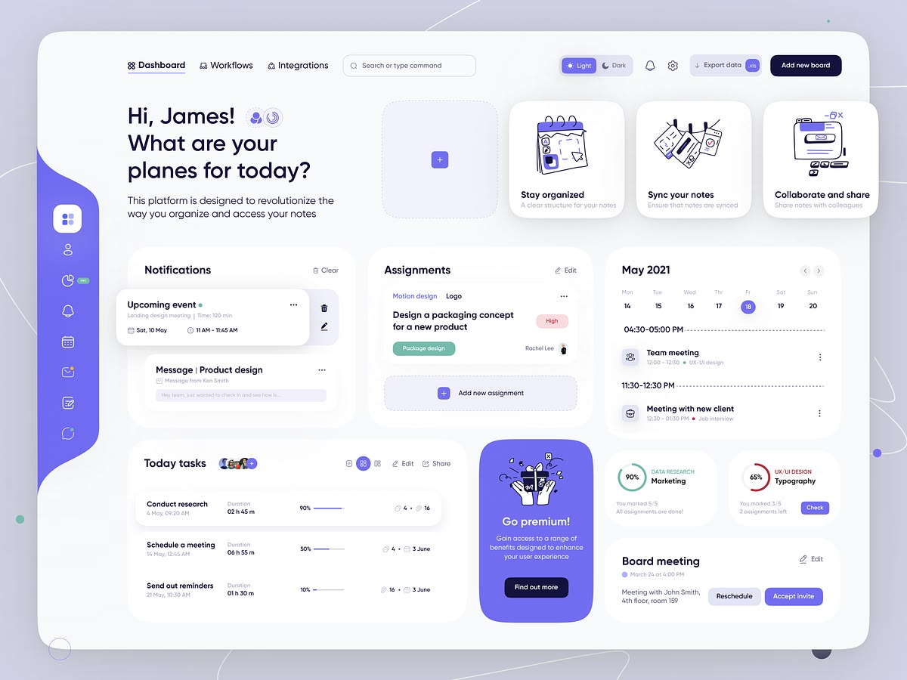

# Referencia visual — Dashboard violeta suave

## Uso previsto

Esta imagen es una referencia de dirección visual para futuras pantallas de TurnoShift, en especial la planificación semanal (F5), "Mi horario" (F6) y la evolución del inicio operativo. No sustituye la identidad actual de TurnoShift ni autoriza un rediseño inmediato de las pantallas implementadas.

## Rasgos a conservar como inspiración

- Fondo muy claro con superficies blancas y sombras sutiles.
- Acento violeta/lila para navegación activa, acciones secundarias y elementos de progreso.
- Tarjetas redondeadas, jerarquía visual limpia y mucho espacio en blanco.
- Iconografía lineal y controles compactos.
- Estados importantes con color semántico, sin depender únicamente del color.

## Paleta orientativa

Los colores son una aproximación extraída visualmente de la referencia; deberán contrastarse y ajustarse antes de uso productivo.

| Token propuesto | Color | Uso sugerido |
| --- | --- | --- |
| `--ui-violet-700` | `#40338F` | Texto o acciones de alto énfasis sobre fondos claros. |
| `--ui-violet-600` | `#6557E8` | Navegación activa, botones secundarios y foco. |
| `--ui-violet-400` | `#8B82F4` | Progreso, badges y detalles decorativos. |
| `--ui-lilac-100` | `#EEEAFE` | Fondos suaves, estados activos y contenedores destacados. |
| `--ui-surface` | `#FFFFFF` | Tarjetas y paneles. |
| `--ui-canvas` | `#F7F7FC` | Fondo principal de aplicación. |
| `--ui-ink` | `#171533` | Títulos y texto de mayor contraste. |
| `--ui-muted` | `#77748C` | Texto auxiliar y metadatos. |

## Compatibilidad con TurnoShift

El ámbar actual de TurnoShift seguirá siendo el acento de marca y de acciones primarias mientras no se apruebe un rediseño integral. El violeta de esta referencia se utilizaría como acento complementario, no como reemplazo automático del sistema visual existente.
