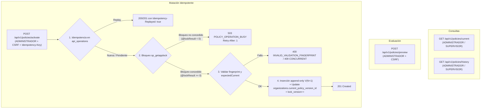
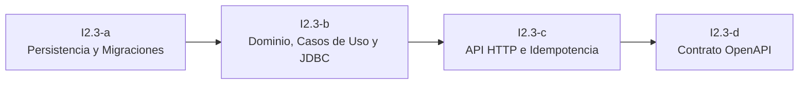

# 16 — Diseño Técnico I2.3: Política Operativa Inicial

## 1. Propósito, Alcance y Límites de I2.3

### 1.1. Propósito
El subincremento **I2.3 — Política operativa inicial** establece el mecanismo empresarial para que una organización defina, consulte, previsualice y active su primera versión de política de planificación de turnos dentro de TurnoShift.

Proporciona la base de configuración que regirá las futuras validaciones de horarios, descansos y umbrales de jornada semanal, resolviendo además la referencia circular histórica entre la tabla `organizations` y sus versiones de política.

### 1.2. Alcance Funcional
- Consulta de la política operativa vigente de la organización (`GET /api/v1/policies/current`).
- Consulta del historial cronológico inmutable de políticas (`GET /api/v1/policies/history`).
- Previsualización no persistente del impacto y cálculo de huella canónica (`POST /api/v1/policies/preview`).
- Activación transaccional e idempotente de una nueva versión de política (`POST /api/v1/policies/activate`).
- Definición e instalación de las tablas y restricciones relacionales de políticas con aislamiento multi-tenant estricto.

### 1.3. Límites y Exclusiones Explícitas
En concordancia con la entrega gradual de **HU-09** definida en el documento de backlog y planificación:
- **Sin publicaciones ni turnos existentes:** En I2.3 la organización se encuentra en fase inicial de configuración. No existen publicaciones (`schedule_publications`), asignaciones (`assignments`), revisiones (`assignment_revisions`), borradores (`schedule_drafts`) ni solicitudes de intercambio (`swap_requests`).
- **Sin simulación ficticia de conflictos de horario:** Los endpoints de evaluación (`preview`) y activación (`activate`) en I2.3 **no deben simular ni inventar validaciones sobre turnos inexistentes**. Toda verificación de descansos entre turnos adyacentes publicados o acumulación semanal de horas queda estrictamente diferida a **I3** (primera publicación) e **I4** (cambios de política sobre publicaciones existentes).
- **Exclusión de `planning_change_sets`:** No se introduce la tabla `planning_change_sets` en I2.3. Dicha estructura agrupa decisiones que originan publicaciones o resuelven intercambios de turnos. En I2.3, la política es una entidad de configuración pura cuya auditoría e idempotencia quedan plenamente cubiertas por `planning_policy_versions` y `api_operations` (V11).
- **Activación inmediata:** El MVP contempla únicamente activación en tiempo real; no se implementa activación programada en fecha futura.

---

## 2. Valores Iniciales del Producto y Naturaleza Operativa

Para el primer MVP de TurnoShift, se establecen como valores de configuración inicial predeterminados:
- **`minimumRestMinutes = 660`** (equivalente a 11 horas de descanso continuo entre turnos consecutivos).
- **`weeklyWarningMinutes = 2400`** (equivalente a 40 horas semanales de trabajo).

> [!IMPORTANT]
> **Declaración de naturaleza operativa:**
> Estos valores corresponden a parámetros de configuración inicial predeterminados del software para el soporte operativo de las plantillas y turnos. **No constituyen declaraciones ni garantías de cumplimiento legal, normativo o estatutario laboral por parte de la plataforma.** Corresponde a la administración de cada organización determinar y verificar la conformidad de dichos parámetros con el marco regulatorio aplicable a su actividad y jurisdicción.

---

## 3. Modelo de Datos y Persistencia (`planning_policy_versions`)

### 3.1. Modelo Append-Only por Contrato
Las versiones de política siguen un modelo **estrictamente append-only** respaldado por el contrato de aplicación y repositorio:
- Cada activación inserta una fila nueva e inalterable.
- No se exponen métodos ni endpoints de actualización (`UPDATE`) ni borrado (`DELETE`) sobre registros de versiones en I2.3.
- `planning_policy_versions` no requiere columna `lock_version` propia. El control de concurrencia optimista sobre el estado de la organización se gobierna a través de `organizations.lock_version`, que se incrementa en cada activación atómica al mover el puntero `current_policy_version_id`.

### 3.2. Definición Física de la Tabla `planning_policy_versions`

| Columna | Tipo SQL Server | Nulabilidad | Descripción y Restricciones |
| :--- | :--- | :--- | :--- |
| `id` | `UNIQUEIDENTIFIER` | `NOT NULL` | Clave primaria técnica (`DEFAULT NEWID()`). |
| `organization_id` | `UNIQUEIDENTIFIER` | `NOT NULL` | Identificador de la organización propietaria. |
| `version_number` | `INT` | `NOT NULL` | Secuencia incremental por organización (1, 2, 3...). Debe ser positivo (`> 0`). |
| `minimum_rest_minutes` | `INT` | `NOT NULL` | Descanso mínimo continuo en minutos (`1` a `1440` inclusive). |
| `weekly_warning_minutes`| `INT` | `NOT NULL` | Umbral de aviso semanal en minutos (`1` a `10080` inclusive). |
| `effective_at` | `DATETIMEOFFSET(3)` | `NOT NULL` | Instante UTC de entrada en vigor (`DEFAULT SYSUTCDATETIME()`). |
| `created_by_user_id` | `UNIQUEIDENTIFIER` | `NOT NULL` | Identificador del usuario que activó la versión. |
| `change_reason` | `NVARCHAR(500)` | `NOT NULL` | Motivo de la activación. Capacidad física de 500 unidades UTF-16. No vacío. |
| `created_at` | `DATETIMEOFFSET(3)` | `NOT NULL` | Auditoría técnica de inserción (`DEFAULT SYSUTCDATETIME()`). |

### 3.3. Restricciones e Integridad Relacional
- **Clave primaria:** `CONSTRAINT pk_planning_policy_versions PRIMARY KEY (id)`
- **Clave candidata empresarial:** `CONSTRAINT uq_policy_versions_org_id UNIQUE (organization_id, id)`
  - Esencial para habilitar claves foráneas compuestas que blindan la pertenencia multi-tenant desde `organizations` y futuras entidades de planificación.
- **Unicidad de secuencia de versión:** `CONSTRAINT uq_policy_versions_org_version UNIQUE (organization_id, version_number)`
  - Garantiza unicidad del número de versión dentro de cada empresa y actúa como segunda barrera física ante condiciones de carrera concurrentes.
- **Clave foránea a organización:**
  `CONSTRAINT fk_policy_versions_organization FOREIGN KEY (organization_id) REFERENCES organizations (id) ON DELETE NO ACTION ON UPDATE NO ACTION`
- **Clave foránea compuesta a usuario autor:**
  `CONSTRAINT fk_policy_versions_author FOREIGN KEY (organization_id, created_by_user_id) REFERENCES app_users (organization_id, id) ON DELETE NO ACTION ON UPDATE NO ACTION`
  - Garantiza a nivel de base de datos que el usuario que activa la política pertenezca a la misma organización.
- **Validaciones CHECK:**
  - `CONSTRAINT chk_policy_version_number_positive CHECK (version_number > 0)`
  - `CONSTRAINT chk_policy_minimum_rest_range CHECK (minimum_rest_minutes >= 1 AND minimum_rest_minutes <= 1440)`
  - `CONSTRAINT chk_policy_weekly_warning_range CHECK (weekly_warning_minutes >= 1 AND weekly_warning_minutes <= 10080)`
  - `CONSTRAINT chk_policy_reason_not_empty CHECK (LEN(LTRIM(RTRIM(change_reason))) > 0)`

### 3.4. Convención Temporal
En total consistencia con `V13__employees.sql` y las normas consolidadas del proyecto:
- **Tipos y valores por defecto SQL Server:** Columnas `effective_at` y `created_at` de tipo `DATETIMEOFFSET(3)` con valor predeterminado `SYSUTCDATETIME()`.
- **Mapeo en Dominio Java:** Tipadas como `java.time.Instant` en el modelo de dominio.
- **Capa JDBC:** Mapeadas mediante `ResultSet.getObject(col, OffsetDateTime.class).toInstant()`.
- **Representación API:** Cadenas de texto en formato canónico ISO-8601 UTC (ej. `2026-09-24T23:35:00.000Z`).

---

## 4. Resolución de la Referencia Circular y Alternativas Evaluadas

### 4.1. Análisis del Problema
Existe una relación bidireccional entre `organizations` y `planning_policy_versions`:
- Cada versión de política pertenece a una organización (`planning_policy_versions.organization_id`).
- La organización mantiene una referencia directa a su política vigente (`organizations.current_policy_version_id`).

### 4.2. Alternativas Evaluadas

#### Alternativa 1 (Adoptada): Puntero en `organizations` con FK Compuesta de Pertenencia Empresarial
- **Estructura:** Se utiliza la columna existente `organizations.current_policy_version_id` y se le añade una clave foránea compuesta que apunta a la clave candidata empresarial de la tabla de políticas:
  ```sql
  ALTER TABLE organizations
  ADD CONSTRAINT fk_organizations_current_policy
  FOREIGN KEY (id, current_policy_version_id)
  REFERENCES planning_policy_versions (organization_id, id)
  ON DELETE NO ACTION
  ON UPDATE NO ACTION;
  ```
- **Comportamiento ante nulos:** En SQL Server, cuando `current_policy_version_id` es `NULL`, la restricción compuesta se evalúa como satisfecha (`UNKNOWN`). Esto permite que organizaciones nuevas comiencen limpiamente sin política.
- **Aislamiento multi-tenant garantizado:** Cuando `current_policy_version_id` contiene un UUID, el motor exige que la fila destino tenga `organization_id == organizations.id`. Resulta físicamente imposible que una organización apunte a una política de otra organización.
- **Ventajas:** Cumple con la decisión formal `DEC-08-DEFER-FK-POLICY`, mantiene las versiones de política como un log inmutable y append-only puro, y optimiza la lectura de la política vigente.

#### Alternativa 2 (Descartada): Flag `is_current BIT` en `planning_policy_versions` con Índice Único Filtrado
- **Estructura:** Añadir `is_current BIT NOT NULL DEFAULT 0` e índice filtrado `WHERE is_current = 1`.
- **Motivo de descarte:** Rompe el principio append-only al obligar a ejecutar `UPDATE` sobre la fila de la versión anterior para apagar el bit `is_current`. Además, generaría discrepancias o doble fuente de verdad con la columna existente desde `V1` en `organizations`.

---

## 5. Estrategia de Migraciones y Validación Fail-Closed

El despliegue de persistencia se divide en dos migraciones Flyway consecutivas:

### 5.1. Migración `V15__planning_policy_versions.sql`
1. Crea la tabla `planning_policy_versions` con sus columnas, tipos, defaults y restricciones `CHECK`.
2. Establece la clave primaria `pk_planning_policy_versions (id)`.
3. Establece las restricciones únicas `uq_policy_versions_org_id (organization_id, id)` y `uq_policy_versions_org_version (organization_id, version_number)`.
4. Establece las claves foráneas a `organizations` y `app_users`.

### 5.2. Migración `V16__organizations_policy_fk.sql`
1. **Comprobación fail-closed de punteros legados:** Antes de alterar cualquier restricción o instalar la clave foránea, la migración ejecuta una verificación de coherencia sobre filas existentes en `organizations`:
   ```sql
   IF EXISTS (
       SELECT 1
       FROM organizations o
       WHERE o.current_policy_version_id IS NOT NULL
         AND NOT EXISTS (
             SELECT 1
             FROM planning_policy_versions p
             WHERE p.organization_id = o.id
               AND p.id = o.current_policy_version_id
         )
   )
   BEGIN
       THROW 50000, 'Migración V16 abortada: existen organizaciones con current_policy_version_id que no corresponden a una versión válida de la misma organización.', 1;
   END;
   ```
   Si se detecta cualquier inconsistencia, la migración falla de inmediato con `THROW 50000`, impidiendo el arranque y evitando cualquier alteración o eliminación arbitraria de datos. Cabe aclarar que este escenario fail-closed representa una manipulación manual, anomalía externa o estado legado excepcional, dado que la migración `V3` impedía punteros no nulos por defecto en el ciclo regular de la aplicación mediante la restricción `chk_organizations_policy_version_null`.
2. **Retiro de la guarda transitoria `chk_organizations_policy_version_null` (V3):** Solo si la validación del puntero legado es exitosa (es decir, todos los punteros existentes son estrictamente válidos o nulos), se procede a eliminar la restricción `chk_organizations_policy_version_null` creada en `V3` (`CHECK (current_policy_version_id IS NULL)`). Esta guarda era transitoria y necesaria para proteger la base de datos hasta que existiera físicamente la tabla `planning_policy_versions` (cumpliendo `DEC-08-DEFER-FK-POLICY`); su retiro controlado permite admitir punteros no nulos, ahora debidamente protegidos y garantizados por la nueva clave foránea compuesta.
3. **Instalación de la clave foránea compuesta:** Finalmente, se instala la restricción `fk_organizations_current_policy`:
   ```sql
   ALTER TABLE organizations
   ADD CONSTRAINT fk_organizations_current_policy
       FOREIGN KEY (id, current_policy_version_id)
       REFERENCES planning_policy_versions (organization_id, id)
       ON DELETE NO ACTION
       ON UPDATE NO ACTION;
   ```

---

## 6. Límites Explícitos y Reglas de Validación

Los límites del producto se aplican de manera uniforme en la capa de dominio, el contrato OpenAPI y las restricciones relacionales de base de datos:

| Campo | Rango / Límite | Validación de Aplicación | Restricción SQL Server |
| :--- | :--- | :--- | :--- |
| `minimumRestMinutes` | 1 a 1440 min inclusive (1 min a 24 horas) | `val >= 1 && val <= 1440` | `CHECK (minimum_rest_minutes >= 1 AND minimum_rest_minutes <= 1440)` |
| `weeklyWarningMinutes`| 1 a 10080 min inclusive (1 min a 7 días) | `val >= 1 && val <= 10080` | `CHECK (weekly_warning_minutes >= 1 AND weekly_warning_minutes <= 10080)` |
| `reason` | Obligatorio, no compuesto solo por espacios Unicode, máx 500 UTF-16 | Regla única de aplicación (ver detalle abajo) | `NVARCHAR(500)`, `CHECK (LEN(LTRIM(RTRIM(change_reason))) > 0)` |

- **Regla única de aplicación para `reason`:**
  1. `reason` no puede ser `null`.
  2. `reason.length() <= 500` unidades de código UTF-16.
  3. Se rechaza cuando todos sus puntos de código cumplen:
     `Character.isWhitespace(codePoint) || Character.isSpaceChar(codePoint)`.
  Esta regla cubre exhaustivamente espacios Unicode habituales, incluido el espacio no separable (NBSP `\u00A0`), espacio fino, espacios tipográficos y caracteres de control/separación.
- **Tratamiento en base de datos:** La base de datos conserva el texto recibido con total fidelidad (incluyendo caracteres Unicode y espacios internos) y mantiene solamente su `CHECK` mínimo de protección (`LEN(LTRIM(RTRIM(change_reason))) > 0`). La base de datos no intenta duplicar la lógica de clasificación de puntos de código Unicode de la aplicación.

---

## 7. Catálogo de Endpoints y Contratos API

Todas las rutas operan bajo el prefijo `/api/v1/policies`:



### 7.1. Consulta de Política Vigente: `GET /api/v1/policies/current`
- **Permisos:** `ADMINISTRADOR` y `SUPERVISOR`.
- **Seguridad:** Requiere cookie de sesión `TSESSIONID`. Sin CSRF ni `Idempotency-Key`.
- **Comportamiento:**
  - Sin política configurada (`current_policy_version_id IS NULL`): responde `200 OK` con `{"policy": null}` (estado conocido y esperado, no es un 404).
  - Con política vigente: responde `200 OK` con la representación de la versión actual:
    ```json
    {
      "policy": {
        "id": "c1f7b0a0-0000-0000-0000-000000000001",
        "versionNumber": 1,
        "minimumRestMinutes": 660,
        "weeklyWarningMinutes": 2400,
        "effectiveAt": "2026-09-24T23:35:00.000Z",
        "changeReason": "Configuración inicial de parámetros operativos para el piloto",
        "createdByUserId": "u1f7b0a0-0000-0000-0000-000000000001"
      }
    }
    ```

### 7.2. Historial de Políticas: `GET /api/v1/policies/history`
- **Permisos:** `ADMINISTRADOR` y `SUPERVISOR`.
- **Seguridad:** Requiere cookie de sesión `TSESSIONID`. Sin CSRF ni `Idempotency-Key`.
- **Comportamiento y Ordenación:**
  - El contrato de la entrega no define paginación.
  - Retorna un listado simple envuelto en `{"items": [...]}` con ordenación estable y determinista por `versionNumber DESC`.
  - Sin versiones activadas, responde `200 OK` con `{"items": []}`.

### 7.3. Previsualización de Propuesta: `POST /api/v1/policies/preview`
- **Permisos:** Exclusivo `ADMINISTRADOR`.
- **Seguridad:** Requiere sesión y cabecera `X-CSRF-TOKEN`. Sin `Idempotency-Key` (operación evaluativa de solo lectura).
- **Tratamiento estricto de `expectedCurrentPolicyVersionId`:**
  - Es una propiedad JSON **obligatoria y nullable**.
  - Si la propiedad no está presente en el cuerpo JSON recibido (`!node.has("expectedCurrentPolicyVersionId")`), se rechaza de inmediato con `400 VALIDATION_FAILED`.
  - Si está presente con valor explícito `null`, indica la expectativa de que no exista política vigente.
  - Si contiene un valor escalar de texto, se valida su formato UUID RFC 4122.
- **Cuerpo de Petición (`PolicyPreviewRequest`):**
  ```json
  {
    "expectedCurrentPolicyVersionId": null,
    "minimumRestMinutes": 660,
    "weeklyWarningMinutes": 2400
  }
  ```
- **Validaciones ejecutadas:**
  1. Estructurales: `minimumRestMinutes` en `[1, 1440]` y `weeklyWarningMinutes` en `[1, 10080]`.
  2. Coherencia de estado: comprueba si la versión vigente actual en BD coincide con `expectedCurrentPolicyVersionId`. Si difiere, rechaza con `409 POLICY_CONCURRENT_MODIFICATION`.
  3. Cálculo de delta: diferencia aritmética respecto a los valores vigentes (o `null` si no hay política previa).
  4. Generación del token canónico `validationFingerprint`.
- **Cuerpo de Respuesta (`PolicyPreviewResponse`):**
  ```json
  {
    "currentPolicy": null,
    "proposedValues": {
      "minimumRestMinutes": 660,
      "weeklyWarningMinutes": 2400
    },
    "delta": null,
    "canProceed": true,
    "blockers": [],
    "warnings": [],
    "validationFingerprint": "<digest-sha256-hex-minúsculo>",
    "requirements": {
      "reasonRequired": true
    }
  }
  ```
  *(En I2.3, `blockers` y `warnings` se devuelven como listas vacías al no existir publicaciones previas).*

### 7.4. Activación de Versión: `POST /api/v1/policies/activate`
- **Permisos:** Exclusivo `ADMINISTRADOR`.
- **Seguridad e Idempotencia:** Requiere sesión, `X-CSRF-TOKEN` y cabecera `Idempotency-Key: <UUID>`.
- **Cuerpo de Petición (`ActivatePolicyRequest`):**
  ```json
  {
    "expectedCurrentPolicyVersionId": null,
    "minimumRestMinutes": 660,
    "weeklyWarningMinutes": 2400,
    "validationFingerprint": "<digest-sha256-hex-minúsculo>",
    "reason": "Configuración inicial de parámetros operativos para el piloto"
  }
  ```
- **Respuesta Exitosa (`201 Created`):**
  ```json
  {
    "policy": {
      "id": "c1f7b0a0-0000-0000-0000-000000000001",
      "versionNumber": 1,
      "minimumRestMinutes": 660,
      "weeklyWarningMinutes": 2400,
      "effectiveAt": "2026-09-24T23:35:00.000Z",
      "changeReason": "Configuración inicial de parámetros operativos para el piloto",
      "createdByUserId": "u1f7b0a0-0000-0000-0000-000000000001"
    }
  }
  ```

---

## 8. Tratamiento de `expectedCurrentPolicyVersionId`

Para prevenir actualizaciones sobre estados obsoletos, la propiedad `expectedCurrentPolicyVersionId` debe ser suministrada obligatoriamente en `preview` y `activate`:

1. **Propiedad ausente en el payload JSON:**
   - La petición es rechazada de inmediato con HTTP `400 Bad Request`, código Problem Details `VALIDATION_FAILED` y detalle del campo faltante.
2. **Propiedad presente con valor `null` explícito:**
   - Indica formalmente que el emisor espera que la organización **no cuente con una política configurada** (`current_policy_version_id IS NULL`).
3. **Propiedad presente con UUID válido:**
   - Indica que el emisor espera reemplazar exactamente la versión referenciada por dicho identificador.
4. **Detección técnica en la capa web:**
   - Para evitar que Jackson colapse indistintamente un campo ausente y un `null` explícito en un campo `UUID` nulo en Java, el DTO o el validador inspecciona el árbol `JsonNode` (o utiliza `JsonNullable<UUID>`), verificando:
     ```java
     if (!rootNode.has("expectedCurrentPolicyVersionId")) {
         // Rechazar con 400 VALIDATION_FAILED (campo obligatorio ausente)
     }
     ```

---

## 9. Huella Canónica (`validationFingerprint`)

### 9.1. Propósito y Naturaleza
El `validationFingerprint` es un token determinista de correlación de contexto que enlaza los valores del payload de activación con el estado base esperado. Permite detectar una huella inconsistente si el cliente envía una combinación de parámetros que no coincide con el estado base o la propuesta pretendida.
- **No es secreta.**
- **No es firma.**
- **No demuestra que el endpoint `/preview` se haya invocado** (no es un recibo ni prueba de ejecución previa).
- **No certifica exención de confirmaciones.**

### 9.2. Formato Canónico Versión 1 (`v1`)
Cadena canónica codificada en UTF-8 con la siguiente estructura delimitada por barras verticales:
```text
v1|{organizationId}|{expectedCurrentPolicyVersionIdOrNull}|{minimumRestMinutes}|{weeklyWarningMinutes}
```
Donde:
- `v1`: prefijo de versión del esquema de huella.
- `{organizationId}`: UUID canónico en 36 caracteres minúsculos.
- `{expectedCurrentPolicyVersionIdOrNull}`: UUID en 36 caracteres minúsculos, o la cadena literal `"null"`.
- `{minimumRestMinutes}`: entero en base 10 sin ceros a la izquierda.
- `{weeklyWarningMinutes}`: entero en base 10 sin ceros a la izquierda.

*Ejemplo de cadena canónica:* `v1|c1f7b0a0-0000-0000-0000-000000000001|null|660|2400`

### 9.3. Algoritmo y Representación
- Función hash: **SHA-256**.
- Formato de salida: cadena de 64 caracteres hexadecimales en **minúsculas** (`[0-9a-f]{64}`).

### 9.4. Verificación al Activar
Al recibir `POST /api/v1/policies/activate`:
1. El servidor reconstruye la cadena canónica `v1` utilizando los campos del cuerpo recibido y el `organizationId` autenticado.
2. Calcula el digest SHA-256 en minúsculas.
3. Si el valor calculado difiere del `validationFingerprint` proporcionado en el payload, se rechaza inmediatamente con `400 VALIDATION_FAILED` (código de error `INVALID_VALIDATION_FINGERPRINT`).

---

## 10. Concurrencia, Serialización y Bloqueos

La activación de una política se orquesta respetando estrictamente el orden de capas: **idempotencia primero; bloqueo de política después**:

```text
Petición POST /policies/activate
  │
  ├── 1. BusinessIdempotentOperationExecutor (api_operations)
  │      ├── ¿Clave completada? ──> Replay inmediato (201 con Idempotency-Replayed: true)
  │      ├── ¿Clave en progreso? ──> 409 IDEMPOTENCY_KEY_IN_PROGRESS
  │      └── ¿Clave reutilizada con distinta huella? ──> 409 IDEMPOTENCY_KEY_REUSED
  │
  ├── 2. Transacción Spring (@Transactional)
  │      │
  │      ├── 3. sp_getapplock (@Resource = 'TurnoShift:Policy:Org:{orgId}', @LockTimeout = 5000)
  │      │      ├── @lockResult < 0 (Bloqueo no concedido) ──> Rollback y 503 POLICY_OPERATION_BUSY
  │      │      │                                                (Header Retry-After: 1)
  │      │      └── @lockResult >= 0 (Bloqueo concedido)
  │      │
  │      ├── 4. Validación de validationFingerprint ──> Fallo: 400 INVALID_VALIDATION_FINGERPRINT
  │      │
  │      ├── 5. Validación de expectedCurrentPolicyVersionId ──> Fallo: 409 POLICY_CONCURRENT_MODIFICATION
  │      │
  │      ├── 6. Inserción append-only en planning_policy_versions (versión N+1)
  │      │      (Protegida además por uq_policy_versions_org_version como segunda barrera física)
  │      │
  │      ├── 7. Actualización de organizations
  │      │      (current_policy_version_id = :newId, lock_version = lock_version + 1, updated_at = UTC)
  │      │
  │      └── 8. Registro de éxito en api_operations y Commit transaccional
  │
  └── 201 Created con respuesta completa de la versión activada
```

### 10.1. Semántica Estricta de `sp_getapplock`
- **`@lockResult >= 0`**: el bloqueo de aplicación fue concedido; la ejecución prosigue con normalidad.
- **`@lockResult < 0`**: el bloqueo de aplicación **no fue concedido** (cubriendo cualquier eventualidad: timeout, cancelación, víctima de interbloqueo o fallo de adquisición).
- **Comportamiento seguro de la API:** La aplicación **no clasifica ni expone la causa interna**. Se aborta la transacción y se responde con HTTP `503 Service Unavailable`, Problem Details `POLICY_OPERATION_BUSY`, cabecera `Retry-After: 1` y mensaje genérico, protegiendo todos los detalles internos de SQL Server e infraestructura.

---

## 11. Seguridad, Autorización y Catálogo de Errores Problem Details (RFC 9457)

### 11.1. Matriz de Autorización RBAC

| Endpoint | Rol ADMINISTRADOR | Rol SUPERVISOR | Rol COLABORADOR | Operadores Plataforma |
| :--- | :--- | :--- | :--- | :--- |
| `GET /api/v1/policies/current` | Permitido (200) | Permitido (200) | Prohibido (403) | Prohibido (403) |
| `GET /api/v1/policies/history` | Permitido (200) | Permitido (200) | Prohibido (403) | Prohibido (403) |
| `POST /api/v1/policies/preview` | Permitido (200) | Prohibido (403) | Prohibido (403) | Prohibido (403) |
| `POST /api/v1/policies/activate`| Permitido (201) | Prohibido (403) | Prohibido (403) | Prohibido (403) |

### 11.2. Catálogo de Respuestas Problem Details (RFC 9457)

Todas las respuestas de error utilizarán el formato `application/problem+json`, sin cabecera HTTP `X-Request-ID` y con `requestId` presente dentro del cuerpo JSON:

| HTTP Status | `type` | `code` | Situación Desencadenante |
| :--- | :--- | :--- | :--- |
| **400 Bad Request** | `.../errors/validation-failed` | `VALIDATION_FAILED` | Propiedad obligatoria ausente (`expectedCurrentPolicyVersionId`), UUID inválido o límites fuera de rango (`[1, 1440]`, `[1, 10080]`). |
| **400 Bad Request** | `.../errors/validation-failed` | `REASON_REQUIRED` | Motivo de activación nulo, compuesto exclusivamente por espacios Unicode/no separables o mayor a 500 unidades UTF-16. |
| **400 Bad Request** | `.../errors/validation-failed` | `INVALID_VALIDATION_FINGERPRINT` | La huella enviada en `activate` no coincide con el digest SHA-256 canónico recalculado. |
| **401 Unauthorized** | `.../errors/session-required` | `SESSION_REQUIRED` | Petición sin cookie de sesión activa o con sesión expirada. |
| **403 Forbidden** | `.../errors/access-denied` | `ACCESS_DENIED` | Rol insuficiente para el endpoint invocado. |
| **403 Forbidden** | `.../errors/csrf-invalid` | `CSRF_INVALID` | Token CSRF ausente o manipulado en peticiones `POST`. |
| **409 Conflict** | `.../errors/policy-concurrent-modification` | `POLICY_CONCURRENT_MODIFICATION` | La política vigente en la base de datos difiere de `expectedCurrentPolicyVersionId`. |
| **409 Conflict** | `.../errors/idempotency-conflict` | `IDEMPOTENCY_KEY_IN_PROGRESS` | Solicitud concurrente en proceso con la misma clave de idempotencia. |
| **409 Conflict** | `.../errors/idempotency-conflict` | `IDEMPOTENCY_KEY_REUSED` | Reutilización de `Idempotency-Key` con distinta huella de comando o payload. |
| **503 Service Unavailable** | `.../errors/policy-operation-busy` | `POLICY_OPERATION_BUSY` | Bloqueo de aplicación no concedido (`@lockResult < 0`). Incluye cabecera HTTP `Retry-After: 1`. |
| **503 Service Unavailable** | `.../errors/service-unavailable` | `POLICY_DATA_ACCESS_ERROR` | Fallo de persistencia JDBC, protegiendo detalles internos de SQL Server. |

---

## 12. Plan de Subincrementos (I2.3-a a I2.3-d) y Pruebas Focalizadas

La implementación se dividirá en cuatro fases secuenciales:



### 12.1. I2.3-a — Persistencia y Migraciones
- **Entregables:**
  - Migración `V15__planning_policy_versions.sql`: tabla con constraints de rango (`1-1440`, `1-10080`), check de motivo no vacío, unicidad `uq_policy_versions_org_version`, clave candidata empresarial `(organization_id, id)` y FKs a `organizations` y `app_users`. Timestamps generados con la convención de `V13` (`DATETIMEOFFSET(3)` y `SYSUTCDATETIME()`).
  - Migración `V16__organizations_policy_fk.sql`: comprobación fail-closed de punteros legados e instalación de `fk_organizations_current_policy`.
- **Pruebas focalizadas permitidas (`PolicyPersistenceIT` sobre Testcontainers SQL Server real):**
  - Prueba de migración progresiva `V14 -> V16`: arranque en V14, inserción de organizaciones, sedes, puestos y usuarios con `current_policy_version_id = NULL`, aplicación de V15/V16 y comprobación de integridad.
  - Prueba de clave foránea compuesta multi-tenant: intento de asociar a la organización A una política perteneciente a la organización B (debe fallar por FK compuesta).
  - Prueba de unicidad: inserción de versiones duplicadas en la misma organización debe ser rechazada.
  - Actualización de suites de upgrade (`SchemaUpgradeV3ToLatestIT`, etc.).

### 12.2. I2.3-b — Dominio, Casos de Uso y Adaptador JDBC
- **Entregables:**
  - Dominio: Value Objects `PolicyVersion`, `PolicyThresholds` (límites 1-1440 y 1-10080), `PolicyDelta`, `ValidationFingerprintService` (generación y verificación canónica SHA-256).
  - Reglas del motivo: validación de presencia (no null), rechazo si todos sus puntos de código cumplen `Character.isWhitespace(codePoint) || Character.isSpaceChar(codePoint)` (cubriendo espacios Unicode habituales y no separables) y límite de 500 unidades UTF-16.
  - Excepciones: `PolicyValidationException`, `PolicyConcurrentModificationException`, `PolicyOperationBusyException`, `PolicyDataAccessException`.
  - Casos de uso: `GetCurrentPolicyUseCase`, `GetPolicyHistoryUseCase`, `PreviewPolicyChangeUseCase`, `ActivatePolicyUseCase`.
  - Persistencia: `JdbcPolicyRepository` con serialización vía `sp_getapplock` (`TurnoShift:Policy:Org:{orgId}`), manejo de `@lockResult < 0` hacia `PolicyOperationBusyException` y actualización atómica del puntero en `organizations`.
- **Pruebas focalizadas permitidas:**
  - Unitarias de dominio: `PolicyThresholdsTest`, `ValidationFingerprintServiceTest`, pruebas específicas de validación de motivo (motivo con solo espacios normales, motivo con solo espacios Unicode/no separables, motivo de más de 500 unidades UTF-16), `PreviewPolicyChangeUseCaseTest`, `ActivatePolicyUseCaseTest`.
  - Integración JDBC (`JdbcPolicyRepositoryIT`): consultas iniciales sin política, activación de versión 1, avance a versión 2, detección de modificación concurrente y manejo de bloqueo no concedido.

### 12.3. I2.3-c — API HTTP de Políticas e Idempotencia
- **Entregables:**
  - DTOs: `PolicyResponse`, `PolicyHistoryResponse`, `PolicyPreviewRequest`, `PolicyPreviewResponse`, `ActivatePolicyRequest`, `PolicyActivationResponse`.
  - Deserialización diferenciada de `expectedCurrentPolicyVersionId` (ausente vs `null` explícito vs UUID).
  - Comando de idempotencia: `PolicyIdempotentCommand` adaptado para `BusinessIdempotentOperationExecutor`.
  - Controlador: `PolicyController` con las cuatro rutas (`/current`, `/history`, `/preview`, `/activate`).
  - Seguridad en `SecurityConfig`: autorización RBAC, CSRF y manejador Problem Details para `503 POLICY_OPERATION_BUSY` con `Retry-After: 1`.
- **Pruebas focalizadas permitidas:**
  - Unitarias MockMvc (`PolicyControllerTest`): validación de roles, CSRF, ausencia de propiedad obligatoria (400), rechazo de motivo (nulo, con solo espacios normales, con solo espacios Unicode/no separables y de más de 500 unidades UTF-16: 400 REASON_REQUIRED), huella inválida (400) y Problem Details RFC 9457.
  - Unitarias de comando: `PolicyIdempotentCommandTest`.
  - Integración HTTP (`PolicyControllerIT` sobre Testcontainers): ciclo completo E2E (consulta inicial `null` -> historial vacío -> preview -> activación v1 -> lectura en current e historial -> rechazo concurrente -> replay idempotente -> bloqueo ocupado con 503).

### 12.4. I2.3-d — Contrato OpenAPI de Políticas
- **Entregables:**
  - Actualización de `docs/api/openapi.yaml` a versión `0.2.3-i2.3`.
  - Documentación de las cuatro rutas bajo `/policies`, esquemas de petición/respuesta y componentes de error dedicados.
- **Verificación permitida:**
  - Validación con Redocly CLI (`npx @redocly/cli lint docs/api/openapi.yaml`: 0 errores, 0 advertencias).

*(La suite global `mvn verify` queda reservada exclusivamente para el cierre formal del incremento I2 completo).*

---

## 13. Riesgos y Supuestos Operativos Aprobados

1. **Activación Inicial Explícita:**
   - Las organizaciones incorporadas durante el onboarding asistido nacen con `current_policy_version_id = NULL`. La versión inicial de política debe ser activada explícitamente por el administrador a través de la API (`expectedCurrentPolicyVersionId: null`).
2. **Independencia Temporal en I2.3:**
   - Los parámetros `minimumRestMinutes` (660) y `weeklyWarningMinutes` (2400) son cantidades absolutas en minutos y no dependen de la zona horaria (`timezone_id`) para su persistencia básica en I2.3. La interpretación del ciclo semanal (lunes a domingo según la zona horaria empresarial) se aplicará en I3 con la gestión de calendarios.
3. **Ausencia de Paginación en `GET /policies/history`:**
   - Al tratarse de versiones operativas de configuración empresarial, el volumen esperado para una organización promedio es de pocas decenas de registros. No se introduce paginación en el MVP para evitar sobre-ingeniería no requerida en los contratos actuales.
4. **Respuesta Unificada ante Bloqueo Ocupado:**
   - La API no distingue de cara al cliente entre timeout, contención o víctima de interbloqueo al ejecutar `sp_getapplock`. Cualquier resultado negativo responde `503 POLICY_OPERATION_BUSY` con cabecera `Retry-After: 1` para proteger los detalles internos del motor de base de datos.
5. **Comprobación Fail-Closed en V16:**
   - Si existiera algún registro con un puntero inválido en `current_policy_version_id`, la migración aborta inmediatamente sin modificar datos.
