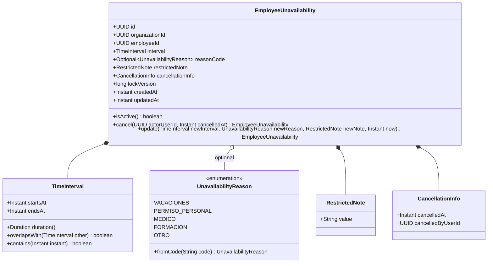
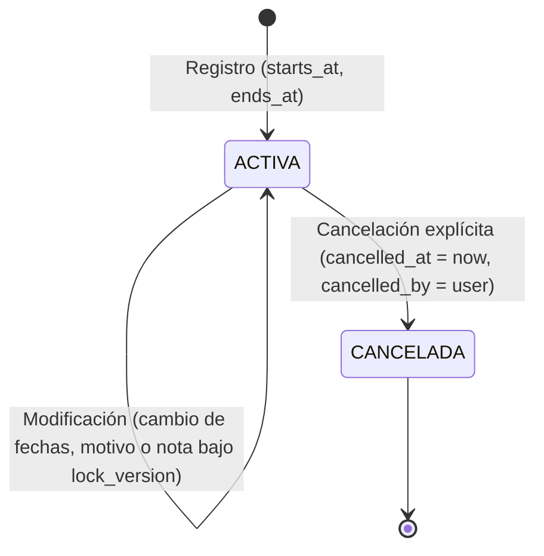
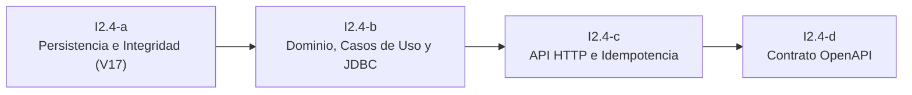

# 19 — Diseño Técnico I2.4: Indisponibilidades de Personal

## 1. Propósito, Alcance y Exclusiones de I2.4

### 1.1. Propósito
El subincremento **I2.4 — Indisponibilidades de personal** completa el núcleo funcional del Incremento 2 (**I2: Gestión de personal y estructura organizativa**) implementando la capacidad operativa para que una organización registre, consulte, modifique y cancele los periodos de tiempo en los cuales un colaborador no está disponible para recibir asignaciones o turnos de trabajo.

Este componente sienta las bases para que el futuro motor de planificación y validación de horarios (**I3: Planificación de turnos**) detecte incompatibilidades y bloquee asignaciones en periodos restringidos, respetando la privacidad de los motivos y garantizando el aislamiento multi-tenant estricto.

---

### 1.2. Alcance Funcional (HU-10)
En total conformidad con la historia de usuario **HU-10 — Registrar indisponibilidades** de [[11 - Backlog MVP y Plan de Implementación]]:
1. **Registro de indisponibilidades:** creación de periodos de indisponibilidad para un colaborador activo perteneciente a la organización autenticada, con inicio y fin cronológicamente válidos (`starts_at < ends_at`).
2. **Consulta de indisponibilidades:**
   - Consulta de indisponibilidades asociadas a un colaborador específico.
   - Consulta de indisponibilidades a nivel de organización/sede dentro de una ventana temporal (soporte para vistas de calendario o cuadrícula de equipo en UI-13).
3. **Modificación de indisponibilidades:** actualización del intervalo temporal, motivo o nota restringida de una indisponibilidad activa bajo control de concurrencia optimista (`lock_version`).
4. **Cancelación lógica de indisponibilidades:** retiro formal de la indisponibilidad del cálculo operativo (`cancelled_at IS NOT NULL`, `cancelled_by_user_id IS NOT NULL`) preservando la trazabilidad histórica sin borrado físico.
5. **Aislamiento multi-tenant estricto:** resolución de la empresa y del usuario actor derivada exclusivamente de la sesión autenticada (`AuthenticatedIdentity`).
6. **Idempotencia mono-transaccional:** protección contra duplicados y soporte de replays mediante `BusinessIdempotentOperationExecutor` y la tabla `api_operations` (V11) con cabecera obligatoria `Idempotency-Key` en operaciones de mutación.

---

### 1.3. Exclusiones Explícitas (Fuera del MVP)
Para preservar la simplicidad, solidez y viabilidad del MVP universitario:
- **Sin flujos de solicitud/aprobación de vacaciones:** No se implementa un portal de autoservicio para colaboradores ni circuitos jerárquicos de aprobación de solicitudes de permisos. El registro es potestad directa de los roles de gestión operativa (**Administrador** y **Supervisor**).
- **Sin reglas de recurrencia:** No se admiten patrones periódicos automáticos (ej. "no disponible todos los martes por la tarde"). Cada registro representa un intervalo temporal discreto y continuo.
- **Sin integración con calendarios externos:** Quedan expresamente fuera sincronizaciones con Google Calendar, Microsoft Outlook, Apple iCal o suscripciones CalDAV/ICS.
- **Sin cálculo de nómina, bajas médicas ni subsidios legales:** El sistema no calcula salarios, descuentos, prestaciones de seguridad social ni gestiona partes oficiales de incapacidad temporal.
- **Sin presunción de disponibilidad:** La ausencia de un registro de indisponibilidad significa estrictamente *"sin restricción registrada"*; no constituye una confirmación explícita de disponibilidad por parte del trabajador (**RN-012**).
- **Sin turnos existentes en I2.4:** Al igual que en I2.3, en este subincremento la organización aún no cuenta con planificaciones publicadas ni turnos en base de datos. La validación bidireccional contra asignaciones publicadas (**RN-013**) se modela a través de un puerto desacoplado que en I2.4 opera en modo inicial (no-op) y se conectará efectivamente al construir I3.

---

## 2. Actores Autorizados y Matriz de Control de Acceso (RBAC)

### 2.1. Definición de Actores y Permisos
De acuerdo con [[04 - Roles, Procesos y Reglas de Negocio]] (§4 y §5):
- **Administrador de empresa (`ROLE_ADMINISTRADOR`):** tiene control total para registrar, consultar, modificar y cancelar indisponibilidades de cualquier colaborador de su organización.
- **Supervisor (`ROLE_SUPERVISOR`):** responsable operativo de la planificación de la sede; puede registrar, consultar, modificar y cancelar indisponibilidades de los colaboradores para mantener actualizada la disponibilidad operativa (**RN-012**, matriz §5).
- **Colaborador (`ROLE_COLABORADOR`):** en el MVP universitario **no tiene acceso** a registrar ni modificar indisponibilidades, ni a consultar la lista administrativa de indisponibilidades ni los motivos de otros compañeros (**RN-014**). Su interacción en I3/I5 se limitará a consultar su horario personal publicado y participar en intercambios.
- **Operador de plataforma (`ROLE_PLATFORM_OPERATOR`):** frontera de seguridad infranqueable; los operadores tienen prohibido acceder a los datos operativos de las empresas clientes (**RN-001**).

### 2.2. Matriz de Autorización HTTP

| Endpoint | Rol ADMINISTRADOR | Rol SUPERVISOR | Rol COLABORADOR | Operador Plataforma |
| :--- | :--- | :--- | :--- | :--- |
| `POST /api/v1/employees/{employeeId}/unavailabilities` | Permitido (201) | Permitido (201) | Prohibido (403) | Prohibido (403) |
| `GET /api/v1/employees/{employeeId}/unavailabilities` | Permitido (200) | Permitido (200) | Prohibido (403) | Prohibido (403) |
| `GET /api/v1/unavailabilities` *(rango organizacional)* | Permitido (200) | Permitido (200) | Prohibido (403) | Prohibido (403) |
| `GET /api/v1/unavailabilities/{unavailabilityId}` | Permitido (200) | Permitido (200) | Prohibido (403) | Prohibido (403) |
| `PUT /api/v1/unavailabilities/{unavailabilityId}` | Permitido (200) | Permitido (200) | Prohibido (403) | Prohibido (403) |
| `POST /api/v1/unavailabilities/{unavailabilityId}/cancel` | Permitido (200) | Permitido (200) | Prohibido (403) | Prohibido (403) |

> [!NOTE]
> A diferencia de la configuración de organización (HU-05) y la activación de políticas (HU-09) donde solo el Administrador puede mutar, en la gestión de indisponibilidades (HU-10) tanto **Administrador** como **Supervisor** tienen permisos de mutación (`POST`, `PUT`, cancelación), reflejando la necesidad de que el supervisor en planta atienda avisos y ausencias imprevistas del personal.

---

## 3. Modelo de Dominio de Indisponibilidades

### 3.1. Entidades y Value Objects



#### 3.1.1. Value Object `TimeInterval`
Representa un intervalo continuo en el tiempo absoluto UTC:
- Invariante obligatoria: `startsAt != null`, `endsAt != null`.
- Invariante cronológica: `startsAt.isBefore(endsAt)` (**RN-016**).
- Semántica de solapamiento estándar TurnoShift (**RN-017**): intervalo semiabierto $[startsAt, endsAt)$.
  Dos intervalos $A$ y $B$ se solapan si y solo si:
  $$startsAt_A < endsAt_B \quad \land \quad startsAt_B < endsAt_A$$
- Si $endsAt_A == startsAt_B$, **no hay solapamiento** (contacto contiguo exacto).

#### 3.1.2. Enumeración `UnavailabilityReason` (Catálogo Cerrado y Opcional)
Catálogo cerrado estandarizado de motivos operativos iniciales:
- `VACACIONES`: periodo vacacional o días de descanso acordados.
- `PERMISO_PERSONAL`: asuntos propios, licencias personales o familiares.
- `MEDICO`: cita médica, consulta de salud o reposo médico sin detalles clínicos.
- `FORMACION`: capacitación, cursos o exámenes autorizados.
- `OTRO`: motivo justificado de naturaleza operativa no clasificado en los anteriores.
- **Tratamiento de opcionalidad por privacidad:** En base de datos la columna es nullable (`reason_code NULL`). En el dominio Java, se expresa y expone rigurosamente como `Optional<UnavailabilityReason>` (no como un value object obligatorio), permitiendo omitir el motivo cuando la confidencialidad lo requiera.

#### 3.1.3. Value Object `RestrictedNote`
Nota textual descriptiva y privada:
- Opcional (`null` permitido).
- Capacidad limitada: longitud máxima de 500 caracteres UTF-16.
- Rechazo estricto de cadenas no nulas vacías o compuestas exclusivamente de espacios en blanco.
- **Regla de confidencialidad (RN-014):** solo accesible por administradores y supervisores; jamás expuesta a colaboradores en endpoints de consulta de turnos ni candidaturas de intercambio.

#### 3.1.4. Value Object `CancellationInfo`
Encapsula la evidencia de cancelación:
- `cancelledAt`: instante UTC en que se canceló.
- `cancelledByUserId`: identificador del usuario (administrador o supervisor) que ejecutó la cancelación.
- Coherencia relacional: ambos campos deben ser simultáneamente nulos (indisponibilidad activa) o simultáneamente no nulos (indisponibilidad cancelada).

---

### 3.2. Ciclo de Vida y Transiciones de Estado
El ciclo de vida de una indisponibilidad es simple, determinista y auditable:



- **ACTIVA (Vigente):** `cancelled_at IS NULL`. El intervalo restringe asignaciones y es tenido en cuenta por el validador de I3.
- **CANCELADA (Histórica/Anulada):** `cancelled_at IS NOT NULL`. La indisponibilidad queda retirada inmediatamente del cálculo vigente (**Nota 07, §6.9**). No se puede volver a reactivar ni modificar (estado terminal).
- **Protección de periodos iniciados o pasados (RN-013):**
  - No se permite cancelar ni modificar una indisponibilidad cuyo `ends_at` ya ocurrió en el pasado (`ends_at <= now`).
  - No se permite modificar el `starts_at` de una indisponibilidad si dicho inicio ya ocurrió (`starts_at <= now`), evitando reescribir retrospectivamente periodos donde ya operaron decisiones de planificación.

---

### 3.3. Puertos del Dominio (`com.turnoshift.unavailability.domain`)

1. **`EmployeeUnavailabilityRepository`:**
   - `EmployeeUnavailability save(EmployeeUnavailability unavailability)`
   - `Optional<EmployeeUnavailability> findById(UUID organizationId, UUID id)`
   - `List<EmployeeUnavailability> findByEmployee(UUID organizationId, UUID employeeId, boolean includeCancelled)`
   - `List<EmployeeUnavailability> findByEmployeeAndInterval(UUID organizationId, UUID employeeId, Instant from, Instant to, boolean includeCancelled)`
   - `List<EmployeeUnavailability> findByOrganizationAndInterval(UUID organizationId, Instant from, Instant to, boolean includeCancelled)`
   - `boolean update(EmployeeUnavailability unavailability, long expectedLockVersion)`
   - `boolean cancel(UUID organizationId, UUID id, UUID actorUserId, Instant cancelledAt, long expectedLockVersion)`
2. **`EmployeeValidationPort`:**
   - Valida que el `employeeId` pertenezca a la misma `organizationId` y se encuentre activo (`is_active = 1`). Reutiliza la existencia verificada en `com.turnoshift.team`.
3. **`UnavailabilityConflictQueryPort` (Puerto para I3):**
   - Expone la consulta pura de conflictos temporales para el motor de planificación.

---

## 4. Manejo Temporal, Zona Horaria, Rangos y Solapamientos

### 4.1. Instantes UTC y Zona Horaria de la Organización
En conformidad con **RN-015** y las convenciones de persistencia del proyecto:
- La base de datos almacena instantes normalizados a UTC en columnas `DATETIMEOFFSET(3)`.
- El dominio Java opera con `java.time.Instant`.
- La zona horaria configurada en la organización (`organizations.timezone_id`, ej. `America/Bogota`, `Europe/Madrid`) se utiliza exclusivamente para:
  1. Interpretar y calcular los límites de días completos ingresados por el usuario.
  2. Resolver la semana de planificación (de lunes a domingo en hora local, **RN-020**).
  3. Renderizar las representaciones horarias para el supervisor en la interfaz web.

---

### 4.2. Rangos Parciales vs. Rangos de Día Completo (Formatos Mutuamente Excluyentes)

El contrato de API admite **exactamente dos formatos mutuamente excluyentes** para definir el periodo temporal:

#### Formato A: Rango Parcial por Horas
- El cliente envía instantes absolutos ISO-8601 UTC explícitos:
  - `startsAt`: instante UTC (ej. `2026-10-15T14:00:00.000Z`).
  - `endsAt`: instante UTC (ej. `2026-10-15T18:00:00.000Z`).
- Invariante: `startsAt < endsAt`.
- Aplicable a permisos de media jornada, salidas médicas o ausencias de pocas horas.

#### Formato B: Rango de Día Completo (`allDay: true`)
- El cliente envía las fechas locales de calendario y el flag booleano:
  - `allDay`: booleano con valor estricto `true`.
  - `startDate`: fecha local en formato ISO-8601 `YYYY-MM-DD` (**inclusiva**).
  - `endDate`: fecha local en formato ISO-8601 `YYYY-MM-DD` (**exclusiva**).
- **Semántica semiabierta de fechas locales:**
  Al igual que los instantes de turno, el rango local es semiabierto $[startDate, endDate)$.
  - Para un único día completo (ej. 15 de octubre): `startDate: "2026-10-15"`, `endDate: "2026-10-16"`.
  - Para un periodo de varios días (ej. del 15 al 17 de octubre inclusive): `startDate: "2026-10-15"`, `endDate: "2026-10-18"`.
- **Regla de expansión canónica a UTC en backend:**
  El servidor consulta la zona horaria de la organización (`organizations.timezone_id`, `ZoneId = ZoneId.of(org.getTimezoneId())`) y expande el rango a instantes UTC absolutos:
  - `startsAt = LocalDate.parse(startDate).atStartOfDay(zoneId).toInstant()`
  - `endsAt = LocalDate.parse(endDate).atStartOfDay(zoneId).toInstant()`
  La expansión se fundamenta de forma estricta y exclusiva en la zona horaria oficial del tenant.

#### Reglas de Validación y Exclusión Mutua Estricta:
El servidor rechaza con HTTP `400 Bad Request` (código Problem Details `VALIDATION_FAILED`) cualquier payload que:
1. **Mezcle ambos formatos:** por ejemplo, enviar `allDay: true` junto con `startsAt` o `endsAt`; o enviar `startDate`/`endDate` acompañados de instantes UTC.
2. **Sea incompleto para su formato:** enviar solo `startsAt` sin `endsAt`, enviar solo `startDate` sin `endDate`, o enviar `startDate`/`endDate` con `allDay: false` o sin el flag `allDay: true`.
3. **Viole la cronología:** `startsAt >= endsAt` en rango parcial, o `startDate >= endDate` en día completo.

---

### 4.3. Semántica de Intervalo Semiabierto y Contacto Contiguo
- En concordancia con **RN-017**, los intervalos se tratan como $[startsAt, endsAt)$.
- Si una indisponibilidad finaliza el viernes a las `14:00:00Z` (`ends_at`) y otra comienza exactamente el viernes a las `14:00:00Z` (`starts_at`), **no se consideran solapadas**.
- De igual forma, cuando en I3 un turno comience exactamente en el instante en que finaliza una indisponibilidad, dicho turno es legal y no intersecta la indisponibilidad.

---

### 4.4. Solapamientos entre Indisponibilidades del Mismo Colaborador
De acuerdo con [[07 - Modelo de Datos y DER]] (§6.9):
> *"Las superposiciones entre indisponibilidades representan unión de intervalos no disponibles. No se suman como horas de ausencia."*

**Regla aprobada:**
1. **Permisividad de solapamiento:** Se permiten indisponibilidades activas superpuestas del mismo empleado en base de datos. No se rechaza con error 409 ni se bloquea su registro.
2. **Evaluación en I3 como unión de intervalos:** El futuro motor de planificación (I3) evaluará los periodos no disponibles como la **unión matemática de intervalos** $\bigcup [s_i, e_i)$, sin duplicar horas de ausencia ni emitir advertencias redundantes.

---

### 4.5. Horas Locales Inexistentes o Ambiguas (Transiciones DST / Horario de Verano)
En cumplimiento de **RN-015** (*"Las horas locales inexistentes o ambiguas por cambios horarios deben rechazarse o resolverse explícitamente; nunca interpretarse de manera silenciosa"*):
- Si el cliente envía instantes absolutos UTC (`startsAt`, `endsAt`), la ambigüedad no existe, ya que UTC es monotónico y carece de saltos.
- Si el cliente utiliza la modalidad de fechas locales o conversión horaria local:
  - Si la hora local cae en un salto de horario inexistente (brecha de primavera donde el reloj pasa de 02:00 a 03:00): el validador rechaza con `400 VALIDATION_FAILED` (código `LOCAL_TIME_ZONE_GAP`).
  - Si la hora local cae en una hora repetida ambigua (otoño donde el reloj retrocede de 03:00 a 02:00): se exige desambiguación mediante offset explícito o se rechaza con código `LOCAL_TIME_ZONE_AMBIGUOUS`.

---

## 5. Modelo Relacional Multi-tenant y Persistencia (`employee_unavailabilities`)

### 5.1. Definición Física de la Tabla
Siguiendo las convenciones de la migración `V13__employees.sql` y las pautas de SQL Server 2022 de la Nota 07 (§6.9):

```sql
CREATE TABLE employee_unavailabilities (
    -- Identificación empresarial (§4.3)
    organization_id         UNIQUEIDENTIFIER    NOT NULL,
    id                      UNIQUEIDENTIFIER    NOT NULL    DEFAULT NEWID(),

    -- Colaborador afectado
    employee_id             UNIQUEIDENTIFIER    NOT NULL,

    -- Intervalo temporal absoluto (UTC)
    starts_at               DATETIMEOFFSET(3)   NOT NULL,
    ends_at                 DATETIMEOFFSET(3)   NOT NULL,

    -- Motivo estandarizado y nota confidencial (§6.9, RN-014)
    reason_code             VARCHAR(32)         NULL,
    restricted_note         NVARCHAR(500)       NULL,

    -- Auditoría de cancelación lógica (§4.7, §6.9)
    cancelled_at            DATETIMEOFFSET(3)   NULL,
    cancelled_by_user_id    UNIQUEIDENTIFIER    NULL,

    -- Auditoría de creación
    created_by_user_id      UNIQUEIDENTIFIER    NOT NULL,
    created_at              DATETIMEOFFSET(3)   NOT NULL    DEFAULT SYSUTCDATETIME(),

    -- Concurrencia y actualización de fila
    updated_at              DATETIMEOFFSET(3)   NOT NULL    DEFAULT SYSUTCDATETIME(),
    lock_version            BIGINT              NOT NULL    DEFAULT 0,

    -- Clave primaria simple
    CONSTRAINT pk_employee_unavailabilities
        PRIMARY KEY (id),

    -- Clave candidata empresarial: habilita integridad multi-tenant en FKs futuras
    CONSTRAINT uq_unavailabilities_org_id
        UNIQUE (organization_id, id),

    -- FK a organizations (sin cascada)
    CONSTRAINT fk_unavailabilities_organization
        FOREIGN KEY (organization_id)
        REFERENCES organizations (id)
        ON DELETE NO ACTION
        ON UPDATE NO ACTION,

    -- FK compuesta a employees: garantiza pertenencia a la misma organización
    CONSTRAINT fk_unavailabilities_employee
        FOREIGN KEY (organization_id, employee_id)
        REFERENCES employees (organization_id, id)
        ON DELETE NO ACTION
        ON UPDATE NO ACTION,

    -- FK compuesta a usuario autor de creación
    CONSTRAINT fk_unavailabilities_created_by
        FOREIGN KEY (organization_id, created_by_user_id)
        REFERENCES app_users (organization_id, id)
        ON DELETE NO ACTION
        ON UPDATE NO ACTION,

    -- FK compuesta a usuario que cancela (nullable)
    CONSTRAINT fk_unavailabilities_cancelled_by
        FOREIGN KEY (organization_id, cancelled_by_user_id)
        REFERENCES app_users (organization_id, id)
        ON DELETE NO ACTION
        ON UPDATE NO ACTION,

    -- Restricción cronológica: inicio antes del fin
    CONSTRAINT chk_unavailabilities_interval
        CHECK (starts_at < ends_at),

    -- Restricción de lock_version no negativo
    CONSTRAINT chk_unavailabilities_lock_version_non_negative
        CHECK (lock_version >= 0),

    -- Restricción de nota: si se envía, no puede ser una cadena vacía tras trim
    CONSTRAINT chk_unavailabilities_note_not_blank
        CHECK (restricted_note IS NULL OR LEN(LTRIM(RTRIM(restricted_note))) > 0),

    -- Restricción de motivo: catálogo controlado
    CONSTRAINT chk_unavailabilities_reason_code
        CHECK (reason_code IS NULL OR reason_code IN ('VACACIONES', 'PERMISO_PERSONAL', 'MEDICO', 'FORMACION', 'OTRO')),

    -- Restricción de coherencia en cancelación: ambos presentes o ambos nulos
    CONSTRAINT chk_unavailabilities_cancellation_coherence
        CHECK (
            (cancelled_at IS NULL AND cancelled_by_user_id IS NULL)
            OR
            (cancelled_at IS NOT NULL AND cancelled_by_user_id IS NOT NULL)
        )
);
```

---

### 5.2. Índices de Rendimiento y Filtrado
Para optimizar las consultas críticas sin sobrecargar el log transaccional de escrituras:

1. **Índice filtrado de indisponibilidades activas por empleado:**
   ```sql
   CREATE INDEX ix_unavailabilities_employee_active
       ON employee_unavailabilities (organization_id, employee_id, starts_at, ends_at)
       WHERE cancelled_at IS NULL;
   ```
   *Uso:* Permite resolver instantáneamente si un colaborador particular tiene indisponibilidades en una fecha u hora determinada.
2. **Índice filtrado de indisponibilidades activas por organización y rango:**
   ```sql
   CREATE INDEX ix_unavailabilities_org_interval_active
       ON employee_unavailabilities (organization_id, starts_at, ends_at)
       INCLUDE (employee_id, reason_code)
       WHERE cancelled_at IS NULL;
   ```
   *Uso:* Permite a I3 cargar en un solo barrido indexado todas las indisponibilidades de la semana para todos los colaboradores de la empresa.

---

### 5.3. Estrategia de Migración Flyway
- En secuencia estricta tras `V16__organizations_policy_fk.sql`, la migración propuesta se denominará:
  `backend/src/main/resources/db/migration/V17__employee_unavailabilities.sql`
- Es completamente aditiva: crea la tabla `employee_unavailabilities`, sus restricciones relacionales compuestas, sus restricciones `CHECK` y sus índices filtrados.
- No modifica tablas existentes ni requiere manipulación de datos legados.

---

## 6. Contratos de API HTTP, Problem Details e Idempotencia

### 6.1. Endpoints Propuestos (Prefijo `/api/v1`)

> [!IMPORTANT]
> **Regla de idempotencia y control de concurrencia en la API:**
> - La cabecera **`Idempotency-Key` (UUID) es estrictamente obligatoria en las tres mutaciones**: `POST` creación, `PUT` modificación y `POST` cancelación.
> - Las peticiones de consulta **`GET` nunca requieren ni procesan `Idempotency-Key`**.
> - Las operaciones de actualización (`PUT`) y cancelación (`POST /cancel`) exigen obligatoriamente **`expectedLockVersion`** para control de concurrencia optimista.

#### 6.1.1. `POST /api/v1/employees/{employeeId}/unavailabilities`
Registra una nueva indisponibilidad para el colaborador indicado.
- **Seguridad:** `sessionCookie` + `csrfHeader` (AND).
- **Cabeceras obligatorias:** `Idempotency-Key: <UUID>`.
- **Request Body (JSON) — Dos formatos exactamente mutuamente excluyentes:**

  *Opción A: Rango parcial por horas:*
  ```json
  {
    "startsAt": "2026-10-15T14:00:00.000Z",
    "endsAt": "2026-10-15T18:00:00.000Z",
    "reasonCode": "PERMISO_PERSONAL",
    "restrictedNote": "Permiso especial de media jornada."
  }
  ```

  *Opción B: Día completo (`allDay: true`, startDate inclusiva, endDate exclusiva):*
  ```json
  {
    "allDay": true,
    "startDate": "2026-10-15",
    "endDate": "2026-10-17",
    "reasonCode": "VACACIONES",
    "restrictedNote": "Vacaciones de dos días: 15 y 16 de octubre (endDate 17 es exclusiva)."
  }
  ```
  *Nota sobre campos opcionales:* `reasonCode` (nullable/omitible) y `restrictedNote` (nullable/omitible).
  *Validación estricta:* Se rechaza con `400 VALIDATION_FAILED` cualquier payload mixto (ej. `allDay: true` con `startsAt`), incompleto o con fechas locales donde `startDate >= endDate`.
- **Respuestas:**
  - `201 Created` con `EmployeeUnavailabilityResponse` y cabecera `Location: /api/v1/unavailabilities/{id}`. Replays con `Idempotency-Replayed: true`.
  - `400 VALIDATION_FAILED`
  - `401 SESSION_REQUIRED`
  - `403 ACCESS_DENIED` / `CSRF_INVALID`
  - `404 EMPLOYEE_NOT_FOUND`
  - `409 CONCURRENT_MODIFICATION` / `IDEMPOTENCY_KEY_REUSED` / `IDEMPOTENCY_KEY_EXPIRED`
  - `503 SERVICE_UNAVAILABLE`

#### 6.1.2. `GET /api/v1/employees/{employeeId}/unavailabilities`
Consulta las indisponibilidades asociadas a un colaborador específico.
- **Seguridad:** `sessionCookie`. **Nunca requiere `Idempotency-Key`**.
- **Parámetros de consulta opcionales:**
  - `from`: ISO-8601 Instant (ej. `2026-10-01T00:00:00Z`).
  - `to`: ISO-8601 Instant (ej. `2026-10-31T23:59:59Z`).
  - `includeCancelled`: booleano (`false` por defecto).
- **Respuesta `200 OK`:**
  ```json
  {
    "items": [
      {
        "id": "f47ac10b-58cc-4372-a567-0e02b2c3d479",
        "employeeId": "b1a2c3d4-e5f6-7a8b-9c0d-1e2f3a4b5c6d",
        "startsAt": "2026-10-15T05:00:00.000Z",
        "endsAt": "2026-10-17T05:00:00.000Z",
        "reasonCode": "VACACIONES",
        "restrictedNote": "Vacaciones de dos días: 15 y 16 de octubre.",
        "cancelled": false,
        "cancelledAt": null,
        "cancelledByUserId": null,
        "createdByUserId": "a1b2c3d4-e5f6-7a8b-9c0d-1e2f3a4b5c6d",
        "lockVersion": 0,
        "createdAt": "2026-09-25T13:30:00.000Z",
        "updatedAt": "2026-09-25T13:30:00.000Z"
      }
    ]
  }
  ```

#### 6.1.3. `GET /api/v1/unavailabilities`
Consulta global de indisponibilidades para la organización (vista de equipo/cuadrícula en UI-13).
- **Seguridad:** `sessionCookie`. **Nunca requiere `Idempotency-Key`**.
- **Parámetros de consulta:**
  - `from`: obligatorio, ISO-8601 Instant.
  - `to`: obligatorio, ISO-8601 Instant (`to > from`, máximo 92 días de rango).
  - `includeCancelled`: opcional, booleano (`false` por defecto).
  - `employeeId`: opcional, UUID (para filtrar un único colaborador si se prefiere usar la ruta global).
- **Respuesta `200 OK`:** colección `{ "items": [ ... ] }`.

#### 6.1.4. `GET /api/v1/unavailabilities/{unavailabilityId}`
Consulta individual de una indisponibilidad por su identificador.
- **Seguridad:** `sessionCookie`. **Nunca requiere `Idempotency-Key`**.
- **Respuesta:** `200 OK` con `EmployeeUnavailabilityResponse` o `404 UNAVAILABILITY_NOT_FOUND`.

#### 6.1.5. `PUT /api/v1/unavailabilities/{unavailabilityId}`
Modificación completa de fechas, motivo y/o nota de una indisponibilidad activa.
- **Seguridad:** `sessionCookie` + `csrfHeader` (AND).
- **Cabeceras obligatorias:** `Idempotency-Key: <UUID>`.
- **Payload:** admite cualquiera de los dos formatos mutuamente excluyentes (rango parcial o día completo con `endDate` exclusiva), junto con `expectedLockVersion` (obligatorio), `reasonCode` (nullable/opcional) y `restrictedNote` (nullable/opcional).
  ```json
  {
    "startsAt": "2026-10-15T13:00:00.000Z",
    "endsAt": "2026-10-15T19:00:00.000Z",
    "reasonCode": "PERMISO_PERSONAL",
    "restrictedNote": "Ajuste de horario por salida médica extendida.",
    "expectedLockVersion": 0
  }
  ```
- **Respuestas:**
  - `200 OK` con la entidad actualizada (`lockVersion` incrementado). Replays con `Idempotency-Replayed: true`.
  - `409 CONCURRENT_MODIFICATION` si `expectedLockVersion` no coincide.
  - `409 UNAVAILABILITY_ALREADY_CANCELLED` si la indisponibilidad ya fue cancelada.
  - `400 VALIDATION_FAILED` si el periodo ya inició o expiró en el pasado (**RN-013**), o si el formato es inválido/mixto.

#### 6.1.6. `POST /api/v1/unavailabilities/{unavailabilityId}/cancel`
Cancela lógicamente una indisponibilidad activa.
- **Seguridad:** `sessionCookie` + `csrfHeader` (AND).
- **Cabeceras obligatorias:** `Idempotency-Key: <UUID>`.
- **Payload:**
  ```json
  {
    "expectedLockVersion": 0
  }
  ```
- **Respuestas:**
  - `200 OK` con la entidad actualizada mostrando `cancelled: true`, `cancelledAt` y `cancelledByUserId`. Replays con `Idempotency-Replayed: true`.
  - `409 CONCURRENT_MODIFICATION` si la versión esperada no coincide.
  - `409 UNAVAILABILITY_ALREADY_CANCELLED` si ya estaba cancelada (o replay idempotente si fue con la misma clave).

---

### 6.2. Catálogo de Problem Details (RFC 9457)

En total cumplimiento de los estándares del backend (`requestId` en el cuerpo JSON, sin cabecera HTTP `X-Request-ID`, `Cache-Control: no-store`):

| HTTP Status | `type` | `code` | Situación Desencadenante |
| :--- | :--- | :--- | :--- |
| **400 Bad Request** | `.../errors/validation-failed` | `VALIDATION_FAILED` | `startsAt >= endsAt`, fechas nulas, formato inválido, rango mayor a 365 días, o brecha DST. |
| **400 Bad Request** | `.../errors/validation-failed` | `PAST_INTERVAL_MODIFICATION_PROHIBITED` | Intento de crear, modificar o cancelar una indisponibilidad sobre un periodo que ya inició o finalizó en el pasado. |
| **401 Unauthorized** | `.../errors/session-required` | `SESSION_REQUIRED` | Ausencia de cookie de sesión o sesión expirada. |
| **403 Forbidden** | `.../errors/access-denied` | `ACCESS_DENIED` | Rol insuficiente (COLABORADOR u Operador) o tenant suspendido. |
| **403 Forbidden** | `.../errors/csrf-invalid` | `CSRF_INVALID` | Petición `POST`/`PUT` sin token CSRF válido. |
| **404 Not Found** | `.../errors/employee-not-found` | `EMPLOYEE_NOT_FOUND` | El colaborador no existe o pertenece a otra organización. |
| **404 Not Found** | `.../errors/unavailability-not-found` | `UNAVAILABILITY_NOT_FOUND` | La indisponibilidad no existe o pertenece a otra organización. |
| **409 Conflict** | `.../errors/concurrent-modification` | `CONCURRENT_MODIFICATION` | `expectedLockVersion` no coincide con el valor actual en base de datos. |
| **409 Conflict** | `.../errors/unavailability-conflict` | `UNAVAILABILITY_ALREADY_CANCELLED` | Intento de modificar o cancelar una indisponibilidad que ya se encuentra en estado cancelado. |
| **409 Conflict** | `.../errors/idempotency-conflict` | `IDEMPOTENCY_KEY_REUSED` | Misma clave de idempotencia enviada con distinta huella o payload. |
| **409 Conflict** | `.../errors/idempotency-conflict` | `IDEMPOTENCY_KEY_EXPIRED` | Clave de idempotencia enviada con más de 24 horas de antigüedad. |
| **503 Service Unavailable** | `.../errors/service-unavailable` | `UNAVAILABILITY_DATA_ACCESS_ERROR` | Fallo de conexión o error técnico de SQL Server sin filtrar trazas ni consultas internas. |

---

## 7. Interfaz de Integración para I3 (Planificación de Turnos)

### 7.1. Requisitos de Consulta de I3
Cuando se implemente el módulo de planificación (**I3**), el motor de validación necesitará responder a dos preguntas fundamentales sin acoplarse a la persistencia interna de indisponibilidades:
1. **Validación puntual de asignación:** *"¿Tiene el colaborador $E$ alguna indisponibilidad vigente que intersecte el turno propuesto $[t_{start}, t_{end})$?"* (**RN-019**).
2. **Validación masiva de borrador semanal:** *"Dame todas las indisponibilidades activas de todos los colaboradores de la sede para la semana $[w_{start}, w_{end})$."*

### 7.2. Contrato de Integración Desacoplado
Se define en el dominio de indisponibilidades una interfaz limpia pensada específicamente para su consumo por parte de I3:

```java
package com.turnoshift.unavailability.domain;

import java.time.Instant;
import java.util.List;
import java.util.Map;
import java.util.Set;
import java.util.UUID;

public interface UnavailabilityConflictQueryPort {

    /**
     * Verifica si un colaborador tiene al menos una indisponibilidad activa que solape con el intervalo.
     */
    boolean hasConflict(UUID organizationId, UUID employeeId, Instant shiftStart, Instant shiftEnd);

    /**
     * Obtiene los periodos de indisponibilidad conflictivos para un colaborador e intervalo.
     */
    List<TimeInterval> findConflictingIntervals(UUID organizationId, UUID employeeId, Instant shiftStart, Instant shiftEnd);

    /**
     * Carga por lote las indisponibilidades activas mediante una consulta acotada por organización,
     * empleados relevantes y ventana temporal; posteriormente, la validación de intervalos se
     * realiza en memoria con costo proporcional a los intervalos recuperados.
     */
    Map<UUID, List<TimeInterval>> findActiveIntervalsByEmployees(
            UUID organizationId,
            Set<UUID> employeeIds,
            Instant rangeStart,
            Instant rangeEnd
    );
}
```

### 7.3. Comprobación Bidireccional Futura (Turnos vs. Indisponibilidades)
- **Turno contra Indisponibilidad (I3):** El validador de borrador invoca `hasConflict(...)`. Si devuelve `true`, la asignación genera un bloqueo operativo (**RN-019**: no se puede publicar un horario con asignaciones que intersecten indisponibilidades).
- **Indisponibilidad contra Turno Publicado (RN-013):** Cuando exista I3, antes de confirmar la creación o modificación de una indisponibilidad, el servicio consultará un puerto inverso `PublishedAssignmentConflictPort`. Si existe un turno publicado que intersecte la nueva indisponibilidad, la operación se rechazará con `409 UNAVAILABILITY_CONFLICTS_WITH_PUBLISHED_ASSIGNMENT`, obligando al supervisor a revisar o desasignar primero el turno en el horario oficial. En I2.4, este validador se implementa con una clase adapter no-op (`NoOpPublishedAssignmentConflictPort`) que siempre retorna vacío, permitiendo probar exhaustivamente I2.4 sin esperar a I3.

---

## 8. Seguridad, Aislamiento Multi-tenant, Concurrencia y Auditoría

### 8.1. Aislamiento Multi-tenant Estricto
1. **Derivación obligatoria por sesión:** La `organizationId` y el `actorUserId` se extraen exclusivamente del `SecurityContextHolder` (`AuthenticatedIdentity`).
2. **Validación relacional cruzada:** Cualquier parámetro de ruta (`employeeId`, `unavailabilityId`) es contrastado explícitamente en SQL contra el `organization_id` de la sesión:
   ```sql
   WHERE id = :unavailabilityId AND organization_id = :sessionOrgId
   ```
   Si la fila existe pero pertenece a otra empresa, la consulta devuelve 0 filas, traduciéndose a HTTP 404 seguro sin filtrar la existencia de recursos de otros inquilinos.

### 8.2. Concurrencia y Serialización
1. **Concurrencia optimista (`lock_version`):**
   - Todas las mutaciones de actualización (`PUT`) y cancelación (`POST /cancel`) exigen `expectedLockVersion`.
   - La sentencia SQL ejecuta:
     ```sql
     UPDATE employee_unavailabilities
     SET ..., lock_version = lock_version + 1, updated_at = SYSUTCDATETIME()
     WHERE id = :id AND organization_id = :orgId AND lock_version = :expectedLockVersion
     ```
   - Si se actualizan 0 filas, se comprueba si la fila existe: si existe, se lanza `OptimisticLockException` mapeada a HTTP 409 `CONCURRENT_MODIFICATION`.
2. **Concurrencia pesimista de nivel de aplicación (`sp_getapplock`):**
   - Al registrar una indisponibilidad para un colaborador, se puede adquirir un bloqueo transaccional de corta duración por colaborador:
     `TurnoShift:Unavailability:Emp:{employeeId}` con `@LockOwner = 'Transaction'` y timeout de 5 segundos.
   - Esto serializa la creación de indisponibilidades simultáneas para el mismo colaborador, garantizando orden determinista y evitando carreras al evaluar periodos contiguos o solapamientos.

### 8.3. Privacidad y Auditoría (RN-014)
- Los campos `reason_code` y `restricted_note` contienen información potencialmente sensible de la vida privada del empleado.
- **Filtro estricto de proyección:** los DTOs de salida y los componentes de UI deben garantizar que estos campos nunca viajen hacia vistas accesibles por el rol `COLABORADOR`.
- Las operaciones de creación, edición y cancelación registran auditoría técnica mediante las columnas `created_by_user_id`, `cancelled_by_user_id`, `created_at` y `updated_at`.

---

## 9. Plan de Subincrementos y Estrategia de Pruebas Focalizadas

Para garantizar un avance seguro, verificable y compatible con los límites de tiempo de compilación y ejecución, I2.4 se divide en cuatro subincrementos estrictamente secuenciales:



### 9.1. I2.4-a — Persistencia y Migración Flyway
- **Alcance:**
  - Creación de `backend/src/main/resources/db/migration/V17__employee_unavailabilities.sql`.
  - Prueba de integración focalizada `UnavailabilityPersistenceIT` con Testcontainers SQL Server real.
- **Verificaciones obligatorias:**
  - Aplicación limpia de la migración V17 sobre el esquema acumulado V1–V16.
  - Integridad referencial: rechazo de FK si `organization_id` del colaborador no coincide con el de la indisponibilidad.
  - Comprobación de checks: rechazo de `starts_at >= ends_at`, rechazo de notas en blanco, coherencia de campos de cancelación.
  - Pruebas de índices filtrados.

### 9.2. I2.4-b — Modelo de Dominio, Casos de Uso y Repositorio JDBC
- **Alcance:**
  - Clases de dominio: `EmployeeUnavailability`, `TimeInterval`, `UnavailabilityReason`, `RestrictedNote`, `CancellationInfo`.
  - Excepciones de dominio: `InvalidUnavailabilityDataException`, `UnavailabilityNotFoundException`, `UnavailabilityOptimisticLockException`, `UnavailabilityAlreadyCancelledException`, `UnavailabilityDataAccessException`.
  - Casos de uso de aplicación: `RegisterUnavailabilityUseCase`, `GetEmployeeUnavailabilitiesUseCase`, `GetOrganizationUnavailabilitiesUseCase`, `UpdateUnavailabilityUseCase`, `CancelUnavailabilityUseCase`.
  - Adaptador de persistencia: `JdbcEmployeeUnavailabilityRepository`.
  - Implementación de `UnavailabilityConflictQueryPort`.
- **Pruebas focalizadas:**
  - Pruebas unitarias de dominio y casos de uso con mocks (`EmployeeUnavailabilityTest`, `UnavailabilityUseCasesTest`).
  - Pruebas de integración de repositorio con Testcontainers (`JdbcEmployeeUnavailabilityRepositoryIT`).

### 9.3. I2.4-c — API HTTP Segura e Idempotencia
- **Alcance:**
  - Controlador web: `EmployeeUnavailabilityController`.
  - DTOs de entrada y salida, validación de payloads y manejo de fechas ISO-8601 UTC / días completos.
  - Integración con `BusinessIdempotentOperationExecutor` y comando `UnavailabilityIdempotentCommand` para serialización de replays deterministas.
  - Seguridad: verificación de RBAC en `SecurityConfig`, CSRF obligatorio en mutaciones, aislamiento multi-tenant por sesión, `Cache-Control: no-store` y Problem Details RFC 9457.
- **Pruebas focalizadas:**
  - Pruebas unitarias de controlador y comando (`EmployeeUnavailabilityControllerTest`, `UnavailabilityIdempotentCommandTest`).
  - Pruebas de integración HTTP end-to-end (`EmployeeUnavailabilityControllerIT`).

### 9.4. I2.4-d — Contrato OpenAPI
- **Alcance:**
  - Actualización de `docs/api/openapi.yaml` a la versión `0.2.4-i2.4`.
  - Documentación de las rutas bajo el tag `unavailabilities`.
  - Modelado de esquemas y respuestas Problem Details.
  - Validación con Redocly CLI (`npx @redocly/cli lint docs/api/openapi.yaml`: 0 errores, 0 advertencias).

---

## 10. Riesgos, Supuestos y Decisiones Pendientes de Aprobación

### 10.1. Riesgos Técnicos y Operativos
1. **Discrepancia por Zonas Horarias y Horario de Verano (DST):**
   - *Riesgo:* Una indisponibilidad de día completo podría interpretarse erróneamente con una hora de desfase si el cliente y el servidor manejan la conversión sin consultar la zona horaria del tenant.
   - *Mitigación:* Toda conversión de día completo a instante absoluto se realiza en el backend consultando autoritativamente `organizations.timezone_id`.
2. **Estrategia de Consulta para I3:**
   - *Riesgo:* Consultar individualmente las indisponibilidades de cada colaborador por cada necesidad temporal en I3 generaría un problema $N+1$ de accesos a base de datos.
   - *Mitigación:* Se diseñó el método de lote `findActiveIntervalsByEmployees` en `UnavailabilityConflictQueryPort`: ejecuta una consulta acotada por organización, empleados relevantes y ventana temporal; posteriormente, la validación de intervalos se lleva a cabo en memoria con un costo proporcional a los intervalos recuperados, sin anticipar ni acoplar el diseño de turnos ni planificaciones.

---

### 10.2. Supuestos de Diseño
1. El catálogo de motivos `reason_code` inicial (`VACACIONES`, `PERMISO_PERSONAL`, `MEDICO`, `FORMACION`, `OTRO`) satisface las necesidades operativas del MVP universitario.
2. Tanto el **Administrador** como el **Supervisor** tienen atribuciones legítimas para registrar ausencias e indisponibilidades imprevistas de los colaboradores (**RN-012**, matriz §5).
3. La cancelación lógica (`cancelled_at IS NOT NULL`) es suficiente para mantener el historial sin requerir una tabla de auditoría separada en esta etapa.

---

### 10.3. Decisiones de Diseño Aprobadas (Cierre de Fase de Diseño)

Las decisiones clave de diseño han sido formalmente **APROBADAS**:

1. **Día completo y formatos mutuamente excluyentes (APROBADO):**
   - Se admiten exactamente dos formatos mutuamente excluyentes:
     a) Rango parcial: `startsAt` y `endsAt` como instantes UTC.
     b) Día completo: `allDay: true`, `startDate` (inclusiva) y `endDate` (exclusiva) como fechas locales.
   - Para `allDay`, `startDate` es inclusiva y `endDate` es exclusiva.
   - Se rechaza cualquier payload que mezcle ambos formatos o que no cumpla estrictamente uno de ellos.
   - La expansión a UTC usa exclusivamente `organizations.timezone_id`.

2. **Permisividad de solapamientos como unión de intervalos (APROBADO):**
   - Se permiten indisponibilidades activas superpuestas del mismo empleado en base de datos.
   - El motor de I3 las evaluará como la unión temporal de intervalos no disponibles, sin duplicar horas de ausencia.

3. **Catálogo cerrado de motivos y opcionalidad por privacidad (APROBADO):**
   - Catálogo cerrado de 5 motivos: `VACACIONES`, `PERMISO_PERSONAL`, `MEDICO`, `FORMACION`, `OTRO`.
   - `reasonCode` es opcional por privacidad (`NULL` permitido en base de datos).
   - En el dominio Java se expresa como `Optional<UnavailabilityReason>`, no como un value object obligatorio.

4. **Paquete backend (APROBADO):**
   - El paquete backend del módulo es `com.turnoshift.unavailability`.

5. **Idempotencia y control de concurrencia optimista (APROBADO):**
   - Cabecera `Idempotency-Key` obligatoria en las tres mutaciones: `POST` creación, `PUT` modificación y `POST` cancelación.
   - Las consultas `GET` nunca requieren `Idempotency-Key`.
   - Se mantiene `expectedLockVersion` para actualización (`PUT`) y cancelación (`POST /cancel`).

6. **Rendimiento y desacoplamiento para I3 (APROBADO):**
   - Consulta acotada por organización, empleados relevantes y ventana temporal; luego validación de intervalos en memoria con costo proporcional a los intervalos recuperados.
   - Se elimina cualquier afirmación de $O(1)$ en memoria y no se diseñan aún turnos ni planificación.

---

**Estado de diseño:** **COMPLETADO Y CONSOLIDADO**. Todas las decisiones han sido aprobadas y no quedan decisiones bloqueantes de diseño pendientes. Se puede proceder con la fase de planificación e implementación de I2.4.
