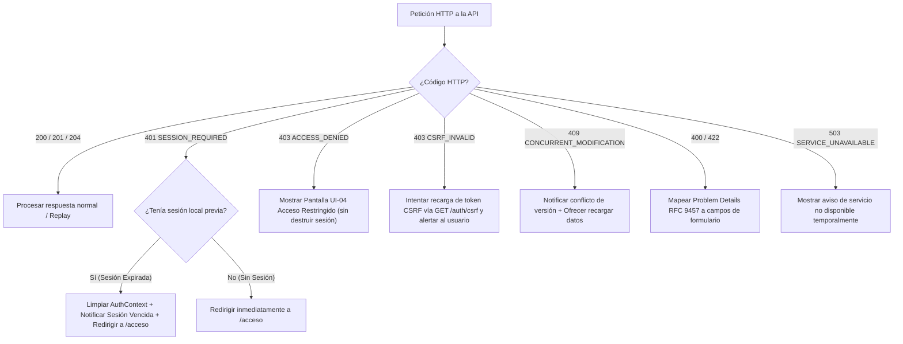
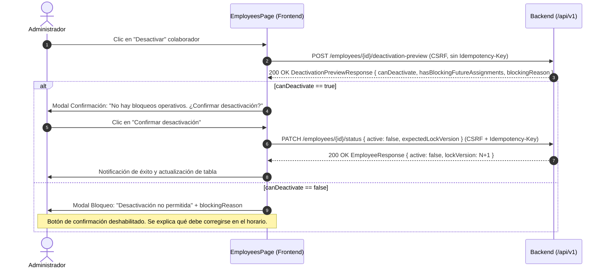
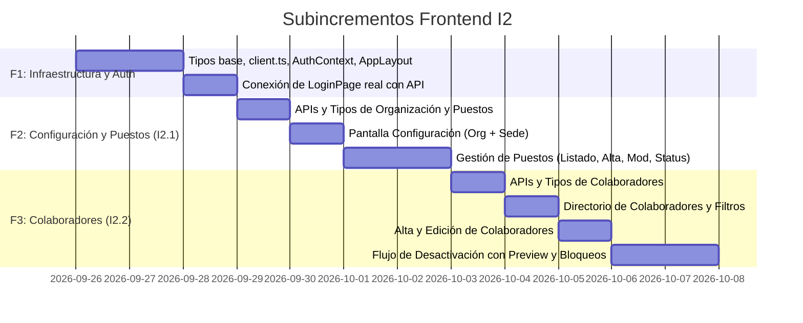

# DISEÑO TÉCNICO FRONTEND I2 — CONFIGURACIÓN, PUESTOS Y COLABORADORES

**Estado:** Propuesta de Diseño Técnico Frontend  
**Fecha:** 2026-09-25  
**Alcance cubierto:** Frontend de I2.1 (HU-05 Configuración y Sede, HU-06 Catálogo de Puestos) e I2.2 (HU-07 Gestión de Colaboradores)  
**Contrato API vigente:** `docs/api/openapi.yaml` (versión 0.2.4-i2.4)  
**Tecnologías:** React 19, TypeScript 5.7, Vite 6, CSS Tokens nativos (sin dependencias externas añadidas)  

---

## 1. Resumen Ejecutivo y Objetivos

El backend de los subincrementos I2.1 (Configuración y Puestos), I2.2 (Colaboradores), I2.3 (Políticas) e I2.4 (Indisponibilidades) se encuentra completamente implementado, probado (con 100% de tests aprobados sobre SQL Server y Testcontainers) y documentado en OpenAPI 3.1.

Este documento establece el diseño arquitectónico, funcional y visual para las pantallas e interfaces frontend pendientes de **I2.1 e I2.2**:
1. **HU-05 (Configuración de Organización y Sede Única Activa):** Consulta y actualización de datos organizacionales y nombre de la sede principal.
2. **HU-06 (Catálogo de Puestos de Trabajo):** Administración de puestos (listado, alta con código inmutable, edición de nombre y conmutación de estado activo/inactivo).
3. **HU-07 (Gestión de Colaboradores / Empleados):** Directorio de colaboradores, filtros operativos, alta, edición, conmutación de estado y desactivación segura guiada por evaluación previa de precondiciones (`deactivation-preview`).

El diseño respeta estrictamente los principios de diseño de TurnoShift: **no inventar rutas, parámetros ni capacidades que el contrato backend no soporte**, adherirse a la identidad visual sobria basada en tokens CSS ya configurados en `frontend/src/styles/tokens.css`, y mantener la seguridad: **la interfaz adapta la experiencia al usuario, pero la autorización, validación e integridad son responsabilidad exclusiva e infranqueable del servidor**.

---

## 2. Navegación, Roles y Ciclo de Vida de Sesión

### 2.1. Matriz de Navegación y Permisos por Rol

La navegación de la aplicación se adapta dinámicamente según la identidad autenticada obtenida desde `GET /api/v1/auth/session` (`AuthenticatedIdentity` con `role: ADMINISTRADOR | SUPERVISOR | COLABORADOR`).

| Ruta Frontend | Pantalla / Sección | ADMINISTRADOR | SUPERVISOR | COLABORADOR | Comportamiento si Rol No Autorizado |
|---|---|---|---|---|---|
| `/acceso` | Iniciar sesión (UI-01) | Público / Anónimo | Público / Anónimo | Público / Anónimo | Si ya hay sesión activa, redirige a su `landingPage`. |
| `/acceso-restringido` | Acceso Restringido (UI-04) | Visible informativo | Visible informativo | Visible informativo | Vista de aterrizaje ante intentos 403. |
| `/app/inicio` | Inicio operativo (UI-05) | Ver y gestionar | Ver resumen | Redirigido a `/app/mi-horario` | Redirige automáticamente a su horario personal. |
| `/app/configuracion` | Configuración y Puestos (UI-14) | **Ver y Editar** | **Solo Lectura** (catálogos de consulta) | **Denegado (403)** | Redirige a `/acceso-restringido`. |
| `/app/equipo` | Colaboradores / Directorio (UI-12) | **Ver y Editar** (alta, mod, estado) | **Solo Lectura** (consulta de equipo) | **Denegado (403)** | Redirige a `/acceso-restringido`. |
| `/app/mi-horario` | Mi Horario (UI-09) | Con acceso personal activo | Con acceso personal activo | **Landing Page principal** | Exclusivo para usuarios vinculados a colaborador. |

### 2.2. Distinción de Capacidades: Ver vs. Editar

1. **ADMINISTRADOR:**
   - Visualiza todos los campos expuestos por el contrato de configuración, puestos y empleados.
   - Tiene disponibles los controles interactivos de mutación: botones "Guardar cambios", "Nuevo puesto", "Nuevo colaborador", modales de edición, conmutadores de estado y diálogo de confirmación de desactivación.
   - Todas las mutaciones emiten cabeceras obligatorias `X-CSRF-TOKEN` e `Idempotency-Key` (UUID v4) y el campo `expectedLockVersion`.

2. **SUPERVISOR:**
   - Puede consultar la configuración de la empresa y la sede activa (`GET /organization/configuration`).
   - Puede consultar el catálogo de puestos (`GET /positions?active=`).
   - Puede consultar el directorio de colaboradores y su detalle (`GET /employees`, `GET /employees/{id}`).
   - **No visualiza ningún control de edición, creación ni borrado.** Los botones de alta, edición y conmutación de estado no se renderizan en el DOM. Si forzara una petición HTTP directamente, el backend respondería `403 ACCESS_DENIED`.

3. **COLABORADOR:**
   - Su punto de entrada predeterminado (`landingPage`) es `/app/mi-horario`.
   - No tiene acceso a los módulos de configuración ni al directorio de equipo. Los enlaces en la barra de navegación no se presentan.

### 2.3. Estados de Sesión y Manejo de Errores de Autenticación

El frontend gestiona de forma centralizada tres estados críticos de transporte y sesión:



1. **Sin Sesión (401):**
   - Detectado al arrancar la SPA mediante `GET /api/v1/auth/session` o por ausencia de sesión.
   - Redirige al usuario a la página de login (`/acceso` / `LoginPage.tsx`), recordando opcionalmente la ruta de destino original en memoria (`returnTo`).
2. **Sesión Expirada (401 sobre sesión previa):**
   - Ocurre tras 30 minutos de inactividad o superado el límite absoluto de 8 horas (`authenticatedAt`).
   - El cliente intercepta el 401, limpia el estado de autenticación en `AuthContext` y muestra un mensaje contextual en el login: *"Tu sesión ha caducado por seguridad. Por favor, inicia sesión nuevamente."*
3. **Sin Autorización (403):**
   - Acceso denegado por rol insuficiente (`ACCESS_DENIED`) o token CSRF inválido (`CSRF_INVALID`).
   - No desautentica al usuario ni borra la sesión. Renderiza la vista de acceso restringido (`/acceso-restringido`) explicando que su rol actual no tiene privilegios para realizar esa acción, con un botón para regresar a su pantalla principal autorizada.

---

## 3. Pantalla de Configuración Organizacional (HU-05)

### 3.1. Ruta y Organización Visual

- **Ruta:** `/app/configuracion` (pestaña o sección "Organización y Sede").
- **Actor:** Solo editable por `ADMINISTRADOR`. Consultable por `SUPERVISOR`.
- **Endpoint de lectura:** `GET /api/v1/organization/configuration`.

### 3.2. Mapeo de Campos y Reglas Contractuales

| Campo Visual | Campo OpenAPI | Tipo | Editable | Reglas y Restricciones |
|---|---|---|---|---|
| **Nombre de la Organización** | `displayName` | `string` | **Sí** | Longitud 1..150 caracteres. Normalización de espacios. Mutación vía `PATCH /organization/configuration/display-name`. |
| **Sede Activa** | `activeSite.name` | `string` | **Sí** | Longitud 1..150 caracteres. Sede única activa del MVP. Mutación vía `PATCH /organization/configuration/active-site/name`. |
| **Tipo de Sede** | `activeSite.isPrincipal` | `boolean` | **No** | Siempre `true` (sede principal única en MVP). Indicador visual badge tipo pill: "Sede Principal". |
| **Zona Horaria** | `timezoneId` | `string` | **No (Solo lectura)** | Identificador IANA (ej. `Europe/Madrid`). En I2.1/I2.2 es estrictamente de solo lectura para contextualizar turnos. No existe endpoint de mutación (diferido a I3 con evaluación de impacto). Mostrar badge informativo: *"Zona horaria fijada (modificación disponible en I3)"*. |
| **Versión de Concurrencia** | `lockVersion` | `integer` | **No (Técnico)** | Control de versión optimista. Se almacena en el estado del componente y se envía como `expectedLockVersion` en ambos `PATCH`. |

> [!IMPORTANT]
> **Campos restringidos no expuestos:** La API no devuelve `service_status`, `max_active_employees` ni `current_policy_version_id`. La interfaz no debe simular ni intentar consultar estos valores.

### 3.3. Flujo de Guardado, Idempotencia y Manejo de Conflictos

1. **Validación previa en cliente:**
   - Trim de espacios en blanco. Comprobar que `displayName.length >= 1 && displayName.length <= 150`.
   - Comprobar que `siteName.length >= 1 && siteName.length <= 150`.
   - Si no hay cambios con respecto al valor cargado, los botones de guardado permanecen deshabilitados.
2. **Envío de mutación:**
   - Cada guardado genera una nueva clave de idempotencia `Idempotency-Key: crypto.randomUUID()`.
   - Inyecta cabecera `X-CSRF-TOKEN` y payload `{ displayName, expectedLockVersion }` o `{ name, expectedLockVersion }`.
   - Estado del botón cambia a `saving` con spinner y texto "Guardando...".
3. **Recepción de respuesta:**
   - **200 OK:** Se actualiza el estado local con la nueva `OrganizationConfigurationResponse` recibida (incluyendo el nuevo `lockVersion` incrementado). Se muestra notificación toast: *"Configuración actualizada correctamente"*.
   - **Replay (`Idempotency-Replayed: true`):** El cliente detecta la cabecera y muestra el toast: *"Operación confirmada (repetición registrada)"*.
   - **409 `CONCURRENT_MODIFICATION`:** Otro administrador modificó la configuración simultáneamente. Se presenta un banner de advertencia con botón: *"Los datos fueron actualizados por otro usuario. [Recargar datos actuales]"*. No se sobrescriben cambios ciegamente.
   - **400 `VALIDATION_FAILED`:** Se muestran los mensajes devueltos en `errors` debajo de los campos correspondientes.

---

## 4. Gestión de Sedes y Catálogo de Puestos (HU-06)

### 4.1. Ubicación y Componentes

- **Ruta:** `/app/configuracion` (sección / pestaña "Puestos de trabajo").
- **Actor:** `ADMINISTRADOR` (gestión completa) / `SUPERVISOR` (consulta).
- **Endpoints:**
  - Listado: `GET /api/v1/positions?active=`
  - Creación: `POST /api/v1/positions`
  - Edición de nombre: `PUT /api/v1/positions/{positionId}`
  - Activación/Desactivación: `PATCH /api/v1/positions/{positionId}/status`

### 4.2. Listado, Filtros y Estados Vacíos

- **Controles de filtro:**
  - Selector de estado: `Todos` (omite parámetro), `Activos` (`?active=true`), `Inactivos` (`?active=false`).
  - Input de búsqueda rápida en cliente por nombre o código sobre la lista cargada.
- **Tabla de puestos:**
  - Columnas: Código (badge monoespaciado), Nombre del Puesto, Estado (Badge verde "Activo" / gris "Inactivo"), Acciones.
- **Estado vacío (Empty State):**
  - Si la lista está vacía y no hay filtros: Ilustración sobria en grid pattern, título *"No hay puestos de trabajo registrados"*, descripción *"Define los puestos operativos (ej. CAJERO, COCINERO) para asignarlos a tus colaboradores."* y botón principal *"Crear puesto"*.
  - Si no hay resultados para el filtro seleccionado: *"No se encontraron puestos con el criterio seleccionado."*

### 4.3. Alta de Puesto (`POST /positions`)

- Formulario en Modal o Panel Lateral accesible:
  - **Código (`code`):**
    - Input con `text-transform: uppercase`, auto-trim.
    - Validación en cliente: 2..32 caracteres, regex estricto `^[A-Z0-9-]+$`.
    - Ayuda contextual: *"Identificador único e inmutable (solo mayúsculas, números y guiones). No se podrá cambiar después."*
  - **Nombre (`name`):**
    - Input de texto, 1..100 caracteres.
- **Manejo de errores específicos:**
  - `409 POSITION_CODE_CONFLICT`: El servidor rechaza el código duplicado. La UI marca el campo `code` en rojo con el error: *"Ya existe un puesto con este código en la empresa."*
  - `400 VALIDATION_FAILED`: Mapeo RFC 9457 al campo infractor.
  - Al completar (201 Created): Se cierra el modal, se inserta el puesto en la lista y se notifica el éxito.

### 4.4. Edición de Nombre (`PUT /positions/{positionId}`)

- Al editar un puesto existente:
  - El campo **Código** se renderiza deshabilitado (`readOnly`) con un icono de candado y etiqueta *"Código inmutable"*.
  - Solo el campo **Nombre** (`name`, 1..100) es editable.
  - Se envía `expectedLockVersion`. Si devuelve 409 `CONCURRENT_MODIFICATION`, se notifica la colisión y se ofrece recargar.

### 4.5. Conmutación de Estado (`PATCH /positions/{positionId}/status`)

- Acción rápida desde la fila de la tabla (menú contextual o switch accesible):
  - Solicita confirmación ligera: *"¿Deseas desactivar el puesto [NOMBRE]? Los colaboradores asignados mantendrán su puesto, pero no podrá asignarse a nuevos colaboradores."*
  - Envía `{ active: !currentStatus, expectedLockVersion }` con `Idempotency-Key`.
  - Actualiza la fila en tiempo real con animación suave.

---

## 5. Gestión de Colaboradores (HU-07)

### 5.1. Ubicación y Estructura

- **Ruta:** `/app/equipo` (UI-12).
- **Actor:** `ADMINISTRADOR` (administración total) / `SUPERVISOR` (consulta).
- **Endpoints:**
  - Listado: `GET /api/v1/employees?status=&positionId=`
  - Detalle: `GET /api/v1/employees/{employeeId}`
  - Creación: `POST /api/v1/employees`
  - Edición parcial: `PATCH /api/v1/employees/{employeeId}`
  - Activación/Desactivación: `PATCH /api/v1/employees/{employeeId}/status`
  - Previsualización de desactivación: `POST /api/v1/employees/{employeeId}/deactivation-preview`

### 5.2. Directorio y Filtros Operativos

- **Barra de herramientas superior:**
  - Filtro por estado: `Activos` (`status=ACTIVO`, predeterminado), `Inactivos` (`status=INACTIVO`), `Todos` (`status=TODOS`).
  - Filtro por puesto: Dropdown poblado dinámicamente desde `GET /positions?active=true` (`positionId=<UUID>`).
  - Buscador reactivo en cliente (filtra por `code` o `displayName`).
  - Botón principal de acción (solo Administrador): `+ Nuevo Colaborador`.
- **Tabla de colaboradores:**
  - **Código:** Identificador de nómina o empleado (1..50 chars, font mono/tabular).
  - **Colaborador:** Nombre visible (`displayName`, 1..150 chars).
  - **Puesto:** Nombre del puesto asignado (`position.name`).
  - **Sede:** Sede asignada (`site.name`).
  - **Estado:** Badge verde (`ACTIVO`) o gris (`INACTIVO`).
  - **Acciones (solo Administrador):** Editar datos, Cambiar estado / Desactivar, Ver detalle.

### 5.3. Alta de Colaborador (`POST /employees`)

- Modal "Registrar Colaborador":
  - **Código (`code`):** Texto 1..50 caracteres.
  - **Nombre y Apellidos (`displayName`):** Texto 1..150 caracteres.
  - **Puesto de trabajo (`positionId`):** Selector desplegable obligatorio mostrando solo puestos activos.
  - *(Nota técnica: La sede no se solicita en el formulario porque la asigna el backend automáticamente a la sede única activa).*
- **Manejo de errores de negocio en alta:**
  - `409 EMPLOYEE_CODE_CONFLICT`: *"Ya existe un colaborador con este código en la organización."*
  - `409 MAX_ACTIVE_EMPLOYEES_REACHED`: Modal de límite de suscripción: *"Has alcanzado el límite máximo de colaboradores activos permitidos por tu plan. Desactiva colaboradores sin uso o contacta con el administrador del sistema."*
  - `409 INACTIVE_POSITION_ASSIGNMENT_PROHIBITED`: *"El puesto seleccionado ha sido desactivado. Por favor, selecciona un puesto activo."*

### 5.4. Edición de Colaborador (`PATCH /employees/{employeeId}`)

- Modal "Editar Colaborador":
  - **Código:** Inmutable. Se muestra solo como referencia de lectura.
  - **Nombre (`displayName`):** Editable (1..150 chars).
  - **Puesto (`positionId`):** Editable. Permite cambiar el puesto seleccionando otro puesto activo.
  - Envía `expectedLockVersion`.

### 5.5. Desactivación Segura con Evaluación de Precondiciones (Flujo Crítico)

Para cumplir con la regla de negocio y evitar que un colaborador con turnos publicados futuros sea desactivado de manera descontrolada, el frontend implementa el flujo de dos pasos:



- Si el administrador intenta desactivar:
  1. La UI llama primero a `POST /api/v1/employees/{employeeId}/deactivation-preview` mostrando un estado de carga breve en el diálogo.
  2. Si `canDeactivate === true`: Presenta el diálogo de confirmación permitiendo proceder con `PATCH /employees/{employeeId}/status`.
  3. Si `canDeactivate === false`: El diálogo se convierte en un aviso de bloqueo operativo. Muestra claramente el motivo devuelto en `blockingReason` (ej. turnos futuros asignados). El botón de confirmación permanece bloqueado, orientando al administrador a reasignar los turnos antes de desactivar.
  4. En caso de carrera (la previsualización dio true pero al confirmar el backend emite `409 EMPLOYEE_HAS_BLOCKING_ASSIGNMENTS`), se captura el error y se muestra la explicación recibida en el Problem Details.

### 5.6. Vinculación con Cuenta de Usuario y Confidencialidad

- **Estado Contractual Real:** En el contrato actual OpenAPI `v0.2.4-i2.4`, `EmployeeResponse` **no contiene** `linkedUserId`, correo de cuenta ni datos de credenciales. La creación de usuarios empresariales y el vínculo cuenta-colaborador pertenecen a HU-03 (Administración de cuentas de usuario, fuera del alcance actual).
- **Diseño Responsable:** La UI de TurnoShift **no inventa** formularios de usuario, generación de contraseñas ni switches ficticios de "Crear cuenta de acceso".
- En el modal de detalle del colaborador, se incluye una sección informativa sobria:
  > **Acceso al sistema (Cuenta de usuario):**  
  > *Las cuentas de acceso y vinculación de credenciales se configuran desde la administración de usuarios (HU-03). Este perfil representa la ficha del colaborador para turnos y descansos.*
- **Confidencialidad:** El rol `SUPERVISOR` puede consultar los colaboradores pero no ve información confidencial ni acciones administrativas.

---

## 6. Sistema de Diseño e Identidad Visual

El diseño frontend para I2 no incorpora librerías pesadas de componentes ni CSS-in-JS. Se basa exclusivamente en los tokens CSS (`tokens.css`) y patrones existentes en la aplicación:

### 6.1. Tokens y Paleta de Color Aplicada

- **Fondo de aplicación:** `var(--stone-50)` (#f7f5f2).
- **Contenedores y Tarjetas:** `var(--white)` (#ffffff) con borde `1px solid var(--stone-200)` (#e0dbd5) y sombra suave `var(--shadow-md)`.
- **Textos:**
  - Primario: `var(--stone-950)` (#0f0e0d).
  - Secundario / Etiquetas: `var(--stone-600)` (#6b6560) o `var(--stone-800)` (#2e2b28).
  - Texto atenuado / Ayuda: `var(--stone-400)` (#a8a19a).
- **Acentos de Interacción:**
  - Primario: `var(--accent)` (#b45309 - ámbar institucional sobrio), hover `var(--accent-hover)` (#92400e), foco `var(--focus-ring)` (`0 0 0 3px rgba(180, 83, 9, 0.12)`).
- **Semántica de Estados:**
  - Activo / Éxito: Fondo `var(--success-subtle)` (#dcfce7), texto `var(--success)` (#166534).
  - Inactivo / Cancelado: Fondo `var(--stone-100)` (#f0ece7), texto `var(--stone-600)` (#6b6560).
  - Advertencias / Bloqueos: Fondo `var(--accent-subtle)` (#fef3c7), texto `var(--accent-hover)` (#92400e).
  - Errores: Fondo `var(--danger-subtle)` (#fef2f2), borde `var(--danger-border)` (#fecaca), texto `var(--danger)` (#991b1b).

### 6.2. Tipografía y Números Tabulares

- Tipografía general: `var(--font-ui)` (`Inter Variable`, system-ui).
- Logotipos y títulos de sección: `var(--font-brand)` (`DM Sans`).
- **Números tabulares obligatorios (`font-variant-numeric: tabular-nums`):** Aplicados en códigos de puesto (`POS-01`), códigos de empleado (`EMP-104`), identificadores y versiones de bloqueo, garantizando alineación visual vertical en tablas.

### 6.3. Estructura de Layout (AppLayout)

```
┌──────────────────────────────────────────────────────────────────────────────────┐
│  [TS] TurnoShift  |  Empresa: Panadería Madrid  |  Juan Pérez (ADMIN)  [Cerrar] │  ← Cabecera persistente
├─────────────────┬────────────────────────────────────────────────────────────────┤
│  [Inicio]       │  Configuración Organizacional                                  │
│  [Equipo]       │  ────────────────────────────────────────────────────────────  │
│  [Configuración]│  [ Pestaña: Organización y Sede ]  [ Pestaña: Puestos ]        │  ← Contenido Principal
│                 │                                                                │
│  (Navegación    │  ┌──────────────────────────────────────────────────────────┐  │
│   adaptada      │  │ Nombre de la Organización: [ Panadería Central Madrid  ] │  │
│   por rol)      │  │ Sede Principal:            [ Obrador Central           ] │  │
│                 │  │ Zona Horaria:              Europe/Madrid (Solo lectura)  │  │
│                 │  │ [Guardar cambios]                                        │  │
│                 │  └──────────────────────────────────────────────────────────┘  │
└─────────────────┴────────────────────────────────────────────────────────────────┘
```

- **Escritorio:** Barra lateral izquierda fija (240px) y área de trabajo central con scroll independiente (`max-width: 1200px`).
- **Móvil (< 640px):** Barra de navegación colapsable en menú hamburguesa o barra inferior fija; tablas transformadas en tarjetas apiladas de lista.

---

## 7. Arquitectura Frontend y Gestión de Estado

### 7.1. Estructura Modular de Archivos

```
frontend/src/
├── api/
│   ├── client.ts                 # Fetch wrapper centralizado: CSRF, cookies, Problem Details RFC 9457
│   ├── authApi.ts                # login, logout, getSession, getCsrfToken
│   ├── organizationApi.ts        # getConfiguration, updateDisplayName, updateSiteName
│   ├── positionApi.ts            # getPositions, createPosition, updatePosition, changePositionStatus
│   └── employeeApi.ts            # getEmployees, getEmployee, createEmployee, updateEmployee, changeEmployeeStatus, previewDeactivation
├── context/
│   └── AuthContext.tsx           # Contexto React de sesión (usuario, organización, rol, csrfToken, métodos de autenticación)
├── types/
│   ├── api.ts                    # ProblemDetails, FieldErrorDto, ApiError, Result<T>
│   ├── auth.ts                   # AuthenticatedUser, OrganizationSummary, SessionResponse
│   ├── organization.ts           # OrganizationConfigurationResponse, SiteResponse
│   ├── position.ts               # PositionResponse, CreatePositionRequest, UpdatePositionRequest, ChangePositionStatusRequest
│   └── employee.ts               # EmployeeResponse, CreateEmployeeRequest, UpdateEmployeeRequest, DeactivationPreviewResponse
├── components/
│   ├── layout/
│   │   ├── AppHeader.tsx         # Cabecera con datos de tenant, usuario y botón de logout
│   │   ├── AppSidebar.tsx        # Navegación con filtrado estricto por rol
│   │   └── AppLayout.tsx         # Envoltura de aplicación protegida
│   ├── ui/
│   │   ├── Button.tsx            # Botón con variantes (primary, secondary, danger) y spinner de carga
│   │   ├── Input.tsx             # Campo de texto con accesibilidad, etiquetas y errores de validación
│   │   ├── Select.tsx            # Selector desplegable estilizado
│   │   ├── Badge.tsx             # Indicadores de estado pill (Activo, Inactivo, Principal)
│   │   ├── Modal.tsx             # Diálogo accesible con focus trap y tecla Escape
│   │   ├── Toast.tsx             # Sistema de notificaciones no intrusivas para éxitos y advertencias
│   │   ├── ConfirmDialog.tsx     # Diálogo de confirmación genérico para mutaciones
│   │   └── EmptyState.tsx        # Contenedor para listas vacías
│   └── routing/
│       └── Router.tsx            # Enrutador declarativo sin librerías externas basado en History API
├── pages/
│   ├── login/
│   │   ├── LoginPage.tsx         # Login real conectado con AuthContext y authApi
│   │   └── LoginPage.css
│   ├── forbidden/
│   │   ├── ForbiddenPage.tsx     # Pantalla UI-04 para errores 403
│   │   └── ForbiddenPage.css
│   ├── configuration/
│   │   ├── ConfigurationPage.tsx # Vista principal de configuración con subsecciones
│   │   ├── ConfigurationPage.css
│   │   ├── OrganizationSection.tsx # Formulario de nombre y sede
│   │   └── PositionsSection.tsx    # Tabla y gestión de puestos de trabajo
│   └── team/
│       ├── EmployeesPage.tsx     # Directorio de colaboradores con filtros
│       ├── EmployeesPage.css
│       ├── EmployeeModal.tsx     # Alta y edición de colaborador
│       └── DeactivationModal.tsx # Diálogo de 2 pasos con deactivation-preview
└── utils/
    ├── idempotency.ts            # Generador estándar de UUID v4 para cabeceras Idempotency-Key
    └── problemDetails.ts         # Parser de errores RFC 9457 y extractor de mensajes
```

### 7.2. Cliente HTTP y Gestión de Problem Details RFC 9457

El módulo `api/client.ts` centraliza todas las peticiones fetch de la aplicación:

1. **Credenciales y Cookies:** Incluye siempre `credentials: 'same-origin'` para enviar automáticamente la cookie `TSESSIONID`.
2. **Protección CSRF:** En toda petición con método mutador (`POST`, `PUT`, `PATCH`, `DELETE`), extrae el token CSRF activo almacenado en `AuthContext` y lo inyecta en la cabecera `X-CSRF-TOKEN`.
3. **Parseo de Errores Problem Details:**
   - Si la respuesta tiene status `>= 400`, analiza si el `Content-Type` es `application/problem+json` o `application/json`.
   - Extrae `status`, `title`, `detail`, `code` y la lista de `errors: FieldErrorDto[]`.
   - Lanza una instancia tipada de `ApiProblemError`.
   - Si el status es `401`, dispara la acción global `onSessionExpired()` para redirigir al login.
   - Si el status es `403` por `CSRF_INVALID`, renueva el token CSRF mediante `GET /api/v1/auth/csrf` e informa la necesidad de reintentar.

---

## 8. Plan de Subincrementos Frontend (Fases F1, F2, F3)

Para garantizar un desarrollo ordenado, incremental y 100% verificable, la implementación frontend de I2 se divide en 3 subincrementos acotados:



### 8.1. F1 — Infraestructura Frontend, Autenticación y Layout Base
- **Alcance:**
  1. Crear `api/client.ts`, `api/authApi.ts`, `types/api.ts` y `types/auth.ts`.
  2. Implementar `AuthContext.tsx` con soporte para sesión real, token CSRF, login, logout y expiración de sesión.
  3. Crear componentes de layout: `AppHeader.tsx`, `AppSidebar.tsx`, `AppLayout.tsx`, `ForbiddenPage.tsx`.
  4. Conectar `LoginPage.tsx` existente al endpoint real `POST /api/v1/auth/login`.
- **Verificación focalizada:**
  - Compilación TypeScript sin errores: `npm run build` en carpeta `frontend`.
  - Prueba manual de flujo: Login exitoso con credenciales de prueba (`ADMINISTRADOR`), carga de `GET /auth/session`, visualización de datos de la empresa en la cabecera, y logout exitoso revocando la sesión.

### 8.2. F2 — Pantalla de Configuración Organizacional y Catálogo de Puestos (I2.1)
- **Alcance:**
  1. Crear `api/organizationApi.ts`, `api/positionApi.ts`, `types/organization.ts`, `types/position.ts`.
  2. Componentes UI reutilizables necesarios: `Button`, `Input`, `Select`, `Badge`, `Modal`, `Toast`, `EmptyState`.
  3. Implementar `ConfigurationPage.tsx`:
     - Sección Organización: formulario de `displayName` y `activeSite.name` con envío de `expectedLockVersion` e `Idempotency-Key`. Zona horaria en solo lectura.
     - Sección Puestos de Trabajo: tabla reactiva con filtro de activos/inactivos, modal de alta con validación de código inmutable, modal de edición de nombre, y cambio de estado con confirmación.
- **Verificación focalizada:**
  - Compilación `npm run build`.
  - Pruebas end-to-end con backend local:
    - Actualización de nombre de empresa y sede; verificar incremento de `lockVersion`.
    - Crear puesto de trabajo; comprobar detección de conflicto `409 POSITION_CODE_CONFLICT` si se repite el código.
    - Desactivar y reactivar puesto de trabajo.
    - Probar con usuario `SUPERVISOR`: verificar que los botones de edición no aparecen.

### 8.3. F3 — Directorio y Gestión de Colaboradores (I2.2)
- **Alcance:**
  1. Crear `api/employeeApi.ts` y `types/employee.ts`.
  2. Implementar `EmployeesPage.tsx`:
     - Directorio con filtros por estado (`ACTIVO`, `INACTIVO`, `TODOS`) y selector de puesto.
     - Modal de alta `EmployeeModal.tsx` con selección de puesto activo y captura de error de cupo de suscripción `409 MAX_ACTIVE_EMPLOYEES_REACHED`.
     - Modal de edición para actualizar nombre o puesto.
     - Diálogo `DeactivationModal.tsx`: ejecuta previamente `POST /api/v1/employees/{id}/deactivation-preview`; si `canDeactivate` es false, bloquea la acción y explica el motivo; si es true, permite confirmar y ejecutar el cambio de estado.
- **Verificación focalizada:**
  - Compilación `npm run build`.
  - Pruebas funcionales con backend local:
    - Listar y filtrar colaboradores por puesto y estado.
    - Crear nuevo colaborador asignándolo a un puesto.
    - Intentar desactivar colaborador con turnos/compromisos futuros y comprobar que el modal muestra el bloqueo y no permite desactivar.
    - Desactivar colaborador elegible y verificar que su estado pasa a `INACTIVO`.

---

## 9. Alcance Explícitamente Excluido

Para mantener el foco, la calidad técnica y la integridad del cronograma, quedan explícitamente fuera del frontend de I2 los siguientes elementos:

1. **Motor de turnos y generación de cuadrantes (I3):** No se implementan matrices de turnos, generadores algorítmicos ni edición semanal de turnos (UI-06, UI-07, UI-08).
2. **Pantallas completas de Indisponibilidades (I2.4 / UI-13):** Aunque la API backend de indisponibilidades está terminada, la interfaz de usuario de indisponibilidades se coordinará en su momento junto con la visualización del horario o en una fase posterior.
3. **Módulo de Administración de Cuentas de Usuario (HU-03 / UI-15):** Creación de credenciales, invitación por correo o vinculación de cuentas de colaboradores (no existen endpoints en OpenAPI actual).
4. **Modificación de Zona Horaria Organizacional:** La zona horaria permanece en solo lectura (mutación con evaluación de impacto diferida a I3).
5. **Reportes, nóminas y exportaciones CSV (I5+):** Fuera del alcance del MVP de personal.
6. **Lógica de autorización en el cliente como reemplazo de seguridad backend:** El frontend solo ajusta la experiencia de usuario; el backend sigue siendo la única autoridad de seguridad.
7. **Modificaciones a contratos OpenAPI, backend o migraciones SQL:** Este diseño se ajusta 100% al sistema backend existente sin requerir cambios adicionales.

---

## 10. Conclusión y Siguiente Paso Recomendado

El diseño técnico especificado proporciona una ruta clara, robusta y verificable para completar el frontend de I2.1 e I2.2 con cero dependencias externas añadidas, pleno apego al contrato OpenAPI v0.2.4-i2.4 y estricto respeto a los tokens de diseño preexistentes.

### Siguiente Paso Recomendado
**Crear el Plan de Implementación para la Fase F1 (Infraestructura Frontend, Autenticación y Layout Base)** en `docs/planning/24 - Plan de Implementacion Frontend F1 - Autenticacion y Layout.md`.
