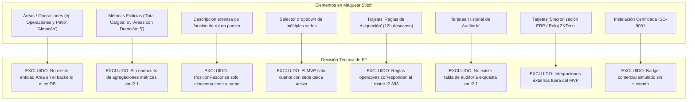
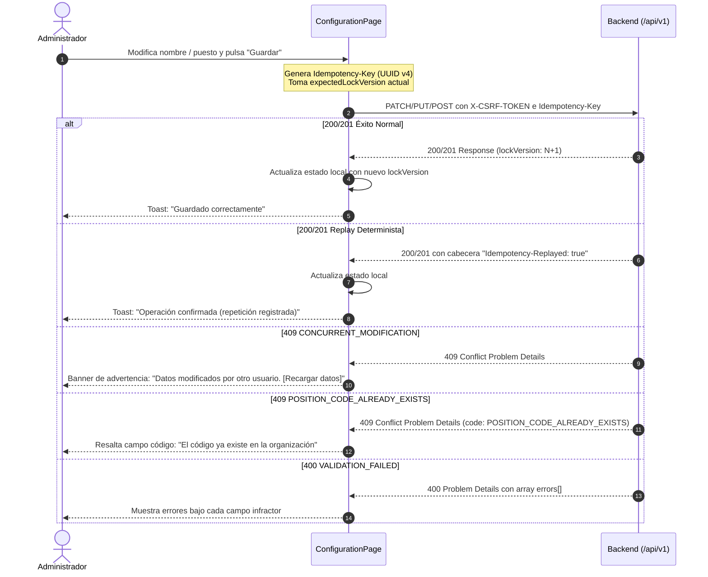

# PLAN DE IMPLEMENTACIÓN FRONTEND F2 — CONFIGURACIÓN ORGANIZACIONAL Y PUESTOS

**Estado:** Plan de Implementación  
**Fecha:** 2026-09-25  
**Documento de diseño de referencia:** `docs/planning/23 - Diseño Frontend I2 - Configuración, Puestos y Colaboradores.md`  
**Contrato API vigente:** `docs/api/openapi.yaml` (versión 0.2.4-i2.4)  
**Alcance cubierto:** Frontend de HU-05 (Configuración de Organización y Sede Única Activa) y HU-06 (Catálogo de Puestos de Trabajo).  
**Stack frontend:** React 19.0.0, TypeScript 5.7.2, Vite 6.2.0, CSS Tokens nativos (sin dependencias npm adicionales).  

---

## 1. Visión General y Objetivos de F2

El subincremento **Frontend F2** tiene como objetivo implementar las pantallas operativas y la lógica de interacción para la administración básica de la organización y el catálogo maestro de puestos de trabajo, dando vida a la ruta `/app/configuracion` y sustituyendo su placeholder actual.

La implementación se basa estrictamente en los contratos reales de la API empresarial documentados en `docs/api/openapi.yaml` e implementados en los subincrementos I2.1 de backend.

### Objetivos Principales

1. **Configuración de Organización y Sede Activa (HU-05 / UI-01):**
   - Consulta centralizada mediante `GET /api/v1/organization/configuration`.
   - Modificación del nombre visible de la empresa mediante `PATCH /api/v1/organization/configuration/display-name`.
   - Modificación del nombre de la sede activa única del MVP mediante `PATCH /api/v1/organization/configuration/active-site/name`.
   - Visualización informativa y contextual de la zona horaria institucional (`timezoneId`) en **modo estricto de solo lectura** (su mutación se difiere a I3 con evaluación previa de impacto en turnos).
   - Control estricto de concurrencia optimista (`expectedLockVersion`), cabeceras de idempotencia (`Idempotency-Key` UUID v4), detección de repeticiones (`Idempotency-Replayed: true`) y resolución amigable de colisiones `409 CONCURRENT_MODIFICATION` mediante recarga sin pérdida de contexto.

2. **Catálogo de Puestos de Trabajo (HU-06 / UI-02):**
   - Consulta y listado reactivo con `GET /api/v1/positions` soportando filtrado por estado (`active=true`, `active=false` o sin parámetro para todos).
   - Búsqueda textual rápida en cliente por código o nombre sobre el catálogo cargado.
   - Alta de puesto mediante `POST /api/v1/positions` con validación estricta de código inmutable (`^[A-Z0-9-]+$`, 2..32 caracteres, mayúsculas automáticas) y nombre (1..100 caracteres).
   - Edición descriptiva del puesto mediante `PUT /api/v1/positions/{positionId}` con código bloqueado en solo lectura y envío de `expectedLockVersion`.
   - Conmutación de estado activo/inactivo mediante `PATCH /api/v1/positions/{positionId}/status` con diálogo de confirmación contextual y `expectedLockVersion`.
   - Manejo de conflictos de código duplicado (`409 POSITION_CODE_ALREADY_EXISTS`) asignado al campo infractor.

3. **Distinción de Roles y Seguridad:**
   - **ADMINISTRADOR:** Acceso completo para consultar y editar la configuración y el catálogo de puestos.
   - **SUPERVISOR:** Acceso en **modo consulta / solo lectura**. Puede ver la configuración de la organización, la sede y el catálogo de puestos, pero **ningún control de mutación (botones de guardar, nuevo puesto, editar, conmutar estado) se renderiza en el DOM**.
   - **COLABORADOR:** Acceso denegado (redirigido automáticamente a `/acceso-restringido`).

4. **Identidad Visual Sobria y Poda de Falsedades (Honest UI):**
   - Reutilización de los tokens CSS nativos de TurnoShift (`tokens.css`, `global.css`) y estética sobria empresarial.
   - Poda estricta de elementos ficticios que aparecen en las maquetas visuales de Stitch pero que no existen en el contrato backend ni en el modelo relacional.

---

## 2. Análisis del Contrato OpenAPI vs. Maqueta Visual Stitch

### 2.1. Endpoints y Schemas Reales del Backend

| Endpoint | Método | Actor Permitido | Payload Petición | Respuesta Exitosa | Códigos de Conflicto / Error |
|---|---|---|---|---|---|
| `/organization/configuration` | `GET` | ADMIN, SUPERVISOR | — | `200 OK`<br>`OrganizationConfigurationResponse` | 401, 403, 404, 503 |
| `/organization/configuration/display-name` | `PATCH` | ADMIN | `UpdateOrganizationDisplayNameRequest`<br>`{ displayName, expectedLockVersion }` | `200 OK`<br>`OrganizationView` | 400, 401, 403, 404, `409 CONCURRENT_MODIFICATION`, 503 |
| `/organization/configuration/active-site/name` | `PATCH` | ADMIN | `UpdateActiveSiteNameRequest`<br>`{ name, expectedLockVersion }` | `200 OK`<br>`ActiveSiteView` | 400, 401, 403, 404, `409 CONCURRENT_MODIFICATION`, 503 |
| `/positions` | `GET` | ADMIN, SUPERVISOR | Query: `active` (`true`, `false`, o ausente) | `200 OK`<br>`PositionResponse[]` | 400, 401, 403, 503 |
| `/positions` | `POST` | ADMIN | `CreatePositionRequest`<br>`{ code, name }` | `201 Created`<br>`PositionResponse` | 400, 401, 403, `409 POSITION_CODE_ALREADY_EXISTS`, 503 |
| `/positions/{positionId}` | `PUT` | ADMIN | `UpdatePositionRequest`<br>`{ name, expectedLockVersion }` | `200 OK`<br>`PositionResponse` | 400, 401, 403, 404, `409 CONCURRENT_MODIFICATION`, 503 |
| `/positions/{positionId}/status` | `PATCH` | ADMIN | `ChangePositionStatusRequest`<br>`{ isActive, expectedLockVersion }` | `200 OK`<br>`PositionResponse` | 400, 401, 403, 404, `409 CONCURRENT_MODIFICATION`, 503 |

### 2.2. Campos OpenAPI y Validaciones

- **`OrganizationView`:**
  - `id`: UUID (solo lectura).
  - `displayName`: `string`, 1..150 caracteres.
  - `timezoneId`: `string` IANA (ej. `America/Bogota`), solo lectura.
  - `lockVersion`: `integer` (int64) >= 0.
- **`ActiveSiteView`:**
  - `id`: UUID (solo lectura).
  - `code`: `string` inmutable (ej. `SEDE-PRINCIPAL`).
  - `name`: `string`, 1..150 caracteres.
  - `lockVersion`: `integer` (int64) >= 0.
- **`PositionResponse`:**
  - `id`: UUID (solo lectura).
  - `code`: `string`, 2..32 caracteres, patrón `^[A-Z0-9-]+$`. Inmutable tras creación.
  - `name`: `string`, 1..100 caracteres.
  - `isActive`: `boolean`.
  - `lockVersion`: `integer` (int64) >= 0.
  - `createdAt`: ISO 8601 date-time.
  - `updatedAt`: ISO 8601 date-time.

### 2.3. Exclusión Explícita de Elementos Ficticios de Stitch

La inspección de la captura de pantalla de Stitch (`configuraci_n_y_puestos_turnoshift/screen.png`) evidencia múltiples componentes decorativos que no corresponden a la realidad funcional ni a la arquitectura de TurnoShift.



En su lugar, la interfaz de TurnoShift presentará:
- **Card 1: Organización y Sede Activa:** Formulario sobrio con inputs para nombre visible de organización y nombre de la sede activa, pastilla fija de "Sede Principal", badge de "Zona Horaria" en solo lectura con nota explicativa de su diferimiento a I3, y botones de guardado con versionado optimista.
- **Card 2: Catálogo de Puestos de Trabajo:** Barra superior con selector de filtro (`Todos`, `Activos`, `Inactivos`), buscador local en tiempo real por texto, botón `+ Nuevo Puesto` (solo Administrador), tabla limpia con números tabulares en códigos, badges verde/gris para estado, acciones directas "Editar" y "Desactivar/Activar", y empty state ante resultados vacíos.
- **Modales limpios y accesibles:** Modal de puesto con solo dos campos reales (`Código` y `Nombre`), con código bloqueado en modo edición y diálogo de confirmación para conmutar estado.

---

## 3. Arquitectura Frontend y Principios de Diseño

### 3.1. Principios Arquitectónicos Clave

1. **Distinción Estricta entre Consultas (Queries) y Mutaciones:**
   - **Consultas (`GET /organization/configuration`, `GET /positions`):**
     - Operaciones puras de lectura, seguras e idempotentes.
     - No envían cabecera `X-CSRF-TOKEN` ni `Idempotency-Key`.
     - Responden con cabecera `Cache-Control: no-store`.
     - Accesibles para roles `ADMINISTRADOR` y `SUPERVISOR`.
   - **Mutaciones (`PATCH`, `POST`, `PUT`):**
     - Operaciones de modificación de estado en el servidor.
     - Requieren obligatoriamente cabecera `X-CSRF-TOKEN` (extraída de memoria volátil) e `Idempotency-Key` (UUID v4 fresco por acción intencional).
     - Requieren control de concurrencia optimista mediante `expectedLockVersion` (enviado en el cuerpo JSON).
     - Exclusivas para el rol `ADMINISTRADOR`.

2. **Evitar Duplicar Validaciones que Pertenecen al Backend:**
   - El cliente **no debe reinventar ni duplicar** reglas de negocio complejas o validaciones que ya ejecuta de forma canónica el backend (ej. comprobaciones de unicidad en BD, collation binaria exacta, existencia previa de entidades).
   - En el frontend solo se aplican validaciones ergonómicas defensivas inmediatas:
     - `trim()` de espacios en blanco al escribir y enviar.
     - Forzado visual de mayúsculas en códigos (`text-transform: uppercase`).
     - Validación de presencia básica (`value.length > 0`) y límites físicos máximos de almacenamiento (150 chars para nombres de organización/sede, 100 chars para nombres de puesto, 32 chars para código de puesto).
   - Cualquier fallo de formato o regla de negocio (`400 VALIDATION_FAILED`, `409 POSITION_CODE_ALREADY_EXISTS`, etc.) se delega íntegramente a la interpretación estructurada de la respuesta RFC 9457 Problem Details (`ApiProblemError`), mapeando los mensajes de `errors: FieldErrorDto[]` directamente a los campos correspondientes.

3. **Ciclo de Vida de los Cinco Estados de la Interfaz:**
   - **Estado de Carga (`Loading`):**
     - Spinner discreto y sobrio (`app-loading-spinner`) mientras se completan las llamadas GET iniciales.
     - No bloquea la pantalla con overlays intrusivos; se presenta en la zona de contenido de la pestaña activa.
   - **Estado Vacío (`Empty State`):**
     - Diferenciación visual clara entre *"catálogo sin registros en la empresa"* (invitando al Administrador a crear el primer puesto) y *"búsqueda/filtro sin coincidencias"* (ofreciendo un botón para restablecer filtros).
   - **Estado de Guardado (`Saving`):**
     - Los botones de acción pasan a estado deshabilitado con spinner inline (`"Guardando..."` o `"Creando..."`) para mitigar pulsaciones múltiples accidentales.
     - Los inputs permanecen estables sin parpadeos.
   - **Estado de Conflicto de Concurrencia (`Conflict 409`):**
     - Si otra sesión actualizó la organización, sede o puesto (`CONCURRENT_MODIFICATION`), se despliega un banner de alerta persistente en la cabecera del formulario:
       > ⚠️ **Modificación concurrente detectada:** Otro usuario o sesión ha actualizado esta información recientemente.
       > `[Recargar datos actuales]`
     - Al pulsar `Recargar datos actuales`, se vuelven a solicitar los datos frescos del servidor, sincronizando el nuevo `lockVersion` sin perder el contexto de la pantalla.
   - **Estado de Acceso Restringido (`Forbidden`):**
     - La navegación oculta proactivamente enlaces y botones según el rol del usuario (`AuthContext`).
     - Para `SUPERVISOR`: la pantalla se presenta en **Modo Consulta**, con banner informativo superior y **sin renderizar en el DOM los botones de edición, creación o cambio de estado**.
     - Para `COLABORADOR`: cualquier intento directo de acceder a `/app/configuracion` es interceptado por el router y redirigido a `/acceso-restringido` (`ForbiddenPage`).

### 3.2. Estructura de Archivos a Crear y Modificar

```
frontend/src/
├── api/
│   ├── client.ts                                    # [EXISTENTE] Fetch wrapper con cookies, CSRF y Problem Details
│   ├── authApi.ts                                   # [EXISTENTE] Autenticación y sesión
│   ├── organizationApi.ts                           # [CREAR F2.1] getConfiguration, updateDisplayName, updateActiveSiteName
│   └── positionApi.ts                               # [CREAR F2.1] getPositions, createPosition, updatePosition, changePositionStatus
├── types/
│   ├── api.ts                                       # [EXISTENTE] ProblemDetails, FieldErrorDto, ApiProblemError
│   ├── auth.ts                                      # [EXISTENTE] Tipos de sesión y usuario
│   ├── organization.ts                              # [CREAR F2.1] OrganizationView, ActiveSiteView, DTOs y requests
│   └── position.ts                                  # [CREAR F2.1] PositionResponse, requests, DTOs y filtros
├── utils/
│   └── idempotency.ts                               # [CREAR F2.1] Generador de claves UUID v4 nativo con crypto.randomUUID()
├── components/
│   ├── common/
│   │   └── Icons.tsx                                # [MODIFICAR F2.2] Añadir iconos de edición, candado, check, alerta, más
│   └── layout/
│       ├── AppSidebar.tsx                           # [MODIFICAR F2.3] Habilitar enlace de configuración para Supervisor en modo 'Consulta'
│       └── AppHeader.tsx                            # [EXISTENTE]
├── pages/
│   └── configuration/
│       ├── ConfigurationPage.tsx                    # [CREAR F2.2] Contenedor principal con pestañas, estado general y banners
│       ├── ConfigurationPage.css                    # [CREAR F2.2] Estilos de la página, pestañas, alertas y formularios
│       ├── OrganizationSection.tsx                  # [CREAR F2.2] Subvista UI-01 (Nombre org, sede activa, zona horaria)
│       ├── PositionsSection.tsx                     # [CREAR F2.3] Subvista UI-02 (Tabla, filtros, empty state, acciones)
│       ├── PositionModal.tsx                        # [CREAR F2.3] Modal accesible para alta (código+nombre) y edición (nombre)
│       └── StatusConfirmModal.tsx                   # [CREAR F2.3] Diálogo accesible de confirmación para conmutar estado
└── App.tsx                                          # [MODIFICAR F2.3] Reemplazar PlaceholderPage por ConfigurationPage en /app/configuracion
```

---

## 4. Tareas Detalladas de Implementación

### Tarea F2.1: Capa de Tipos, Idempotencia y Clientes de API (I2.1)

#### 1. Crear `frontend/src/types/organization.ts`
Modelar los contratos exactos según `docs/api/openapi.yaml`:
```ts
export interface OrganizationView {
  readonly id: string;
  readonly displayName: string;
  readonly timezoneId: string;
  readonly lockVersion: number;
}

export interface ActiveSiteView {
  readonly id: string;
  readonly code: string;
  readonly name: string;
  readonly lockVersion: number;
}

export interface OrganizationConfigurationResponse {
  readonly organization: OrganizationView;
  readonly activeSite: ActiveSiteView;
}

export interface UpdateOrganizationDisplayNameRequest {
  readonly displayName: string;
  readonly expectedLockVersion: number;
}

export interface UpdateActiveSiteNameRequest {
  readonly name: string;
  readonly expectedLockVersion: number;
}
```

#### 2. Crear `frontend/src/types/position.ts`
Modelar los contratos de puestos y tipos de filtro:
```ts
export interface PositionResponse {
  readonly id: string;
  readonly code: string;
  readonly name: string;
  readonly isActive: boolean;
  readonly lockVersion: number;
  readonly createdAt: string;
  readonly updatedAt: string;
}

export interface CreatePositionRequest {
  readonly code: string;
  readonly name: string;
}

export interface UpdatePositionRequest {
  readonly name: string;
  readonly expectedLockVersion: number;
}

export interface ChangePositionStatusRequest {
  readonly isActive: boolean;
  readonly expectedLockVersion: number;
}

export type PositionStatusFilter = 'all' | 'active' | 'inactive';
```

#### 3. Crear `frontend/src/utils/idempotency.ts`
Implementar generador nativo de claves UUID v4 sin dependencias:
```ts
export function generateIdempotencyKey(): string {
  if (typeof crypto !== 'undefined' && typeof crypto.randomUUID === 'function') {
    return crypto.randomUUID();
  }
  // Fallback seguro en entornos sin crypto.randomUUID
  return 'xxxxxxxx-xxxx-4xxx-yxxx-xxxxxxxxxxxx'.replace(/[xy]/g, (c) => {
    const r = (Math.random() * 16) | 0;
    const v = c === 'x' ? r : (r & 0x3) | 0x8;
    return v.toString(16);
  });
}
```

#### 4. Crear `frontend/src/api/organizationApi.ts`
Funciones tipadas para consultar y modificar la configuración organizacional.
- Para capturar si la respuesta fue un replay determinista (`Idempotency-Replayed: true`), se puede retornar `{ data, isReplayed: boolean }` o una estructura `ApiResponseWithMeta<T>`, o soportar una opción limpia en `organizationApi`.
```ts
export interface MutationResult<T> {
  readonly data: T;
  readonly isReplayed?: boolean;
}

export const organizationApi = {
  async getConfiguration(): Promise<OrganizationConfigurationResponse> {
    return apiClient<OrganizationConfigurationResponse>('/organization/configuration', {
      method: 'GET'
    });
  },

  async updateDisplayName(
    request: UpdateOrganizationDisplayNameRequest,
    idempotencyKey: string = generateIdempotencyKey()
  ): Promise<OrganizationView> {
    return apiClient<OrganizationView>('/organization/configuration/display-name', {
      method: 'PATCH',
      headers: {
        'Idempotency-Key': idempotencyKey
      },
      body: request
    });
  },

  async updateActiveSiteName(
    request: UpdateActiveSiteNameRequest,
    idempotencyKey: string = generateIdempotencyKey()
  ): Promise<ActiveSiteView> {
    return apiClient<ActiveSiteView>('/organization/configuration/active-site/name', {
      method: 'PATCH',
      headers: {
        'Idempotency-Key': idempotencyKey
      },
      body: request
    });
  }
};
```

#### 5. Crear `frontend/src/api/positionApi.ts`
Funciones tipadas para consultar y modificar el catálogo de puestos:
```ts
export const positionApi = {
  async getPositions(active?: boolean): Promise<PositionResponse[]> {
    let endpoint = '/positions';
    if (active !== undefined) {
      endpoint += `?active=${active}`;
    }
    return apiClient<PositionResponse[]>(endpoint, {
      method: 'GET'
    });
  },

  async createPosition(
    request: CreatePositionRequest,
    idempotencyKey: string = generateIdempotencyKey()
  ): Promise<PositionResponse> {
    return apiClient<PositionResponse>('/positions', {
      method: 'POST',
      headers: {
        'Idempotency-Key': idempotencyKey
      },
      body: request
    });
  },

  async updatePosition(
    positionId: string,
    request: UpdatePositionRequest,
    idempotencyKey: string = generateIdempotencyKey()
  ): Promise<PositionResponse> {
    return apiClient<PositionResponse>(`/positions/${encodeURIComponent(positionId)}`, {
      method: 'PUT',
      headers: {
        'Idempotency-Key': idempotencyKey
      },
      body: request
    });
  },

  async changePositionStatus(
    positionId: string,
    request: ChangePositionStatusRequest,
    idempotencyKey: string = generateIdempotencyKey()
  ): Promise<PositionResponse> {
    return apiClient<PositionResponse>(`/positions/${encodeURIComponent(positionId)}/status`, {
      method: 'PATCH',
      headers: {
        'Idempotency-Key': idempotencyKey
      },
      body: request
    });
  }
};
```

#### 6. Verificación de F2.1
- Ejecutar `npm run build` en la carpeta `frontend/` y comprobar 0 errores TypeScript.

---

### Tarea F2.2: Pantalla de Configuración Organizacional y Sede Activa (UI-01)

#### 1. Actualizar `frontend/src/components/common/Icons.tsx`
Añadir iconos SVG lineales necesarios para formularios y acciones:
- `IconEdit`: lápiz de edición.
- `IconPlus`: añadir/crear.
- `IconLock`: candado para campos inmutables / solo lectura.
- `IconCheck`: marca de éxito o confirmación.
- `IconAlertTriangle`: advertencias de concurrencia y confirmación.
- `IconRefresh`: recarga de datos tras conflicto.

#### 2. Crear `frontend/src/pages/configuration/OrganizationSection.tsx`
Componente que encapsula la vista UI-01:
- **Props:**
  - `config`: `OrganizationConfigurationResponse`.
  - `isReadOnly`: `boolean` (true si el usuario tiene rol `SUPERVISOR`).
  - `onConfigUpdated`: `(newConfig: OrganizationConfigurationResponse) => void`.
  - `onConflict`: `(message: string) => void`.
- **Estructura visual:**
  - Formulario 1: **Nombre visible de la organización** (`displayName`):
    - Input de texto con `maxLength={150}`. Trim automático.
    - Botón "Guardar nombre" (visible solo si no es readOnly).
    - Deshabilitado mientras se guarda o si el valor no difiere de `config.organization.displayName`.
    - Envío con `expectedLockVersion: config.organization.lockVersion`.
  - Formulario 2: **Sede activa única** (`activeSite.name`):
    - Indicador visual fijo: Badge pill "Sede Principal" y Código inmutable (`activeSite.code`).
    - Input de texto para nombre de la sede con `maxLength={150}`.
    - Botón "Guardar sede" (visible solo si no es readOnly).
    - Envío con `expectedLockVersion: config.activeSite.lockVersion`.
  - Bloque 3: **Zona horaria institucional** (`timezoneId`):
    - Campo bloqueado (`readOnly`, fondo `var(--stone-100)`), icono de candado.
    - Nota explicativa: *"La zona horaria institucional rige la validación de turnos y descansos en toda la empresa. Su modificación requiere evaluación previa de impacto y estará disponible en el subincremento I3."*
- **Manejo de errores específicos:**
  - `409 CONCURRENT_MODIFICATION`: invoca `onConflict` con mensaje explicativo para que el contenedor ofrezca recargar los datos frescos sin pisar cambios de otros usuarios.
  - `400 VALIDATION_FAILED`: renderiza los errores de campo recibidos en `ApiProblemError.problem.errors` debajo del input respectivo (`aria-invalid="true"`, `aria-describedby`).
  - Fallo de red o 503: banner local de error permitiendo reintento seguro.

#### 3. Crear `frontend/src/pages/configuration/ConfigurationPage.tsx` y `ConfigurationPage.css`
- Contenedor principal de `/app/configuracion`:
  - Hook `useAuth()` para extraer rol del usuario (`ADMINISTRADOR` o `SUPERVISOR`).
  - Carga inicial automática de `organizationApi.getConfiguration()`.
  - Control de estados: `loading`, `error`, `success`.
  - Pestañas superiores (Tabs accesibles con `role="tablist"`):
    1. **"Organización y Sede"** (activa por defecto).
    2. **"Catálogo de Puestos"**.
  - Si el usuario es `SUPERVISOR`:
    - Muestra un banner contextual superior:
      > **Modo Consulta:** Tienes permisos de visualización sobre la configuración y los puestos de la empresa. Las modificaciones administrativas están reservadas para usuarios con rol Administrador.
  - Banner de concurrencia flotante o superior ante error 409:
    - *"Los datos fueron actualizados por otro usuario o en otra sesión. [Recargar datos actuales]"* con botón que ejecuta `loadConfiguration()` fresco.
  - Toasts de feedback tras guardado exitoso.

#### 4. Verificación de F2.2
- Ejecutar `npm run build` en `frontend/` y comprobar 0 errores TypeScript.

---

### Tarea F2.3: Catálogo y Mutaciones de Puestos de Trabajo (UI-02)

#### 1. Crear `frontend/src/pages/configuration/PositionModal.tsx`
Modal accesible para registrar o editar un puesto:
- **Accesibilidad:** `role="dialog"`, `aria-modal="true"`, `aria-labelledby`, foco inicial en el primer campo editable, cierre con tecla `Escape` y backdrop clicable.
- **Modos:**
  - **Modo Creación (`mode: 'create'`):**
    - Campo `code`:
      - Input de texto con `text-transform: uppercase`.
      - Validación en tiempo real: longitud 2..32 caracteres, regex `^[A-Z0-9-]+$`.
      - Ayuda contextual: *"Identificador único e inmutable (letras mayúsculas, números y guiones). No podrá modificarse posteriormente."*
    - Campo `name`:
      - Input de texto, 1..100 caracteres.
    - Errores de servidor:
      - Si el servidor responde `409` con código `POSITION_CODE_ALREADY_EXISTS`, marcar el campo `code` en rojo con: *"El código ingresado ya existe en la organización."*
  - **Modo Edición (`mode: 'edit'`):**
    - Campo `code`: Se presenta deshabilitado (`readOnly`, con icono de candado y etiqueta *"Código inmutable"*).
    - Campo `name`: Editable, 1..100 caracteres.
    - Envío con `expectedLockVersion: position.lockVersion`.
- Botones de acción: "Cancelar" y "Guardar puesto" / "Crear puesto", con spinner de guardado.

#### 2. Crear `frontend/src/pages/configuration/StatusConfirmModal.tsx`
Diálogo de confirmación para conmutar estado de un puesto:
- **Props:**
  - `position`: `PositionResponse | null`.
  - `isOpen`: `boolean`.
  - `onClose`: `() => void`.
  - `onConfirm`: `(position: PositionResponse) => Promise<void>`.
  - `isSubmitting`: `boolean`.
- **Contenido del diálogo:**
  - Título según acción: *"¿Desactivar puesto?"* o *"¿Activar puesto?"*.
  - Explicación contextual clara:
    - Al desactivar: *"El puesto '{name}' quedará inactivo. Los colaboradores que ya tienen asignado este puesto lo conservarán, pero no podrá asignarse a nuevos colaboradores ni seleccionarse en futuras contrataciones."*
    - Al activar: *"El puesto '{name}' volverá a estar disponible para asignaciones operativas."*
  - Botón primario: "Confirmar desactivación" (variante de advertencia) o "Confirmar activación" (variante ámbar).
  - Botón secundario: "Cancelar".

#### 3. Crear `frontend/src/pages/configuration/PositionsSection.tsx`
Subvista UI-02 del catálogo de puestos:
- **Carga de datos:**
  - Llama a `positionApi.getPositions(filter)` según el filtro seleccionado (`all`, `active`, `inactive`).
  - Estado de carga y manejo de errores.
- **Barra de herramientas superior:**
  - Selector de filtro por estado: Pills o botones segmentados:
    - `Todos` (omite parámetro `active`).
    - `Activos` (`active=true`).
    - `Inactivos` (`active=false`).
  - Campo de búsqueda rápida en cliente: input de texto que filtra instantáneamente por coincidencia insensible a mayúsculas/minúsculas en `code` o `name`.
  - Botón `+ Nuevo puesto`: Solo se renderiza si `role === 'ADMINISTRADOR'`. Al pulsar, abre `PositionModal` en modo creación.
- **Tabla de puestos (`<table>` semántica):**
  - **Columnas:**
    1. **Código:** Badge monoespaciado con fuente tabular (`font-variant-numeric: tabular-nums`).
    2. **Nombre del puesto:** Texto principal.
    3. **Estado:** Badge pill semántico:
       - Activo: fondo verde tenue `var(--success-subtle)`, texto `var(--success)`.
       - Inactivo: fondo gris `var(--stone-100)`, texto `var(--stone-600)`.
    4. **Acciones (solo visible para ADMINISTRADOR):**
       - Botón "Editar" (icono lápiz + texto): abre `PositionModal` en modo edición.
       - Botón "Desactivar" / "Activar": abre `StatusConfirmModal`.
- **Empty States:**
  - Si el catálogo está vacío en la empresa:
    - Mensaje amigable: *"No hay puestos de trabajo registrados todavía."*
    - Descripción: *"Define los puestos operativos (ej. CAJERO, COCINERO) para organizar a tu equipo."*
    - Botón "+ Registrar primer puesto" (solo Administrador).
  - Si el filtro o búsqueda no devuelve resultados:
    - *"No se encontraron puestos que coincidan con el criterio seleccionado."* con opción de limpiar filtros.

#### 4. Integrar en `App.tsx` y `AppSidebar.tsx`
- En `frontend/src/components/layout/AppSidebar.tsx`:
  - Permitir que los usuarios con rol `SUPERVISOR` vean el enlace a `/app/configuracion` con la etiqueta opcional `tag: 'Consulta'`.
- En `frontend/src/App.tsx`:
  - Importar `ConfigurationPage` desde `./pages/configuration/ConfigurationPage`.
  - Modificar la protección de `/app/configuracion`:
    ```tsx
    if (normalizedPath === '/app/configuracion') {
      if (role !== 'ADMINISTRADOR' && role !== 'SUPERVISOR') {
        return <ForbiddenPage />;
      }
      return <ConfigurationPage />;
    }
    ```

#### 5. Verificación de F2.3
- Ejecutar `npm run build` en `frontend/` y comprobar 0 errores TypeScript.

---

## 5. Idempotencia, Concurrencia Optimista y Manejo de Errores

### 5.1. Flujo de Mutaciones e Idempotencia



### 5.2. Reglas Clave de Resiliencia

1. **Clave de Idempotencia Única por Intento Intencional:**
   - Cada vez que el usuario hace clic en guardar tras editar datos, se genera una nueva clave UUID con `generateIdempotencyKey()`.
   - Si una petición falla por error de red antes de confirmarse, la reanudación conserva la clave o genera una nueva garantizando que no se reusen claves con payloads divergentes (`IDEMPOTENCY_KEY_REUSED`).
2. **Replays Deterministas:**
   - La cabecera HTTP `Idempotency-Replayed: true` devuelta por el backend no debe tratarse como un error; el cliente la reconoce como una confirmación idempotente exitosa.
3. **Control de Concurrencia Optimista (409):**
   - El cliente nunca sobrescribe ciegamente los cambios de otro administrador. Si se recibe `CONCURRENT_MODIFICATION`, se notifica al usuario y se le permite refrescar la pantalla para ver el estado más reciente de la base de datos.
4. **Validación Preventiva en Cliente:**
   - Trim de cadenas antes de comprobar longitudes.
   - Forzado de mayúsculas en el código de puesto (`input.value.toUpperCase()`).
   - Prevención de envíos vacíos o que excedan los límites físicos de base de datos (150 chars para nombres de organización/sede, 100 chars para nombres de puesto, 32 chars para código).

---

## 6. Plan de Verificación

Dado que el frontend no dispone de suite de testing unitario instalada en `package.json`, la verificación técnica estandarizada e irrefutable es la compilación completa de TypeScript y el empaquetado de producción con Vite:

```powershell
cd frontend
npm run build
```

**Criterios de Éxito de Compilación:**
- Cero errores en TypeScript compiler (`tsc -b`).
- Cero advertencias críticas en el empaquetador Vite.
- Generación limpia de assets en `frontend/dist/`.

**Verificación Funcional Local (Reservada para fase interactiva):**
1. **HU-05 (Configuración):**
   - Iniciar sesión como `ADMINISTRADOR`.
   - Navegar a `/app/configuracion`.
   - Verificar carga de nombre de empresa, nombre de sede y zona horaria (solo lectura).
   - Modificar nombre de empresa y verificar guardado e incremento de `lockVersion`.
   - Modificar nombre de sede y verificar guardado e incremento de `lockVersion`.
2. **HU-06 (Puestos):**
   - Listar puestos, probar filtros `Todos`, `Activos` e `Inactivos`.
   - Crear un nuevo puesto con código válido (ej. `CAJ-01`) y nombre.
   - Intentar crear otro puesto con el mismo código `CAJ-01` y comprobar que la interfaz marca el error 409 de código duplicado.
   - Editar el nombre de un puesto existente y verificar que el código está deshabilitado.
   - Desactivar un puesto y comprobar el cambio a badge gris "Inactivo". Reactivarlo y verificar badge verde "Activo".
3. **Verificación de Rol SUPERVISOR:**
   - Iniciar sesión con usuario `SUPERVISOR`.
   - Navegar a `/app/configuracion`.
   - Verificar que se muestra el aviso de "Modo Consulta".
   - Verificar que **no** aparecen botones para editar nombre de empresa, nombre de sede, crear puestos, editar puestos ni conmutar estados.

---

## 7. Próximo Paso Inmediato

Una vez aprobado este plan, se procederá con la implementación de la primera subtarea:

👉 **Subtarea F2.1 — Capa Base de Tipos, Idempotencia y Clientes de API (I2.1)**
- Creación de `frontend/src/types/organization.ts`.
- Creación de `frontend/src/types/position.ts`.
- Creación de `frontend/src/utils/idempotency.ts`.
- Creación de `frontend/src/api/organizationApi.ts`.
- Creación de `frontend/src/api/positionApi.ts`.
- Verificación con `npm run build`.
