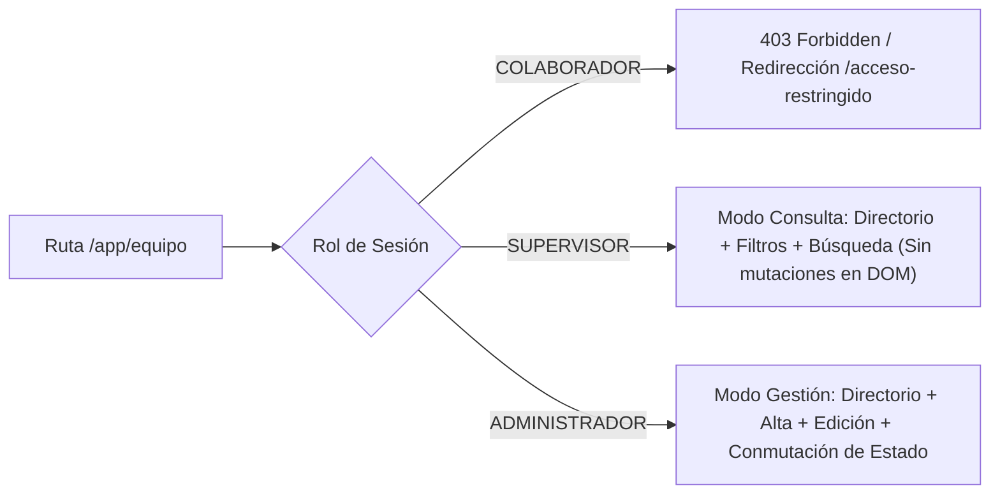
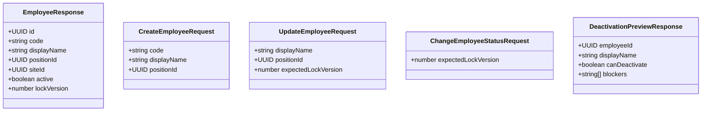
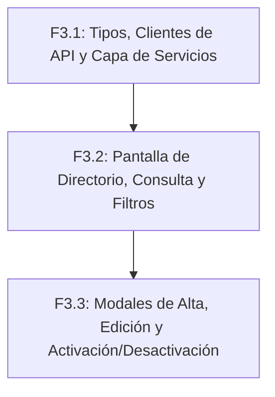

# PLAN DE IMPLEMENTACIÓN FRONTEND F3 — DIRECTORIO Y GESTIÓN DE COLABORADORES (HU-07)

**Estado:** Plan de Implementación  
**Fecha:** 2026-09-25  
**Documento de diseño de referencia:** `docs/planning/23 - Diseño Frontend I2 - Configuración, Puestos y Colaboradores.md`  
**Contrato API vigente:** `docs/api/openapi.yaml` (versión 0.2.4-i2.4)  
**Alcance cubierto:** Frontend de HU-07 (Directorio de Colaboradores, Alta, Edición, Activación y Desactivación con Evaluación Previa de Precondiciones).  
**Stack frontend:** React 19.0.0, TypeScript 5.7.2, Vite 6.2.0, CSS Tokens nativos (sin dependencias npm adicionales).  

---

## 1. Visión General y Objetivos de F3

El subincremento **Frontend F3** implementa la interfaz de usuario y la lógica de interacción para el **Directorio y Gestión de Colaboradores** de la organización, reemplazando el placeholder actual en la ruta `/app/equipo`.

Esta implementación se sustenta exclusivamente en los endpoints, esquemas, roles y comportamientos del backend implementados en el subincremento I2.2 y documentados en el contrato `docs/api/openapi.yaml`.



---

## 2. Análisis del Contrato OpenAPI vs. Maqueta Visual Stitch

### 2.1. Endpoints Reales del Backend para Colaboradores

| Endpoint | Método | Roles Permitidos | Payload de Entrada | Respuesta Exitosa | Códigos de Conflicto y Error RFC 9457 |
|---|---|---|---|---|---|
| `/employees` | `GET` | ADMIN, SUPERVISOR | Query: `active` (`true`, `false`, omitido) | `200 OK`<br>`EmployeeResponse[]` | 400 `VALIDATION_FAILED`, 401 `SESSION_REQUIRED`, 403 `ACCESS_DENIED`, 503 `SERVICE_UNAVAILABLE` |
| `/employees` | `POST` | ADMIN | `CreateEmployeeRequest`<br>`{ code, displayName, positionId }` | `201 Created`<br>`EmployeeResponse` | 400 `VALIDATION_FAILED`, 401 `SESSION_REQUIRED`, 403 `ACCESS_DENIED`/`CSRF_INVALID`, 404 `POSITION_NOT_FOUND`, 409 `EMPLOYEE_CODE_ALREADY_EXISTS`, `POSITION_INACTIVE`, `NO_ACTIVE_SITE`, `EMPLOYEE_LICENSE_LIMIT_REACHED`, `IDEMPOTENCY_KEY_REUSED`, `IDEMPOTENCY_KEY_EXPIRED`, 503 |
| `/employees/{employeeId}` | `GET` | ADMIN, SUPERVISOR | Path: `employeeId` (UUID) | `200 OK`<br>`EmployeeResponse` | 400, 401, 403, 404 `EMPLOYEE_NOT_FOUND`, 503 |
| `/employees/{employeeId}` | `PATCH` | ADMIN | `UpdateEmployeeRequest`<br>`{ displayName?, positionId?, expectedLockVersion }` | `200 OK`<br>`EmployeeResponse` | 400 `VALIDATION_FAILED`, 401, 403, 404 `EMPLOYEE_NOT_FOUND`, `POSITION_NOT_FOUND`, 409 `CONCURRENT_MODIFICATION`, `POSITION_INACTIVE`, `IDEMPOTENCY_KEY_REUSED`, `IDEMPOTENCY_KEY_EXPIRED`, 503 |
| `/employees/{employeeId}/activate` | `POST` | ADMIN | `ChangeEmployeeStatusRequest`<br>`{ expectedLockVersion }` | `200 OK`<br>`EmployeeResponse` | 400 `VALIDATION_FAILED`, 401, 403, 404 `EMPLOYEE_NOT_FOUND`, 409 `CONCURRENT_MODIFICATION`, `EMPLOYEE_LICENSE_LIMIT_REACHED`, `IDEMPOTENCY_KEY_REUSED`, `IDEMPOTENCY_KEY_EXPIRED`, 503 |
| `/employees/{employeeId}/deactivate` | `POST` | ADMIN | `ChangeEmployeeStatusRequest`<br>`{ expectedLockVersion }` | `200 OK`<br>`EmployeeResponse` | 400 `VALIDATION_FAILED`, 401, 403, 404 `EMPLOYEE_NOT_FOUND`, 409 `CONCURRENT_MODIFICATION`, `IDEMPOTENCY_KEY_REUSED`, `IDEMPOTENCY_KEY_EXPIRED`, 503 |
| `/employees/{employeeId}/deactivation-preview` | `POST` | ADMIN | Path: `employeeId` (Sin cuerpo) | `200 OK`<br>`DeactivationPreviewResponse`<br>`{ employeeId, displayName, canDeactivate, blockers }` | 400 `VALIDATION_FAILED`, 401 `SESSION_REQUIRED`, 403 `ACCESS_DENIED`/`CSRF_INVALID`, 404 `EMPLOYEE_NOT_FOUND`, 503 |

### 2.2. Estructura Exacta de Schemas de Colaboradores



- **`EmployeeResponse`:**
  - `id`: UUID único e inmutable del colaborador.
  - `code`: Código alfanumérico único (`^[A-Z0-9-]+$`, 2..32 chars), inmutable tras su registro.
  - `displayName`: Nombre visible o completo (1..100 chars tras trim).
  - `positionId`: UUID del puesto de trabajo asignado.
  - `siteId`: UUID de la sede asignada (asociada automáticamente a la sede activa única en el alta).
  - `active`: Booleano que define si el colaborador está habilitado para turnos y operaciones.
  - `lockVersion`: Versión de concurrencia optimista (`number` int64 >= 0).
- **`CreateEmployeeRequest`:**
  - `code` (requerido), `displayName` (requerido), `positionId` (requerido). Sede asignada internamente por backend.
- **`UpdateEmployeeRequest`:**
  - Requiere `expectedLockVersion`. Al menos uno entre `displayName` y `positionId` debe estar presente. `code` y `siteId` son inmutables.
- **`DeactivationPreviewResponse`:**
  - `canDeactivate`: Booleano que determina si la desactivación está permitida sin bloqueos operativos.
  - `blockers`: Arreglo de cadenas explicando los impedimentos cuando `canDeactivate` es falso.

### 2.3. Poda Estricta de Elementos Ficticios de Stitch (Honest UI)

La inspección de la maqueta de Stitch (`equipo_turnoshift/screen.png`) contiene artefactos gráficos y conceptos que **no existen en la arquitectura ni en el contrato OpenAPI**. Se declaran explícitamente excluidos:

| Elemento en Maqueta Stitch | Realidad Técnica en OpenAPI | Decisión de Implementación |
|---|---|---|
| **Correo electrónico en filas (`rodrigo.m@dla.cl`)** | `EmployeeResponse` NO expone email. El correo pertenece a `app_users` y el vínculo cuenta-colaborador no expone credenciales ni emails en HU-07. | **EXCLUIDO.** La tabla no renderiza columnas de correo de cuenta. |
| **Fotos de perfil / Avatares reales** | No existe servicio de almacenamiento ni campos de fotos en `EmployeeResponse`. | **EXCLUIDO.** Se utilizan glifos circulares con iniciales generados en CSS nativo a partir de `displayName`. |
| **Búsqueda por RUT/Cédula** | El backend no almacena documentos de identidad fiscal; solo el código operativo `code`. | **EXCLUIDO.** El placeholder del buscador será: *"Buscar por código o nombre..."*. |
| **Banner "Capacidad de Operación 96% / 48 de 50 contratados"** | No existe endpoint de consulta de cuota ni agregación de licencias en I2. El límite se manifiesta únicamente como `409 EMPLOYEE_LICENSE_LIMIT_REACHED`. | **EXCLUIDO.** No se renderizan banners con porcentajes o números no respaldados por endpoints reales. |
| **Tarjetas de métricas ("Personal Total", "Turno Activo Hoy", "Licencias / Permisos")** | No existen turnos activos ni agregaciones en I2. Las indisponibilidades se planifican en I2.4/I3 y no hay endpoint de conteo en HU-07. | **EXCLUIDO.** No se inventan tarjetas métricas ni contadores sin API. |
| **Botón "Exportar"** | No existe endpoint de exportación CSV/Excel en el contrato OpenAPI. | **EXCLUIDO.** No se colocan botones de descarga ficticios. |
| **Paginación ("Página 1 de 10")** | `GET /employees` devuelve un arreglo plano completo `EmployeeResponse[]`. | **EXCLUIDO.** La lista se renderiza completa en la tabla con scroll vertical y filtrado reactivo en cliente. |
| **Estados "Licencia médica" en tabla** | En HU-07 el estado del colaborador es estrictamente booleano (`active: true | false`). Las indisponibilidades pertenecen a HU-08. | **EXCLUIDO.** Los badges de estado son exclusivamente `Activo` (verde) e `Inactivo` (gris). |
| **Vinculación con cuenta de usuario / Login** | No existe endpoint de invitación de usuario ni creación de cuenta desde la pantalla de colaboradores. | **EXCLUIDO.** El modal de alta/edición no incluye opciones de cuenta de usuario ni contraseñas. |

---

## 3. Especificación Funcional de las Vistas

### 3.1. Consulta de Colaboradores (`/app/equipo`)

- **Ruta:** `/app/equipo`.
- **Control de Acceso (RBAC):**
  - `ADMINISTRADOR`: Acceso completo a consulta y acciones de mutación.
  - `SUPERVISOR`: Acceso completo a consulta y filtros. Los botones de mutación (*"+ Nuevo colaborador"*, *"Editar"*, *"Desactivar"*, *"Activar"*) no se renderizan en el DOM. Se muestra un banner contextual sobrio indicando *"Modo consulta"*.
  - `COLABORADOR`: Acceso denegado, redirigido a `/acceso-restringido`.
- **Fuentes de Datos:**
  - Colaboradores: `GET /api/v1/employees` (opcionalmente filtrado por `active`).
  - Catálogo de Puestos: `GET /api/v1/positions` para resolver `positionId → position.name`.
  - Configuración Organizacional: `GET /api/v1/organization/configuration` para resolver `siteId → activeSite.name`.
- **Filtros en Barra de Herramientas:**
  1. **Filtro de Estado:** Botones conmutadores o selector: `Todos`, `Activos` (`active=true`), `Inactivos` (`active=false`).
  2. **Filtro de Puesto:** Selector desplegable con los puestos disponibles (`Todos los puestos` o puesto específico por `positionId`).
  3. **Búsqueda Textual:** Input reactivo que filtra en cliente por coincidencia parcial de `code` o `displayName` (case-insensitive).
- **Columnas de la Tabla:**
  1. `Código`: Badge alfanumérico en fuente monoespaciada (`code`).
  2. `Colaborador`: Avatar con iniciales en círculo neutro + `displayName` en peso seminegrita.
  3. `Puesto Operativo`: Nombre descriptivo del puesto resuelto desde el catálogo (`position.name`). Si el puesto no se encuentra o fue eliminado lógicamente, se muestra `"Puesto no disponible"`.
  4. `Sede`: Nombre de la sede activa resuelta (`activeSite.name`).
  5. `Estado`: Badge pill (`Activo` en verde, `Inactivo` en gris piedra).
  6. `Acciones` (solo visible para `ADMINISTRADOR`):
     - Botón *"Editar"*: Abre modal de modificación.
     - Botón *"Desactivar"* (si `active: true`): Abre modal de confirmación con previsualización evaluativa.
     - Botón *"Activar"* (si `active: false`): Abre modal de confirmación de activación.
- **Estados de la Pantalla:**
  - `Cargando`: Spinner sobrio o indicador de carga empresarial.
  - `Error de Carga`: Mensaje de error RFC 9457 con botón de reintento manual.
  - `Catálogo Vacío Total`: Tarjeta ilustrada sobria informando que no hay colaboradores registrados, con botón para crear el primero (si es administrador).
  - `Sin Coincidencias de Filtro`: Mensaje claro informando que no hay resultados para el término o filtros aplicados, con botón para *"Restablecer filtros"*.

### 3.2. Alta de Colaborador (Modal)

- **Actor:** Exclusivamente `ADMINISTRADOR`.
- **Campos del Formulario:**
  - `Código del Colaborador` (`code`):
    - Input de texto, required, normalización automática a mayúsculas.
    - Validación: `^[A-Z0-9-]+$`, 2 a 32 caracteres.
    - Indicador de ayuda: *"Identificador único inmutable dentro de la empresa (ej. EMP-010)."*
  - `Nombre Completo / Visible` (`displayName`):
    - Input de texto, required.
    - Validación: 1 a 100 caracteres tras trim.
  - `Puesto de Trabajo` (`positionId`):
    - Selector desplegable (`<select>`).
    - Solo muestra puestos con `isActive === true` del catálogo cargado. Si no hay puestos activos, se muestra advertencia de que debe crearse o activarse un puesto primero.
  - `Sede Asignada`:
    - Campo de solo lectura contextualizado que muestra el nombre de la sede activa única actual (`activeSite.name`), indicando que se asigna automáticamente.
- **Flujo de Envío e Idempotencia:**
  - Generación de `Idempotency-Key` (UUID v4) mediante `crypto.randomUUID()`.
  - Retención de la intención ante error de red (`err.isNetworkError`) comparando operación `create`, `code`, `displayName` y `positionId`.
  - En caso de éxito: inserción en el estado local si coincide con el filtro activo, cierre de modal y banner de éxito.
  - Manejo de Errores RFC 9457:
    - `409 EMPLOYEE_CODE_ALREADY_EXISTS`: Mensaje de error vinculado al campo `code`.
    - `409 POSITION_INACTIVE`: Mensaje vinculado al campo `positionId` solicitando seleccionar otro puesto.
    - `409 EMPLOYEE_LICENSE_LIMIT_REACHED`: Banner de alerta de límite de colaboradores alcanzado.
    - `409 NO_ACTIVE_SITE`: Alerta de que la organización no tiene sede activa configurada.
    - `400 VALIDATION_FAILED`: Mapeo a los campos específicos.

### 3.3. Edición de Colaborador (Modal)

- **Actor:** Exclusivamente `ADMINISTRADOR`.
- **Campos del Formulario:**
  - `Código`: Campo de texto en modo de solo lectura (bloqueado/deshabilitado con indicación de inmutabilidad).
  - `Sede`: Campo de solo lectura con la sede asignada.
  - `Nombre Completo / Visible` (`displayName`): Editable, 1 a 100 caracteres.
  - `Puesto de Trabajo` (`positionId`): Editable mediante selector con puestos activos. Permite mantener el puesto actual aunque estuviese inactivo.
- **Control de Concurrencia Optimista e Idempotencia:**
  - Envío de `expectedLockVersion: selectedEmployee.lockVersion`.
  - Retención de clave de idempotencia ante error de red verificando `operation: 'edit'`, `employeeId`, `displayName`, `positionId` y `expectedLockVersion`.
  - Manejo de Conflictos:
    - `409 CONCURRENT_MODIFICATION`: Cierre de modal o banner con aviso de modificación concurrente y botón para recargar el catálogo.
    - `409 POSITION_INACTIVE`: Alerta de puesto inactivo.
    - `404 EMPLOYEE_NOT_FOUND`: Alerta de colaborador inexistente.

### 3.4. Activación y Desactivación de Colaborador (Modales Contextuales)

#### A. Desactivación con Evaluación Previa (2 Pasos)
1. **Paso 1: Consulta Evaluativa sin Efectos Colaterales:**
   - Al abrir el modal de confirmación, se ejecuta de inmediato `POST /api/v1/employees/{employeeId}/deactivation-preview` con cabecera `X-CSRF-TOKEN` (sin `Idempotency-Key` ni cuerpo).
   - Mientras carga, el modal muestra un estado de evaluación (*"Evaluando condiciones operativas..."*).
2. **Paso 2A: Desactivación Bloqueada (`canDeactivate: false`):**
   - Si la respuesta indica `canDeactivate === false`:
     - Se muestra un banner de advertencia destacando que el colaborador **no puede ser desactivado en este momento**.
     - Se despliega la lista de impedimentos (`blockers: string[]`) entregada por el backend.
     - El botón de confirmación se deshabilita con mensaje explicativo.
     - Única acción permitida: *"Cerrar"*.
3. **Paso 2B: Desactivación Permitida (`canDeactivate: true`):**
   - Si `canDeactivate === true`:
     - Se muestra la confirmación neutral y verificable: *"¿Deseas desactivar al colaborador [displayName] ([code])? El colaborador quedará marcado como inactivo."*
     - Sin promesas especulativas ni afirmaciones no garantizadas por el contrato backend.
     - El botón *"Confirmar desactivación"* se habilita.
     - Al confirmar: se envía `POST /api/v1/employees/{employeeId}/deactivate` con `{ expectedLockVersion }`, cabecera `Idempotency-Key` y `X-CSRF-TOKEN`.
     - Si la respuesta es exitosa (200), se actualiza el colaborador en el estado local.

#### B. Activación
- Diálogo de confirmación accesible con envío de `POST /api/v1/employees/{employeeId}/activate` con `{ expectedLockVersion }`, cabecera `Idempotency-Key` y `X-CSRF-TOKEN`.
- Manejo de conflicto `409 EMPLOYEE_LICENSE_LIMIT_REACHED` si la organización superó el cupo máximo contratado de colaboradores activos.
- Manejo de `409 CONCURRENT_MODIFICATION` si el colaborador fue modificado concurrentemente.

---

## 4. Desglose de Fases de Implementación



### 4.1. Subfase F3.1 — Tipos TypeScript y Capa de API de Colaboradores
- **Archivos a crear/editar:**
  - Crear `frontend/src/types/employee.ts`:
    - Interfaces exactas: `EmployeeResponse`, `CreateEmployeeRequest`, `UpdateEmployeeRequest`, `ChangeEmployeeStatusRequest`, `DeactivationPreviewResponse`, `EmployeeStatusFilter` (`'all' | 'active' | 'inactive'`).
  - Crear `frontend/src/api/employeeApi.ts`:
    - Métodos cliente: `getEmployees(active?)`, `getEmployee(id)`, `createEmployee(data, idempotencyKey)`, `updateEmployee(id, data, idempotencyKey)`, `activateEmployee(id, data, idempotencyKey)`, `deactivateEmployee(id, data, idempotencyKey)`, `previewDeactivation(id)`.
    - Integración con `apiClient` existente (cookies HttpOnly, `X-CSRF-TOKEN` volátil, Problem Details RFC 9457).
- **Verificación:** `npm run build` (0 errores TypeScript, 0 advertencias Vite).

### 4.2. Subfase F3.2 — Pantalla de Directorio, Navegación y Filtros
- **Archivos a crear/editar:**
  - Crear `frontend/src/pages/employees/EmployeesPage.tsx` y `EmployeesPage.css`:
    - Carga paralela de colaboradores (`employeeApi.getEmployees`), puestos (`positionApi.getPositions`) y configuración/sede (`organizationApi.getConfiguration`).
    - Dictionarios en memoria para resolución inmediata de nombres de puestos y sedes.
    - Barra de herramientas: búsqueda reactiva, filtro por estado (`Todos`, `Activos`, `Inactivos`) y filtro por puesto.
    - Tabla accesible con códigos, avatares de iniciales, puestos, sede y badges de estado.
    - Modo consulta para `SUPERVISOR`: banner contextual y exclusión total de controles de mutación en el DOM.
    - Estados visuales: carga, error con reintento, catálogo vacío y búsqueda sin coincidencias.
  - Modificar `frontend/src/App.tsx`:
    - Reemplazar el `PlaceholderPage` de `/app/equipo` por `EmployeesPage` para Administrador y Supervisor.
    - Mantener `ForbiddenPage` para Colaborador.
  - Modificar `frontend/src/pages/home/HomePage.tsx`:
    - Actualizar badges del módulo de Equipo (removiendo etiqueta de fase pendiente).
- **Verificación:** `npm run build` (0 errores TypeScript, 0 advertencias Vite).

### 4.3. Subfase F3.3 — Modales y Mutaciones Seguras con Concurrencia e Idempotencia
- **Archivos a crear/editar:**
  - Crear `frontend/src/pages/employees/EmployeeModal.tsx`:
    - Modal accesible para alta y edición de colaboradores.
    - Selector poblado exclusivamente con puestos activos del catálogo.
    - Mapeo de errores RFC 9457: código duplicado, puesto inactivo, cupo de licencia superado.
  - Crear `frontend/src/pages/employees/EmployeeStatusModal.tsx`:
    - Modal de conmutación de estado con flujo de 2 pasos para desactivación:
      - Ejecución de `previewDeactivation`.
      - Despliegue de `blockers` cuando `canDeactivate` es falso.
      - Confirmación neutral cuando `canDeactivate` es verdadero.
    - Confirmación directa de activación con captura de `EMPLOYEE_LICENSE_LIMIT_REACHED`.
  - Integrar en `EmployeesPage.tsx`:
    - Gestión de intenciones de idempotencia con `PendingOperationIntent`:
      ```typescript
      type PendingEmployeeIntent =
        | { readonly operation: 'create'; readonly key: string; readonly code: string; readonly displayName: string; readonly positionId: string }
        | { readonly operation: 'edit'; readonly key: string; readonly employeeId: string; readonly displayName?: string; readonly positionId?: string; readonly expectedLockVersion: number }
        | { readonly operation: 'activate'; readonly key: string; readonly employeeId: string; readonly expectedLockVersion: number }
        | { readonly operation: 'deactivate'; readonly key: string; readonly employeeId: string; readonly expectedLockVersion: number };
      ```
    - Retención estricta ante errores de red y regeneración de clave ante cambios de payload o nueva operación.
- **Verificación:** `npm run build` (0 errores TypeScript, 0 advertencias Vite).

---

## 5. Matriz de Componentes y Responsabilidades

| Componente | Ruta / Archivo | Responsabilidad Principal |
|---|---|---|
| **`employee.ts`** | `src/types/employee.ts` | Modelado estricto de tipos según `docs/api/openapi.yaml`. |
| **`employeeApi.ts`** | `src/api/employeeApi.ts` | Funciones tipadas HTTP hacia los 7 endpoints de colaboradores. |
| **`EmployeesPage`** | `src/pages/employees/EmployeesPage.tsx` | Contenedor principal, carga coordinada, filtros, búsqueda, tabla y gestión de intenciones de idempotencia. |
| **`EmployeeModal`** | `src/pages/employees/EmployeeModal.tsx` | Diálogo accesible para creación (código, nombre, puesto) y edición (nombre, puesto) con validación contextual. |
| **`EmployeeStatusModal`** | `src/pages/employees/EmployeeStatusModal.tsx` | Diálogo accesible para activación y desactivación con evaluación previa de `blockers`. |
| **`App.tsx`** | `src/App.tsx` | Enrutamiento protegido de `/app/equipo` hacia `EmployeesPage` con RBAC. |

---

## 6. Verificación y Criterios de Aceptación

1. **Compilación y Tipado:**
   - La única verificación requerida por subfase es `cd frontend; npm run build`.
   - Cero errores de compilación TypeScript (`tsc -b`) y cero advertencias de Vite.
   - Sin instalación de frameworks adicionales de test en el frontend (Jest, Vitest, Cypress o Playwright).
2. **Fidelidad Contractual OpenAPI:**
   - Cero campos inventados: no existen correos de colaboradores, fotos de perfil, fechas de nacimiento, salarios ni vinculaciones de login.
   - Respeto estricto del código inmutable y de la asignación automática de sede activa única.
   - Respeto del control optimista de concurrencia (`expectedLockVersion`) y de las claves de idempotencia (`Idempotency-Key` UUID v4).
3. **Seguridad y RBAC:**
   - `COLABORADOR`: Redirigido a `/acceso-restringido`.
   - `SUPERVISOR`: Puede consultar el directorio y aplicar filtros, pero ningún botón de alta, edición ni cambio de estado se renderiza en el DOM.
   - `ADMINISTRADOR`: Capacidad total de gestión.
4. **Verificación Manual End-to-End:**
   - La prueba interactiva completa con servidor backend local y base de datos SQL Server queda reservada para la fase de preparación de demo.
