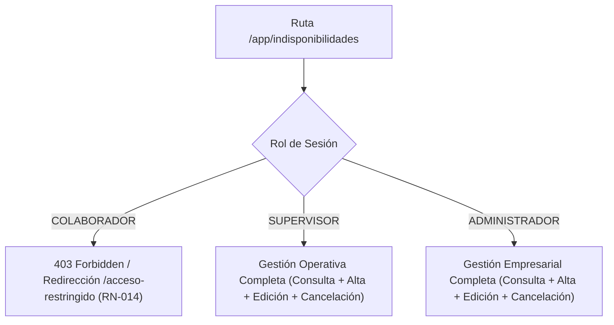
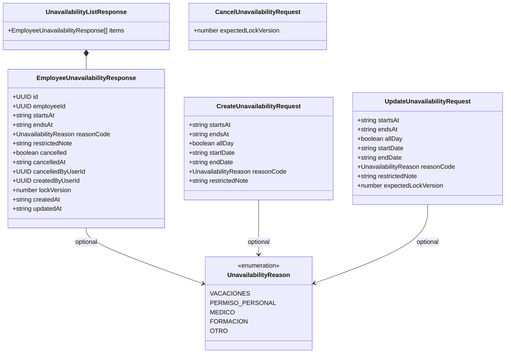
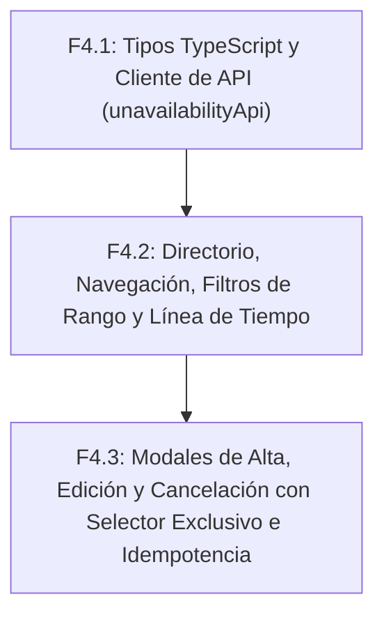

# PLAN DE IMPLEMENTACIÓN FRONTEND F4 — INDISPONIBILIDADES DE COLABORADORES (HU-08 / HU-10)

**Estado:** Plan de Implementación  
**Fecha:** 2026-09-25  
**Documentos de diseño técnico de referencia:**
- `docs/planning/19 - Diseño Técnico I2.4 - Indisponibilidades.md`
- `docs/planning/22 - Plan de Implementación I2.4-c - API HTTP e Idempotencia.md`
- `docs/planning/23 - Diseño Frontend I2 - Configuración, Puestos y Colaboradores.md`
**Contrato API vigente:** `docs/api/openapi.yaml` (versión 0.2.4-i2.4)  
**Alcance funcional:** Frontend de HU-08 (denominada HU-10 en diseño técnico): Consulta organizacional y por colaborador, Registro, Modificación y Cancelación lógica de indisponibilidades bajo concurrencia optimista e idempotencia.  
**Stack frontend:** React 19.0.0, TypeScript 5.7.2, Vite 6.2.0, CSS nativo con variables de diseño (sin librerías npm adicionales).  

---

## 1. Visión General y Objetivos de F4

El subincremento **Frontend F4** implementa la interfaz de usuario para el registro, consulta, modificación y cancelación de los periodos de **indisponibilidad de personal** de la organización.

Este módulo completa el soporte visual del núcleo de personal del Incremento 2 (**I2: Gestión de personal y estructura organizativa**), proveyendo los datos de restricción que consumirá el futuro motor de planificación y validación de turnos (**I3: Planificación de turnos**).



### 1.1. Principios de Diseño y Reglas Fundamentales de Negocio
1. **Acceso Dual de Gestión (Admin y Supervisor):** A diferencia de configuración organizacional (HU-05) y puestos (HU-06) donde solo el Administrador muta datos, en indisponibilidades (HU-08 / HU-10) **tanto el Administrador como el Supervisor tienen permisos completos de mutación y consulta** en el backend (`SecurityConfig.java`), reflejando la necesidad de que el supervisor en planta atienda ausencias sobrevenidas y permisos imprevistos.
2. **Confidencialidad de Motivos y Notas (RN-014):** El rol `COLABORADOR` no tiene acceso a este módulo ni a endpoints de indisponibilidades de otros trabajadores. Las notas restringidas (`restrictedNote`) contienen datos sensibles (médicos o personales) y solo son visibles para Administradores y Supervisores.
3. **Sin Presunción de Disponibilidad (RN-012):** La ausencia de una indisponibilidad registrada significa estrictamente *"sin restricción registrada"*; no constituye una confirmación explícita de disponibilidad del trabajador.
4. **Permisividad de Solapamientos entre Indisponibilidades (RN-017 / §4.4 de Diseño Técnico 19):**
   - Las indisponibilidades superpuestas para un mismo colaborador **están permitidas por diseño** en la base de datos y la API (se interpretan como la unión de intervalos sin duplicación de horas).
   - **No existe ningún código de error `UNAVAILABILITY_OVERLAP`** en el contrato backend ni en Problem Details RFC 9457.
   - La validación de compatibilidad temporal contra turnos publicados y la detección de incompatibilidades pertenece estrictamente al motor de planificación de **I3**.
5. **Protección de Periodos Iniciados o Pasados (RN-013):**
   - No se permite cancelar ni modificar una indisponibilidad si su periodo ya inició (`startsAt <= now`).
   - No se permite modificar una indisponibilidad si su nuevo intervalo inicia en el pasado (`newStartsAt <= now`).
   - No se permite registrar una indisponibilidad en un periodo que ya haya finalizado por completo (`endsAt <= now`). Se permiten registros que hayan comenzado en el pasado siempre que su finalización sea estrictamente futura (`endsAt > now`).
6. **Formatos Temporales Mutuamente Excluyentes (RN-015, RN-016):**
   - **Formato A (Parcial por horas):** `startsAt` y `endsAt` en UTC ISO-8601 (`startsAt < endsAt`).
   - **Formato B (Día completo local):** `allDay: true`, `startDate` (inclusiva `YYYY-MM-DD`) y `endDate` (exclusiva `YYYY-MM-DD`). La conversión canónica a UTC la realiza el servidor utilizando la zona horaria de la organización (`organizations.timezone_id`).
   - Queda terminantemente prohibido mezclar campos de ambos formatos (el backend responderá `400 VALIDATION_FAILED`).

---

## 2. Poda Estricta de Funcionalidades Ficticias (Honest UI)

Para preservar la viabilidad, honestidad técnica y simplicidad del MVP universitario:

| Característica de Maqueta Típica / Calendario | Realidad Contractual en OpenAPI 3.1 | Decisión de Implementación |
|---|---|---|
| **Sincronización con calendarios externos (Google Calendar, Outlook, iCal, CalDAV)** | No existe soporte ni endpoints de exportación ICS en OpenAPI. | **EXCLUIDO.** Cero botones o integraciones de calendarios externos. |
| **Flujos de solicitud, revisión o aprobación de vacaciones** | No hay portal de autoservicio de colaborador ni workflow jerárquico; la gestión es directa por Admin/Supervisor. | **EXCLUIDO.** No se crean bandejas de "Aprobar", "Rechazar" ni solicitudes pendientes. |
| **Reglas de recurrencia periódica ("todos los lunes")** | Cada indisponibilidad es un intervalo discreto y continuo sin reglas de repetición. | **EXCLUIDO.** No hay selectores de repetición ("semanal", "mensual"). |
| **Cálculo de nómina, bajas médicas o subsidios legales** | No se manejan conceptos salariales, convenios ni partes oficiales de incapacidad. | **EXCLUIDO.** No se presentan importes, subsidios ni cálculos económicos. |
| **Librerías npm pesadas de calendario (FullCalendar, React-Big-Calendar)** | No se deben agregar dependencias al `package.json`. | **EXCLUIDO.** Se implementa una vista limpia de lista cronológica / línea de tiempo con CSS nativo y controles accesibles. |
| **Paginación numérica en backend** | `GET /unavailabilities` y `GET /employees/{id}/unavailabilities` devuelven `{ items: [...] }` plano dentro de la ventana consultada. | **EXCLUIDO.** La lista se renderiza completa con scroll vertical y filtrado en cliente. |

---

## 3. Análisis del Contrato OpenAPI vs. Capa Web

### 3.1. Endpoints Reales del Backend para Indisponibilidades

| Endpoint | Método | Roles | Parámetros / Payload | Respuesta Exitosa | Códigos de Conflicto y Error RFC 9457 |
|---|---|---|---|---|---|
| `/unavailabilities` | `GET` | ADMIN, SUPERVISOR | Query: `from` (req), `to` (req), `includeCancelled` (req/opt) | `200 OK`<br>`UnavailabilityListResponse`<br>`{ items: [...] }` | 400 `VALIDATION_FAILED` (rango >92 días, fechas inválidas), 401 `SESSION_REQUIRED`, 403 `ACCESS_DENIED`, 503 `SERVICE_UNAVAILABLE` |
| `/employees/{employeeId}/unavailabilities` | `GET` | ADMIN, SUPERVISOR | Path: `employeeId`<br>Query: `from` (opt), `to` (opt), `includeCancelled` (opt) | `200 OK`<br>`UnavailabilityListResponse`<br>`{ items: [...] }` | 400 `VALIDATION_FAILED`, 401 `SESSION_REQUIRED`, 403 `ACCESS_DENIED`, 404 `EMPLOYEE_NOT_FOUND`, 503 |
| `/unavailabilities/{unavailabilityId}` | `GET` | ADMIN, SUPERVISOR | Path: `unavailabilityId` (UUID) | `200 OK`<br>`EmployeeUnavailabilityResponse` | 400 `VALIDATION_FAILED`, 401, 403, 404 `UNAVAILABILITY_NOT_FOUND`, 503 |
| `/employees/{employeeId}/unavailabilities` | `POST` | ADMIN, SUPERVISOR | Headers: `Idempotency-Key` (obligatoria), `X-CSRF-TOKEN`<br>Body: `CreateUnavailabilityRequest` | `201 Created`<br>`EmployeeUnavailabilityResponse`<br>Header: `Location` | 400 `VALIDATION_FAILED`, `PAST_INTERVAL_MODIFICATION_PROHIBITED`, 401, 403, 404 `EMPLOYEE_NOT_FOUND`, 409 `IDEMPOTENCY_KEY_REUSED`, `IDEMPOTENCY_KEY_EXPIRED`, 503 |
| `/unavailabilities/{unavailabilityId}` | `PUT` | ADMIN, SUPERVISOR | Headers: `Idempotency-Key` (obligatoria), `X-CSRF-TOKEN`<br>Body: `UpdateUnavailabilityRequest`<br>(con `expectedLockVersion`) | `200 OK`<br>`EmployeeUnavailabilityResponse` | 400 `VALIDATION_FAILED`, `PAST_INTERVAL_MODIFICATION_PROHIBITED`, 401, 403, 404 `UNAVAILABILITY_NOT_FOUND`, 409 `CONCURRENT_MODIFICATION`, `UNAVAILABILITY_ALREADY_CANCELLED`, `IDEMPOTENCY_KEY_REUSED`, `IDEMPOTENCY_KEY_EXPIRED`, 503 |
| `/unavailabilities/{unavailabilityId}/cancel` | `POST` | ADMIN, SUPERVISOR | Headers: `Idempotency-Key` (obligatoria), `X-CSRF-TOKEN`<br>Body: `CancelUnavailabilityRequest`<br>(con `expectedLockVersion`) | `200 OK`<br>`EmployeeUnavailabilityResponse` | 400 `VALIDATION_FAILED`, `PAST_INTERVAL_MODIFICATION_PROHIBITED`, 401, 403, 404 `UNAVAILABILITY_NOT_FOUND`, 409 `CONCURRENT_MODIFICATION`, `UNAVAILABILITY_ALREADY_CANCELLED`, `IDEMPOTENCY_KEY_REUSED`, `IDEMPOTENCY_KEY_EXPIRED`, 503 |

> [!IMPORTANT]
> **Obligatoriedad de Idempotency-Key:** La cabecera `Idempotency-Key` (UUID v4) es **estrictamente obligatoria** en las tres operaciones mutadoras (`createUnavailability`, `updateUnavailability`, `cancelUnavailability`). La capa de API del frontend **no debe omitirla ni permitirla como opcional (`?`)**. Cada mutación debe recibir una clave explícita para garantizar la trazabilidad y la retención determinista ante errores de red.

### 3.2. Estructura Exacta de Schemas y DTOs



---

## 4. Especificación Funcional de las Vistas y Modales

### 4.1. Navegación, Enrutamiento y Roles
- **Ruta Principal:** `/app/indisponibilidades`
- **Control de Acceso (RBAC):**
  - `ADMINISTRADOR`: Acceso completo (consulta, registro, edición y cancelación).
  - `SUPERVISOR`: Acceso completo (consulta, registro, edición y cancelación).
  - `COLABORADOR`: Acceso restringido (`403 Forbidden` / Redirección a `/acceso-restringido`).
- **Puntos de Entrada en la UI:**
  1. **Barra Lateral (`AppSidebar.tsx`):** Ítem "Indisponibilidades" con icono `IconCalendar` para Administrador y Supervisor.
  2. **Directorio de Colaboradores (`EmployeesPage.tsx`):**
     - Botón en la cabecera: *"Indisponibilidades del equipo"* que navega a `/app/indisponibilidades`.
     - Acción en la tabla por colaborador: botón/enlace rápido que navega a `/app/indisponibilidades?employeeId=${emp.id}` para abrir la vista filtrada directamente sobre ese trabajador.
  3. **Página de Inicio (`HomePage.tsx`):** Módulo de accesos rápidos actualizado hacia Indisponibilidades.

### 4.2. Consulta y Filtros de Indisponibilidades (`UnavailabilitiesPage`)
- **Fuentes de Datos Coordinadas:**
  - `unavailabilityApi.getOrganizationUnavailabilities(from, to, includeCancelled)`: carga la lista de periodos en la ventana temporal requerida.
  - `employeeApi.getEmployees()`: carga el directorio de colaboradores para resolver `employeeId` a nombre visible (`displayName`) y código (`code`).
- **Gestión del Rango Temporal Obligatorio (`from` / `to`):**
  - El backend exige `from` y `to` como instantes ISO-8601 UTC obligatorios y con diferencia máxima de 92 días.
  - **Ventana por defecto en frontend:**
    - Inicio: primer día del mes actual a las `00:00:00` en la zona horaria del tenant.
    - Fin: último día del mes siguiente a las `23:59:59` en la zona horaria del tenant (aprox. 60 días).
    - Ambas fechas convertidas a instantes UTC `ISOString` para la llamada HTTP.
  - **Selector de Ventana en la Barra de Herramientas:**
    - Controles de selección de fecha `Desde` y `Hasta` en hora local.
    - Botones de acceso rápido: *"Mes actual"*, *"Próximos 30 días"*, *"Bimestre actual"*.
    - Validación client-side: `from < to` y diferencia no mayor a 90 días para evitar el error `400 VALIDATION_FAILED` del servidor.
- **Filtros Adicionales en Cliente:**
  - **Filtro por Colaborador:** Selector desplegable con buscador (`Todos los colaboradores` o selección específica).
  - **Filtro por Motivo:** Todos o filtro por `VACACIONES`, `MEDICO`, `PERMISO_PERSONAL`, `FORMACION`, `OTRO`.
  - **Filtro de Estado:** Selector entre `Solo activas` (`includeCancelled=false`) y `Todas (incluyendo canceladas)` (`includeCancelled=true`).
- **Renderizado del Listado Cronológico / Línea de Tiempo:**
  - Agrupación visual por colaborador o cronológica descendente por fecha de inicio.
  - Cada tarjeta o fila despliega:
    - **Colaborador:** Iniciales en avatar neutro + `displayName` + `code` en fuente monoespaciada.
    - **Intervalo Fechas/Horas:**
      - Formateado estrictamente con `Intl.DateTimeFormat` usando la zona horaria oficial del tenant (`session.organization.timeZone`).
      - Identificación clara de jornada completa (*"Día completo: 15 oct 2026"* o *"15 oct al 17 oct 2026"*) vs. jornada parcial (*"15 oct 2026, 14:00 – 18:00 (America/Bogota)"*).
    - **Motivo Operativo:** Badge con color semántico según `reasonCode` (ej. Vacaciones en azul cielo, Médico en ámbar, Formación en violeta, Personal en teal, Otro en gris) o *"Sin motivo"* si es nulo.
    - **Nota Restringida:** Si existe, icono discreto de confidencialidad con texto expandible protegido, recordando su privacidad.
    - **Estado:**
      - Badge `Activa` (verde esmeralda).
      - Badge `Cancelada` (gris con texto tachado, indicando fecha y autor si constan en `cancelledAt`/`cancelledByUserId`).
    - **Acciones:**
      - Botón *"Modificar"*: Habilitado si `!cancelled` y `startsAt > now`. Deshabilitado con tooltip si el periodo ya inició o está cancelado (RN-013).
      - Botón *"Cancelar"*: Habilitado si `!cancelled` y `startsAt > now`. Deshabilitado con tooltip si el periodo ya inició o está cancelado (RN-013).
- **Estados de la Pantalla:**
  - `Cargando`: Indicador accesible de carga con contexto de zona horaria.
  - `Error de Carga`: Mensaje Problem Details RFC 9457 con botón para reintentar.
  - `Ventana Vacía`: Mensaje informando que no existen indisponibilidades en el rango seleccionado, con botón para *"Registrar indisponibilidad"*.
  - `Sin Resultados por Filtro`: Mensaje claro de ausencia de coincidencias para el colaborador o motivo seleccionado, con botón *"Restablecer filtros"*.

---

### 4.3. Alta de Indisponibilidad (`UnavailabilityModal`)
- **Actor:** `ADMINISTRADOR` o `SUPERVISOR`.
- **Campos del Formulario:**
  1. `Colaborador`: Selector desplegable obligatorio (pre-seleccionado si se abrió desde la fila de un colaborador).
  2. `Modalidad Temporal` (Selector mutuamente excluyente):
     - **Opción A: Por Horas (Parcial):**
       - Campo `Fecha`: Fecha local (`YYYY-MM-DD`).
       - Campo `Hora de inicio`: Hora local (`HH:mm`).
       - Campo `Hora de fin`: Hora local (`HH:mm`).
       - Conversión a UTC: A partir de la fecha y hora seleccionada, se calcula el instante absoluto UTC `startsAt` y `endsAt` o se envían como cadenas ISO completas.
       - Validación client-side: `startsAt < endsAt` y `endsAt > now` (no registrar en periodos finalizados).
       - Los campos `allDay`, `startDate` y `endDate` se omiten o envían como `null`.
     - **Opción B: Día Completo (`allDay: true`):**
       - Campo `Fecha de inicio`: Fecha local inclusiva (`YYYY-MM-DD`).
       - Campo `Fecha de fin`: La UI recibe la fecha final inclusiva (el último día de ausencia seleccionado por el usuario, ej. `2026-10-15`).
       - **Aritmética de fecha-calendario sin conversión horaria:**
         - El cálculo de `endDate` exclusiva debe sumar exactamente 1 día calendario (`fechaFin + 1 día`).
         - **Prohibido terminantemente usar `new Date('YYYY-MM-DD')`** o constructores/métodos con conversión horaria implícita del navegador, ya que provocan saltos de día por desfases de zona horaria local o transiciones de horario de verano (DST).
         - La lógica descompone la cadena en sus componentes año, mes y día numéricos (`parts = dateStr.split('-')`), suma 1 día mediante aritmética de calendario puro (ej. usando `Date.UTC(y, m - 1, d + 1)` proyectado a formato `YYYY-MM-DD`), preservando el día calendario seleccionado sin importar la zona horaria del cliente ni transiciones DST.
         - Ejemplo determinista: si el usuario selecciona fecha inicio `2026-10-15` y fecha fin inclusiva `2026-10-15`, el cálculo genera `startDate: "2026-10-15"` y `endDate: "2026-10-16"` con `allDay: true`.
         - El backend recibe `startDate` y `endDate` y las interpreta utilizando la zona horaria oficial del tenant (`organizations.timezone_id`).
         - Los campos `startsAt` y `endsAt` se omiten o envían como `null`.
  3. `Motivo Operativo` (`reasonCode`): Selector desplegable opcional con valores `VACACIONES`, `PERMISO_PERSONAL`, `MEDICO`, `FORMACION`, `OTRO`, o *"Sin especificar"*.
  4. `Nota Restringida` (`restrictedNote`):
     - Área de texto opcional, máximo 500 caracteres UTF-16 con contador en tiempo real.
     - **Aviso de Confidencialidad Obligatorio:**
       > 🔒 **Nota confidencial:** Esta nota solo será visible para Administradores y Supervisores. No se expondrá a colaboradores ni en turnos publicados (RN-014).
- **Flujo de Envío e Idempotencia:**
  - Generación de `Idempotency-Key` (UUID v4) con `crypto.randomUUID()`.
  - Paso obligatorio de `idempotencyKey` a la capa API.
  - Retención de clave únicamente ante fallo de red (`err.isNetworkError`).
  - Mapeo de errores RFC 9457:
    - `400 PAST_INTERVAL_MODIFICATION_PROHIBITED`: *"No se puede registrar una indisponibilidad en un periodo que ya ha finalizado."*
    - `400 VALIDATION_FAILED`: Resaltar los campos en conflicto.
    - `404 EMPLOYEE_NOT_FOUND`: Advertencia de colaborador inactivo o inexistente.
    - `409 IDEMPOTENCY_KEY_REUSED`: Clave duplicada con datos distintos.

---

### 4.4. Modificación de Indisponibilidad (`UnavailabilityModal` en modo edición)
- **Actor:** `ADMINISTRADOR` o `SUPERVISOR`.
- **Precondiciones Visuales:**
  - Si `unavailability.startsAt <= now` o `unavailability.cancelled === true`, el botón de modificar estará deshabilitado. Si se accede indebidamente, el modal se abre en modo solo lectura con advertencia.
- **Campos Editables:**
  - El colaborador es de solo lectura (no se puede transferir una indisponibilidad a otro trabajador).
  - Intervalo temporal (selector excluyente parcial vs. día completo con aritmética pura de fecha-calendario).
  - Motivo (`reasonCode`).
  - Nota restringida (`restrictedNote`).
- **Concurrencia Optimista e Idempotencia:**
  - Envío obligatorio de `expectedLockVersion: currentUnavailability.lockVersion`.
  - Paso obligatorio de `idempotencyKey: string` a la API.
  - Si el backend responde `409 CONCURRENT_MODIFICATION`, se notifica al usuario y se ofrece recargar los datos actualizados.

---

### 4.5. Cancelación de Indisponibilidad (`UnavailabilityCancelModal`)
- **Actor:** `ADMINISTRADOR` o `SUPERVISOR`.
- **Precondición:** Periodo aún no iniciado (`startsAt > now`) y no cancelado previamente (`!cancelled`).
- **Diálogo de Confirmación Sobrio:**
  - Texto neutral y verificable:
    > "¿Deseas cancelar la indisponibilidad de **[Nombre del Colaborador]** programada del **[Inicio legible]** al **[Fin legible]**? La indisponibilidad quedará marcada como cancelada y retirada de la planificación de turnos."
  - Botón de acción: *"Confirmar cancelación"*.
  - Envío de `POST /api/v1/unavailabilities/{id}/cancel` con `{ expectedLockVersion }` y cabeceras obligatorias `Idempotency-Key` y `X-CSRF-TOKEN`.
  - Mapeo de errores:
    - `409 UNAVAILABILITY_ALREADY_CANCELLED`: Aviso de que ya estaba cancelada.
    - `400 PAST_INTERVAL_MODIFICATION_PROHIBITED`: Aviso de que el intervalo ya inició y no puede cancelarse.
    - `409 CONCURRENT_MODIFICATION`: Aviso de modificación concurrente.

---

## 5. Idempotencia y Manejo de Concurrencia

### 5.1. Unión Discriminada de Intenciones Pendientes
Siguiendo el patrón probado en F2 y F3, las intenciones retenidas tras fallo de red se tipan rigurosamente:

```typescript
export type PendingUnavailabilityIntent =
  | {
      readonly operation: 'create';
      readonly key: string;
      readonly employeeId: string;
      readonly startsAt?: string;
      readonly endsAt?: string;
      readonly allDay?: boolean;
      readonly startDate?: string;
      readonly endDate?: string;
      readonly reasonCode?: string | null;
      readonly restrictedNote?: string | null;
    }
  | {
      readonly operation: 'update';
      readonly key: string;
      readonly unavailabilityId: string;
      readonly startsAt?: string;
      readonly endsAt?: string;
      readonly allDay?: boolean;
      readonly startDate?: string;
      readonly endDate?: string;
      readonly reasonCode?: string | null;
      readonly restrictedNote?: string | null;
      readonly expectedLockVersion: number;
    }
  | {
      readonly operation: 'cancel';
      readonly key: string;
      readonly unavailabilityId: string;
      readonly expectedLockVersion: number;
    };
```

### 5.2. Reglas de Reuso vs. Invalidación de Claves
1. **Obligatoriedad en la Capa API:** En los métodos de mutación (`createUnavailability`, `updateUnavailability`, `cancelUnavailability`), el parámetro `idempotencyKey: string` es **estrictamente obligatorio**. No puede ser opcional (`?`) ni contar con generación automática opaca en el cliente API.
2. **Reintento legítimo:** Si ocurre un error de red (`err.isNetworkError === true`), la clave generada se retiene en `pendingIntentRef`. Al reintentar, se verifica que todos los campos del payload, la operación y el `expectedLockVersion` sean exactamente idénticos; en tal caso, se reenvía la misma clave.
3. **Generación obligatoria de nueva clave:** Si el usuario edita cualquier campo, cambia de fecha, altera el motivo o inicia una nueva operación, la intención previa se invalida y se genera un nuevo UUID v4 mediante `crypto.randomUUID()`.

---

## 6. Desglose de Fases de Implementación



### 6.1. Subfase F4.1 — Tipos TypeScript y Capa de API de Indisponibilidades
- **Archivos a crear/editar:**
  - Crear `frontend/src/types/unavailability.ts`:
    - Tipos y enums exactos según OpenAPI 3.1:
      - `UnavailabilityReason` (`'VACACIONES' | 'PERMISO_PERSONAL' | 'MEDICO' | 'FORMACION' | 'OTRO'`).
      - `EmployeeUnavailabilityResponse` con todos sus atributos requeridos y opcionales.
      - `UnavailabilityListResponse` (`{ items: EmployeeUnavailabilityResponse[] }`).
      - `CreateUnavailabilityRequest` (con exclusión mutua de formatos).
      - `UpdateUnavailabilityRequest` (con `expectedLockVersion`).
      - `CancelUnavailabilityRequest` (con `expectedLockVersion`).
      - `UnavailabilityStatusFilter` (`'active' | 'all'`).
      - `UnavailabilityConflictCode` con códigos Problem Details reales (sin solapamientos ficticios):
        `'CONCURRENT_MODIFICATION' | 'PAST_INTERVAL_MODIFICATION_PROHIBITED' | 'UNAVAILABILITY_ALREADY_CANCELLED' | 'UNAVAILABILITY_NOT_FOUND' | 'EMPLOYEE_NOT_FOUND' | 'IDEMPOTENCY_KEY_REUSED' | 'IDEMPOTENCY_KEY_EXPIRED' | 'VALIDATION_FAILED'`.
      - `PendingUnavailabilityIntent` (unión discriminada para idempotencia).
  - Crear `frontend/src/api/unavailabilityApi.ts`:
    - Métodos cliente sobre `apiClient` con `idempotencyKey: string` obligatoria en mutaciones:
      - `getOrganizationUnavailabilities(from: string, to: string, includeCancelled?: boolean): Promise<UnavailabilityListResponse>`
      - `getEmployeeUnavailabilities(employeeId: string, from?: string, to?: string, includeCancelled?: boolean): Promise<UnavailabilityListResponse>`
      - `getUnavailabilityById(unavailabilityId: string): Promise<EmployeeUnavailabilityResponse>`
      - `createUnavailability(employeeId: string, data: CreateUnavailabilityRequest, idempotencyKey: string): Promise<EmployeeUnavailabilityResponse>`
      - `updateUnavailability(unavailabilityId: string, data: UpdateUnavailabilityRequest, idempotencyKey: string): Promise<EmployeeUnavailabilityResponse>`
      - `cancelUnavailability(unavailabilityId: string, data: CancelUnavailabilityRequest, idempotencyKey: string): Promise<EmployeeUnavailabilityResponse>`
- **Verificación:** `cd frontend; npm run build` (0 errores TypeScript, 0 advertencias Vite).

---

### 6.2. Subfase F4.2 — Directorio, Navegación, Filtros de Rango y Línea de Tiempo
- **Archivos a crear/editar:**
  - Crear `frontend/src/pages/unavailabilities/UnavailabilitiesPage.tsx` y `UnavailabilitiesPage.css`:
    - Carga paralela: `unavailabilityApi.getOrganizationUnavailabilities` con rango `from`/`to` + `employeeApi.getEmployees` para resolver datos de colaboradores.
    - Controles de selección de rango temporal con validación de <= 90 días.
    - Filtros en cliente por colaborador, motivo y estado de cancelación.
    - Formateo de fecha y hora localizado en la zona horaria del tenant (`session.organization.timeZone`) usando `Intl.DateTimeFormat`.
    - Renderizado de tarjetas/filas cronológicas con badges de motivo, estado y acciones de mutación.
    - Deshabilitación contextual de modificar/cancelar ante periodos pasados o iniciados (`startsAt <= now`).
    - Estados visuales: carga, error con reintento, ventana sin indisponibilidades, sin coincidencias de filtro.
  - Modificar `frontend/src/App.tsx`:
    - Registrar ruta `/app/indisponibilidades`.
    - Permitir acceso a `ADMINISTRADOR` y `SUPERVISOR`. Redirigir `COLABORADOR` a `ForbiddenPage`.
  - Modificar `frontend/src/components/layout/AppSidebar.tsx`:
    - Añadir ítem de menú "Indisponibilidades" para `ADMINISTRADOR` y `SUPERVISOR`.
  - Modificar `frontend/src/pages/employees/EmployeesPage.tsx`:
    - Añadir botón de acceso rápido hacia `/app/indisponibilidades` en la cabecera.
    - Añadir botón contextual en cada fila para navegar filtrado por el colaborador seleccionado.
  - Modificar `frontend/src/pages/home/HomePage.tsx`:
    - Actualizar tarjeta de indisponibilidades como módulo activo.
- **Verificación:** `cd frontend; npm run build` (0 errores TypeScript, 0 advertencias Vite).

---

### 6.3. Subfase F4.3 — Modales de Mutación, Selector Exclusivo e Idempotencia
- **Archivos a crear/editar:**
  - Crear `frontend/src/pages/unavailabilities/UnavailabilityModal.tsx`:
    - Modal accesible para creación y edición de indisponibilidades.
    - Selector mutuamente excluyente con pestañas accesibles:
      - Modo Parcial (fecha, hora inicio, hora fin en UTC/local).
      - Modo Día Completo (`allDay: true`, fecha inicio inclusiva, fecha fin con cálculo aritmético de calendario puro de `endDate` exclusiva sin `new Date('YYYY-MM-DD')`).
    - Selector de motivo opcional del catálogo `UnavailabilityReason`.
    - Área de texto para nota restringida con advertencia destacada de privacidad (RN-014).
    - Soporte de modo edición con paso de `expectedLockVersion` e `idempotencyKey`.
  - Crear `frontend/src/pages/unavailabilities/UnavailabilityCancelModal.tsx`:
    - Diálogo de confirmación accesible para cancelación lógica con `expectedLockVersion` e `idempotencyKey`.
  - Integrar en `UnavailabilitiesPage.tsx`:
    - Gestión de intenciones `PendingUnavailabilityIntent` con retención de clave tras error de red.
    - Manejo exhaustivo de conflictos RFC 9457: `CONCURRENT_MODIFICATION`, `PAST_INTERVAL_MODIFICATION_PROHIBITED`, `UNAVAILABILITY_ALREADY_CANCELLED`, `IDEMPOTENCY_KEY_REUSED`, `IDEMPOTENCY_KEY_EXPIRED`, `VALIDATION_FAILED`.
- **Verificación:** `cd frontend; npm run build` (0 errores TypeScript, 0 advertencias Vite).

---

## 7. Matriz de Componentes y Responsabilidades

| Componente / Archivo | Ubicación | Responsabilidad Principal |
|---|---|---|
| `unavailability.ts` | `frontend/src/types/unavailability.ts` | Modelado estricto de tipos, schemas, enumeraciones y códigos Problem Details según OpenAPI 0.2.4-i2.4. |
| `unavailabilityApi.ts` | `frontend/src/api/unavailabilityApi.ts` | Métodos clientes HTTP tipados hacia los 6 endpoints de indisponibilidades integrados con `apiClient` e `idempotencyKey: string` obligatoria. |
| `UnavailabilitiesPage.tsx` | `frontend/src/pages/unavailabilities/UnavailabilitiesPage.tsx` | Vista principal, cálculo de ventana temporal, filtrado por colaborador/motivo, formateo de zona horaria y orquestación de modales. |
| `UnavailabilityModal.tsx` | `frontend/src/pages/unavailabilities/UnavailabilityModal.tsx` | Diálogo accesible para alta y edición con selector temporal exclusivo (parcial vs. día completo con aritmética pura de fecha) y nota confidencial. |
| `UnavailabilityCancelModal.tsx` | `frontend/src/pages/unavailabilities/UnavailabilityCancelModal.tsx` | Diálogo accesible de confirmación para cancelación lógica de indisponibilidades activas. |
| `App.tsx` | `frontend/src/App.tsx` | Registro de la ruta `/app/indisponibilidades` con guardias RBAC (Admin/Supervisor permitidos, Colaborador denegado). |
| `AppSidebar.tsx` | `frontend/src/components/layout/AppSidebar.tsx` | Acceso de navegación lateral para Administrador y Supervisor. |
| `EmployeesPage.tsx` | `frontend/src/pages/employees/EmployeesPage.tsx` | Enlaces contextuales para navegar hacia indisponibilidades generales o por colaborador. |

---

## 8. Verificación y Criterios de Aceptación

1. **Compilación y Tipado:**
   - La única verificación requerida por subfase es `cd frontend; npm run build`.
   - 0 errores de compilación TypeScript (`tsc -b`) y 0 advertencias de Vite.
   - Sin librerías externas adicionales ni frameworks de pruebas en frontend.
2. **Fidelidad Contractual OpenAPI y Backend:**
   - Cumplimiento estricto de los dos formatos mutuamente excluyentes (parcial vs. día completo).
   - Conversión precisa de fecha final exclusiva en día completo sin desajustes de calendario ni dependencias de zona horaria del cliente.
   - Respeto del control de concurrencia optimista (`expectedLockVersion`) e idempotencia (`Idempotency-Key: string` obligatoria en mutaciones).
   - Bloqueo en cliente y servidor de mutaciones sobre periodos iniciados o pasados (RN-013).
   - Reconocimiento de que los periodos solapados están permitidos por diseño en la base de datos (RN-017).
3. **Seguridad y Confidencialidad:**
   - `COLABORADOR` estrictamente restringido (`403 Forbidden`).
   - Advertencia de privacidad clara en notas restringidas (RN-014).
4. **Verificación Manual End-to-End:**
   - La prueba interactiva completa con servidor backend local y base de datos SQL Server queda reservada para la fase de preparación de demo.

---

## 9. Prompt de Implementación para F4.1

```markdown
Implementa únicamente F4.1 — Tipos y capa de API de Indisponibilidades de colaboradores (HU-08 / HU-10).

Antes de editar, inspecciona:
- docs/planning/27 - Plan de Implementación Frontend F4 - Indisponibilidades.md
- docs/api/openapi.yaml: rutas /unavailabilities, /unavailabilities/{unavailabilityId}, /unavailabilities/{unavailabilityId}/cancel, /employees/{employeeId}/unavailabilities y sus schemas asociados
- frontend/src/api/client.ts
- frontend/src/types/api.ts
- frontend/src/utils/idempotency.ts
- frontend/src/types/employee.ts
- frontend/src/api/employeeApi.ts

Alcance exacto:

1. Crear frontend/src/types/unavailability.ts:
   - Tipos y enums exactos según el contrato OpenAPI:
     - UnavailabilityReason: 'VACACIONES' | 'PERMISO_PERSONAL' | 'MEDICO' | 'FORMACION' | 'OTRO'.
     - EmployeeUnavailabilityResponse: id, employeeId, startsAt, endsAt, reasonCode (UnavailabilityReason | null), restrictedNote (string | null), cancelled (boolean), cancelledAt (string | null), cancelledByUserId (string | null), createdByUserId (string), lockVersion (number), createdAt (string), updatedAt (string).
     - UnavailabilityListResponse: { items: EmployeeUnavailabilityResponse[] }.
     - CreateUnavailabilityRequest: { startsAt?: string | null; endsAt?: string | null; allDay?: boolean | null; startDate?: string | null; endDate?: string | null; reasonCode?: UnavailabilityReason | null; restrictedNote?: string | null; }.
     - UpdateUnavailabilityRequest: { startsAt?: string | null; endsAt?: string | null; allDay?: boolean | null; startDate?: string | null; endDate?: string | null; reasonCode?: UnavailabilityReason | null; restrictedNote?: string | null; expectedLockVersion: number; }.
     - CancelUnavailabilityRequest: { expectedLockVersion: number; }.
     - UnavailabilityStatusFilter: 'active' | 'all'.
     - UnavailabilityConflictCode con códigos Problem Details reales RFC 9457:
       'CONCURRENT_MODIFICATION' | 'PAST_INTERVAL_MODIFICATION_PROHIBITED' | 'UNAVAILABILITY_ALREADY_CANCELLED' | 'UNAVAILABILITY_NOT_FOUND' | 'EMPLOYEE_NOT_FOUND' | 'IDEMPOTENCY_KEY_REUSED' | 'IDEMPOTENCY_KEY_EXPIRED' | 'VALIDATION_FAILED'.
       (Nota: solapamientos entre indisponibilidades están permitidos por diseño en base de datos; la compatibilidad con turnos pertenece a I3; no incluir UNAVAILABILITY_OVERLAP).
     - PendingUnavailabilityIntent: unión discriminada con operation: 'create' | 'update' | 'cancel', key, identificadores, expectedLockVersion y payload temporal normalizado.

2. Crear frontend/src/api/unavailabilityApi.ts:
   - Cliente tipado que utiliza exclusivamente apiClient:
     - getOrganizationUnavailabilities(from: string, to: string, includeCancelled?: boolean): Promise<UnavailabilityListResponse> hacia GET /unavailabilities?from={from}&to={to}&includeCancelled={includeCancelled}.
     - getEmployeeUnavailabilities(employeeId: string, from?: string, to?: string, includeCancelled?: boolean): Promise<UnavailabilityListResponse> hacia GET /employees/{employeeId}/unavailabilities con query params opcionales.
     - getUnavailabilityById(unavailabilityId: string): Promise<EmployeeUnavailabilityResponse> hacia GET /unavailabilities/{unavailabilityId}.
     - createUnavailability(employeeId: string, data: CreateUnavailabilityRequest, idempotencyKey: string): Promise<EmployeeUnavailabilityResponse> hacia POST /employees/{employeeId}/unavailabilities con cabecera Idempotency-Key obligatoria.
     - updateUnavailability(unavailabilityId: string, data: UpdateUnavailabilityRequest, idempotencyKey: string): Promise<EmployeeUnavailabilityResponse> hacia PUT /unavailabilities/{unavailabilityId} con cabecera Idempotency-Key obligatoria.
     - cancelUnavailability(unavailabilityId: string, data: CancelUnavailabilityRequest, idempotencyKey: string): Promise<EmployeeUnavailabilityResponse> hacia POST /unavailabilities/{unavailabilityId}/cancel con cabecera Idempotency-Key obligatoria.

Restricciones:
- No modificar ningún otro archivo, ni OpenAPI, ni backend, ni migraciones SQL, ni documentación de contexto, ni README.
- No ejecutar Maven, Docker, Redocly ni Git. No commits ni push.
- Verificación requerida:
  cd frontend; npm run build
  Debe terminar con 0 errores TypeScript y 0 advertencias de Vite.
```
