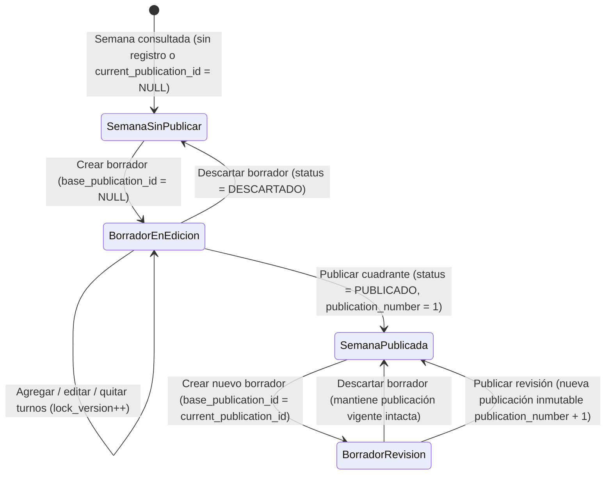

# 28 — Diseño Técnico I3: Planificación de Turnos

## 1. Propósito, Alcance MVP de I3 y Exclusiones

### 1.1. Propósito
El incremento **I3 — Planificación de turnos** constituye el núcleo operativo del MVP de TurnoShift. Su objetivo es permitir que un `ADMINISTRADOR` o `SUPERVISOR` cree un cuadrante borrador para la sede activa y una semana determinada (`lunes` a `domingo`), asigne colaboradores activos a bloques de trabajo (turnos), valide de forma determinista las restricciones operativas (puestos, indisponibilidades de I2.4 y política operativa vigente de I2.3) y publique una versión oficial e inmutable del cuadrante que los `COLABORADORES` puedan consultar desde su vista personal.

El diseño resuelve las necesidades inmediatas del MVP universitario manteniendo intacta la arquitectura de versionado, trazabilidad y aislamiento multi-tenant requerida para evolucionar hacia un SaaS comercial completo en los incrementos posteriores (`I4+`).

### 1.2. Alcance Funcional Incluido en I3
1. **Consulta del estado de planificación semanal (`HU-11`):**
   - Navegación por semanas canónicas (`weekStart`, estrictamente lunes en la zona horaria de la organización).
   - Visibilidad clara de los estados de una semana: *Nunca publicada*, *Publicada con asignaciones*, *Publicada vacía* (`DEC-03`), y presencia o ausencia de un *Borrador abierto* (incluyendo detección de borrador desactualizado si la publicación base cambió).
2. **Creación y edición de borradores semanales (`HU-12`):**
   - Regla de unicidad: como máximo **un borrador abierto** (`status = 'BORRADOR'`) por sede y semana (**RN-027**).
   - Creación en blanco (cuando no existe publicación previa) o precargada a partir de la publicación vigente de esa semana.
   - Adición, edición y eliminación de bloques de turno asignados a colaboradores dentro del borrador, bajo control de concurrencia optimista (`expectedLockVersion`) e idempotencia (`Idempotency-Key`).
   - Tolerancia de edición progresiva (**RN-057**): el borrador permite persistir asignaciones con conflictos operativos (como solapamientos o cruces con indisponibilidades) para que el planificador pueda construir y ajustar el horario antes de publicar.
3. **Motor determinista de validación de restricciones (`HU-13`):**
   - Evaluación de asignaciones del borrador frente al catálogo vigente de puestos (`I2.1`), estado y puesto principal del colaborador (`I2.2`), indisponibilidades activas (`I2.4`), política operativa vigente (`I2.3`: `minimumRestMinutes` y `weeklyWarningMinutes`) y turnos publicados en las fronteras de las semanas adyacentes ($W-1$ y $W+1$).
   - Separación estricta entre **errores bloqueantes** (que impiden publicar sin excepción) y **advertencias operativas** (que permiten publicar solo mediante reconocimiento individual explícito y motivo justificado, conforme a `DEC-04`).
4. **Previsualización y publicación atómica del cuadrante (`HU-14`):**
   - Previsualización previa a la confirmación (`publication-preview`) que emite una huella criptográfica determinista (`validationFingerprint` SHA-256) vinculada al estado exacto del borrador, la versión de política evaluada y las advertencias detectadas.
   - Publicación transaccional (`publish`) que genera registros inmutables (`schedule_publications`, `assignments`, `assignment_revisions`, `publication_assignments`, `planning_change_sets` y `planning_warning_acknowledgements`).
   - Soporte de **publicación de semana vacía** (`DEC-03`) con confirmación explícita (`confirmEmptySchedule = true`) y motivo obligatorio (`reason`).
5. **Protección de compromisos publicados frente a mutaciones de I2 (`RN-011`, `RN-013`):**
   - Activación de la validación cruzada pendiente desde I2: impedir registrar/editar indisponibilidades (`I2.4`), desactivar colaboradores o cambiar su puesto principal (`I2.2`) si entran en conflicto con turnos futuros ya publicados.
6. **Consulta personal del horario publicado por el colaborador (`HU-17`):**
   - Endpoint y pantalla exclusivos (`/app/mi-horario`) para que el usuario con rol `COLABORADOR` (o usuario con `employeeId` vinculado) consulte únicamente sus propios turnos publicados vigentes en la zona horaria de la organización.

### 1.3. Exclusiones Explícitas en I3 y Preparación para Evolución SaaS
Para acotar la complejidad del MVP universitario sin comprometer el diseño de datos, quedan **excluidos de I3**:

| Capacidad excluida en I3 | Incremento destino | Cómo queda preparado el modelo desde I3 |
| :--- | :--- | :--- |
| **Solicitudes e intercambios de turnos entre colaboradores (`HU-19`, `HU-20`)** | **I4** | Se introduce desde I3 la separación entre identidad estable del turno (`assignments`) y su revisión inmutable (`assignment_revisions`), requisito indispensable para que un intercambio futuro apunte a una asignación concreta y genere una nueva publicación de origen `'INTERCAMBIO'` sin romper referencias. |
| **Catálogo administrable de plantillas de turno (`shift_types`)** | **Post-MVP / SaaS** | En `I3` los bloques de turno en `draft_assignments` y `assignment_revisions` operan exclusivamente con instantes `starts_at` y `ends_at`, **sin persistir un UUID `shift_type_id` huérfano sin FK ni tabla propietaria**. Cuando dicha capacidad sea aprobada en el futuro, una migración dedicada añadirá el catálogo `shift_types`, la FK compuesta y los snapshots correspondientes. |
| **Notificaciones in-app, correo o push (`HU-18`, `outbox_events`, `notifications`)** | **I5+** | Cada publicación registra un `planning_change_sets` con autor, instante y `schedule_publications` asociado, proporcionando el evento de dominio exacto desde el cual se alimentará el patrón Transactional Outbox en I5. |
| **Fichaje, reloj biométrico, control de asistencia real y cálculo de nómina** | **Fuera del alcance del producto** | TurnoShift gestiona la **planificación y cobertura de turnos**, no la asistencia biométrica ni la liquidación salarial. La interfaz y la API no simularán marcas de entrada/salida ni montos económicos. |
| **Generación algorítmica / optimización matemática automática (solvers MILP/CP-SAT)** | **Evolución SaaS futura** | El contrato de `schedule_drafts` y el motor validador de dominio están desacoplados del origen de las líneas; un generador automático futuro simplemente poblará `draft_assignments` y se someterá al mismo validador determinista. |

---

## 2. Modelo de Dominio y Ciclo de Vida

### 2.1. Conceptos Fundamentales del Dominio de Planificación
Siguiendo el modelo conceptual establecido en `07 - Modelo de Datos y DER.md` (§7.1), el diseño distingue seis conceptos con responsabilidades estrictamente separadas:

1. **Planificación Semanal (`Schedule` / `schedules`):**
   - Entidad raíz que representa el contenedor de programación para una **organización**, una **sede** (`site_id`) y una **semana calendario** (`week_start`, siempre lunes).
   - Actúa como puntero autoritativo hacia la versión oficial vigente mediante `current_publication_id` (`NULL` si la semana nunca ha sido publicada).
2. **Borrador Semanal (`ScheduleDraft` / `schedule_drafts`):**
   - Propuesta de trabajo editable asociada a un `Schedule`.
   - Conserva en `base_publication_id` la referencia a la publicación que estaba vigente cuando se abrió el borrador (`NULL` si se abrió sobre una semana aún no publicada).
3. **Línea de Borrador (`DraftAssignment` / `draft_assignments`):**
   - Bloque de turno temporal dentro de un borrador (`employee_id`, `position_id`, `starts_at`, `ends_at`).
   - Posee su propio `id` (`draftAssignmentId`) para permitir su edición o borrado mientras el borrador está abierto, antes de que exista una asignación oficial publicada.
   - Si la línea proviene de un turno ya publicado (al abrir un borrador de revisión), conserva `assignment_id` y `base_revision_id`; si es una línea nueva creada en el borrador, ambos campos son `NULL`.
4. **Identidad de Asignación (`Assignment` / `assignments`) y Revisión Inmutable (`AssignmentRevision` / `assignment_revisions`):**
   - `Assignment` otorga una identidad permanente a un turno publicado dentro de una planificación (`schedule_id`).
   - `AssignmentRevision` captura de forma **inmutable** el contenido concreto de ese turno en una versión (`revision_number`, `employee_id`, `position_id`, `starts_at`, `ends_at`, `employee_name_snapshot`, `position_name_snapshot`).
5. **Publicación Semanal (`SchedulePublication` / `schedule_publications` + `publication_assignments`):**
   - Instantánea oficial numerada secuencialmente (`publication_number = 1, 2, ...`) que agrupa el conjunto exacto de `AssignmentRevision` vigentes en esa versión mediante la tabla asociativa `publication_assignments`.
6. **Conjunto de Cambio (`PlanningChangeSet` / `planning_change_sets`) y Reconocimiento de Advertencias (`PlanningWarningAcknowledgement` / `planning_warning_acknowledgements`):**
   - Registro de auditoría de negocio que documenta **quién** (`actor_user_id`), **cuándo** (`confirmed_at`), **con qué política** (`policy_version_id`), **bajo qué huella de validación** (`validation_fingerprint`) y **por qué** (`reason`) se confirmó la publicación, junto con la evidencia individual de cada advertencia aceptada.

### 2.2. Ciclo de Vida del Cuadrante y Estados Mínimos



#### Estados de la Semana (`ScheduleWeekStatus` — Vista proyectada para API/UI)
- `UNPUBLISHED` (*Sin publicar*): `current_publication_id IS NULL`. Puede tener o no un borrador activo.
- `PUBLISHED` (*Publicada*): `current_publication_id IS NOT NULL` con 1 o más asignaciones en `publication_assignments`.
- `PUBLISHED_EMPTY` (*Publicada vacía*, `DEC-03`): `current_publication_id IS NOT NULL` con 0 filas en `publication_assignments` y `empty_schedule_confirmed = 1`.

#### Estados del Borrador (`DraftStatus` — Columna `schedule_drafts.status`)
- `BORRADOR`: único estado mutable y activo. Solo puede existir una fila con `status = 'BORRADOR'` por `(organization_id, schedule_id)`.
- `PUBLICADO`: estado terminal alcanzado en la misma transacción en que se emite `schedule_publications`. Rellena obligatoriamente `result_publication_id`.
- `DESCARTADO`: estado terminal alcanzado cuando el usuario descarta la propuesta. No altera `schedules.current_publication_id` y deja `result_publication_id = NULL`.

### 2.3. Inmutabilidad Pospublicación y Manejo de Cambios Futuros sin Destruir Trazabilidad
1. **Prohibición de mutación física sobre publicaciones:**
   - Una vez confirmada una publicación, las filas en `schedule_publications`, `assignment_revisions`, `publication_assignments`, `planning_change_sets` y `planning_warning_acknowledgements` **jamás se actualizan (`UPDATE`) ni se eliminan (`DELETE`)** (**RN-033**).
   - Los nombres del colaborador y del puesto en el momento de publicar quedan congelados en `employee_name_snapshot` y `position_name_snapshot` dentro de `assignment_revisions`. Si posteriormente un administrador renombra un puesto en `I2.1` o cambia el nombre visible de un colaborador en `I2.2`, la publicación histórica conserva intacta su representación original.
2. **Mecanismo de revisión controlada (Copy-on-Write por revisión):**
   - Cuando se requiere modificar un cuadrante ya publicado, se abre un nuevo `schedule_draft` cuyo `base_publication_id` apunta a `schedules.current_publication_id`, clonando sus asignaciones vigentes hacia `draft_assignments` (con sus `assignment_id` y `base_revision_id` originales).
   - Al publicar ese nuevo borrador (`origin = 'REVISION'`):
     - Si una línea de borrador **no sufrió cambios** en `(employee_id, position_id, starts_at, ends_at)` respecto a su `base_revision_id`, la nueva publicación **reutiliza la misma fila de `assignment_revisions`** en `publication_assignments`.
     - Si una línea existente **cambió** en horario, puesto o colaborador, se inserta una **nueva fila en `assignment_revisions`** con `revision_number = base_revision_number + 1` para el mismo `assignment_id`.
     - Si una línea existente **fue retirada** del borrador (siempre que aún no haya iniciado), simplemente deja de incluirse en las filas de `publication_assignments` de la nueva publicación, mientras su revisión anterior permanece intacta en la publicación histórica previa.
     - Si se agregó una **línea nueva**, se crea un nuevo `assignments` y su `assignment_revisions` con `revision_number = 1`.
3. **Protección absoluta de turnos ya iniciados o finalizados (`RN-031`, `RN-032`):**
   - Tomando como única fuente autoritativa el reloj UTC del servidor (`Clock`), ninguna operación sobre un borrador ni ninguna publicación de revisión puede modificar `(employee_id, position_id, starts_at, ends_at)` ni retirar un turno publicado cuyo `starts_at <= now()`, ni crear un turno nuevo con `starts_at <= now()`.

---

## 3. Tiempo, Husos Horarios y Multitenancy

### 3.1. Qué se Guarda en UTC y Qué se Interpreta en la Zona Horaria de la Organización

| Dato / Columna | Tipo en SQL Server | Tipo en Dominio Java | Semántica Temporal Exacta |
| :--- | :--- | :--- | :--- |
| `organizations.timezone_id` | `VARCHAR(64)` | `ZoneId` | Identificador IANA oficial de la organización (ej. `America/Lima`, `Europe/Madrid`). Fuente autoritativa para delimitar días y semanas locales. |
| `schedules.week_start` | `DATE` | `LocalDate` | Fecha calendario del **lunes** que inicia la semana en la zona horaria `timezone_id` de la organización (`DayOfWeek.MONDAY`). |
| `draft_assignments.starts_at`, `ends_at` | `DATETIMEOFFSET(3)` | `Instant` | Instantes absolutos en UTC (`+00:00`). Representan un intervalo semiabierto `[starts_at, ends_at)` con `starts_at < ends_at`. |
| `assignment_revisions.starts_at`, `ends_at` | `DATETIMEOFFSET(3)` | `Instant` | Instantes absolutos en UTC (`+00:00`), inmutables tras la publicación. |
| `schedule_publications.timezone_id_snapshot` | `VARCHAR(64)` | `ZoneId` | Copia inmutable del `timezone_id` de la organización en el instante de publicar, garantizando interpretación histórica exacta. |
| `schedule_publications.published_at` | `DATETIMEOFFSET(3)` | `Instant` | Instante UTC exacto de confirmación generado desde `SYSUTCDATETIME()` / reloj del servidor. |
| `planning_warning_acknowledgements.period_start`, `period_end_exclusive` | `DATE` | `LocalDate` | Rango semanal local `[week_start, week_start + 7 días)` evaluado para el umbral de minutos semanales. |

### 3.2. Ventana Semanal Canónica y Turnos Nocturnos que Cruzan Medianoche

#### 1. Cálculo de la ventana semanal en la zona de la organización
Dada una fecha lunes `weekStart` (`LocalDate`) y la zona IANA de la organización `orgZone` (`ZoneId`):
- **Inicio de semana (`weekStartInstant`):**
  $$\text{weekStartInstant} = \text{weekStart.atStartOfDay(orgZone).toInstant()}$$
- **Fin exclusivo de semana (`weekEndExclusiveInstant`):**
  $$\text{weekEndExclusiveInstant} = \text{weekStart.plusDays(7).atStartOfDay(orgZone).toInstant()}$$

Por ejemplo, para una organización en `America/Lima` (`UTC-05:00`) y la semana `2026-10-05`:
- `weekStartInstant` = `2026-10-05T05:00:00Z` (lunes 00:00 hora de Lima).
- `weekEndExclusiveInstant` = `2026-10-12T05:00:00Z` (lunes siguiente 00:00 hora de Lima).

#### 2. Regla de pertenencia de turnos y cruce de medianoche (*Propuesta de diseño para I3*)
Un turno nocturno (por ejemplo, de `22:00` a `06:00` del día siguiente) cruza la medianoche local:
- **Regla de anclaje semanal por instante de inicio:** Un turno pertenece al cuadrante de la semana `week_start` **si y solo si su instante de inicio `starts_at` pertenece al intervalo semiabierto de esa semana**:
  $$\text{weekStartInstant} \le \text{startsAt} < \text{weekEndExclusiveInstant}$$
- **Turnos de martes/miércoles/... que cruzan medianoche:** Si un turno inicia el martes a las `22:00` local y termina el miércoles a las `06:00` local, tanto `starts_at` como `ends_at` caen dentro de la misma semana.
- **Turnos de domingo por la noche que cruzan hacia la madrugada del lunes siguiente:**
  - Si un turno inicia el domingo a las `22:00` local (`starts_at < weekEndExclusiveInstant`) y finaliza el lunes siguiente a las `06:00` local (`ends_at > weekEndExclusiveInstant`), el turno **pertenece íntegramente al cuadrante de la semana $W$** (donde inició).
  - Para impedir duraciones absurdas o errores de captura, todo bloque de turno exige cumplir la invariante de duración operativa (*Propuesta de diseño*):
    $$15 \text{ minutos} \le (\text{endsAt} - \text{startsAt}) \le 960 \text{ minutos (16 horas)}$$
- **Atribución determinista de minutos semanales (`weekly_warning_minutes`):**
  - *Propuesta de diseño para I3:* Los minutos de duración completa de cada turno ($\text{durationMinutes} = (\text{endsAt} - \text{startsAt}) \text{ en minutos}$) se atribuyen a la semana $W$ a la que pertenece el turno según su `starts_at`. Esta regla evita partir un turno nocturno de domingo en dos fragmentos entre las semanas $W$ y $W+1$, hace que la suma de horas del cuadrante $W$ dependa exclusivamente de los turnos asignados en $W$, y garantiza que el cálculo de `planned_minutes` y `warning_fingerprint` en `planning_warning_acknowledgements` sea 100 % determinista y reproducible.
- **Validación de frontera entre semanas consecutivas ($W-1$, $W$, $W+1$):**
  - Aunque los minutos semanales se atribuyen por semana de inicio, el **solapamiento físico de turnos (`RN-017`)** y el **descanso mínimo continuo (`RN-018`, `minimum_rest_minutes`)** son propiedades continuas en la línea de tiempo UTC.
  - Por ello, al validar o publicar la semana $W$, el repositorio carga una ventana de contexto extendida de las publicaciones vigentes de la semana anterior ($W-1$, turnos que terminan cerca o después de `weekStartInstant`) y de la semana siguiente ($W+1$, turnos que inician cerca de `weekEndExclusiveInstant`):
    - Si un colaborador tiene un turno publicado en $W-1$ que termina el lunes de $W$ a las `06:00` local, y en el borrador de $W$ se le asigna un turno el lunes a las `05:00` local → **Error bloqueante `SHIFT_OVERLAP`**.
    - Si ese colaborador termina el lunes a las `06:00` local (del turno de $W-1$) y en el borrador de $W$ se le asigna un turno el lunes a las `14:00` local ($480 \text{ min} < 660 \text{ min}$ de descanso mínimo) → **Error bloqueante `MINIMUM_REST_VIOLATION`**.
    - Simétricamente, si el último turno del borrador de $W$ termina el lunes de $W+1$ a las `06:00` local y en la publicación vigente de $W+1$ ya existe un turno el lunes a las `12:00` local → **Error bloqueante `MINIMUM_REST_VIOLATION`**.

### 3.3. Prevención de Cruces entre Organizaciones, Sedes, Empleados y Puestos
1. **Derivación exclusiva desde la sesión:** El `organizationId` y el `actorUserId` se obtienen única y exclusivamente de `AuthenticatedIdentity` en el `SecurityContext`. Jamás se acepta `organizationId` en cuerpo, query ni path.
2. **Resolución de sede activa:** En el MVP (1 sede activa por organización), el servicio resuelve la sede activa de la organización o verifica mediante clave compuesta `(organization_id, site_id)` que la sede pertenezca a la organización y esté activa.
3. **Pertenencia del colaborador a la sede y organización:**
   - A nivel SQL Server: `FOREIGN KEY (organization_id, employee_id) REFERENCES employees (organization_id, id)` impide físicamente referenciar empleados de otro tenant.
   - A nivel de aplicación y consulta JDBC: se verifica que `employee.siteId().equals(schedule.siteId())`. Un empleado adscrito a otra sede es rechazado con `400/409 EMPLOYEE_SITE_MISMATCH`.
4. **Pertenencia del puesto a la organización:**
   - A nivel SQL Server: `FOREIGN KEY (organization_id, position_id) REFERENCES positions (organization_id, id)` impide físicamente referenciar puestos de otro tenant.

---

## 4. Relación con I2 (Catálogos, Indisponibilidades y Política Operativa)

### 4.1. Integración con Puestos (`I2.1`) y Colaboradores (`I2.2`)
- **En edición de borrador (`HU-12`):**
  - El selector de la interfaz ofrece únicamente puestos activos y colaboradores activos cuyo `position_id` coincida con el puesto requerido.
  - Si un colaborador o puesto es desactivado mientras un borrador está abierto, el borrador conserva la línea para no destruir el trabajo del planificador, pero el motor de validación marca inmediatamente la línea con error bloqueante (`EMPLOYEE_INACTIVE` o `POSITION_INACTIVE`).
- **En validación y publicación (`HU-13`, `HU-14`):**
  - Se verifica que todo `employee_id` del borrador esté activo (`is_active = 1`) y que su `position_id` actual en la tabla `employees` coincida exactamente con el `position_id` de la línea del turno (**RN-010**: puesto principal único en el MVP).
- **Cierre de los ganchos diferidos en `I2.2` (`RN-011` y `previewDeactivation`):**
  - En `I2.2`, la pre-evaluación de desactivación de un colaborador (`POST /api/v1/employees/{employeeId}/deactivation-preview`), la desactivación (`POST /api/v1/employees/{employeeId}/deactivate`) y el cambio de puesto (`PUT /api/v1/employees/{employeeId}`) dejaron preparada la estructura de `blockers` para cuando existieran turnos publicados.
  - *Propuesta de integración en I3:* Se implementa el adaptador real del puerto de consulta de compromisos publicados (`PublishedAssignmentCommitmentQueryPort`):
    - Si un colaborador posee asignaciones en la publicación vigente (`schedules.current_publication_id`) con `ends_at > now()`, `previewDeactivation` devuelve `canDeactivate = false` con el blocker descriptivo real y `deactivateEmployee` rechaza con `409 EMPLOYEE_HAS_FUTURE_ASSIGNMENTS`.
    - Si se intenta cambiar el `positionId` de un colaborador en `updateEmployee` y dicho colaborador posee turnos futuros publicados (`starts_at > now()`) o líneas en un borrador abierto con su puesto anterior (**RN-011**), se rechaza con `409 EMPLOYEE_POSITION_CHANGE_CONFLICT`.

### 4.2. Integración con Indisponibilidades de Colaboradores (`I2.4`)
- **Regla de intersección semiabierta (`RN-017`, `RN-019`):**
  - Toda indisponibilidad activa (`cancelled_at IS NULL`) en `employee_unavailabilities` define un intervalo `[u.starts_at, u.ends_at)`.
  - Un bloque de turno `[a.starts_at, a.ends_at)` entra en conflicto con una indisponibilidad si y solo si:
    $$a.\text{startsAt} < u.\text{endsAt} \land u.\text{startsAt} < a.\text{endsAt}$$
  - Cuando existe intersección, el motor de validación emite el error bloqueante `EMPLOYEE_UNAVAILABLE` indicando el `draftAssignmentId`, el `employeeId`, el `unavailabilityId` y el sub-intervalo de conflicto, **sin incluir jamás el campo confidencial `restricted_note`** (**RN-014**).
- **Cierre del gancho diferido en `I2.4` (`RN-013` — No contradicción con turnos publicados):**
  - En `I2.4`, el registro o edición de una indisponibilidad debe rechazarse si contradice un turno ya publicado vigente del colaborador.
  - *Cambio de integración requerido en `I3.1-c`:* Al crear o actualizar una indisponibilidad en `I2.4`, se incorporará la adquisición del candado transaccional compartido `TurnoShift_OrgPlanning_<organizationId>` y se consultará si el colaborador tiene alguna asignación en una publicación vigente (`schedules.current_publication_id`) que se solape con el nuevo intervalo `[starts_at, ends_at)` y cuyo fin sea futuro (`ends_at > now()`). Si existe, se rechazará con `409 PUBLISHED_SHIFT_CONFLICT`, exigiendo que primero se revise el cuadrante publicado antes de asentar la indisponibilidad.

### 4.3. Uso de la Política Operativa Vigente (`I2.3`), Bloqueos vs Advertencias y Trazabilidad
1. **Obtención de la política operativa vigente:**
   - El validador consulta `organizations.current_policy_version_id` y carga la fila correspondiente de `planning_policy_versions` (`version_number`, `minimum_rest_minutes`, `weekly_warning_minutes`).
   - Si la organización aún no tiene política activa (`current_policy_version_id IS NULL`), `validate`, `publication-preview` y `publish` informan el bloqueo `POLICY_NOT_CONFIGURED`.
2. **Clasificación estricta de reglas en `HU-13` y `HU-14` (`DEC-04`):**

| Código de Regla | Severidad | Condición de Disparo | Comportamiento en Borrador (`HU-12`) | Comportamiento en Publicación (`HU-14`) |
| :--- | :--- | :--- | :--- | :--- |
| `POLICY_NOT_CONFIGURED` | **BLOQUEANTE** | `organizations.current_policy_version_id IS NULL`. | Permite editar borrador; muestra aviso de configuración pendiente. | Rechaza con `409 POLICY_NOT_CONFIGURED`. |
| `EMPLOYEE_INACTIVE` | **BLOQUEANTE** | El colaborador asignado tiene `is_active = 0`. | Se permite guardar para reasignar. | Rechaza con `409 PUBLICATION_BLOCKED_BY_ERRORS`. |
| `POSITION_INACTIVE` | **BLOQUEANTE** | El puesto del turno tiene `is_active = 0`. | Se permite guardar para corregir. | Rechaza con `409 PUBLICATION_BLOCKED_BY_ERRORS`. |
| `POSITION_MISMATCH` | **BLOQUEANTE** | `draft_assignment.position_id != employee.position_id` (**RN-010**). | Se permite guardar si el puesto del empleado cambió tras añadir la línea; exige corrección. | Rechaza con `409 PUBLICATION_BLOCKED_BY_ERRORS`. |
| `SHIFT_OVERLAP` | **BLOQUEANTE** | Dos turnos del mismo colaborador se solapan ($startsAt_1 < endsAt_2 \land startsAt_2 < endsAt_1$) en la semana o contra fronteras publicadas $W-1 / W+1$ (**RN-017**). | Se permite guardar en borrador (**RN-057**). | Rechaza con `409 PUBLICATION_BLOCKED_BY_ERRORS`. |
| `EMPLOYEE_UNAVAILABLE` | **BLOQUEANTE** | El turno se solapa con una indisponibilidad activa (`cancelled_at IS NULL`) del colaborador (**RN-019**). | Se permite guardar en borrador (**RN-057**). | Rechaza con `409 PUBLICATION_BLOCKED_BY_ERRORS`. |
| `MINIMUM_REST_VIOLATION` | **BLOQUEANTE** | El descanso entre dos turnos consecutivos del colaborador (en $W$ o frontera $W-1 / W+1$) es $< \text{minimum\_rest\_minutes}$ (**RN-018**). | Se permite guardar en borrador (**RN-057**). | Rechaza con `409 PUBLICATION_BLOCKED_BY_ERRORS`. |
| `PAST_SHIFT_MODIFICATION` | **BLOQUEANTE** | Se intenta crear un turno con `starts_at <= now()` o alterar/eliminar un turno publicado con `starts_at <= now()` (**RN-031**). | Rechazado directamente al intentar mutar turno iniciado; o bloqueado si el reloj avanzó mientras el borrador estaba abierto. | Rechaza con `409 PAST_SHIFT_MODIFICATION_PROHIBITED`. |
| `WEEKLY_PLANNED_MINUTES_EXCEEDED` | **ADVERTENCIA** | La suma de minutos asignados al colaborador en la semana $W$ supera `weekly_warning_minutes` (**RN-023**). | Se permite guardar y se muestra indicador ámbar con exceso de minutos. | Permite publicar **solo si** el cliente incluye su `warningFingerprint` en `acknowledgedWarningFingerprints` y aporta un `reason` no vacío (`DEC-04`). |

3. **Trazabilidad reproducible de la versión de política asociada:**
   - **Durante borrador (`schedule_drafts`):** El borrador **no congela** una política obsoleta; cada vez que se invoca `validate` o `publication-preview`, se evalúa contra `organizations.current_policy_version_id` en ese instante.
   - **En la previsualización (`publication-preview`):** El cálculo de `validationFingerprint` (SHA-256) incorpora el `policyVersionId` vigente, el `draftLockVersion`, la lista canónica ordenada de asignaciones del borrador, los turnos frontera relevantes de $W-1$ y $W+1$, y los `warningFingerprints` resultantes.
   - **En la publicación (`publish`):**
     - Dentro de la transacción protegida por `sp_getapplock`, el servidor recalcula la validación contra `organizations.current_policy_version_id`.
     - Si la huella recién calculada no coincide con el `validationFingerprint` enviado por el cliente (por ejemplo, porque otro usuario activó una nueva política en `I2.3` o registró una indisponibilidad en `I2.4` hace un segundo), la operación aborta con `409 VALIDATION_FINGERPRINT_MISMATCH`.
     - Si coincide, el UUID de la versión de política evaluada queda grabado de forma **permanente e inmutable** tanto en `planning_change_sets.policy_version_id` como en `schedule_publications.policy_version_id`. De este modo, cualquier auditoría futura puede reconstruir exactamente con qué `minimum_rest_minutes` y `weekly_warning_minutes` fue aprobado el cuadrante, incluso si la empresa cambia su política meses después.

---

## 5. Concurrencia, Idempotencia y Seguridad

### 5.1. Matriz de Control de Acceso Basado en Roles (RBAC)

| Operación / Recurso | `ADMINISTRADOR` | `SUPERVISOR` | `COLABORADOR` | `PLATFORM_OPERATOR` |
| :--- | :---: | :---: | :---: | :---: |
| Consultar estado semanal de sede (`GET /schedules/week`) | ✅ Permitido | ✅ Permitido | ❌ `403 ACCESS_DENIED` | ❌ `403 ACCESS_DENIED` |
| Crear, editar o descartar borrador (`POST/PUT /schedule-drafts/**`) | ✅ Permitido | ✅ Permitido | ❌ `403 ACCESS_DENIED` | ❌ `403 ACCESS_DENIED` |
| Validar y previsualizar publicación (`validate`, `publication-preview`) | ✅ Permitido | ✅ Permitido | ❌ `403 ACCESS_DENIED` | ❌ `403 ACCESS_DENIED` |
| Publicar cuadrante semanal (`POST /schedule-drafts/{id}/publish`) | ✅ Permitido | ✅ Permitido | ❌ `403 ACCESS_DENIED` | ❌ `403 ACCESS_DENIED` |
| Consultar horario personal publicado (`GET /my/schedule`) | ✅ Si tiene `employeeId` vinculado (o `403`/`404` según vínculo) | ✅ Si tiene `employeeId` vinculado | ✅ Permitido (solo sus propios turnos) | ❌ `403 ACCESS_DENIED` |

> [!IMPORTANT]
> **Aislamiento de privacidad para `COLABORADOR`:**
> El endpoint `GET /api/v1/my/schedule` resuelve el `employeeId` exclusivamente desde `AuthenticatedIdentity.employeeId()` almacenado en la sesión del servidor. Un colaborador jamás puede enviar otro `employeeId` por parámetro, ni recibir información sobre turnos de otros compañeros, borradores no publicados, motivos de cambio del cuadrante ni notas restringidas (`RN-014`). Si una cuenta con rol `COLABORADOR` no tiene `employee_id` asociado en `app_users`, el servidor responde `403 ACCESS_DENIED` con código `EMPLOYEE_LINK_REQUIRED`.

### 5.2. Idempotencia en Mutaciones (`Idempotency-Key`)
Todas las operaciones de mutación (`POST`, `PUT` y acciones de eliminación/descarte/publicación) utilizan el infraestructura consolidada `BusinessIdempotentOperationExecutor` sobre la tabla `api_operations` (`V11`):
- Cabecera `Idempotency-Key` (UUID v4) y cabecera `X-CSRF-TOKEN` obligatorias.
- Cálculo de huella canónica (`RequestFingerprintCalculator`) prefijada por longitud (`<len>:<val>;`) incluyendo método HTTP, ruta normalizada, versión de esquema y todos los campos del comando.
- Reintentos con la misma clave e idéntica huella dentro de las 24 horas devuelven el mismo código y cuerpo HTTP con cabecera `Idempotency-Replayed: true`.
- Reuso de clave con distinta huella devuelve `409 IDEMPOTENCY_KEY_REUSED`.
- Nota: Los endpoints de cálculo puro sin efectos secundarios persistentes (`POST /schedule-drafts/{draftId}/validate` y `POST /schedule-drafts/{draftId}/publication-preview`) son consultas deterministas de evaluación; requieren sesión y `X-CSRF-TOKEN` (por ser `POST`), pero no requieren `Idempotency-Key` ni alteran `lock_version`, en total simetría con `POST /policies/preview` (`I2.3`) y `POST /employees/{id}/deactivation-preview` (`I2.2`).

### 5.3. Control de Concurrencia Optimista y Estrategia Anti-Carreras (`sp_getapplock`)
Para evitar condiciones de carrera (doble creación de borrador, edición simultánea entre dos supervisores, o publicación concurrente con la inserción de una indisponibilidad o el cambio de política), se combinan tres mecanismos complementarios:

1. **Concurrencia optimista en el borrador (`schedule_drafts.lock_version`):**
   - Cada vez que se agrega, actualiza o elimina una fila en `draft_assignments`, se ejecuta en la misma transacción:
     ```sql
     UPDATE schedule_drafts
     SET lock_version = lock_version + 1,
         updated_at = ?
     WHERE organization_id = ?
       AND id = ?
       AND status = 'BORRADOR'
       AND lock_version = ?
     ```
   - Si otro usuario modificó o publicó el borrador concurrentemente, la sentencia actualiza `0` filas y se rechaza con `409 CONCURRENT_MODIFICATION`.
2. **Índice único filtrado en base de datos (`RN-027`):**
   - El índice `uix_schedule_drafts_open` sobre `(organization_id, schedule_id) WHERE status = 'BORRADOR'` impide físicamente que coexistan dos borradores abiertos para la misma sede y semana.
3. **Serialización transaccional por organización con `sp_getapplock` (`PROP-I3-03`):**
   - Para cerrar cualquier ventana de condición de carrera de tipo *Write Skew* (por ejemplo, el Usuario A publica un cuadrante para el empleado E al mismo tiempo que el Usuario B registra una indisponibilidad para el empleado E en `I2.4`, desactiva o cambia el puesto del colaborador en `I2.2`, o el Usuario C activa una nueva política en `I2.3`), se define el recurso de candado de aplicación compartido a nivel de organización en SQL Server:
     - **Lock 1 (Idempotencia):** `TurnoShift_Idem_<actorUserId>_<idempotencyKey>`
     - **Lock 2 (Operación de planificación de la organización):** `TurnoShift_OrgPlanning_<organizationId>` (modo `Exclusive`, `LockOwner = 'Transaction'`, timeout `10000 ms`).
   - **Adquisición en operaciones de `I3` y cambio de integración requerido hacia `I2` en `I3.1-c`:**
     - El recurso compartido `TurnoShift_OrgPlanning_<organizationId>` será adquirido transaccionalmente por las futuras operaciones de `I3` que publiquen o modifiquen compromisos publicados (como `PublishScheduleDraft`).
     - Las rutas preexistentes de `I2.2`, `I2.3` e `I2.4` **aún no utilizan este candado**. Su integración coordinada se implementará como cambio requerido en el subincremento `I3.1-c`, incorporando la adquisición de `TurnoShift_OrgPlanning_<organizationId>` en las mutaciones de desactivación/cambio de puesto (`I2.2`), activación de política (`I2.3`) y alta/edición de indisponibilidades (`I2.4`) para que no compitan con publicaciones concurrentes.
     - Bajo dicho candado, `PublishScheduleDraft` volverá a leer el estado de empleados, puestos, indisponibilidades, semanas adyacentes y `current_policy_version_id`, verificará que el `validationFingerprint` siga siendo idéntico, insertará la publicación y actualizará `schedules.current_publication_id` en un único commit atómico.

### 5.4. Catálogo de Códigos Problem Details (RFC 9457) para I3

| Código HTTP | `code` (Problem Details) | Cuándo se emite |
| :---: | :--- | :--- |
| `400` | `VALIDATION_FAILED` | Parámetros malformados, `weekStart` que no es lunes, `startsAt >= endsAt`, duración fuera de rango (`<15m` o `>960m`) o turno cuyo `startsAt` no pertenece a la semana del borrador. |
| `401` | `SESSION_REQUIRED` | Petición sin sesión activa o expirada. |
| `403` | `ACCESS_DENIED` | Rol no autorizado o cuenta de `COLABORADOR` sin `employeeId` vinculado (`EMPLOYEE_LINK_REQUIRED`). |
| `403` | `CSRF_INVALID` | Token CSRF ausente o inválido en petición de escritura. |
| `404` | `SCHEDULE_NOT_FOUND` / `DRAFT_NOT_FOUND` / `DRAFT_ASSIGNMENT_NOT_FOUND` | El cuadrante, borrador o línea no existe o pertenece a otra organización. |
| `409` | `DRAFT_ALREADY_EXISTS` | Ya existe un borrador abierto (`status = 'BORRADOR'`) para esa sede y semana. |
| `409` | `DRAFT_NOT_EDITABLE` | El borrador ya se encuentra en estado `PUBLICADO` o `DESCARTADO`. |
| `409` | `DRAFT_OUTDATED` | `base_publication_id` del borrador difiere de `schedules.current_publication_id` (**RN-030**). |
| `409` | `POLICY_NOT_CONFIGURED` | La organización no tiene una versión de política operativa activa (`current_policy_version_id IS NULL`). |
| `409` | `PUBLICATION_BLOCKED_BY_ERRORS` | Intento de publicar cuando existen errores bloqueantes (`SHIFT_OVERLAP`, `EMPLOYEE_UNAVAILABLE`, `MINIMUM_REST_VIOLATION`, etc.). |
| `409` | `UNACKNOWLEDGED_WARNINGS` | Existen advertencias (`WEEKLY_PLANNED_MINUTES_EXCEEDED`) cuyos `warningFingerprint` no fueron reconocidos o falta `reason`. |
| `409` | `EMPTY_SCHEDULE_CONFIRMATION_REQUIRED` | El borrador no tiene turnos y no se envió `confirmEmptySchedule = true` junto con `reason` (**DEC-03**). |
| `409` | `VALIDATION_FINGERPRINT_MISMATCH` | El estado del borrador, catálogos, indisponibilidades o versión de política cambió entre `publication-preview` y `publish`. |
| `409` | `PAST_SHIFT_MODIFICATION_PROHIBITED` | Intento de agregar un turno con `starts_at <= now()` o alterar/retirar un turno publicado ya iniciado (**RN-031**). |
| `409` | `CONCURRENT_MODIFICATION` | `expectedLockVersion` no coincide con el `lock_version` actual del recurso. |
| `503` | `SERVICE_UNAVAILABLE` | Indisponibilidad técnica de SQL Server o timeout al adquirir `sp_getapplock` (sin exponer SQL ni detalles internos). |

---

## 6. Persistencia y Estrategia de Migraciones Futuras (Flyway)

> [!NOTE]
> Conforme a las restricciones de esta fase de diseño, **no se crean archivos SQL en `db/migration` todavía**. A continuación se especifica la estructura física exacta para las futuras migraciones Flyway (`V18` y `V19`), manteniendo el estilo SQL Server, tipos y convenciones de `V1`–`V17`.

### 6.1. Entidades y Tablas Propuestas

#### 1. Tabla `schedules` (Cabecera de Planificación Semanal)
- **Columnas:**
  - `id UNIQUEIDENTIFIER NOT NULL DEFAULT NEWID()` (PK `pk_schedules`)
  - `organization_id UNIQUEIDENTIFIER NOT NULL`
  - `site_id UNIQUEIDENTIFIER NOT NULL`
  - `week_start DATE NOT NULL` (lunes local)
  - `current_publication_id UNIQUEIDENTIFIER NULL` (puntero a la publicación vigente)
  - `lock_version BIGINT NOT NULL DEFAULT 0`
  - `created_at DATETIMEOFFSET(3) NOT NULL DEFAULT SYSUTCDATETIME()`
  - `updated_at DATETIMEOFFSET(3) NOT NULL DEFAULT SYSUTCDATETIME()`
- **Claves y Restricciones:**
  - `uq_schedules_org_id UNIQUE (organization_id, id)`
  - `uq_schedules_org_site_week UNIQUE (organization_id, site_id, week_start)`
  - `uq_schedules_org_id_current_pub UNIQUE (organization_id, id, current_publication_id)`
  - `fk_schedules_site FOREIGN KEY (organization_id, site_id) REFERENCES sites (organization_id, id)`
  - `chk_schedules_week_start_monday CHECK (DATEDIFF(DAY, '19000101', week_start) % 7 = 0)` *(independiente de `@@DATEFIRST`, dado que `1900-01-01` fue lunes)*.
  - `chk_schedules_lock_version CHECK (lock_version >= 0)`

#### 2. Tabla `schedule_drafts` (Borradores Semanales)
- **Columnas:**
  - `id UNIQUEIDENTIFIER NOT NULL DEFAULT NEWID()` (PK `pk_schedule_drafts`)
  - `organization_id UNIQUEIDENTIFIER NOT NULL`
  - `schedule_id UNIQUEIDENTIFIER NOT NULL`
  - `base_publication_id UNIQUEIDENTIFIER NULL`
  - `status VARCHAR(16) COLLATE Latin1_General_100_BIN2 NOT NULL` (`'BORRADOR'`, `'PUBLICADO'`, `'DESCARTADO'`)
  - `result_publication_id UNIQUEIDENTIFIER NULL`
  - `change_reason NVARCHAR(500) NULL`
  - `created_by_user_id UNIQUEIDENTIFIER NOT NULL`
  - `lock_version BIGINT NOT NULL DEFAULT 0`
  - `created_at DATETIMEOFFSET(3) NOT NULL DEFAULT SYSUTCDATETIME()`
  - `updated_at DATETIMEOFFSET(3) NOT NULL DEFAULT SYSUTCDATETIME()`
- **Claves, Checks e Índices:**
  - `uq_schedule_drafts_org_id UNIQUE (organization_id, id)`
  - `uq_schedule_drafts_org_schedule_id UNIQUE (organization_id, schedule_id, id)`
  - `fk_schedule_drafts_schedule FOREIGN KEY (organization_id, schedule_id) REFERENCES schedules (organization_id, id)`
  - `fk_schedule_drafts_author FOREIGN KEY (organization_id, created_by_user_id) REFERENCES app_users (organization_id, id)`
  - `chk_schedule_drafts_status CHECK (status IN ('BORRADOR', 'PUBLICADO', 'DESCARTADO'))`
  - `chk_schedule_drafts_result_coherence CHECK ((status = 'PUBLICADO' AND result_publication_id IS NOT NULL) OR (status IN ('BORRADOR', 'DESCARTADO') AND result_publication_id IS NULL))`
  - **Índice único filtrado (`RN-027`):**
    `CREATE UNIQUE INDEX uix_schedule_drafts_one_open ON schedule_drafts (organization_id, schedule_id) WHERE status = 'BORRADOR'`

#### 3. Tabla `assignments` (Identidad Estable de Turnos Publicados)
- **Columnas:**
  - `id UNIQUEIDENTIFIER NOT NULL DEFAULT NEWID()` (PK `pk_assignments`)
  - `organization_id UNIQUEIDENTIFIER NOT NULL`
  - `schedule_id UNIQUEIDENTIFIER NOT NULL`
  - `created_at DATETIMEOFFSET(3) NOT NULL DEFAULT SYSUTCDATETIME()`
- **Claves:**
  - `uq_assignments_org_schedule_id UNIQUE (organization_id, schedule_id, id)` *(clave candidata compuesta utilizada por revisiones, líneas de borrador y publicaciones sin duplicar un índice `(organization_id, id)`)*
  - `fk_assignments_schedule FOREIGN KEY (organization_id, schedule_id) REFERENCES schedules (organization_id, id)`

#### 4. Tabla `assignment_revisions` (Contenido Inmutable Versionado de cada Turno)
- **Columnas:**
  - `id UNIQUEIDENTIFIER NOT NULL DEFAULT NEWID()` (PK `pk_assignment_revisions`)
  - `organization_id UNIQUEIDENTIFIER NOT NULL`
  - `schedule_id UNIQUEIDENTIFIER NOT NULL`
  - `assignment_id UNIQUEIDENTIFIER NOT NULL`
  - `revision_number INT NOT NULL`
  - `employee_id UNIQUEIDENTIFIER NOT NULL`
  - `position_id UNIQUEIDENTIFIER NOT NULL`
  - `starts_at DATETIMEOFFSET(3) NOT NULL`
  - `ends_at DATETIMEOFFSET(3) NOT NULL`
  - `employee_name_snapshot NVARCHAR(150) NOT NULL`
  - `position_name_snapshot NVARCHAR(100) NOT NULL`
  - `created_by_user_id UNIQUEIDENTIFIER NOT NULL`
  - `created_at DATETIMEOFFSET(3) NOT NULL DEFAULT SYSUTCDATETIME()`
  *(Sin columna `shift_type_id`: el catálogo `shift_types` está fuera de `I3`; una migración futura añadirá el catálogo, la FK y posibles snapshots cuando esa capacidad sea aprobada).*
- **Claves y Restricciones:**
  - `uq_assignment_revisions_org_sched_assign_id UNIQUE (organization_id, schedule_id, assignment_id, id)` *(clave candidata compuesta que permite validar simultáneamente pertenencia al tenant, a la semana y a la asignación en `draft_assignments` y `publication_assignments`, sin índices redundantes)*
  - `uq_assignment_revisions_number UNIQUE (organization_id, assignment_id, revision_number)`
  - `fk_assignment_revisions_assignment FOREIGN KEY (organization_id, schedule_id, assignment_id) REFERENCES assignments (organization_id, schedule_id, id)`
  - `fk_assignment_revisions_employee FOREIGN KEY (organization_id, employee_id) REFERENCES employees (organization_id, id)`
  - `fk_assignment_revisions_position FOREIGN KEY (organization_id, position_id) REFERENCES positions (organization_id, id)`
  - `fk_assignment_revisions_author FOREIGN KEY (organization_id, created_by_user_id) REFERENCES app_users (organization_id, id)`
  - `chk_assignment_revisions_interval CHECK (starts_at < ends_at AND DATEDIFF(MINUTE, starts_at, ends_at) BETWEEN 15 AND 960)`
  - `chk_assignment_revisions_rev_pos CHECK (revision_number > 0)`

#### 5. Tabla `draft_assignments` (Líneas Editables del Borrador)
- **Columnas:**
  - `id UNIQUEIDENTIFIER NOT NULL DEFAULT NEWID()` (PK `pk_draft_assignments`)
  - `organization_id UNIQUEIDENTIFIER NOT NULL`
  - `schedule_id UNIQUEIDENTIFIER NOT NULL`
  - `draft_id UNIQUEIDENTIFIER NOT NULL`
  - `assignment_id UNIQUEIDENTIFIER NULL`
  - `base_revision_id UNIQUEIDENTIFIER NULL`
  - `employee_id UNIQUEIDENTIFIER NOT NULL`
  - `position_id UNIQUEIDENTIFIER NOT NULL`
  - `starts_at DATETIMEOFFSET(3) NOT NULL`
  - `ends_at DATETIMEOFFSET(3) NOT NULL`
  - `created_at DATETIMEOFFSET(3) NOT NULL DEFAULT SYSUTCDATETIME()`
  - `updated_at DATETIMEOFFSET(3) NOT NULL DEFAULT SYSUTCDATETIME()`
  *(Sin columna `shift_type_id`; diferida a una migración futura junto con la tabla propietaria `shift_types`).*
- **Claves y Restricciones:**
  - `uq_draft_assignments_org_id UNIQUE (organization_id, id)`
  - `fk_draft_assignments_draft FOREIGN KEY (organization_id, schedule_id, draft_id) REFERENCES schedule_drafts (organization_id, schedule_id, id) ON DELETE CASCADE`
  - `fk_draft_assignments_employee FOREIGN KEY (organization_id, employee_id) REFERENCES employees (organization_id, id)`
  - `fk_draft_assignments_position FOREIGN KEY (organization_id, position_id) REFERENCES positions (organization_id, id)`
  - `fk_draft_assignments_assignment FOREIGN KEY (organization_id, schedule_id, assignment_id) REFERENCES assignments (organization_id, schedule_id, id)` *(valida que `assignment_id`, si existe, pertenezca al mismo `(organization_id, schedule_id)` del borrador)*
  - `fk_draft_assignments_base_rev FOREIGN KEY (organization_id, schedule_id, assignment_id, base_revision_id) REFERENCES assignment_revisions (organization_id, schedule_id, assignment_id, id)` *(valida que tanto `assignment_id` como `base_revision_id`, si existen, pertenezcan al mismo `(organization_id, schedule_id)` del borrador)*
  - `chk_draft_assignments_base_coherence CHECK ((assignment_id IS NULL AND base_revision_id IS NULL) OR (assignment_id IS NOT NULL AND base_revision_id IS NOT NULL))`
  - `chk_draft_assignments_interval CHECK (starts_at < ends_at AND DATEDIFF(MINUTE, starts_at, ends_at) BETWEEN 15 AND 960)`
  - Índice único filtrado `uix_draft_assignments_unique_published_ref` sobre `(organization_id, draft_id, assignment_id) WHERE assignment_id IS NOT NULL`.

#### 6. Tabla `planning_change_sets` y `planning_warning_acknowledgements`
- **`planning_change_sets`:**
  - Representa **exclusivamente operaciones de planificación iniciadas en `I3` o incrementos posteriores** (publicación de borrador, revisión posterior de cuadrante y futura aprobación de intercambio). `I2.3` conserva su propia trazabilidad dedicada de activación de políticas en `planning_policy_versions`.
  - Columnas: `id`, `organization_id`, `schedule_id` (`UNIQUEIDENTIFIER NOT NULL`), `change_type` (`'PUBLICACION_BORRADOR'`, `'REVISION_PUBLICACION'`, `'APROBACION_INTERCAMBIO'`), `actor_user_id`, `policy_version_id` *(snapshot/referencia inmutable a la versión de política utilizada para validar y publicar el cuadrante)*, `source_draft_id` (`UNIQUEIDENTIFIER NULL`), `reason` (`NVARCHAR(500)`), `empty_schedule_confirmed` (`BIT`), `validation_fingerprint` (`BINARY(32)`), `validation_schema_version` (`INT`), `correlation_id` (`UNIQUEIDENTIFIER`), `confirmed_at` (`DATETIMEOFFSET(3)`).
  - Claves candidatas:
    - `uq_planning_change_sets_org_id UNIQUE (organization_id, id)` *(usada por `planning_warning_acknowledgements`)*
    - `uq_planning_change_sets_org_sched_id_policy UNIQUE (organization_id, schedule_id, id, policy_version_id)` *(garantiza pertenencia a la misma semana y coincidencia exacta de la versión de política evaluada con `schedule_publications`)*
  - Claves foráneas:
    - `fk_planning_change_sets_schedule FOREIGN KEY (organization_id, schedule_id) REFERENCES schedules (organization_id, id)`
    - `fk_planning_change_sets_source_draft FOREIGN KEY (organization_id, schedule_id, source_draft_id) REFERENCES schedule_drafts (organization_id, schedule_id, id)` *(impide referenciar un borrador de otra semana, incluso dentro del mismo tenant)*
    - `fk_planning_change_sets_actor FOREIGN KEY (organization_id, actor_user_id) REFERENCES app_users (organization_id, id)`
    - `fk_planning_change_sets_policy_version FOREIGN KEY (organization_id, policy_version_id) REFERENCES planning_policy_versions (organization_id, id)`
  - `chk_planning_change_sets_type CHECK (change_type IN ('PUBLICACION_BORRADOR', 'REVISION_PUBLICACION', 'APROBACION_INTERCAMBIO'))`.
- **`planning_warning_acknowledgements`:**
  - `id`, `organization_id`, `change_set_id`, `employee_id`, `warning_code` (`'WEEKLY_PLANNED_MINUTES_EXCEEDED'`), `period_start` (`DATE`), `period_end_exclusive` (`DATE`), `timezone_id_snapshot` (`VARCHAR(64)`), `planned_minutes` (`INT`), `threshold_minutes` (`INT`), `warning_fingerprint` (`BINARY(32)`), `context_schema_version` (`INT`), `context_data` (`NVARCHAR(MAX)` con `CHECK (ISJSON(context_data) = 1)`), `created_at`.
  - `CHECK (planned_minutes > threshold_minutes)`.

#### 7. Tabla `schedule_publications` y `publication_assignments`
- **`schedule_publications`:**
  - `id`, `organization_id`, `schedule_id`, `publication_number` (`INT > 0`), `previous_publication_id` (`NULL` en `publication_number = 1`), `policy_version_id`, `timezone_id_snapshot`, `origin` (`'INICIAL'`, `'REVISION'`, `'INTERCAMBIO'`), `change_set_id`, `published_at`.
  - `uq_schedule_publications_org_schedule_id UNIQUE (organization_id, schedule_id, id)`
  - `uq_schedule_publications_number UNIQUE (organization_id, schedule_id, publication_number)`
  - `fk_schedule_publications_change_set FOREIGN KEY (organization_id, schedule_id, change_set_id, policy_version_id) REFERENCES planning_change_sets (organization_id, schedule_id, id, policy_version_id)` *(garantiza que la publicación y el `change_set` pertenezcan al mismo `organization_id` y `schedule_id` y compartan `policy_version_id`)*
- **`publication_assignments`:**
  - `organization_id`, `schedule_id` (`UNIQUEIDENTIFIER NOT NULL`), `publication_id`, `assignment_id`, `assignment_revision_id`.
  - `PRIMARY KEY (organization_id, schedule_id, publication_id, assignment_id)`.
  - `fk_pub_assignments_publication FOREIGN KEY (organization_id, schedule_id, publication_id) REFERENCES schedule_publications (organization_id, schedule_id, id)`
  - `fk_pub_assignments_assignment FOREIGN KEY (organization_id, schedule_id, assignment_id) REFERENCES assignments (organization_id, schedule_id, id)`
  - `fk_pub_assignments_revision FOREIGN KEY (organization_id, schedule_id, assignment_id, assignment_revision_id) REFERENCES assignment_revisions (organization_id, schedule_id, assignment_id, id)`

### 6.2. Estrategia de Migración en Dos Pasos (Resolución de Referencias Circulares)
Siguiendo el mismo patrón de `DEC-08-DEFER-FK-POLICY` aplicado en `V15` y `V16`:
1. **`V18__schedule_planning_tables.sql`:** Crea las 9 tablas (`schedules`, `schedule_drafts`, `assignments`, `assignment_revisions`, `draft_assignments`, `planning_change_sets`, `planning_warning_acknowledgements`, `schedule_publications`, `publication_assignments`) con todas las FKs directas, índices únicos filtrados e índices de búsqueda por ventana temporal (`starts_at`, `ends_at`, `employee_id`).
2. **`V19__schedule_planning_circular_fks.sql`:** Instala las claves foráneas diferidas que cierran el ciclo entre `schedules`, `schedule_drafts` y `schedule_publications`:
   - `fk_schedules_current_publication`: `(organization_id, id, current_publication_id) -> schedule_publications (organization_id, schedule_id, id)`.
   - `fk_schedule_drafts_base_publication`: `(organization_id, schedule_id, base_publication_id) -> schedule_publications (organization_id, schedule_id, id)`.
   - `fk_schedule_drafts_result_publication`: `(organization_id, schedule_id, result_publication_id) -> schedule_publications (organization_id, schedule_id, id)`.

---

## 7. Especificación de API HTTP y Frontend Futuro

> [!NOTE]
> El archivo `docs/api/openapi.yaml` **no se modifica en esta tarea**. Se presenta el diseño contractual que guiará los subincrementos `I3.1-c` (API), `I3.1-d` (OpenAPI) y `F5`/`F6` (Frontend).

### 7.1. API de Gestión del Cuadrante (`ADMINISTRADOR` y `SUPERVISOR`)

| Método y Ruta (bajo `/api/v1`) | Idempotencia / Concurrencia | Propósito y Comportamiento |
| :--- | :--- | :--- |
| `GET /schedules/week?weekStart=YYYY-MM-DD` | Solo lectura | Devuelve el estado integral de la semana para la sede activa: metadatos de `schedule` (si existe), `currentPublication` con sus turnos (si fue publicada), `activeDraft` con sus líneas (si existe borrador abierto), bandera `isDraftOutdated`, e información de la política operativa vigente (`currentPolicy`). |
| `POST /schedules/week/drafts` | `Idempotency-Key` | Crea el borrador semanal (`weekStart`, `initializeFromCurrentPublication: boolean`). Si aún no existe fila en `schedules` para esa sede y `weekStart`, la crea en la misma transacción. Si ya existe borrador abierto, responde `409 DRAFT_ALREADY_EXISTS`. |
| `GET /schedule-drafts/{draftId}` | Solo lectura | Obtiene el detalle completo del borrador, sus `draftAssignments`, estado de obsolescencia (`isOutdated`) y la evaluación actual de validaciones. |
| `POST /schedule-drafts/{draftId}/assignments` | `Idempotency-Key` + `expectedDraftLockVersion` | Agrega un bloque de turno (`employeeId`, `positionId`, `startsAt`, `endsAt`) al borrador, incrementa `lock_version` del borrador y retorna el borrador actualizado con su validación en vivo. |
| `PUT /schedule-drafts/{draftId}/assignments/{draftAssignmentId}` | `Idempotency-Key` + `expectedDraftLockVersion` | Actualiza un bloque de turno del borrador (`employeeId`, `positionId`, `startsAt`, `endsAt`), verifica que no altere un turno base ya iniciado (`RN-031`), incrementa `lock_version` y retorna el estado actualizado. |
| `POST /schedule-drafts/{draftId}/assignments/{draftAssignmentId}/remove` | `Idempotency-Key` + `expectedDraftLockVersion` | Elimina una línea del borrador (diseñado como comando `POST` con cuerpo JSON `{ "expectedDraftLockVersion": ... }` para compatibilidad uniforme con `BusinessIdempotentOperationExecutor` y CSRF). Rechaza si corresponde a un turno publicado que ya inició (`RN-031`). |
| `POST /schedule-drafts/{draftId}/discard` | `Idempotency-Key` + `expectedDraftLockVersion` | Marca el borrador como `DESCARTADO` sin afectar la publicación vigente (`200 OK`). |
| `POST /schedule-drafts/{draftId}/validate` | Consulta `POST` (sin `Idempotency-Key`) | Ejecuta el motor de validación determinista y retorna `ScheduleValidationResponse`: `canPublish`, `emptySchedule`, `policyVersionId`, `blockingErrors[]`, `warnings[]` y `employeeWeeklySummaries[]` (minutos planificados vs umbral por colaborador). |
| `POST /schedule-drafts/{draftId}/publication-preview` | Consulta `POST` (sin `Idempotency-Key`) | Calcula el diagnóstico final de publicación y emite `validationFingerprint` (64 chars hex SHA-256), `draftLockVersion`, `policyVersionId`, `emptySchedule`, `blockingErrors[]` y `warnings[]` (cada una con su `warningFingerprint`). |
| `POST /schedule-drafts/{draftId}/publish` | `Idempotency-Key` + `expectedDraftLockVersion` | Confirma atómicamente la publicación. Recibe `{ expectedDraftLockVersion, validationFingerprint, confirmEmptySchedule, acknowledgedWarningFingerprints[], reason }`. Retorna `201 Created` (o `200 OK`) con `SchedulePublicationResponse`. |

### 7.2. API de Consulta Personal del Colaborador (`COLABORADOR`)

| Método y Ruta (bajo `/api/v1`) | Rol / Seguridad | Propósito y Comportamiento |
| :--- | :--- | :--- |
| `GET /my/schedule?weekStart=YYYY-MM-DD` | `COLABORADOR` (o usuario con `employeeId` en sesión) | Devuelve `MyWeeklyScheduleResponse`: `weekStart`, `weekEndExclusive`, `siteName`, `timezoneId`, `scheduleStatus` (`UNPUBLISHED`, `PUBLISHED`, `PUBLISHED_EMPTY`), `publicationNumber`, `publishedAt`, `totalPlannedMinutes` del colaborador en esa semana y el arreglo `shifts[]` (`assignmentId`, `startsAt`, `endsAt`, `durationMinutes`, `positionName`). Cero exposición de otros colaboradores, borradores o notas. |

### 7.3. Pantallas Frontend Futuras (`F5` y `F6`)

1. **Frontend F5 — Planificación Semanal (`/app/planificacion`, `ADMINISTRADOR` y `SUPERVISOR`):**
   - **Barra superior de semana y estado:** Selector de semana (`Semana anterior`, `Semana actual`, `Semana siguiente` + selector de fecha que normaliza al lunes local de la organización), pastilla de estado (`Sin publicar`, `Publicado #N`, `Publicado vacío`, `Borrador activo vX`) y resumen de la política vigente (`Descanso mín.: 11h | Umbral semanal: 40h`).
   - **Matriz semanal operativa (Lunes a Domingo × Colaboradores de la sede):**
     - Filas por colaborador activo mostrando su nombre, código, puesto principal y contador de horas semanales (`ej. 36h / 40h`, cambiando a ámbar si supera `weeklyWarningMinutes`).
     - Celdas diarias en la zona horaria de la organización (`timezoneId`) donde se visualizan:
       - Bloques de turno asignados (con código de color por franja: mañana, tarde, noche).
       - Franjas sombreadas de indisponibilidades activas (`I2.4`) para guía visual inmediata del planificador.
       - Indicadores visuales en los bloques que presentan error bloqueante (`SHIFT_OVERLAP`, `MINIMUM_REST_VIOLATION`, `EMPLOYEE_UNAVAILABLE`).
   - **Modal de Turno (`ShiftAssignmentModal` via `createPortal`):**
     - Selección de colaborador, fecha local de inicio, hora local de inicio y fin (con soporte explícito para "+1 día / cruza medianoche"), conversión transparente a instantes UTC canónicos y validación previa.
   - **Panel de Validación y Modal de Publicación (`PublishScheduleModal`):**
     - Ejecuta `publication-preview`. Si existen `blockingErrors`, deshabilita el botón de publicar y lista cada conflicto de forma accionable.
     - Si existen `warnings` (`WEEKLY_PLANNED_MINUTES_EXCEEDED`), exige marcar el checkbox de reconocimiento de cada advertencia e ingresar el motivo (`reason`).
     - Si la semana está vacía (`0` turnos), exige marcar la confirmación explícita de semana vacía (`confirmEmptySchedule`) e ingresar el motivo (`DEC-03`).
2. **Frontend F6 — Portal Mi Horario (`/app/mi-horario`, `COLABORADOR`):**
   - Reemplaza el `PlaceholderPage` actual en `/app/mi-horario`.
   - Muestra el navegador semanal (lunes a domingo), tarjeta resumen de horas asignadas en la semana, estado de la publicación de su sede y tarjetas diarias con los turnos publicados del colaborador formateados en la zona horaria oficial de la organización (`Intl.DateTimeFormat` con `timeZone`).

---

## 8. División Propuesta en Subincrementos Implementables

En cumplimiento de la disciplina de verificación focalizada del proyecto (**sin ejecutar `verify` global de toda la suite en cada paso**), la implementación de `I3` se divide en 6 subincrementos acotados:

### Subincremento `I3.1-a` — Persistencia y Migraciones Flyway de Planificación
- **Alcance:** Creación de `V18__schedule_planning_tables.sql` y `V19__schedule_planning_circular_fks.sql`; actualización de la versión esperada en pruebas de esquema.
- **Pruebas focalizadas:** `SchedulePlanningSchemaIT` y `SchemaUpgradeV3ToLatestIT` sobre Testcontainers SQL Server (`-Dit.test=SchedulePlanningSchemaIT,SchemaUpgradeV3ToLatestIT`).

### Subincremento `I3.1-b` — Dominio de Planificación, Motor de Validación y Persistencia JDBC
- **Alcance:** Entidades y value objects inmutables (`Schedule`, `ScheduleDraft`, `DraftAssignment`, `SchedulePublication`, `ScheduleValidationResult`), motor puro `ScheduleValidationEngine` (solapamientos, cruce con indisponibilidades, descanso mínimo en semana y fronteras $W-1/W+1$, exceso de minutos semanales y cálculo de `validationFingerprint`/`warningFingerprint`), y repositorios JDBC (`JdbcScheduleRepository`, `JdbcScheduleDraftRepository`, `JdbcSchedulePublicationRepository`).
- **Pruebas focalizadas:** Pruebas unitarias (`ScheduleValidationEngineTest`, `ValidationFingerprintCalculatorTest`) y pruebas de integración JDBC (`JdbcSchedulePlanningRepositoryIT`).

### Subincremento `I3.1-c` — Casos de Uso Transaccionales, Integración Coordinada con I2 y API HTTP
- **Alcance:** Casos de uso de `I3` con `sp_getapplock` (`TurnoShift_OrgPlanning_<organizationId>`) e idempotencia (`CreateScheduleDraft`, `MutateDraftAssignment`, `DiscardScheduleDraft`, `ValidateScheduleDraft`, `PreviewSchedulePublication`, `PublishScheduleDraft`, `GetMyWeeklySchedule`); cambio de integración coordinado en las mutaciones preexistentes de `I2.2` (desactivación y cambio de puesto), `I2.3` (activación de política) e `I2.4` (alta/edición de indisponibilidades) para adquirir `TurnoShift_OrgPlanning_<organizationId>` y verificar compromisos publicados (`PublishedAssignmentCommitmentQueryPort`, `RN-011`, `RN-013`); y controladores `SchedulePlanningController` y `MyScheduleController`.
- **Pruebas focalizadas:** Pruebas unitarias de casos de uso y controladores (`PublishScheduleDraftTest`, `SchedulePlanningControllerTest`, `MyScheduleControllerTest`) y prueba de integración HTTP (`SchedulePlanningControllerIT`).

### Subincremento `I3.1-d` — Contrato OpenAPI de Planificación (`v0.3.0-i3`)
- **Alcance:** Documentación completa de los endpoints de gestión de cuadrantes y consulta personal en `docs/api/openapi.yaml` y actualización de `docs/api/README.md`.
- **Validación focalizada:** `npx @redocly/cli lint docs/api/openapi.yaml` (`0 errores, 0 advertencias`).

### Subincremento `Frontend F5` — Interfaz de Planificación Semanal (`ADMINISTRADOR` y `SUPERVISOR`)
- **Alcance:** Tipos TypeScript (`src/types/schedule.ts`), cliente API (`src/api/scheduleApi.ts`), vista `/app/planificacion` (`SchedulePlanningPage.tsx`), modales accesibles (`ShiftAssignmentModal.tsx`, `PublishScheduleModal.tsx`) y enlace en `AppSidebar` y `HomePage`.
- **Validación focalizada:** `npm run build` en `frontend/` (`0 errores TypeScript, 0 advertencias Vite`).

### Subincremento `Frontend F6` — Interfaz de Mi Horario Personal (`COLABORADOR`)
- **Alcance:** Vista `/app/mi-horario` (`MySchedulePage.tsx`) conectada con `GET /api/v1/my/schedule`, estados de semana no publicada, publicada vacía y publicada con turnos.
- **Validación focalizada:** `npm run build` en `frontend/` y verificación manual integrada del flujo `Crear borrador -> Asignar turnos -> Validar -> Publicar -> Consultar como Colaborador`.

---

## 9. Riesgos, Decisiones Pendientes y Compatibilidad SaaS Futura

### 9.1. Decisiones de Diseño Identificadas en este Documento
Las siguientes definiciones se registran como **propuestas técnicas de diseño para I3**, sujetas a homologación al iniciar `I3.1-a`:
1. **`PROP-I3-01` (Anclaje semanal de turnos nocturnos):** Un turno pertenece a la semana `week_start` donde se ubica su `starts_at` en la zona horaria de la organización (`weekStartInstant <= startsAt < weekEndExclusiveInstant`), permitiendo que `ends_at` cruce la medianoche (incluida la medianoche del domingo al lunes siguiente) con una duración entre `15` y `960` minutos.
2. **`PROP-I3-02` (Atribución de minutos semanales):** La duración total de un turno se suma íntegramente al acumulador semanal de la semana a la que pertenece su `starts_at`, evitando particiones artificiales de turnos nocturnos de domingo entre dos semanas.
3. **`PROP-I3-03` (Candado transaccional compartido de planificación e integración coordinada con I2 en `I3.1-c`):** El recurso compartido `sp_getapplock` `TurnoShift_OrgPlanning_<organizationId>` será adquirido transaccionalmente por las futuras operaciones de `I3` que publiquen o modifiquen compromisos publicados. Dado que las rutas preexistentes de `I2.2`, `I2.3` e `I2.4` aún no utilizan dicho candado, su integración con las mutaciones de desactivación/cambio de puesto (`I2.2`), activación de política (`I2.3`) e indisponibilidades (`I2.4`) se implementará de manera coordinada como cambio requerido en el subincremento `I3.1-c`, garantizando que no compitan con publicaciones en curso.

### 9.2. Compatibilidad y Evolución SaaS Futura (`I4+`)
1. **Cambios posteriores a la publicación (`HU-15` en I4):**
   - El esquema de `schedule_publications` (`publication_number` incremental y `previous_publication_id`) junto con `assignments` y `assignment_revisions` soporta de forma nativa revisiones múltiples sobre una semana ya publicada, preservando turnos ya iniciados (`starts_at <= now()`) y dejando trazabilidad completa de qué asignaciones cambiaron entre la publicación `#1` y la `#2`.
2. **Auditoría empresarial (`audit_entries`):**
   - `planning_change_sets` y `planning_warning_acknowledgements` capturan la evidencia estructurada de negocio desde I3, permitiendo poblar o proyectar vistas de auditoría (`I5`) sin modificar las tablas de planificación.
3. **Notificaciones asíncronas (`outbox_events` y `notifications`):**
   - Al estar la publicación encapsulada en un caso de uso transaccional único (`PublishScheduleDraft`), la incorporación futura de avisos a los colaboradores afectados consistirá únicamente en insertar un evento `SCHEDULE_PUBLISHED` en `outbox_events` dentro de la misma transacción.
4. **Solicitudes de intercambio (`swap_requests` en I4):**
   - Las solicitudes de intercambio referenciarán `assignments.id` y `assignment_revisions.id` (creados desde I3). Al aprobarse un intercambio en I4, se generará un nuevo `planning_change_sets` (`change_type = 'APROBACION_INTERCAMBIO'`) y una nueva `schedule_publications` (`origin = 'INTERCAMBIO'`), reutilizando el mismo motor de validación determinista diseñado en I3.
5. **Crecimiento multi-sede y escalabilidad de volumen:**
   - Aunque el MVP opera con la sede única activa de la organización, `schedules` está particionado e indexado por `(organization_id, site_id, week_start)`. Cuando se habiliten múltiples sedes activas por empresa en la versión comercial SaaS, el modelo de datos y las consultas indexadas escalarán sin necesidad de reestructurar claves primarias ni foráneas.
