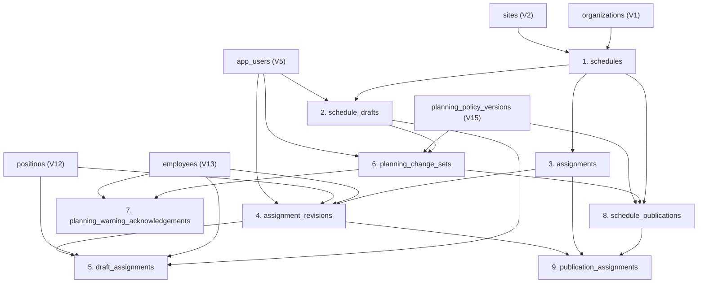

# 29 — Plan de Implementación I3.1-a: Persistencia y Migraciones de Planificación de Turnos

## 1. Propósito y Alcance del Subincremento `I3.1-a`

El subincremento **`I3.1-a — Persistencia y Migraciones de Planificación de Turnos`** materializa en SQL Server el modelo relacional diseñado en [`28 - Diseño Técnico I3 - Planificación de Turnos.md`](file:///d:/Proyectos/TurnoShift/docs/planning/28%20-%20Dise%C3%B1o%20T%C3%A9cnico%20I3%20-%20Planificaci%C3%B3n%20de%20Turnos.md) (§2 y §6).

### 1.1. Qué incluye `I3.1-a`
- Creación de las migraciones Flyway **`V18__schedule_planning_tables.sql`** y **`V19__schedule_planning_circular_fks.sql`**.
- Definición física de las **9 tablas** del núcleo de planificación semanal, sus claves primarias, claves candidatas compuestas multi-tenant `(organization_id, ...)`, claves foráneas compuestas, restricciones `CHECK`, índices únicos filtrados e índices operativos por ventana temporal.
- Resolución segura en dos pasos (`V18` + `V19`) de las referencias circulares entre `schedules`, `schedule_drafts`, `planning_change_sets` y `schedule_publications`.
- Creación de la suite de integración de persistencia [`SchedulePlanningPersistenceIT.java`](file:///d:/Proyectos/TurnoShift/backend/src/test/java/com/turnoshift/persistence/SchedulePlanningPersistenceIT.java) y sincronización de las aserciones de versión del historial Flyway (`V1`–`V19`) y catálogo de tablas en las pruebas de actualización y arranque existentes.

### 1.2. Qué queda excluido de `I3.1-a`
- Entidades de dominio Java, motor `ScheduleValidationEngine` y repositorios JDBC (corresponden a `I3.1-b`).
- Casos de uso transaccionales con `sp_getapplock` (`TurnoShift_OrgPlanning_<organizationId>`), adaptadores hacia `I2.2`/`I2.3`/`I2.4` y controladores HTTP (corresponden a `I3.1-c`).
- Modificación de `docs/api/openapi.yaml` (`I3.1-d`) e interfaces Frontend (`F5` y `F6`).
- Cualquier alteración de las migraciones históricas ya consolidadas **`V1`–`V17`**.

---

## 2. Delimitación Exacta de las Nuevas Migraciones (`V18` y `V19`)

Siguiendo el patrón arquitectónico establecido en `V13`/`V14` (empleados y vínculo en `app_users`) y `V15`/`V16` (`planning_policy_versions` y puntero vigente en `organizations`, conforme a `DEC-08-DEFER-FK-POLICY`), la persistencia de planificación se divide en dos migraciones con responsabilidades estrictamente separadas:

| Versión | Archivo | Responsabilidad Individual Exacta |
| :---: | :--- | :--- |
| **`V18`** | `backend/src/main/resources/db/migration/V18__schedule_planning_tables.sql` | 1. Crear en orden topológico sin ciclos las **9 tablas** del dominio de planificación (`schedules`, `schedule_drafts`, `assignments`, `assignment_revisions`, `draft_assignments`, `planning_change_sets`, `planning_warning_acknowledgements`, `schedule_publications`, `publication_assignments`).<br>2. Declarar todas las claves primarias (`PRIMARY KEY`), claves candidatas empresariales (`UNIQUE (organization_id, ...)`), claves foráneas compuestas acíclicas, restricciones `CHECK` de dominio (lunes canónico, intervalos de 15 a 960 min, estados válidos, tipos de cambio exclusivamente de `I3+`, coherencia de punteros nulos/no nulos y umbrales de advertencias).<br>3. Declarar las columnas puntero hacia publicaciones (`schedules.current_publication_id`, `schedule_drafts.base_publication_id`, `schedule_drafts.result_publication_id`) como `UNIQUEIDENTIFIER NULL` listas para enlazar en `V19`.<br>4. Crear los índices únicos filtrados (`uix_schedule_drafts_one_open`, `uix_draft_assignments_unique_published_ref`) y los índices de búsqueda temporal por sede/colaborador/intervalo. |
| **`V19`** | `backend/src/main/resources/db/migration/V19__schedule_planning_circular_fks.sql` | 1. Ejecutar comprobaciones *preflight fail-closed* (`IF EXISTS (...) THROW 50000, ...`) verificando que no existan punteros huérfanos ni cruzados entre organizaciones en `schedules.current_publication_id`, `schedule_drafts.base_publication_id` ni `schedule_drafts.result_publication_id`.<br>2. Instalar mediante `ALTER TABLE ... ADD CONSTRAINT` las **3 claves foráneas compuestas diferidas** que cierran el ciclo relacional hacia `schedule_publications (organization_id, schedule_id, id)` con `ON DELETE NO ACTION ON UPDATE NO ACTION`. |

---

## 3. Orden Seguro de Creación de Tablas, Candidate Keys, FKs Compuestas, Checks e Índices (`V18`)

Para que SQL Server ejecute `V18` de principio a fin sin errores de objetos inexistentes ni rutas de cascada múltiples (*multiple cascade paths*), las 9 tablas deben crearse exactamente en el siguiente **orden topológico**:



### 3.1. Especificación Tabla por Tabla en `V18`

#### Paso 1 — Tabla `schedules` (Contenedor Semanal por Sede)
- **Propósito:** Identificar de forma única la semana de planificación (`week_start` lunes) para una organización y sede, manteniendo el puntero a la publicación vigente (`current_publication_id`).
- **Columnas clave y defaults:**
  - `id UNIQUEIDENTIFIER NOT NULL DEFAULT NEWID()`
  - `organization_id UNIQUEIDENTIFIER NOT NULL`
  - `site_id UNIQUEIDENTIFIER NOT NULL`
  - `week_start DATE NOT NULL`
  - `current_publication_id UNIQUEIDENTIFIER NULL` *(FK diferida a `V19`)*
  - `lock_version BIGINT NOT NULL DEFAULT 0`
  - `created_at DATETIMEOFFSET(3) NOT NULL DEFAULT SYSUTCDATETIME()`
  - `updated_at DATETIMEOFFSET(3) NOT NULL DEFAULT SYSUTCDATETIME()`
- **Primary Key y Candidate Keys:**
  - `pk_schedules PRIMARY KEY (id)`
  - `uq_schedules_org_id UNIQUE (organization_id, id)` *(habilita FKs compuestas desde tablas hijas)*
  - `uq_schedules_org_site_week UNIQUE (organization_id, site_id, week_start)` *(unicidad de una planificación por sede/semana)*
  - `uq_schedules_org_id_current_pub UNIQUE (organization_id, id, current_publication_id)`
- **Foreign Keys (`ON DELETE NO ACTION ON UPDATE NO ACTION`):**
  - `fk_schedules_organization`: `(organization_id) -> organizations (id)`
  - `fk_schedules_site`: `(organization_id, site_id) -> sites (organization_id, id)`
- **Checks:**
  - `chk_schedules_week_start_monday CHECK (DATEDIFF(DAY, '19000101', week_start) % 7 = 0)` *(determinista e independiente de `@@DATEFIRST`, ya que `1900-01-01` fue lunes)*.
  - `chk_schedules_lock_version_non_negative CHECK (lock_version >= 0)`

#### Paso 2 — Tabla `schedule_drafts` (Borradores Semanales)
- **Propósito:** Representar propuestas de horario editables (`BORRADOR`) o finalizadas (`PUBLICADO`, `DESCARTADO`) asociadas a un `schedule_id`.
- **Columnas clave y defaults:**
  - `id UNIQUEIDENTIFIER NOT NULL DEFAULT NEWID()`
  - `organization_id UNIQUEIDENTIFIER NOT NULL`
  - `schedule_id UNIQUEIDENTIFIER NOT NULL`
  - `base_publication_id UNIQUEIDENTIFIER NULL` *(FK diferida a `V19`)*
  - `status VARCHAR(16) COLLATE Latin1_General_100_BIN2 NOT NULL DEFAULT 'BORRADOR'`
  - `result_publication_id UNIQUEIDENTIFIER NULL` *(FK diferida a `V19`)*
  - `change_reason NVARCHAR(500) NULL`
  - `created_by_user_id UNIQUEIDENTIFIER NOT NULL`
  - `lock_version BIGINT NOT NULL DEFAULT 0`
  - `created_at DATETIMEOFFSET(3) NOT NULL DEFAULT SYSUTCDATETIME()`
  - `updated_at DATETIMEOFFSET(3) NOT NULL DEFAULT SYSUTCDATETIME()`
- **Primary Key y Candidate Keys:**
  - `pk_schedule_drafts PRIMARY KEY (id)`
  - `uq_schedule_drafts_org_id UNIQUE (organization_id, id)`
  - `uq_schedule_drafts_org_schedule_id UNIQUE (organization_id, schedule_id, id)` *(habilita que `draft_assignments` valide pertenencia tanto al borrador como al mismo `schedule_id`)*
- **Foreign Keys (`ON DELETE NO ACTION ON UPDATE NO ACTION`):**
  - `fk_schedule_drafts_organization`: `(organization_id) -> organizations (id)`
  - `fk_schedule_drafts_schedule`: `(organization_id, schedule_id) -> schedules (organization_id, id)`
  - `fk_schedule_drafts_author`: `(organization_id, created_by_user_id) -> app_users (organization_id, id)`
- **Checks:**
  - `chk_schedule_drafts_status CHECK (status IN ('BORRADOR', 'PUBLICADO', 'DESCARTADO'))`
  - `chk_schedule_drafts_result_coherence CHECK ((status = 'PUBLICADO' AND result_publication_id IS NOT NULL) OR (status IN ('BORRADOR', 'DESCARTADO') AND result_publication_id IS NULL))`
  - `chk_schedule_drafts_reason_not_blank CHECK (change_reason IS NULL OR LEN(LTRIM(RTRIM(change_reason))) > 0)`
  - `chk_schedule_drafts_lock_version_non_negative CHECK (lock_version >= 0)`
- **Índice Único Filtrado (`RN-027`):**
  - `CREATE UNIQUE INDEX uix_schedule_drafts_one_open ON schedule_drafts (organization_id, schedule_id) WHERE status = 'BORRADOR';`

#### Paso 3 — Tabla `assignments` (Identidad Estable de Turnos Publicados)
- **Propósito:** Otorgar un identificador estable a cada turno publicado a lo largo de múltiples revisiones o intercambios futuros (`I4`).
- **Columnas clave:**
  - `id UNIQUEIDENTIFIER NOT NULL DEFAULT NEWID()`, `organization_id UNIQUEIDENTIFIER NOT NULL`, `schedule_id UNIQUEIDENTIFIER NOT NULL`, `created_at DATETIMEOFFSET(3) NOT NULL DEFAULT SYSUTCDATETIME()`
- **Primary Key, Candidate Keys y Foreign Keys:**
  - `pk_assignments PRIMARY KEY (id)`
  - `uq_assignments_org_schedule_id UNIQUE (organization_id, schedule_id, id)` *(única candidate key necesaria para validar pertenencia simultánea a la organización y a la semana desde `assignment_revisions`, `draft_assignments` y `publication_assignments`, evitando duplicar un índice `(organization_id, id)`)*
  - `fk_assignments_organization`: `(organization_id) -> organizations (id)`
  - `fk_assignments_schedule`: `(organization_id, schedule_id) -> schedules (organization_id, id)`

#### Paso 4 — Tabla `assignment_revisions` (Contenido Inmutable Versionado de Turno)
- **Propósito:** Almacenar de forma append-only e inmutable los datos efectivos del turno en cada versión publicada, incluyendo snapshots de nombres (`RN-033`).
- **Columnas clave:**
  - `id UNIQUEIDENTIFIER NOT NULL DEFAULT NEWID()`, `organization_id`, `schedule_id`, `assignment_id`, `revision_number INT NOT NULL`, `employee_id`, `position_id`, `starts_at DATETIMEOFFSET(3) NOT NULL`, `ends_at DATETIMEOFFSET(3) NOT NULL`, `employee_name_snapshot NVARCHAR(150) NOT NULL`, `position_name_snapshot NVARCHAR(100) NOT NULL`, `created_by_user_id`, `created_at DATETIMEOFFSET(3) NOT NULL DEFAULT SYSUTCDATETIME()`
  - *Nota sobre `shift_types`:* Se elimina `shift_type_id` para `I3`. No se persiste ningún UUID sin FK ni tabla propietaria; cuando se apruebe el catálogo `shift_types` en un incremento futuro, una migración dedicada añadirá el catálogo, la FK compuesta y los posibles snapshots.
- **Primary Key y Candidate Keys:**
  - `pk_assignment_revisions PRIMARY KEY (id)`
  - `uq_assignment_revisions_org_sched_assign_id UNIQUE (organization_id, schedule_id, assignment_id, id)` *(candidate key compuesta estricta para las FKs de `draft_assignments` y `publication_assignments`; evita crear índices redundantes `(organization_id, id)` o `(organization_id, assignment_id, id)`)*
  - `uq_assignment_revisions_number UNIQUE (organization_id, assignment_id, revision_number)`
- **Foreign Keys (`ON DELETE NO ACTION ON UPDATE NO ACTION`):**
  - `fk_assignment_revisions_organization`: `(organization_id) -> organizations (id)`
  - `fk_assignment_revisions_assignment`: `(organization_id, schedule_id, assignment_id) -> assignments (organization_id, schedule_id, id)`
  - `fk_assignment_revisions_employee`: `(organization_id, employee_id) -> employees (organization_id, id)`
  - `fk_assignment_revisions_position`: `(organization_id, position_id) -> positions (organization_id, id)`
  - `fk_assignment_revisions_author`: `(organization_id, created_by_user_id) -> app_users (organization_id, id)`
- **Checks e Índices:**
  - `chk_assignment_revisions_rev_positive CHECK (revision_number > 0)`
  - `chk_assignment_revisions_interval CHECK (starts_at < ends_at AND DATEDIFF(MINUTE, starts_at, ends_at) BETWEEN 15 AND 960)`
  - `chk_assignment_revisions_emp_snapshot_not_empty CHECK (LEN(LTRIM(RTRIM(employee_name_snapshot))) > 0)`
  - `chk_assignment_revisions_pos_snapshot_not_empty CHECK (LEN(LTRIM(RTRIM(position_name_snapshot))) > 0)`
  - Índice de búsqueda temporal y por colaborador: `ix_assignment_revisions_org_emp_interval ON assignment_revisions (organization_id, employee_id, starts_at, ends_at) INCLUDE (schedule_id, assignment_id, position_id)`

#### Paso 5 — Tabla `draft_assignments` (Líneas Editables del Borrador)
- **Propósito:** Persistir los bloques de turno editables de un borrador (`RN-057`), con referencia opcional (`assignment_id`, `base_revision_id`) cuando el borrador proviene de una publicación previa de esa misma semana.
- **Columnas clave:**
  - `id UNIQUEIDENTIFIER NOT NULL DEFAULT NEWID()`, `organization_id`, `schedule_id`, `draft_id`, `assignment_id UNIQUEIDENTIFIER NULL`, `base_revision_id UNIQUEIDENTIFIER NULL`, `employee_id`, `position_id`, `starts_at DATETIMEOFFSET(3) NOT NULL`, `ends_at DATETIMEOFFSET(3) NOT NULL`, `created_at DATETIMEOFFSET(3) NOT NULL DEFAULT SYSUTCDATETIME()`, `updated_at DATETIMEOFFSET(3) NOT NULL DEFAULT SYSUTCDATETIME()`
  - *Nota sobre `shift_types`:* Sin columna `shift_type_id` en `I3`.
- **Primary Key, Candidate Keys y Foreign Keys:**
  - `pk_draft_assignments PRIMARY KEY (id)`
  - `uq_draft_assignments_org_id UNIQUE (organization_id, id)`
  - `fk_draft_assignments_organization`: `(organization_id) -> organizations (id)` (`NO ACTION`)
  - `fk_draft_assignments_draft`: `(organization_id, schedule_id, draft_id) -> schedule_drafts (organization_id, schedule_id, id) ON DELETE CASCADE ON UPDATE NO ACTION` *(única cascada permitida sobre líneas efímeras del borrador; no genera multiple cascade paths porque las demás FKs usan `NO ACTION`)*
  - `fk_draft_assignments_employee`: `(organization_id, employee_id) -> employees (organization_id, id)` (`NO ACTION`)
  - `fk_draft_assignments_position`: `(organization_id, position_id) -> positions (organization_id, id)` (`NO ACTION`)
  - `fk_draft_assignments_assignment`: `(organization_id, schedule_id, assignment_id) -> assignments (organization_id, schedule_id, id)` (`NO ACTION`) *(garantiza que `assignment_id`, cuando existe, pertenezca al mismo `(organization_id, schedule_id)` del borrador)*
  - `fk_draft_assignments_base_revision`: `(organization_id, schedule_id, assignment_id, base_revision_id) -> assignment_revisions (organization_id, schedule_id, assignment_id, id)` (`NO ACTION`) *(garantiza que tanto `assignment_id` como `base_revision_id`, cuando existen, pertenezcan al mismo `(organization_id, schedule_id)` del borrador)*
- **Checks e Índices Filtrados:**
  - `chk_draft_assignments_base_coherence CHECK ((assignment_id IS NULL AND base_revision_id IS NULL) OR (assignment_id IS NOT NULL AND base_revision_id IS NOT NULL))`
  - `chk_draft_assignments_interval CHECK (starts_at < ends_at AND DATEDIFF(MINUTE, starts_at, ends_at) BETWEEN 15 AND 960)`
  - `CREATE UNIQUE INDEX uix_draft_assignments_unique_published_ref ON draft_assignments (organization_id, draft_id, assignment_id) WHERE assignment_id IS NOT NULL;`
  - `CREATE INDEX ix_draft_assignments_draft_starts ON draft_assignments (organization_id, draft_id, starts_at, ends_at) INCLUDE (employee_id, position_id);`

#### Paso 6 — Tabla `planning_change_sets` (Conjuntos de Cambio de Planificación)
- **Propósito:** Registrar exclusivamente operaciones de confirmación de planificación iniciadas en `I3` o posteriores (`PUBLICACION_BORRADOR`, `REVISION_PUBLICACION`, `APROBACION_INTERCAMBIO`), conservando `policy_version_id` como snapshot/referencia inmutable de la versión de política operativa evaluada (`I2.3` conserva su propia trazabilidad de activación en `planning_policy_versions`).
- **Columnas clave:**
  - `id UNIQUEIDENTIFIER NOT NULL DEFAULT NEWID()`
  - `organization_id UNIQUEIDENTIFIER NOT NULL`
  - `schedule_id UNIQUEIDENTIFIER NOT NULL`
  - `change_type VARCHAR(32) COLLATE Latin1_General_100_BIN2 NOT NULL`
  - `actor_user_id UNIQUEIDENTIFIER NOT NULL`
  - `policy_version_id UNIQUEIDENTIFIER NOT NULL`
  - `source_draft_id UNIQUEIDENTIFIER NULL`
  - `reason NVARCHAR(500) NULL`
  - `empty_schedule_confirmed BIT NOT NULL DEFAULT 0`
  - `validation_fingerprint BINARY(32) NOT NULL`
  - `validation_schema_version INT NOT NULL DEFAULT 1`
  - `correlation_id UNIQUEIDENTIFIER NULL`
  - `confirmed_at DATETIMEOFFSET(3) NOT NULL DEFAULT SYSUTCDATETIME()`
- **Primary Key, Candidate Keys y Foreign Keys (`NO ACTION`):**
  - `pk_planning_change_sets PRIMARY KEY (id)`
  - `uq_planning_change_sets_org_id UNIQUE (organization_id, id)` *(usada por `planning_warning_acknowledgements`)*
  - `uq_planning_change_sets_org_sched_id_policy UNIQUE (organization_id, schedule_id, id, policy_version_id)` *(garantiza que `schedule_publications` pertenezca al mismo `(organization_id, schedule_id)` y referencie exactamente la misma `policy_version_id` del `change_set`)*
  - `fk_planning_change_sets_organization`: `(organization_id) -> organizations (id)`
  - `fk_planning_change_sets_schedule`: `(organization_id, schedule_id) -> schedules (organization_id, id)`
  - `fk_planning_change_sets_actor`: `(organization_id, actor_user_id) -> app_users (organization_id, id)`
  - `fk_planning_change_sets_policy_version`: `(organization_id, policy_version_id) -> planning_policy_versions (organization_id, id)`
  - `fk_planning_change_sets_source_draft`: `(organization_id, schedule_id, source_draft_id) -> schedule_drafts (organization_id, schedule_id, id)` *(valida mediante `uq_schedule_drafts_org_schedule_id` que `source_draft_id`, cuando aplica, pertenezca exactamente a la misma semana `schedule_id` y organización)*
- **Checks:**
  - `chk_planning_change_sets_type CHECK (change_type IN ('PUBLICACION_BORRADOR', 'REVISION_PUBLICACION', 'APROBACION_INTERCAMBIO'))` *(sin `'ACTIVACION_POLITICA'`)*
  - `chk_planning_change_sets_draft_coherence CHECK ((change_type IN ('PUBLICACION_BORRADOR', 'REVISION_PUBLICACION') AND source_draft_id IS NOT NULL) OR (change_type = 'APROBACION_INTERCAMBIO'))`
  - `chk_planning_change_sets_empty_reason CHECK (empty_schedule_confirmed = 0 OR (reason IS NOT NULL AND LEN(LTRIM(RTRIM(reason))) > 0))` *(garantiza `DEC-03`: una publicación vacía confirmada exige motivo no vacío)*
  - `chk_planning_change_sets_reason_not_blank CHECK (reason IS NULL OR LEN(LTRIM(RTRIM(reason))) > 0)`
  - `chk_planning_change_sets_schema_ver_pos CHECK (validation_schema_version > 0)`

#### Paso 7 — Tabla `planning_warning_acknowledgements` (Reconocimientos Individuales de Advertencias `DEC-04`)
- **Propósito:** Evidencia estructurada e inmutable por cada advertencia operativa (`WEEKLY_PLANNED_MINUTES_EXCEEDED`) aceptada durante la publicación.
- **Columnas clave:**
  - `id UNIQUEIDENTIFIER NOT NULL DEFAULT NEWID()`, `organization_id`, `change_set_id`, `employee_id`, `warning_code VARCHAR(64) COLLATE Latin1_General_100_BIN2 NOT NULL`, `period_start DATE NOT NULL`, `period_end_exclusive DATE NOT NULL`, `timezone_id_snapshot VARCHAR(64) NOT NULL`, `planned_minutes INT NOT NULL`, `threshold_minutes INT NOT NULL`, `warning_fingerprint BINARY(32) NOT NULL`, `context_schema_version INT NOT NULL DEFAULT 1`, `context_data NVARCHAR(MAX) NULL`, `created_at DATETIMEOFFSET(3) NOT NULL DEFAULT SYSUTCDATETIME()`
- **Primary Key, Candidate Keys, Foreign Keys y Checks:**
  - `pk_planning_warning_acknowledgements PRIMARY KEY (id)`
  - `uq_warning_acks_org_id UNIQUE (organization_id, id)`
  - `uq_warning_acks_change_set_fingerprint UNIQUE (organization_id, change_set_id, warning_fingerprint)`
  - `fk_warning_acks_organization`: `(organization_id) -> organizations (id)`
  - `fk_warning_acks_change_set`: `(organization_id, change_set_id) -> planning_change_sets (organization_id, id)`
  - `fk_warning_acks_employee`: `(organization_id, employee_id) -> employees (organization_id, id)`
  - `chk_warning_acks_code CHECK (warning_code IN ('WEEKLY_PLANNED_MINUTES_EXCEEDED'))`
  - `chk_warning_acks_minutes_exceeded CHECK (threshold_minutes > 0 AND planned_minutes > threshold_minutes)`
  - `chk_warning_acks_period CHECK (DATEDIFF(DAY, period_start, period_end_exclusive) = 7)`
  - `chk_warning_acks_timezone_not_empty CHECK (LEN(LTRIM(RTRIM(timezone_id_snapshot))) > 0)`
  - `chk_warning_acks_json CHECK (context_data IS NULL OR ISJSON(context_data) = 1)`

#### Paso 8 — Tabla `schedule_publications` (Instantáneas Oficiales Inmutables)
- **Propósito:** Representar cada versión oficial publicada (`publication_number = 1, 2, ...`) de un cuadrante semanal.
- **Columnas clave:**
  - `id UNIQUEIDENTIFIER NOT NULL DEFAULT NEWID()`, `organization_id`, `schedule_id`, `publication_number INT NOT NULL`, `previous_publication_id UNIQUEIDENTIFIER NULL`, `policy_version_id UNIQUEIDENTIFIER NOT NULL`, `timezone_id_snapshot VARCHAR(64) NOT NULL`, `origin VARCHAR(16) COLLATE Latin1_General_100_BIN2 NOT NULL`, `change_set_id UNIQUEIDENTIFIER NOT NULL`, `published_at DATETIMEOFFSET(3) NOT NULL DEFAULT SYSUTCDATETIME()`
- **Primary Key y Candidate Keys:**
  - `pk_schedule_publications PRIMARY KEY (id)`
  - `uq_schedule_publications_org_schedule_id UNIQUE (organization_id, schedule_id, id)` *(clave candidata compuesta utilizada tanto por `publication_assignments` como por las 3 FKs diferidas de `V19`; evita crear un índice redundante `(organization_id, id)`)*
  - `uq_schedule_publications_number UNIQUE (organization_id, schedule_id, publication_number)`
  - `uq_schedule_publications_change_set UNIQUE (organization_id, change_set_id)`
- **Foreign Keys (`ON DELETE NO ACTION ON UPDATE NO ACTION`):**
  - `fk_schedule_publications_organization`: `(organization_id) -> organizations (id)`
  - `fk_schedule_publications_schedule`: `(organization_id, schedule_id) -> schedules (organization_id, id)`
  - `fk_schedule_publications_previous`: `(organization_id, schedule_id, previous_publication_id) -> schedule_publications (organization_id, schedule_id, id)`
  - `fk_schedule_publications_policy_version`: `(organization_id, policy_version_id) -> planning_policy_versions (organization_id, id)`
  - `fk_schedule_publications_change_set`: `(organization_id, schedule_id, change_set_id, policy_version_id) -> planning_change_sets (organization_id, schedule_id, id, policy_version_id)` *(garantiza que la publicación y el `change_set` pertenezcan al mismo `(organization_id, schedule_id)` y compartan la misma `policy_version_id`)*
- **Checks:**
  - `chk_schedule_publications_number_positive CHECK (publication_number > 0)`
  - `chk_schedule_publications_prev_coherence CHECK ((publication_number = 1 AND previous_publication_id IS NULL) OR (publication_number > 1 AND previous_publication_id IS NOT NULL))`
  - `chk_schedule_publications_origin CHECK (origin IN ('INICIAL', 'REVISION', 'INTERCAMBIO'))`
  - `chk_schedule_publications_origin_coherence CHECK ((publication_number = 1 AND origin = 'INICIAL') OR (publication_number > 1 AND origin IN ('REVISION', 'INTERCAMBIO')))`
  - `chk_schedule_publications_timezone_not_empty CHECK (LEN(LTRIM(RTRIM(timezone_id_snapshot))) > 0)`

#### Paso 9 — Tabla `publication_assignments` (Asociación Publicación ↔ Revisión de Turno)
- **Propósito:** Vincular cada `schedule_publications` con el conjunto exacto de `assignment_revisions` vigentes en esa instantánea (0 filas cuando se trata de una semana publicada vacía `DEC-03`), garantizando que publicación, asignación y revisión pertenezcan al mismo `(organization_id, schedule_id)`.
- **Columnas clave:**
  - `organization_id UNIQUEIDENTIFIER NOT NULL`, `schedule_id UNIQUEIDENTIFIER NOT NULL`, `publication_id UNIQUEIDENTIFIER NOT NULL`, `assignment_id UNIQUEIDENTIFIER NOT NULL`, `assignment_revision_id UNIQUEIDENTIFIER NOT NULL`
- **Primary Key y Foreign Keys (`ON DELETE NO ACTION ON UPDATE NO ACTION`):**
  - `pk_publication_assignments PRIMARY KEY (organization_id, schedule_id, publication_id, assignment_id)` *(impide incluir dos revisiones distintas del mismo `assignment_id` en una misma publicación)*
  - `fk_pub_assignments_publication`: `(organization_id, schedule_id, publication_id) -> schedule_publications (organization_id, schedule_id, id)`
  - `fk_pub_assignments_assignment`: `(organization_id, schedule_id, assignment_id) -> assignments (organization_id, schedule_id, id)`
  - `fk_pub_assignments_revision`: `(organization_id, schedule_id, assignment_id, assignment_revision_id) -> assignment_revisions (organization_id, schedule_id, assignment_id, id)`
- **Índice de consulta:**
  - `CREATE INDEX ix_pub_assignments_revision ON publication_assignments (organization_id, schedule_id, assignment_revision_id) INCLUDE (publication_id, assignment_id);`

---

## 4. Resolución Explícita de las Referencias Circulares (`V19` y Protocolo Transaccional)

### 4.1. Por qué existen ciclos en el modelo relacional
En el modelo de planificación existen tres lazos de integridad cruzada:
1. **`schedules` ↔ `schedule_publications`:**
   - Toda publicación pertenece a una planificación (`schedule_publications (organization_id, schedule_id) -> schedules (organization_id, id)`).
   - El encabezado de la semana apunta a su publicación activa (`schedules (organization_id, id, current_publication_id) -> schedule_publications (organization_id, schedule_id, id)`).
2. **`schedule_drafts` ↔ `schedule_publications`:**
   - Un borrador pertenece a una planificación (`schedule_drafts (organization_id, schedule_id) -> schedules (organization_id, id)`) y es fuente del conjunto de cambio (`planning_change_sets (organization_id, schedule_id, source_draft_id) -> schedule_drafts (organization_id, schedule_id, id)`) del que nace `schedule_publications`.
   - A su vez, el borrador apunta a la publicación base sobre la que se abrió (`base_publication_id`) y, al publicarse, apunta a la publicación resultante (`result_publication_id`) dentro del mismo `(organization_id, schedule_id)`.
3. **`planning_change_sets` ↔ `schedule_publications`:**
   - `schedule_publications` referencia a `planning_change_sets` mediante la FK cuádruple `(organization_id, schedule_id, change_set_id, policy_version_id) -> planning_change_sets (organization_id, schedule_id, id, policy_version_id)`. Este vínculo **no es circular** siempre que `planning_change_sets` se cree e inserte **antes** que `schedule_publications`.

### 4.2. Cómo los resuelve `V19__schedule_planning_circular_fks.sql` a nivel DDL
Una vez creadas `schedules`, `schedule_drafts` y `schedule_publications` en `V18` (incluyendo la clave candidata `uq_schedule_publications_org_schedule_id (organization_id, schedule_id, id)`), la migración `V19`:
1. Ejecuta tres validaciones *preflight fail-closed* (`IF EXISTS (...) THROW 50000, ...`) para garantizar que ningún puntero no nulo contradiga la integridad referencial antes de añadir las restricciones.
2. Instala las **3 claves foráneas compuestas** que aseguran pertenencia simultánea a la **misma organización** y al **mismo `schedule_id`**:
   - **`fk_schedules_current_publication`:**
     `schedules (organization_id, id, current_publication_id) -> schedule_publications (organization_id, schedule_id, id)`
   - **`fk_schedule_drafts_base_publication`:**
     `schedule_drafts (organization_id, schedule_id, base_publication_id) -> schedule_publications (organization_id, schedule_id, id)`
   - **`fk_schedule_drafts_result_publication`:**
     `schedule_drafts (organization_id, schedule_id, result_publication_id) -> schedule_publications (organization_id, schedule_id, id)`

> [!IMPORTANT]
> Gracias a que tanto las FKs directas de `V18` (`fk_planning_change_sets_source_draft`, `fk_schedule_publications_change_set`, `fk_draft_assignments_assignment`, `fk_draft_assignments_base_revision`, `fk_pub_assignments_publication`, `fk_pub_assignments_assignment`, `fk_pub_assignments_revision`) como las 3 FKs diferidas de `V19` incluyen `(organization_id, schedule_id)`, SQL Server impide físicamente cualquier cruce de punteros entre dos semanas distintas (`W1` y `W2`) incluso dentro de la misma organización.

### 4.3. Protocolo de Escritura en Dos Pasos en Tiempo de Ejecución (SQL Server sin `DEFERRABLE`)
Dado que SQL Server evalúa las restricciones `CHECK` y `FOREIGN KEY` sentencia por sentencia (no soporta `DEFERRABLE INITIALLY DEFERRED`), toda transacción de publicación (y las pruebas de persistencia de `I3.1-a`) ejecuta la siguiente secuencia ordenada dentro de la misma transacción:

1. **Estado previo al publicar:** Existe la fila en `schedules` (`current_publication_id = NULL` o `pub_N`) y el borrador en `schedule_drafts` con `status = 'BORRADOR'` y `result_publication_id = NULL` (cumpliendo `chk_schedule_drafts_result_coherence`).
2. **Paso 1 (`INSERT planning_change_sets` + `planning_warning_acknowledgements`):** Se inserta el conjunto de cambio referenciando `(organization_id, schedule_id, source_draft_id)` (que ya existe en `schedule_drafts`) y `(organization_id, policy_version_id)` (que ya existe en `planning_policy_versions`).
3. **Paso 2 (`INSERT assignments` + `assignment_revisions`):** Si existen turnos en el borrador, se insertan sus identidades y revisiones inmutables referenciando `(organization_id, schedule_id)`.
4. **Paso 3 (`INSERT schedule_publications` + `publication_assignments`):** Se inserta la nueva fila en `schedule_publications` referenciando `(organization_id, schedule_id)` y `(organization_id, schedule_id, change_set_id, policy_version_id)`, seguida de las filas en `publication_assignments` con `(organization_id, schedule_id, publication_id, assignment_id, assignment_revision_id)`.
5. **Paso 4 (`UPDATE schedule_drafts` y `UPDATE schedules`):** Ya existiendo la fila de `schedule_publications`, se ejecutan dos `UPDATE`:
   - `UPDATE schedule_drafts SET status = 'PUBLICADO', result_publication_id = @pubId, lock_version = lock_version + 1, updated_at = SYSUTCDATETIME() WHERE organization_id = @orgId AND id = @draftId;` *(satisface en una sola sentencia tanto `chk_schedule_drafts_result_coherence` como `fk_schedule_drafts_result_publication`)*.
   - `UPDATE schedules SET current_publication_id = @pubId, lock_version = lock_version + 1, updated_at = SYSUTCDATETIME() WHERE organization_id = @orgId AND id = @scheduleId;` *(satisface `fk_schedules_current_publication`)*.

---

## 5. Diseño de las Pruebas de Persistencia, Upgrades y Arranque

### 5.1. Nueva Suite Dedicada: `SchedulePlanningPersistenceIT`
Se creará [`backend/src/test/java/com/turnoshift/persistence/SchedulePlanningPersistenceIT.java`](file:///d:/Proyectos/TurnoShift/backend/src/test/java/com/turnoshift/persistence/SchedulePlanningPersistenceIT.java) (`@SpringBootTest`, `@Testcontainers`, `@Transactional`, `@Rollback`) cubriendo los siguientes escenarios verificables sobre SQL Server 2022 real:

1. **Esquema nuevo desde base vacía e inspección de catálogo:**
   - Verifica que `flyway_schema_history` contiene exactamente `"1"` a `"19"` con `success = 1`.
   - Verifica en `INFORMATION_SCHEMA.TABLES`, `INFORMATION_SCHEMA.COLUMNS` (incluyendo la ausencia de `shift_type_id` en `draft_assignments` y `assignment_revisions`) y `sys.objects` / `sys.indexes` la existencia física de las 9 tablas nuevas, todas las PKs, Candidate Keys (`uq_*`), FKs de `V18` y `V19` (`fk_*`), Checks (`chk_*`) e índices filtrados (`uix_schedule_drafts_one_open`, `uix_draft_assignments_unique_published_ref`).
2. **Flujo completo de publicación en dos pasos y referencias circulares (`V19`):**
   - Inserta organización, sede, puesto, colaborador, usuario autor y versión de política activa (`V15`/`V16`).
   - Crea `schedules` (`week_start = '2026-10-05'`, lunes), `schedule_drafts` (`BORRADOR`), `draft_assignments`, `planning_change_sets` (`PUBLICACION_BORRADOR`), `assignments`, `assignment_revisions`, `schedule_publications` (`publication_number = 1`, `origin = 'INICIAL'`) y `publication_assignments`, y actualiza `schedule_drafts.result_publication_id` + `schedules.current_publication_id`.
   - Verifica que `fk_schedules_current_publication`, `fk_schedule_drafts_base_publication` y `fk_schedule_drafts_result_publication` rechazan con `DataIntegrityViolationException` cualquier intento de enlazar una publicación de otro `schedule_id` o de otra organización.
3. **Aislamiento multi-tenant estricto (Organization A vs Organization B):**
   - Verifica que SQL Server rechaza mediante sus FKs compuestas:
     - Crear un `schedules` en la Organización A apuntando a una `site_id` de la Organización B (`fk_schedules_site`).
     - Crear un `draft_assignments` o `assignment_revisions` en la Organización A apuntando a un `employee_id` o `position_id` de la Organización B (`fk_draft_assignments_employee`, `fk_draft_assignments_position`, `fk_assignment_revisions_employee`, `fk_assignment_revisions_position`).
     - Crear un `planning_change_sets` en la Organización A apuntando a una `policy_version_id` de la Organización B (`fk_planning_change_sets_policy_version`) o un `schedule_publications` cuya `policy_version_id` no coincida con la del `change_set_id` (`fk_schedule_publications_change_set`).
4. **Escenarios negativos explícitos de mismo tenant, distinta semana (`schedule_id` de `W1` vs `W2`):**
   - **Rechazo de `source_draft_id` cruzado en `planning_change_sets`:** para un mismo tenant con dos semanas `W1` y `W2`, intentar insertar un `planning_change_sets` en `W2` cuyo `source_draft_id` pertenezca al borrador de `W1` falla con `DataIntegrityViolationException` conteniendo el nombre exacto de la restricción `fk_planning_change_sets_source_draft` (y análogamente `fk_schedule_publications_change_set` si se intenta asociar una publicación de `W2` con un `change_set` de `W1`).
   - **Rechazo de `base_revision_id` / `assignment_id` cruzado en `draft_assignments`:** intentar insertar en el borrador de `W2` una línea cuyo `assignment_id` y `base_revision_id` pertenezcan a un turno publicado en `W1` del mismo tenant falla con `DataIntegrityViolationException` conteniendo el nombre exacto de la FK compuesta (`fk_draft_assignments_assignment` / `fk_draft_assignments_base_revision`).
   - **Rechazo de revisión cruzada en `publication_assignments`:** intentar insertar en `publication_assignments` una fila que asocie una publicación de `W2` con un `assignment_id` o `assignment_revision_id` perteneciente a `W1` del mismo tenant falla con `DataIntegrityViolationException` conteniendo el nombre exacto de la FK compuesta (`fk_pub_assignments_publication`, `fk_pub_assignments_assignment` o `fk_pub_assignments_revision`).
5. **Unicidad de una planificación por sede/semana (`uq_schedules_org_site_week`):**
   - Verifica que dos filas en `schedules` con el mismo `(organization_id, site_id, week_start)` son rechazadas por `uq_schedules_org_site_week`, mientras que la misma fecha `week_start` está permitida para otra organización.
6. **Unicidad de un único borrador abierto (`uix_schedule_drafts_one_open`, `RN-027`):**
   - Verifica que para un mismo `(organization_id, schedule_id)` pueden coexistir múltiples borradores históricos en estado `DESCARTADO` o `PUBLICADO`, pero insertar un segundo registro con `status = 'BORRADOR'` falla con `DataIntegrityViolationException` mencionando `uix_schedule_drafts_one_open`.
7. **Checks de lunes, duración de turno, pertenencia y estados:**
   - **Check de lunes (`chk_schedules_week_start_monday`):** insertar `week_start = '2026-10-06'` (martes) o `'2026-10-04'` (domingo) falla con `chk_schedules_week_start_monday`.
   - **Check de duración e intervalo (`chk_draft_assignments_interval`, `chk_assignment_revisions_interval`):** rechaza `starts_at >= ends_at`, duraciones de `14` minutos (`< 15`) y duraciones de `961` minutos (`> 960`); acepta turnos de `15` min, `480` min y turnos nocturnos que cruzan medianoche (`22:00` a `06:00` del día siguiente).
   - **Check de estado y coherencia de borrador (`chk_schedule_drafts_status`, `chk_schedule_drafts_result_coherence`):** rechaza `status = 'PUBLICADO'` con `result_publication_id IS NULL` y rechaza `status = 'BORRADOR'` con `result_publication_id IS NOT NULL`.
   - **Check de `planning_change_sets.change_type` (`chk_planning_change_sets_type`):** acepta `'PUBLICACION_BORRADOR'`, `'REVISION_PUBLICACION'` y `'APROBACION_INTERCAMBIO'`, y rechaza explícitamente `'ACTIVACION_POLITICA'` con `chk_planning_change_sets_type`.
8. **Publicación de semana vacía (`DEC-03`) y reconocimiento de advertencias (`DEC-04`):**
   - Verifica que se puede publicar una semana con `0` filas en `publication_assignments` cuando `empty_schedule_confirmed = 1` y `reason` es no vacío; y que `chk_planning_change_sets_empty_reason` rechaza `empty_schedule_confirmed = 1` cuando `reason IS NULL` o está en blanco.
   - Verifica la inserción en `planning_warning_acknowledgements` y que `chk_warning_acks_minutes_exceeded` rechaza filas donde `planned_minutes <= threshold_minutes`.
9. **Upgrade progresivo desde `V17` (`target("17")` → `target("19")`):**
   - Levanta un contenedor SQL Server aislado, migra con Flyway hasta `target("17")`, inserta datos previos de `organizations`, `sites`, `positions`, `employees`, `app_users`, `planning_policy_versions` (con puntero activo en `organizations.current_policy_version_id`) y `employee_unavailabilities`.
   - Ejecuta `Flyway.migrate()` hasta `target("19")`.
   - Verifica que todos los registros previos de `V1`–`V17` permanecen intactos y que sobre ellos se puede crear y publicar un cuadrante semanal completo.

### 5.2. Sincronización de Pruebas Existentes de Historial Flyway y Arranque
Al agregar `V18` y `V19` al classpath (`db/migration`), las pruebas existentes que validan la lista exacta de versiones aplicadas con `.containsExactly(...)` deben actualizar su expectativa de `"1".."17"` a `"1".."19"`:
- [`SchemaUpgradeV3ToLatestIT.java`](file:///d:/Proyectos/TurnoShift/backend/src/test/java/com/turnoshift/persistence/SchemaUpgradeV3ToLatestIT.java): actualizar la aserción de `flyway_schema_history` a `"1".."19"` y añadir verificación de presencia de las tablas de planificación.
- [`SpringBootStartupIT.java`](file:///d:/Proyectos/TurnoShift/backend/src/test/java/com/turnoshift/health/SpringBootStartupIT.java): actualizar `flywayAutoConfigAplicoMigraciones()` a `"1".."19"` y agregar las 9 tablas nuevas de planificación en `tablasDeProduccionExisten()`.
- [`PolicyPersistenceIT.java`](file:///d:/Proyectos/TurnoShift/backend/src/test/java/com/turnoshift/persistence/PolicyPersistenceIT.java), [`UnavailabilityPersistenceIT.java`](file:///d:/Proyectos/TurnoShift/backend/src/test/java/com/turnoshift/persistence/UnavailabilityPersistenceIT.java) y [`OrganizationsSitesSchemaIT.java`](file:///d:/Proyectos/TurnoShift/backend/src/test/java/com/turnoshift/persistence/OrganizationsSitesSchemaIT.java): actualizar `.containsExactly(...)` de `flyway_schema_history` a `"1".."19"` para mantener consistencia total cuando se ejecuten.

---

## 6. Archivos Exactos a Crear o Modificar en `I3.1-a`

### 6.1. Archivos Nuevos a Crear (3 archivos)
1. `backend/src/main/resources/db/migration/V18__schedule_planning_tables.sql`
2. `backend/src/main/resources/db/migration/V19__schedule_planning_circular_fks.sql`
3. `backend/src/test/java/com/turnoshift/persistence/SchedulePlanningPersistenceIT.java`

### 6.2. Archivos Existentes a Modificar (5 archivos de prueba)
1. [`backend/src/test/java/com/turnoshift/persistence/SchemaUpgradeV3ToLatestIT.java`](file:///d:/Proyectos/TurnoShift/backend/src/test/java/com/turnoshift/persistence/SchemaUpgradeV3ToLatestIT.java)
2. [`backend/src/test/java/com/turnoshift/health/SpringBootStartupIT.java`](file:///d:/Proyectos/TurnoShift/backend/src/test/java/com/turnoshift/health/SpringBootStartupIT.java)
3. [`backend/src/test/java/com/turnoshift/persistence/PolicyPersistenceIT.java`](file:///d:/Proyectos/TurnoShift/backend/src/test/java/com/turnoshift/persistence/PolicyPersistenceIT.java)
4. [`backend/src/test/java/com/turnoshift/persistence/UnavailabilityPersistenceIT.java`](file:///d:/Proyectos/TurnoShift/backend/src/test/java/com/turnoshift/persistence/UnavailabilityPersistenceIT.java)
5. [`backend/src/test/java/com/turnoshift/persistence/OrganizationsSitesSchemaIT.java`](file:///d:/Proyectos/TurnoShift/backend/src/test/java/com/turnoshift/persistence/OrganizationsSitesSchemaIT.java)

*(Ninguna migración previa `V1`–`V17` será modificada).*

---

## 7. Secuencia de Tareas de Implementación y Comando Focalizado

### 7.1. Tareas Propuestas
- **Tarea 1 — Escritura de `V18__schedule_planning_tables.sql`:** Implementar las 9 tablas en orden topológico (sin `shift_type_id`), con `SYSUTCDATETIME()`, `NEWID()`, collations `Latin1_General_100_BIN2`, candidate keys compuestas `(organization_id, schedule_id, ...)`, FKs acíclicas que garantizan pertenencia tanto a la organización como a la semana (`schedule_id`), restricciones `CHECK` e índices filtrados.
- **Tarea 2 — Escritura de `V19__schedule_planning_circular_fks.sql`:** Implementar las validaciones *preflight fail-closed* y las 3 claves foráneas compuestas (`fk_schedules_current_publication`, `fk_schedule_drafts_base_publication`, `fk_schedule_drafts_result_publication`).
- **Tarea 3 — Implementación de `SchedulePlanningPersistenceIT.java`:** Cubrir los 9 bloques de pruebas de persistencia (base vacía, ciclo completo de publicación y FKs circulares, aislamiento multi-tenant, escenarios negativos de mismo tenant y distinta semana comprobando el nombre de cada FK compuesta, unicidad de semana y borrador abierto, checks de lunes/duración/estados/`change_type`, semana vacía y advertencias, y upgrade `V17 -> V19`).
- **Tarea 4 — Sincronización de historial Flyway en pruebas existentes:** Actualizar la lista esperada `"1".."19"` en `SchemaUpgradeV3ToLatestIT`, `SpringBootStartupIT`, `PolicyPersistenceIT`, `UnavailabilityPersistenceIT` y `OrganizationsSitesSchemaIT`.
- **Tarea 5 — Ejecución del único comando Maven focalizado:** Validar las nuevas migraciones, el upgrade progresivo y el arranque de Spring Boot contra SQL Server en Testcontainers.

### 7.2. Único Comando Maven Focalizado Final
Al finalizar la codificación de `I3.1-a`, se ejecutará desde el directorio `backend` **un único comando Maven focalizado** (usando `-Dtest=...` sobre la fase `test` sin `clean`, sin `verify`, sin `failsafe` y sin ejecutar suites globales):

```powershell
$env:JAVA_HOME = 'C:\Users\juan9\.jdks\temurin-21.0.10'; .\mvnw.cmd test "-Dtest=SchedulePlanningPersistenceIT,SchemaUpgradeV3ToLatestIT,SpringBootStartupIT"
```

---

## 8. Riesgos Técnicos y Criterios de Aceptación de `I3.1-a`

### 8.1. Riesgos Técnicos y Mitigación en SQL Server
1. **Error `1785` de SQL Server (*Multiple Cascade Paths*):**
   - *Riesgo:* SQL Server prohíbe definir `ON DELETE CASCADE` cuando una tabla hija alcanza una misma tabla ancestro (`organizations` o `schedules`) por más de una ruta de claves foráneas.
   - *Mitigación:* Todas las claves foráneas de `V18` y `V19` se declaran con `ON DELETE NO ACTION ON UPDATE NO ACTION`, con la única excepción controlada de `fk_draft_assignments_draft` (`draft_assignments -> schedule_drafts ON DELETE CASCADE`), que es segura porque todas las demás rutas hacia `schedule_drafts` y `organizations` usan `NO ACTION`.
2. **Dependencia de configuración regional en el cálculo del lunes (`@@DATEFIRST`):**
   - *Riesgo:* `DATEPART(WEEKDAY, week_start)` varía según el `SET DATEFIRST` de la sesión SQL Server.
   - *Mitigación:* El check `chk_schedules_week_start_monday` utiliza `DATEDIFF(DAY, '19000101', week_start) % 7 = 0`, cuya evaluación aritmética es invariante frente a `@@DATEFIRST` e idioma del servidor.
3. **Bloqueo al cerrar referencias circulares en tiempo de ejecución:**
   - *Riesgo:* Intentar insertar `schedule_drafts` con `status = 'PUBLICADO'` antes de que exista `schedule_publications`.
   - *Mitigación:* `schedule_drafts` nace siempre como `'BORRADOR'` (`result_publication_id = NULL`), se inserta `planning_change_sets` y `schedule_publications`, y se transiciona a `'PUBLICADO'` junto con `result_publication_id = @pubId` en un único `UPDATE` atómico.

### 8.2. Criterios de Aceptación de `I3.1-a`
1. `V18__schedule_planning_tables.sql` y `V19__schedule_planning_circular_fks.sql` aplican limpiamente desde una base vacía (`V1`–`V19`) y desde una base con datos preexistentes en `V17` (`V17` → `V19`), sin persistir `shift_type_id` en `draft_assignments` ni `assignment_revisions`.
2. Ninguna migración previa (`V1`–`V17`) ha sido editada ni renombrada (`validateOnMigrate = true` en verde).
3. Todas las restricciones `PRIMARY KEY`, `UNIQUE`, `FOREIGN KEY`, `CHECK` e índices filtrados existen con sus nombres exactos y rechazan tanto cruces multi-tenant como referencias cruzadas entre distintas semanas (`schedule_id`) del mismo tenant en `SchedulePlanningPersistenceIT`.
4. `planning_change_sets.change_type` admite únicamente `'PUBLICACION_BORRADOR'`, `'REVISION_PUBLICACION'` y `'APROBACION_INTERCAMBIO'`, rechazando `'ACTIVACION_POLITICA'`.
5. El comando focalizado `.\mvnw.cmd test "-Dtest=SchedulePlanningPersistenceIT,SchemaUpgradeV3ToLatestIT,SpringBootStartupIT"` finaliza con `BUILD SUCCESS` y `0` fallos.
