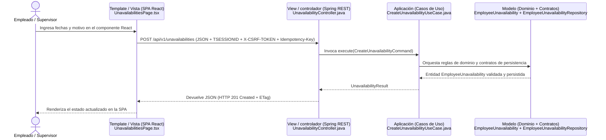

# 30 - Auditoría Académica de Entrega 2 a 6

- **Proyecto:** TurnoShift — Sistema Web SaaS de Planificación Operativa de Turnos, Disponibilidad y Cambios Controlados
- **Curso:** Curso Integrador 1: Sistemas de Software (Universidad Tecnológica del Perú — UTP)
- **Empresa caso de estudio:** **Café Andino S.A.C.** (cafetería y restaurante casual en Lima; operación continua lunes a domingo de `06:30` a `22:30`; puestos operativos: Caja, Barra de café, Cocina fría/caliente, Salón y Limpieza/Apoyo; 1 sede inicial con arquitectura preparada para multi-sede)
- **Índice académico objetivo auditado en este documento:**
  - **2. Planteamiento de alternativas de solución** (`2.1 Primera alternativa`, `2.2 Segunda alternativa`, `2.3 Tercera alternativa`)
  - **3. Diseño de la solución**
  - **4. Prototipos**
  - **5. Pantallas web**
  - **6. Diseño arquitectónico** (`6.1 Patrón MTV`, `6.2 Patrón DAO`)
- **Relación con los capítulos previos ya terminados (`1.9` y `1.10`):** Los Requisitos Funcionales (`1.9`) y los Requisitos No Funcionales (`1.10`) ya forman parte del Capítulo 1 entregado. En esta auditoría se utilizan **exclusivamente como insumo trazable de entrada** para evaluar las alternativas de solución (`Punto 2`), fundamentar el diseño de la solución (`Punto 3`), contrastar los prototipos (`Punto 4`), evidenciar las pantallas web construidas (`Punto 5`) y justificar el diseño arquitectónico (`Punto 6`).
- **Fecha de auditoría:** 2026-04-19
- **Modo de ejecución:** Auditoría documental y técnica en modo lectura sobre el repositorio (`d:\Proyectos\TurnoShift`). Ningún archivo de código, migración, contrato OpenAPI ni documento existente fue alterado.
- **Invariante de honestidad académica:**
  - **`IMPLEMENTADO (Backend + Frontend demostrable)`**: Funcionalidad respaldada por migración Flyway (`V1`–`V17`), código en `backend/`, contrato en `docs/api/openapi.yaml` y pantalla web interactiva en `frontend/` (`I0`, `I1`, `I2.1`, `I2.2`, `I2.4` y `F1`–`F4`).
  - **`IMPLEMENTADO SOLO EN BACKEND/API`**: Funcionalidad respaldada por migración SQL, dominio, casos de uso y controlador REST en `backend/` + `openapi.yaml`, pero **sin pantalla frontend demostrable** (`I2.3` Políticas Operativas e interfaz de operador `/api/v1/operator/*`).
  - **`ALCANCE OBJETIVO DEL MVP Y PROTOTIPOS/DOCUMENTACIÓN DE DISEÑO; NO IMPLEMENTADOS TODAVÍA`**: Planificación semanal, publicación, consulta de horario (`I3`) e intercambios de turno (`I4`).
  - **`FUERA DE ALCANCE`**: Control biométrico de asistencia, reloj marcador, cálculo de planilla/horas extras, horas efectivamente trabajadas, app móvil nativa iOS/Android, optimización automática con IA/solver y certificaciones formales (ISO/SOC2).

> [!WARNING]
> **Advertencia obligatoria sobre el `README.md` de la raíz:**
> **Las cifras antiguas del README no deben utilizarse en la memoria académica sin verificación.** El archivo `README.md` refleja únicamente el corte histórico del incremento `I0` (`V1`–`V3`) y no el estado real del repositorio (`I0`, `I1`, `I2.1`/`I2.2`/`I2.4` con UI, `I2.3` en Backend/API y `F1`–`F4`). Cualquier cifra global no verificada en el acto debe tratarse como **dato a verificar**.

---

## 1. Resumen ejecutivo del estado real

### 1.1 Síntesis ejecutiva para la defensa académica

| Evidencia demostrable hoy (Backend + Frontend o Backend/API) | Evidencia de diseño o prototipo (Alcance objetivo del MVP; no implementados todavía) | No debe afirmarse como implementado |
| :--- | :--- | :--- |
| - **Autenticación, sesiones JDBC (`TSESSIONID`), CSRF y rate-limiting (`I1` + `F1`):** `/login` (`LoginPage.tsx`), `/setup#token=...` (`SetupPage.tsx`), `AuthController.java`, `InvitationAcceptanceController.java`. - **Bootstrap de empresa por operador (`I1.2`):** `OperatorAuthController.java`, `OrganizationBootstrapController.java`. - **Configuración de empresa (`I2.1` + `F2`):** `/app/configuracion` (`ConfigurationPage.tsx`, `OrganizationConfigController.java`, `V12`). - **Catálogo de puestos operativos (`I2.2` + `F2`):** `/app/puestos` (`PositionsPage.tsx`, `PositionController.java`, `V3`, `V13`, `V14`). - **Gestión de colaboradores e invitaciones (`I1.4` + `F3`):** `/app/empleados` (`EmployeesPage.tsx`, `EmployeeController.java`, `V3`, `V7`, `V8`). - **Indisponibilidades con detección de traslapes (`I2.4` + `F4`):** `/app/indisponibilidades` (`UnavailabilitiesPage.tsx`, `UnavailabilityController.java`, `V17`). - **Políticas operativas versionadas (`I2.3` — solo Backend/API):** `PolicyController.java` (`/api/v1/policies/*`) y migraciones `V15`–`V16` (**sin pantalla frontend demostrable**). | - **Planificación semanal de turnos, validación dura/blanda y publicación (`I3`):** Documentación de diseño técnico en `docs/planning/28 - Diseño Técnico I3 - Planificación de Turnos.md` y `docs/planning/29 - Plan de Implementación I3.1-a - Persistencia y Migraciones.md` (migraciones proyectadas `V18` y `V19`). - **Consulta de horario del colaborador (`I3`):** Ruta navegable `/app/mi-horario` en `App.tsx` y `AppSidebar.tsx` que actualmente renderiza el prototipo `PlaceholderPage.tsx`, más especificación de prototipo `UI-12` en `Nota 08`. - **Solicitudes de intercambio de turno (`I4`):** Documentado como alcance objetivo del MVP y prototipos en `Notas 04, 05, 07, 08, 09 y 10` (sin documento de diseño técnico de implementación aprobado ni código). | - **Que el conjunto `I2` está completamente visible en interfaz gráfica:** `I2.3` (Políticas Operativas) está implementado en backend/API pero carece de pantalla en React. - **Que la planificación semanal (`I3`), la publicación de horarios, la consulta de turnos reales en `/app/mi-horario` o los intercambios de turno (`I4`) están implementados.** - **Cualquier funcionalidad fuera del alcance del MVP:** marcación biométrica, reloj control, cálculo de planillas/horas extras, horas efectivamente trabajadas, app móvil nativa u optimización automática por IA. |

### 1.2 Estado real por incremento y trazabilidad con los requisitos de `1.9` y `1.10`

| Incremento / Fase | Alcance funcional y técnico | Estado real preciso en el repositorio | Trazabilidad con los insumos de `1.9` (RF) y `1.10` (RNF) |
| :--- | :--- | :--- | :--- |
| **`I0` + `I1` (`I1.1`–`I1.6`) + `F1`–`F3`** | Fundación multi-tenant, sesiones JDBC (`TSESSIONID`), Argon2id, CSRF, rate-limiting, bootstrap de empresa, directorio de colaboradores e invitaciones de un solo uso | **`IMPLEMENTADO (Backend + Frontend demostrable)`** | Satisface `RF-01` (autenticación y aislamiento por `company_id`), `RF-04` (gestión de colaboradores y onboarding) y `RNF-01` a `RNF-08`. |
| **`I2.1`, `I2.2` e `I2.4` + `F2` / `F4`** | Configuración operativa de empresa (`I2.1`), catálogo de puestos (`I2.2`) y gestión/revisión de indisponibilidades con bloqueo de traslapes (`I2.4`) | **`IMPLEMENTADO (Backend + Frontend demostrable)`** | Satisface `RF-02` (en configuración de empresa `I2.1`), `RF-03` (catálogo de puestos `I2.2`) y `RF-05` (indisponibilidades `I2.4`). |
| **`I2.3`** | Políticas Operativas de Planificación versionadas (`planning_policy_versions`: descanso mínimo, horas máximas diarias/semanales) | **`IMPLEMENTADO SOLO EN BACKEND/API` (Sin pantalla frontend demostrable)** | Satisface en backend/API la parametrización de políticas de `RF-02` y los umbrales de `RN-05`/`RN-06` (`PolicyController.java`, `V15`–`V16`), quedando pendiente su pantalla web en el Punto 5. |
| **`I3` e `I4`** | Planificación semanal de turnos, validación de conflictos al publicar, consulta de horario (`I3`) e intercambios de turno (`I4`) | **`ALCANCE OBJETIVO DEL MVP Y PROTOTIPOS/DOCUMENTACIÓN DE DISEÑO; NO IMPLEMENTADOS TODAVÍA`** | Corresponden a los insumos `RF-06` a `RF-12` del capítulo `1.9`. Se documentan en el **Punto 3 (Diseño de la solución)** y en el **Punto 4 (Prototipos)**, pero no se afirman como pantallas web terminadas en el **Punto 5**. |

---

## 2. Reconciliación con el primer avance y presentación PDF

### 2.1 Hallazgos de reconciliación documental

1. **Ausencia física de archivos `.pdf` / `.pptx` dentro del repositorio:** Se verificó que `TurnoShift_Primer_Avance_Presentacion.pptx.pdf` (y los documentos iniciales del Primer Avance) no se encuentran almacenados en `d:\Proyectos\TurnoShift`. La reconciliación entre dichos entregables y la solución actual se encuentra registrada en `docs/planning/14 - Auditoría de Coherencia Documental y Reconciliación.md` (§6) y en `docs/planning/23` y `24`.
2. **Desfase en `README.md` y documentos preliminares:**
   - **Las cifras antiguas del README no deben utilizarse en la memoria académica sin verificación.** `README.md` solo describe el estado inicial `I0`.
   - `docs/context/PROJECT_CONTEXT.md` y `docs/planning/06 - Arquitectura y Stack Tecnológico.md` (§4) mencionaban inicialmente `Spring Data JPA`, mientras que la solución construida en `backend/pom.xml` emplea **`spring-boot-starter-jdbc` (`JdbcTemplate`) sin JPA/Hibernate**, lo cual sustenta directamente el **Punto `6.2 Patrón DAO`**.

### 2.2 Cómo alinear los capítulos `1.9` / `1.10` ya entregados con los Puntos `2` al `6`

- **No repetir `1.9` (Requisitos Funcionales) ni `1.10` (Requisitos No Funcionales) como capítulos nuevos:** En la Entrega 2–6, los códigos `RF-01`..`RF-12` y `RNF-01`..`RNF-08` ya definidos en el Capítulo 1 se referencian únicamente como **criterios de evaluación y trazabilidad** dentro del **Punto 2 (Planteamiento de alternativas de solución)**, del **Punto 3 (Diseño de la solución)**, del **Punto 4 (Prototipos)**, del **Punto 5 (Pantallas web)** y del **Punto 6 (Diseño arquitectónico)**.

---

## 3. Insumos verificados para Punto 2 — Planteamiento de alternativas de solución

> **Objetivo del Punto 2 del índice académico:** Evaluar tres alternativas de solución frente a la problemática operativa de **Café Andino S.A.C.** y a los requisitos ya establecidos en `1.9` y `1.10`, justificando técnica, operativa y económicamente por qué se eligió la tercera alternativa (**TurnoShift**).
> **Fuentes verificables en el repositorio:** `docs/planning/01 - Contexto de la Empresa y Caso de Estudio.md`, `docs/planning/02 - Problemática y Dolores Operativos.md`, `docs/planning/06 - Arquitectura y Stack Tecnológico.md` y `docs/context/DECISIONS.md`.

### 3.1 Estructura e insumos para `2.1 Primera alternativa`

- **Denominación propuesta:** **Gestión semi-estructurada mediante plantillas en la nube (Google Sheets / Excel Online con macros) y coordinación por mensajería instantánea.**
- **Descripción técnica y operativa:** Estandarizar hojas de cálculo compartidas en la nube con fórmulas condicionales para registrar los turnos de los colaboradores de **Café Andino S.A.C.** (`06:30`–`22:30`) y formularios básicos (Google Forms) para recibir indisponibilidades.
- **Evaluación frente a los insumos `1.9` y `1.10`:**
  - **Ventajas:** Costo de licenciamiento e infraestructura prácticamente nulo; curva de aprendizaje inmediata para el administrador.
  - **Limitaciones críticas (por qué se descarta):**
    - No garantiza control de acceso por rol ni aislamiento estricto de vistas (`RF-01`, `RNF-03`): un colaborador puede alterar celdas por error o ver datos internos.
    - Carece de control transaccional y bloqueo pesimista/optimista (`RNF-04`, `RNF-08`) ante ediciones concurrentes de dos supervisores.
    - No impide de forma determinista el solapamiento de indisponibilidades (`RF-05`) ni conserva historial inmutable de políticas (`RF-02`) ni bitácora de auditoría (`RNF-05`).

### 3.2 Estructura e insumos para `2.2 Segunda alternativa`

- **Denominación propuesta:** **Adopción de una suite SaaS internacional genérica de Workforce Management (WFM) / módulo de RR.HH. de un ERP comercial.**
- **Descripción técnica y operativa:** Contratar licencias por usuario/mes de una plataforma corporativa extranjera de gestión de turnos y asistencia (orientada a grandes cadenas retail o corporativos con módulos de reloj biométrico, nómina e inteligencia artificial).
- **Evaluación frente a los insumos `1.9` y `1.10`:**
  - **Ventajas:** Disponibilidad inmediata en la nube y cobertura estándar de cuadrículas de turnos.
  - **Limitaciones críticas (por qué se descarta):**
    - **Sobrecosto recurrente y sobredimensionamiento:** El cobro mensual en dólares por cada uno de los colaboradores (incluyendo alta rotación de jóvenes a medio tiempo en **Café Andino S.A.C.**) encarece el costo total de propiedad (TCO).
    - **Fricción funcional con el alcance real:** Estas suites acoplan la planificación a módulos de marcación biométrica, geolocalización y cálculo de planilla que están fuera del alcance requerido por la operación, mientras carecen de flexibilidad para adaptar el flujo de onboarding por invitación de un solo uso sin correo corporativo obligatorio (`RF-04`) o el versionado explícito de políticas por semana (`RF-02`).

### 3.3 Estructura e insumos para `2.3 Tercera alternativa` (Alternativa seleccionada)

- **Denominación propuesta:** **Desarrollo de la aplicación web SaaS a medida TurnoShift basada en Monolito Modular en Capas (Spring Boot 4 + Spring JDBC + SQL Server 2022) y SPA en React 19.**
- **Descripción técnica y operativa:** Construcción de una plataforma web multi-empresa (`company_id`) diseñada específicamente para operaciones gastronómicas y de servicios como **Café Andino S.A.C.**, accesible desde cualquier navegador de escritorio o móvil sin requerir instalación nativa.
- **Justificación de selección frente a `2.1` y `2.2` (evidencia real en el repositorio):**
  1. **Adecuación exacta a los requisitos `1.9`:** Implementa el flujo real de configuración operativa (`I2.1`), catálogo de puestos (`I2.2`), políticas versionadas (`I2.3`), onboarding por invitación de un solo uso (`I1.4`), indisponibilidades con validación de traslapes (`I2.4`) y estructura el diseño del alcance objetivo de horarios (`I3`) e intercambios (`I4`).
  2. **Cumplimiento riguroso de los atributos de calidad `1.10`:** Autenticación con hash **Argon2id** (`Argon2PasswordService.java`), sesiones persistidas en SQL Server (`SPRING_SESSION`, cookie `TSESSIONID`), protección CSRF (`X-CSRF-TOKEN`), idempotencia (`IdempotencyService.java`), concurrencia optimista (`ETag`/`If-Match`) y auditoría (`audit_events`).
  3. **Sostenibilidad arquitectónica y académica:** Permite aplicar con total claridad el **Patrón MTV adaptado a SPA + API REST (`6.1`)** y el **Patrón DAO con `JdbcTemplate` (`6.2`)** sin el costo ni la caja negra de un ERP externo.

---

## 4. Insumos verificados para Punto 3 — Diseño de la solución

> **Objetivo del Punto 3 del índice académico:** Presentar el diseño técnico integral de la solución seleccionada (`2.3`), abarcando la organización modular del sistema, el diseño de base de datos relacional (`SQL Server 2022`), el contrato de servicios REST (`OpenAPI 3.1`) y los mecanismos de seguridad y consistencia.

### 4.1 Organización modular de la solución (`backend/` y `frontend/`)

- **Módulos construidos en `backend/src/main/java/com/turnoshift/backend/`:**
  - `identity/`: Autenticación (`AuthController`), aceptación de invitaciones (`InvitationAcceptanceController`), cuentas de usuario (`UserAccount`), tokens de invitación (`InvitationToken`) e historial de credenciales (`user_credential_history`).
  - `operator/`: Autenticación de operadores de plataforma (`OperatorAuthController`) para soporte y aprovisionamiento SaaS.
  - `organization/`: Bootstrap de empresas (`OrganizationBootstrapController`), configuración operativa `I2.1` (`OrganizationConfigController`) y catálogo de puestos `I2.2` (`PositionController`).
  - `policy/`: Gestión y activación de versiones de políticas operativas `I2.3` (`PolicyController`, `PlanningPolicyVersion`) — **implementado en Backend/API, sin pantalla frontend demostrable**.
  - `team/`: Directorio de colaboradores, asignación de puestos/roles y gestión del ciclo de vida de invitaciones `I1.4` (`EmployeeController`, `Employee`).
  - `unavailability/`: Registro, consulta, revisión (`APPROVED`/`REJECTED`) y cancelación de indisponibilidades `I2.4` (`UnavailabilityController`, `EmployeeUnavailability`).
  - `security/` y `shared/`: Configuración de doble cadena de filtros (`SecurityConfig`), sesiones JDBC (`SpringSessionPrincipalSessionInvalidator`), rate-limiting (`JdbcAuthRateLimitAdapter`), idempotencia (`IdempotencyService`), auditoría (`JdbcAuditEventWriter`) y manejo estandarizado de errores RFC 9457 (`GlobalExceptionHandler`).
- **Módulos del alcance objetivo del MVP y prototipos/documentación de diseño; no implementados todavía:**
  - **Planificación semanal, publicación y consulta de horario (`I3`):** Documentado en `docs/planning/28 - Diseño Técnico I3 - Planificación de Turnos.md` y `docs/planning/29 - Plan de Implementación I3.1-a - Persistencia y Migraciones.md`.
  - **Intercambios de turno (`I4`):** Documentado a nivel de alcance funcional y conceptual en `Notas 04, 05, 07, 08 y 10` (sin documento de diseño técnico de implementación aprobado).

### 4.2 Diseño de Base de Datos en SQL Server 2022 (`V1`–`V17` implementadas vs. alcance objetivo `I3`/`I4`)

1. **Esquema físico `IMPLEMENTADO` en `backend/src/main/resources/db/migration/` (`V1` a `V17`):**
   - **Núcleo Multi-Tenant y Organización:** `dbo.companies` (`V1`, `V6`, `V12`), `dbo.positions` (`V3`, `V13`, `V14`), `dbo.planning_policy_versions` (`V15`, `V16`).
   - **Identidad, Seguridad y Onboarding:** `dbo.users` (`V1`, `V5`), `dbo.user_credential_history` (`V10`), `dbo.invitation_tokens` (`V8`), `dbo.auth_rate_limits` (`V11`), `dbo.SPRING_SESSION` y `dbo.SPRING_SESSION_ATTRIBUTES` (`V9`), `dbo.platform_operators` (`V4`), `dbo.provisioning_requests` (`V6`).
   - **Equipo Operativo e Indisponibilidades:** `dbo.employees` (`V3`, `V7` con clave foránea compuesta `FK_employees_company_position` hacia `dbo.positions` y `FK_employees_company_user` hacia `dbo.users`), `dbo.employee_unavailabilities` (`V17` con restricción `CK_employee_unavailabilities_time_range` e índice `IX_employee_unavailabilities_overlap_lookup`).
   - **Consistencia y Trazabilidad Transversal:** `dbo.idempotency_records` (`V2`) y `dbo.audit_events` (`V2`).
2. **Esquema proyectado perteneciente al `alcance objetivo del MVP y prototipos/documentación de diseño; no implementados todavía`:**
   - **Para `I3` (documentado en `Nota 28` y `Nota 29` como migraciones proyectadas `V18` y `V19`):** `schedules`, `schedule_drafts`, `assignments`, `assignment_revisions`, `draft_assignments`, `planning_change_sets`, `planning_warning_acknowledgements`, `schedule_publications` y `publication_assignments`.
   - **Para `I4` (documentado conceptualmente en `Nota 07`):** `shift_swap_requests`.

### 4.3 Diseño de la API REST (`docs/api/openapi.yaml` `v0.2.4-i2.4`)

- Contrato formal en **OpenAPI 3.1.0** (`docs/api/openapi.yaml`) que define los esquemas JSON de petición/respuesta, los requisitos de autenticación por cookie `TSESSIONID`, el token `X-CSRF-TOKEN`, la cabecera `Idempotency-Key`, el control de concurrencia `ETag`/`If-Match` y las respuestas de error `application/problem+json` (RFC 9457).

---

## 5. Insumos verificados para Punto 4 — Prototipos

> **Objetivo del Punto 4 del índice académico:** Documentar el proceso de prototipado visual y funcional de la interfaz de usuario (sistema de diseño, evolución desde los wireframes iniciales y maquetas/prototipos de las vistas del alcance objetivo del MVP que aún no están implementadas como pantallas web definitivas).
> **Fuentes verificables en el repositorio:** `docs/planning/08 - Especificación Funcional y Flujos UI-UX.md`, `docs/planning/09 - Especificación Visual y Sistema de Diseño UI.md`, `docs/planning/23`, `docs/planning/24`, `frontend/src/styles/tokens.css` y `frontend/src/pages/PlaceholderPage.tsx`.

### 5.1 Sistema de Diseño y Tokens Visuales (`Nota 09` y `frontend/src/styles/tokens.css`)

- **Dirección estética:** Interfaz de precisión operativa (*Enterprise Precision*), diseñada para minimizar errores de lectura en tablas de turnos, estados de empleados y rangos horarios.
- **Tokens verificables en `frontend/src/styles/tokens.css`:**
  - Color de acción primaria: Azul institucional (`#1E40AF` / `#2563EB`).
  - Superficies y bordes: Fondo de aplicación `#F8FAFC`, contenedores `#FFFFFF`, divisores `#E2E8F0`, texto principal `#0F172A`.
  - Semántica de insignias (`badges`): Verde esmeralda para estados activos/aprobados (`ACTIVE`, `APPROVED`), ámbar para pendientes (`PENDING`, `PENDING_ONBOARDING`), rojo para rechazos/suspensiones (`REJECTED`, `SUSPENDED`) y gris pizarra para archivados/cancelados (`ARCHIVED`, `CANCELLED`).

### 5.2 Evolución de los prototipos iniciales (Depuración de Stitch)

- En la etapa temprana se elaboraron wireframes exploratorios en Stitch. Durante la planificación de `F1` (`Nota 23`) y `F2` (`Nota 24`), dichos prototipos fueron auditados y depurados para eliminar elementos visuales que no correspondían al alcance real (como menciones cosméticas a "ERP", "Control Biométrico", "ISO 27001" o enlaces de recuperación de contraseña por correo no implementados), consolidando el flujo de activación por **invitación de un solo uso (`/setup#token=...`)**.

### 5.3 Catálogo de prototipos y especificaciones visuales para el Punto 4

En el **Punto 4 (Prototipos)** deben presentarse dos grupos claramente diferenciados:
1. **Bocetos / especificaciones de origen (`Nota 08` y `Nota 09`) que dieron lugar a las pantallas ya construidas:**
   - Especificaciones `UI-01` (Login), `UI-02`/`UI-03` (Activación por invitación), `UI-04` (Inicio), `UI-05` (Configuración y Puestos), `UI-06` (Colaboradores) y `UI-09`/`UI-13` (Indisponibilidades).
2. **Prototipos y documentación de diseño del `alcance objetivo del MVP; no implementados todavía`:**
   - **Prototipo navegable en el código actual (`/app/mi-horario` — `PlaceholderPage.tsx`):** Vista accesible desde el menú lateral (`AppSidebar.tsx`) que actúa como marcador de posición interactivo del módulo de consulta de horario semanal.
   - **Prototipos documentales en `Nota 08` para `I3` (Planificación semanal, publicación y consulta de horario):** `UI-07` (Cuadrícula semanal de planificación de turnos en borrador con alertas de conflicto), `UI-08` (Modal de confirmación de publicación semanal), `UI-11` (Historial de versiones publicadas) y `UI-12` (Vista móvil/web de "Mi Horario" publicado).
   - **Prototipos documentales en `Nota 08` para `I4` (Intercambios de turno):** `UI-10` (Bandeja de aprobación/rechazo de cambios de turno para el supervisor) y `UI-14` (Formulario del colaborador para proponer un intercambio con un compañero elegible).

---

## 6. Insumos verificados para Punto 5 — Pantallas web

> **Objetivo del Punto 5 del índice académico:** Presentar y explicar las **pantallas web reales, funcionales y demostrables hoy** construidas en la SPA de **TurnoShift** (`frontend/src/pages/`), conectadas en tiempo real con la API REST de Spring Boot 4 (`backend/`) y SQL Server 2022.

### 6.1 Regla de oro para el Punto 5 (Precisión sobre `I2` y exclusión de `I3`/`I4`)

- **Distinción obligatoria dentro del incremento `I2`:**
  - **`I2.1` (Configuración Operativa), `I2.2` (Catálogo de Puestos) e `I2.4` (Indisponibilidades) cuentan con backend/API y pantalla frontend demostrable.**
  - **`I2.3` (Políticas Operativas) está implementado en backend/API (`PolicyController.java`, migraciones `V15`–`V16`), pero NO cuenta con pantalla frontend demostrable.**
  - Por lo tanto, **no se debe presentar el conjunto `I2` como completamente visible en interfaz gráfica** dentro del Punto 5.
- **Exclusión de `I3` e `I4` como pantallas terminadas:** La planificación semanal, la publicación, la consulta de horario con turnos reales y los intercambios pertenecen al **alcance objetivo del MVP y prototipos/documentación de diseño; no implementados todavía**, por lo que su lugar es el **Punto 4 (Prototipos)** y no el catálogo de pantallas operativas terminadas del **Punto 5**.

### 6.2 Catálogo verificable de Pantallas Web construidas (`frontend/src/pages/`)

| # | Pantalla Web y Ruta real en `App.tsx` | Componente React verificable | Endpoints de Backend consumidos (`frontend/src/api/`) | Roles autorizados (`RoleGuard.tsx`) | Funcionalidades reales demostrables en vivo |
| :--- | :--- | :--- | :--- | :--- | :--- |
| 1 | **Inicio de Sesión** `/login` | [`LoginPage.tsx`](file:///d:/Proyectos/TurnoShift/frontend/src/pages/LoginPage.tsx) | `POST /api/v1/auth/login` `GET /api/v1/auth/me` | Público (`PublicOnlyRoute`) | Autenticación con correo y contraseña, establecimiento de sesión `TSESSIONID`, visualización de errores estandarizados (`ProblemDetail`) y aviso de bloqueo temporal (`429`) por rate-limiting. |
| 2 | **Activación de Cuenta por Invitación (Onboarding)** `/setup#token=...` | [`SetupPage.tsx`](file:///d:/Proyectos/TurnoShift/frontend/src/pages/SetupPage.tsx) | `POST /api/v1/auth/invitations/validate` `POST /api/v1/auth/invitations/accept` | Público con fragmento `#token=` | Lectura segura del token desde el hash de la URL (sin enviarlo en query params al servidor), validación previa del estado de la invitación, muestra de empresa/email/rol asignado y definición de contraseña con validación de complejidad. |
| 3 | **Panel de Inicio (Shell Operativo)** `/app` | [`HomePage.tsx`](file:///d:/Proyectos/TurnoShift/frontend/src/pages/HomePage.tsx) + [`AppSidebar.tsx`](file:///d:/Proyectos/TurnoShift/frontend/src/components/layout/AppSidebar.tsx) | `GET /api/v1/auth/me` `POST /api/v1/auth/logout` | `ADMIN`, `SUPERVISOR`, `EMPLOYEE` | Vista de bienvenida tras el login con barra lateral adaptativa según el rol del usuario, identificación de sesión activa y cierre de sesión seguro. |
| 4 | **Configuración Operativa de la Empresa (`I2.1`)** `/app/configuracion` | [`ConfigurationPage.tsx`](file:///d:/Proyectos/TurnoShift/frontend/src/pages/ConfigurationPage.tsx) | `GET /api/v1/organization/config` `PUT /api/v1/organization/config` | `ADMIN` (lectura y edición), `SUPERVISOR` (solo lectura) | Visualización y actualización del nombre comercial de **Café Andino S.A.C.**, zona horaria IANA (`America/Lima`) y día de inicio de semana (`MONDAY`), enviando `If-Match` (`ETag`) e `Idempotency-Key`. *(No incluye pantalla de `I2.3` Políticas Operativas).* |
| 5 | **Catálogo de Puestos Operativos (`I2.2`)** `/app/puestos` | [`PositionsPage.tsx`](file:///d:/Proyectos/TurnoShift/frontend/src/pages/PositionsPage.tsx) | `GET /api/v1/positions` `POST /api/v1/positions` `PATCH /api/v1/positions/{id}` `PATCH /api/v1/positions/{id}/status` | `ADMIN` (gestión completa), `SUPERVISOR` (consulta) | Listado paginado y filtrado de los puestos operativos (*Caja*, *Barra de café*, *Cocina*, *Salón*, *Limpieza*) con indicador de empleados activos asignados, creación (`CreatePositionModal.tsx`), edición (`EditPositionModal.tsx`) y archivado/reactivación (`PositionStatusModal.tsx`). |
| 6 | **Directorio de Colaboradores y Onboarding (`I1.4` + `F3`)** `/app/empleados` | [`EmployeesPage.tsx`](file:///d:/Proyectos/TurnoShift/frontend/src/pages/EmployeesPage.tsx) | `GET /api/v1/employees` `POST /api/v1/employees` `PATCH /api/v1/employees/{id}` `PATCH /api/v1/employees/{id}/status` `PATCH /api/v1/employees/{id}/role` `POST /api/v1/employees/{id}/invitations/*` `POST /api/v1/employees/{id}/unlink-user` | `ADMIN` (gestión completa), `SUPERVISOR` (consulta) | Registro de colaboradores asociando puesto principal y rol (`CreateEmployeeModal.tsx`), generación y copiado de enlace de invitación de un solo uso (`InvitationLinkModal.tsx`), edición de perfil (`EditEmployeeModal.tsx`), cambio de rol/estado con invalidación automática de sesión (`ChangeRoleModal.tsx`, `ChangeEmployeeStatusModal.tsx`) y desvinculación de cuenta (`UnlinkUserModal.tsx`). |
| 7 | **Gestión y Revisión de Indisponibilidades (`I2.4` + `F4`)** `/app/indisponibilidades` | [`UnavailabilitiesPage.tsx`](file:///d:/Proyectos/TurnoShift/frontend/src/pages/UnavailabilitiesPage.tsx) | `GET /api/v1/unavailabilities` `POST /api/v1/unavailabilities` `PATCH /api/v1/unavailabilities/{id}/review` `POST /api/v1/unavailabilities/{id}/cancel` | `ADMIN`, `SUPERVISOR`, `EMPLOYEE` | Interfaz dual según rol: el `EMPLOYEE` registra sus solicitudes de indisponibilidad y cancela pendientes (`CancelUnavailabilityModal.tsx`); el `SUPERVISOR`/`ADMIN` filtra solicitudes de todo el equipo, registra ausencias directas (`CreateUnavailabilityModal.tsx`) y aprueba o rechaza solicitudes (`ReviewUnavailabilityModal.tsx`) con validación backend de traslapes horarios. |
| 8 | **Control de Acceso Restringido (RBAC)** `/app/403` | [`ForbiddenPage.tsx`](file:///d:/Proyectos/TurnoShift/frontend/src/pages/ForbiddenPage.tsx) | — (Guarda de cliente `RoleGuard.tsx`) | Cualquier rol autenticado que intente acceder a una ruta no permitida | Pantalla de protección cuando un colaborador con rol `EMPLOYEE` intenta navegar manualmente a rutas administrativas como `/app/configuracion`, `/app/puestos` o `/app/empleados`. |

---

## 7. Insumos verificados para Punto 6 — Diseño arquitectónico (`6.1 Patrón MTV` y `6.2 Patrón DAO`)

> **Objetivo del Punto 6 del índice académico:** Explicar y demostrar con código real del repositorio la aplicación de los dos patrones solicitados por la estructura del curso: **6.1 Patrón MTV** y **6.2 Patrón DAO**.

### 7.1 Subcapítulo `6.1 Patrón MTV` (Adaptación didáctica para una arquitectura SPA + API REST)

#### A. Aclaración conceptual obligatoria
El patrón **MTV (Model – Template – View)** proviene de frameworks web monolíticos como Django con renderizado de HTML en el servidor. En la memoria académica debe aclararse explícitamente que **TurnoShift no es una aplicación Django ni utiliza renderizado en servidor (SSR)**, sino que implementa una **adaptación didáctica de MTV para una arquitectura moderna SPA (React 19) + API REST (Spring Boot 4)**, estructurada en los siguientes cuatro elementos verificables:

| Elemento del mapeo académico MTV | Responsabilidad arquitectónica exacta | Evidencia verificable por rutas en **TurnoShift** |
| :--- | :--- | :--- |
| **1. Modelo (`domain/`)** | **Entidades, Value Objects, reglas de dominio y contratos de persistencia.** Representa el núcleo del negocio e invariantes sin acoplamiento a HTTP ni a SQL. | - [`EmployeeUnavailability.java`](file:///d:/Proyectos/TurnoShift/backend/src/main/java/com/turnoshift/backend/unavailability/domain/EmployeeUnavailability.java) - [`EmployeeUnavailabilityRepository.java`](file:///d:/Proyectos/TurnoShift/backend/src/main/java/com/turnoshift/backend/unavailability/domain/EmployeeUnavailabilityRepository.java) - [`Employee.java`](file:///d:/Proyectos/TurnoShift/backend/src/main/java/com/turnoshift/backend/team/domain/Employee.java), [`Position.java`](file:///d:/Proyectos/TurnoShift/backend/src/main/java/com/turnoshift/backend/organization/domain/Position.java), [`PlanningPolicyVersion.java`](file:///d:/Proyectos/TurnoShift/backend/src/main/java/com/turnoshift/backend/policy/domain/PlanningPolicyVersion.java) |
| **2. Aplicación (`application/`)** | **Casos de uso que orquestan las reglas de dominio**, las fronteras transaccionales (`@Transactional`), la idempotencia (`IdempotencyService`) y la auditoría (`AuditEventWriter`). | - [`CreateUnavailabilityUseCase.java`](file:///d:/Proyectos/TurnoShift/backend/src/main/java/com/turnoshift/backend/unavailability/application/CreateUnavailabilityUseCase.java) - [`ReviewUnavailabilityUseCase.java`](file:///d:/Proyectos/TurnoShift/backend/src/main/java/com/turnoshift/backend/unavailability/application/ReviewUnavailabilityUseCase.java) - [`CreateEmployeeUseCase.java`](file:///d:/Proyectos/TurnoShift/backend/src/main/java/com/turnoshift/backend/team/application/CreateEmployeeUseCase.java) - [`UpdateCompanyConfigurationUseCase.java`](file:///d:/Proyectos/TurnoShift/backend/src/main/java/com/turnoshift/backend/organization/application/UpdateCompanyConfigurationUseCase.java) |
| **3. Template / Vista (`frontend/src/pages/` y `components/`)** | **Páginas y componentes React que renderizan la SPA.** Transforman declarativamente los DTOs JSON en interfaces interactivas (tablas, formularios, modales y badges). | - [`UnavailabilitiesPage.tsx`](file:///d:/Proyectos/TurnoShift/frontend/src/pages/UnavailabilitiesPage.tsx) y [`ReviewUnavailabilityModal.tsx`](file:///d:/Proyectos/TurnoShift/frontend/src/components/unavailabilities/ReviewUnavailabilityModal.tsx) - [`EmployeesPage.tsx`](file:///d:/Proyectos/TurnoShift/frontend/src/pages/EmployeesPage.tsx) - [`PositionsPage.tsx`](file:///d:/Proyectos/TurnoShift/frontend/src/pages/PositionsPage.tsx) - [`ConfigurationPage.tsx`](file:///d:/Proyectos/TurnoShift/frontend/src/pages/ConfigurationPage.tsx) |
| **4. View / controlador (`controller/`)** | **Controladores REST de Spring (`@RestController`) que reciben solicitudes HTTP y devuelven JSON.** Validan permisos RBAC y cabeceras HTTP (`Idempotency-Key`, `If-Match`), delegan en la capa de **Aplicación** y serializan la respuesta JSON hacia el **Template/Vista** React. | - [`UnavailabilityController.java`](file:///d:/Proyectos/TurnoShift/backend/src/main/java/com/turnoshift/backend/unavailability/controller/UnavailabilityController.java) - [`EmployeeController.java`](file:///d:/Proyectos/TurnoShift/backend/src/main/java/com/turnoshift/backend/team/controller/EmployeeController.java) - [`PositionController.java`](file:///d:/Proyectos/TurnoShift/backend/src/main/java/com/turnoshift/backend/organization/controller/PositionController.java) - [`OrganizationConfigController.java`](file:///d:/Proyectos/TurnoShift/backend/src/main/java/com/turnoshift/backend/organization/controller/OrganizationConfigController.java) |

#### B. Flujo de interacción de la adaptación didáctica MTV (`SPA + API REST`)

---

### 7.2 Subcapítulo `6.2 Patrón DAO` (`JdbcTemplate` / `NamedParameterJdbcTemplate` sin JPA/Hibernate)

#### A. Fundamentación técnica del Patrón DAO en TurnoShift
El backend de **TurnoShift** implementa el **Patrón DAO (Data Access Object)** de forma explícita y pura mediante **`spring-boot-starter-jdbc` (`JdbcTemplate` y `NamedParameterJdbcTemplate`)**, prescindiendo por completo de `Spring Data JPA` y de Hibernate (`backend/pom.xml`).

Cada módulo separa:
1. **El contrato de persistencia en la capa de Modelo/Dominio (`domain/*Repository.java`):** Define qué operaciones de acceso a datos necesita la lógica de negocio sin exponer detalles de SQL Server.
2. **El objeto de acceso a datos concreto (`infrastructure/persistence/jdbc/Jdbc*Repository.java`):** Implementa el contrato escribiendo consultas SQL parametrizadas, mapeando filas de `ResultSet` a objetos de dominio mediante métodos `RowMapper` explícitos (`mapRow`), aplicando bloqueos pesimistas `WITH (UPDLOCK, HOLDLOCK)` para evitar condiciones de carrera y validando la columna `version` para concurrencia optimista.

#### B. Evidencia verificable de contratos y DAOs JDBC en el repositorio

| Módulo | Contrato de persistencia (`domain/`) | Implementación DAO JDBC (`infrastructure/persistence/jdbc/`) | Responsabilidad de acceso a datos encapsulada |
| :--- | :--- | :--- | :--- |
| **`unavailability` (`I2.4`)** | [`EmployeeUnavailabilityRepository.java`](file:///d:/Proyectos/TurnoShift/backend/src/main/java/com/turnoshift/backend/unavailability/domain/EmployeeUnavailabilityRepository.java) | [`JdbcEmployeeUnavailabilityRepository.java`](file:///d:/Proyectos/TurnoShift/backend/src/main/java/com/turnoshift/backend/unavailability/infrastructure/persistence/jdbc/JdbcEmployeeUnavailabilityRepository.java) | Bloqueo `lockEmployeeForUnavailabilityCheck` (`UPDLOCK, HOLDLOCK`), consulta de traslape temporal (`starts_at_utc < :endsAtUtc AND ends_at_utc > :startsAtUtc`), búsqueda paginada y actualización con `version`. |
| **`team` (`I1.4`)** | [`EmployeeRepository.java`](file:///d:/Proyectos/TurnoShift/backend/src/main/java/com/turnoshift/backend/team/domain/EmployeeRepository.java) | [`JdbcEmployeeRepository.java`](file:///d:/Proyectos/TurnoShift/backend/src/main/java/com/turnoshift/backend/team/infrastructure/persistence/jdbc/JdbcEmployeeRepository.java) | Consultas de directorio con `JOIN dbo.positions`, `LEFT JOIN dbo.users` y `OUTER APPLY dbo.invitation_tokens` usando `NamedParameterJdbcTemplate`. |
| **`organization` (`I2.1` / `I2.2`)** | [`CompanyRepository.java`](file:///d:/Proyectos/TurnoShift/backend/src/main/java/com/turnoshift/backend/organization/domain/CompanyRepository.java) [`PositionRepository.java`](file:///d:/Proyectos/TurnoShift/backend/src/main/java/com/turnoshift/backend/organization/domain/PositionRepository.java) | [`JdbcCompanyRepository.java`](file:///d:/Proyectos/TurnoShift/backend/src/main/java/com/turnoshift/backend/organization/infrastructure/persistence/jdbc/JdbcCompanyRepository.java) [`JdbcPositionRepository.java`](file:///d:/Proyectos/TurnoShift/backend/src/main/java/com/turnoshift/backend/organization/infrastructure/persistence/jdbc/JdbcPositionRepository.java) | Lectura y actualización de `dbo.companies` y `dbo.positions` con conteo agregado de empleados activos por puesto y control de versión optimista. |
| **`policy` (`I2.3`)** | [`PlanningPolicyVersionRepository.java`](file:///d:/Proyectos/TurnoShift/backend/src/main/java/com/turnoshift/backend/policy/domain/PlanningPolicyVersionRepository.java) | [`JdbcPlanningPolicyVersionRepository.java`](file:///d:/Proyectos/TurnoShift/backend/src/main/java/com/turnoshift/backend/policy/infrastructure/persistence/jdbc/JdbcPlanningPolicyVersionRepository.java) | Transición atómica de versiones `ACTIVE` → `SUPERSEDED` e inserción de nuevas versiones en `dbo.planning_policy_versions`. |
| **`identity` (`I1`)** | [`UserRepository.java`](file:///d:/Proyectos/TurnoShift/backend/src/main/java/com/turnoshift/backend/identity/domain/UserRepository.java) [`InvitationTokenRepository.java`](file:///d:/Proyectos/TurnoShift/backend/src/main/java/com/turnoshift/backend/identity/domain/InvitationTokenRepository.java) [`CredentialHistoryRepository.java`](file:///d:/Proyectos/TurnoShift/backend/src/main/java/com/turnoshift/backend/identity/domain/CredentialHistoryRepository.java) | [`JdbcUserRepository.java`](file:///d:/Proyectos/TurnoShift/backend/src/main/java/com/turnoshift/backend/identity/infrastructure/persistence/jdbc/JdbcUserRepository.java) [`JdbcInvitationTokenRepository.java`](file:///d:/Proyectos/TurnoShift/backend/src/main/java/com/turnoshift/backend/identity/infrastructure/persistence/jdbc/JdbcInvitationTokenRepository.java) [`JdbcCredentialHistoryRepository.java`](file:///d:/Proyectos/TurnoShift/backend/src/main/java/com/turnoshift/backend/identity/infrastructure/persistence/jdbc/JdbcCredentialHistoryRepository.java) | Persistencia de identidades multi-tenant, tokens de invitación con hash SHA-256 e historial de credenciales Argon2id. |
| **`security` / `shared`** | [`AuthRateLimitPort.java`](file:///d:/Proyectos/TurnoShift/backend/src/main/java/com/turnoshift/backend/security/ratelimit/AuthRateLimitPort.java) [`AuditEventWriter.java`](file:///d:/Proyectos/TurnoShift/backend/src/main/java/com/turnoshift/backend/shared/audit/AuditEventWriter.java) [`IdempotencyRecordRepository.java`](file:///d:/Proyectos/TurnoShift/backend/src/main/java/com/turnoshift/backend/shared/idempotency/IdempotencyRecordRepository.java) | [`JdbcAuthRateLimitAdapter.java`](file:///d:/Proyectos/TurnoShift/backend/src/main/java/com/turnoshift/backend/security/ratelimit/JdbcAuthRateLimitAdapter.java) [`JdbcAuditEventWriter.java`](file:///d:/Proyectos/TurnoShift/backend/src/main/java/com/turnoshift/backend/shared/audit/JdbcAuditEventWriter.java) [`JdbcIdempotencyRecordRepository.java`](file:///d:/Proyectos/TurnoShift/backend/src/main/java/com/turnoshift/backend/shared/idempotency/JdbcIdempotencyRecordRepository.java) | Control de intentos fallidos (`dbo.auth_rate_limits`), bitácora de auditoría (`dbo.audit_events`) y registros de idempotencia (`dbo.idempotency_records`). |

---

## 8. Matriz de cobertura académica (Alineada exactamente al Índice: Puntos 2 al 6)

| Punto del Índice Académico Oficial | Subpuntos obligatorios | Fuentes e insumos verificados en el repositorio | Enfoque de redacción y honestidad académica |
| :--- | :--- | :--- | :--- |
| **2. Planteamiento de alternativas de solución** | - **2.1 Primera alternativa** (Hojas de cálculo en la nube + mensajería) - **2.2 Segunda alternativa** (Suite SaaS WFM/ERP internacional genérica) - **2.3 Tercera alternativa** (Solución web SaaS a medida **TurnoShift**) | `Notas 01, 02, 06`; `DECISIONS.md`; requisitos ya cerrados en `1.9` y `1.10` como criterios de comparación. | Evaluar las tres opciones contra las necesidades operativas de **Café Andino S.A.C.** y los criterios de `1.9` y `1.10` (sin reabrir un capítulo de requerimientos), justificando la elección de **TurnoShift (`2.3`)**. |
| **3. Diseño de la solución** | - Organización modular funcional y técnica - Diseño de base de datos (`V1`–`V17` implementadas + esquema proyectado del alcance objetivo `I3`/`I4`) - Diseño de servicios API REST (`openapi.yaml`) y seguridad | `Notas 05, 06, 07, 11, 28, 29`; `backend/pom.xml`; `frontend/package.json`; migraciones `V1`–`V17`; `docs/api/openapi.yaml`. | Presentar el diseño integral de la solución distinguiendo con nitidez el núcleo implementado (`V1`–`V17`, `I0`–`I2`) del alcance objetivo del MVP y prototipos/documentación de diseño no implementados todavía (`I3` e `I4`). |
| **4. Prototipos** | - Sistema de diseño y tokens (`tokens.css`) - Depuración de wireframes iniciales (Stitch) - Prototipos del alcance objetivo (`PlaceholderPage.tsx` en `/app/mi-horario` y vistas proyectadas `UI-07`, `UI-08`, `UI-10`, `UI-11`, `UI-12`, `UI-14`) | `Notas 08, 09, 23, 24`; `frontend/src/styles/tokens.css`; `frontend/src/pages/PlaceholderPage.tsx`. | Concentrar aquí todos los prototipos de diseño y el placeholder `/app/mi-horario`, etiquetando la planificación semanal, publicación, consulta de horario e intercambios como **alcance objetivo del MVP y prototipos/documentación de diseño; no implementados todavía**. |
| **5. Pantallas web** | - Pantallas web reales construidas y demostrables hoy en la SPA React 19 (`/login`, `/setup#token=...`, `/app`, `/app/configuracion`, `/app/puestos`, `/app/empleados`, `/app/indisponibilidades`, `/app/403`) | `frontend/src/App.tsx`; `frontend/src/pages/*.tsx`; `frontend/src/components/`; `Nota 27`. | Incluir únicamente las pantallas construidas y funcionales (`F1`–`F4`: `I1`, `I2.1`, `I2.2`, `I2.4`). Aclarar explícitamente que `I2.3` (Políticas Operativas) está implementado en backend/API pero no tiene pantalla web demostrable en React. |
| **6. Diseño arquitectónico** | - **6.1 Patrón MTV** (Adaptación didáctica SPA + API REST: Modelo, Aplicación, Template/Vista, View/controlador) - **6.2 Patrón DAO** (`JdbcTemplate` sin JPA/Hibernate: contratos `*Repository` e implementaciones `Jdbc*Repository`) | Sección 7 de esta auditoría; `UnavailabilitiesPage.tsx`, `UnavailabilityController.java`, `CreateUnavailabilityUseCase.java`, `EmployeeUnavailability.java`, `EmployeeUnavailabilityRepository.java`, `JdbcEmployeeUnavailabilityRepository.java`. | Desarrollar `6.1` y `6.2` con diagramas UML/Mermaid y extractos comentados del código fuente real de los módulos construidos (`unavailability`, `team`, `organization`). |

---

## 9. Lista de capturas, diagramas y artefactos que debemos generar o tomar

1. **Para el Punto 2 (`Planteamiento de alternativas de solución`):**
   - Tabla comparativa multicriterio (`2.1 Primera alternativa` vs. `2.2 Segunda alternativa` vs. `2.3 Tercera alternativa — TurnoShift`) evaluada frente a los requisitos trazables de `1.9` y `1.10`.
2. **Para el Punto 3 (`Diseño de la solución`):**
   - Diagrama de componentes/módulos de la solución y Diagrama Entidad-Relación (DER) diferenciando las tablas implementadas (`V1`–`V17`) de las tablas del alcance objetivo del MVP no implementadas todavía (`I3`/`I4`).
3. **Para el Punto 4 (`Prototipos`):**
   - Muestra visual de la paleta/tokens de `tokens.css`, captura del prototipo placeholder `/app/mi-horario` (`PlaceholderPage.tsx`) y maquetas de diseño de planificación semanal / intercambios (`Nota 08`) claramente rotuladas como prototipos del alcance objetivo del MVP.
4. **Para el Punto 5 (`Pantallas web`):**
   - Capturas reales en ejecución de las 8 vistas construidas en `frontend/src/pages/`: `LoginPage.tsx` (`/login`), `SetupPage.tsx` (`/setup#token=...`), `HomePage.tsx` (`/app`), `ConfigurationPage.tsx` (`/app/configuracion` — `I2.1`), `PositionsPage.tsx` (`/app/puestos` — `I2.2`), `EmployeesPage.tsx` + `InvitationLinkModal.tsx` (`/app/empleados` — `I1.4`), `UnavailabilitiesPage.tsx` + `ReviewUnavailabilityModal.tsx` (`/app/indisponibilidades` — `I2.4`) y `ForbiddenPage.tsx` (`/app/403`).
5. **Para el Punto 6 (`Diseño arquitectónico: 6.1 Patrón MTV y 6.2 Patrón DAO`):**
   - Diagrama de secuencia de la adaptación didáctica del **Patrón MTV (`6.1`)** (`Template/Vista` → `View/controlador` → `Aplicación` → `Modelo`) y Diagrama de clases UML del **Patrón DAO (`6.2`)** (`*UseCase` → interfaz `*Repository` ← clase `Jdbc*Repository`).

---

## 10. Riesgos académicos / contradicciones que debemos cuidar al redactar

1. **Respeto estricto de la numeración y títulos del índice académico (`2` al `6`):**
   - No titular ningún apartado como "Análisis de Requerimientos", "Arquitectura y Base de Datos" o "Construcción del Sistema". Usar siempre los títulos exactos del índice: **`2. Planteamiento de alternativas de solución` (`2.1`, `2.2`, `2.3`)**, **`3. Diseño de la solución`**, **`4. Prototipos`**, **`5. Pantallas web`** y **`6. Diseño arquitectónico` (`6.1 Patrón MTV`, `6.2 Patrón DAO`)**.
   - Tratar los requisitos funcionales (`1.9`) y no funcionales (`1.10`) únicamente como insumo previo ya terminado.
2. **Advertencia sobre el `README.md` y métricas globales:**
   - **Las cifras antiguas del README no deben utilizarse en la memoria académica sin verificación.** Evitar métricas globales decorativas y respaldar cada afirmación con rutas de archivos del repositorio.
3. **Precisión sobre el incremento `I2` en el Punto 5 (`Pantallas web`):**
   - Dejar claro que **`I2.1`, `I2.2` e `I2.4` cuentan con backend/API y frontend demostrable**, mientras que **`I2.3` (Políticas Operativas) está implementado en backend/API pero no cuenta con pantalla frontend demostrable**.
4. **Clasificación exacta de `I3` e `I4` en los Puntos 3, 4 y 5:**
   - Clasificar siempre la planificación semanal, la publicación, la consulta de horario y los intercambios como **"alcance objetivo del MVP y prototipos/documentación de diseño; no implementados todavía"**, sin atribuir a `I4` un diseño técnico de implementación aprobado.

---

## 11. Plan de redacción recomendado para la siguiente sesión

Para redactar los capítulos **2 al 6** del informe académico siguiendo al pie de la letra el índice oficial del curso, se recomienda avanzar en **4 bloques alineados con la estructura exacta**:

1. **Bloque 1 — Redacción del Punto `2. Planteamiento de alternativas de solución` (`2.1 Primera alternativa`, `2.2 Segunda alternativa`, `2.3 Tercera alternativa`):**
   - Desarrollo de las tres alternativas para **Café Andino S.A.C.** y tabla comparativa de evaluación trazada contra los requisitos `1.9` y `1.10` ya entregados en el Capítulo 1.
2. **Bloque 2 — Redacción del Punto `3. Diseño de la solución`:**
   - Diseño modular funcional y técnico de **TurnoShift**, diseño del modelo de datos en SQL Server 2022 (diferenciando las tablas implementadas `V1`–`V17` de las tablas del alcance objetivo del MVP no implementadas todavía), diseño de contratos REST (`openapi.yaml`) y mecanismos de seguridad/idempotencia/auditoría.
3. **Bloque 3 — Redacción del Punto `4. Prototipos` y del Punto `5. Pantallas web`:**
   - En **`4. Prototipos`:** Sistema de diseño (`tokens.css`), evolución desde los wireframes iniciales y presentación de los prototipos del alcance objetivo del MVP (`/app/mi-horario` en `PlaceholderPage.tsx` y maquetas de planificación semanal, publicación, consulta de horario e intercambios).
   - En **`5. Pantallas web`:** Documentación detallada de las 8 pantallas web reales y demostrables hoy (`LoginPage`, `SetupPage`, `HomePage`, `ConfigurationPage` `I2.1`, `PositionsPage` `I2.2`, `EmployeesPage` `I1.4`, `UnavailabilitiesPage` `I2.4` y `ForbiddenPage`), indicando con precisión que `I2.3` (Políticas Operativas) está implementado en backend/API sin pantalla frontend.
4. **Bloque 4 — Redacción del Punto `6. Diseño arquitectónico` (`6.1 Patrón MTV` y `6.2 Patrón DAO`):**
   - Desarrollo completo de **`6.1 Patrón MTV`** (adaptación didáctica para SPA React + API REST Spring con el mapeo **Modelo**, **Aplicación**, **Template/Vista** y **View/controlador**) y de **`6.2 Patrón DAO`** (separación entre contratos de dominio `*Repository` e implementaciones `Jdbc*Repository` con `JdbcTemplate` sin JPA/Hibernate).
