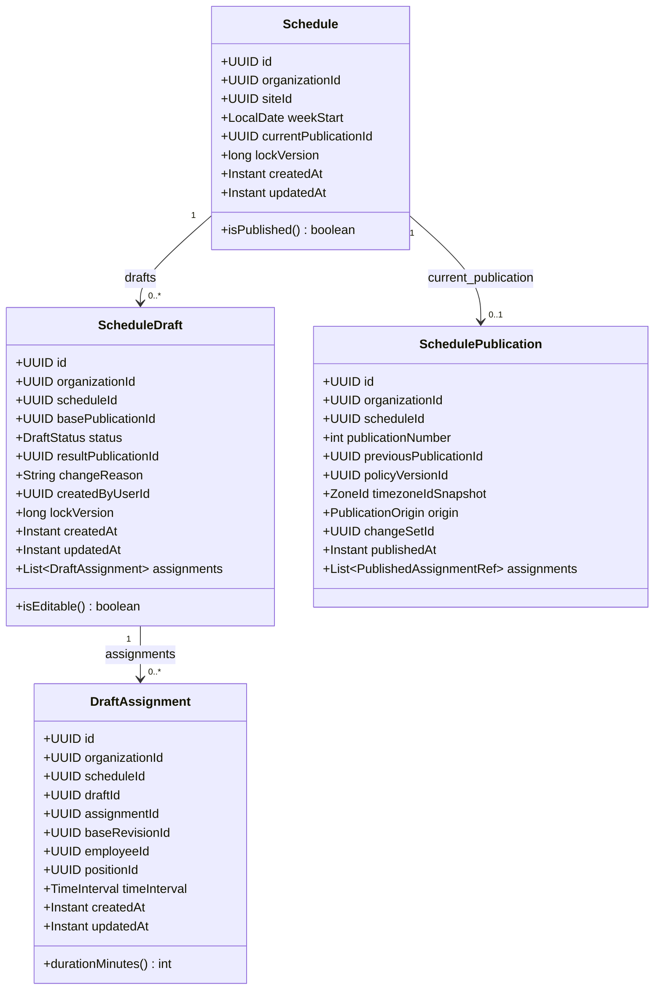
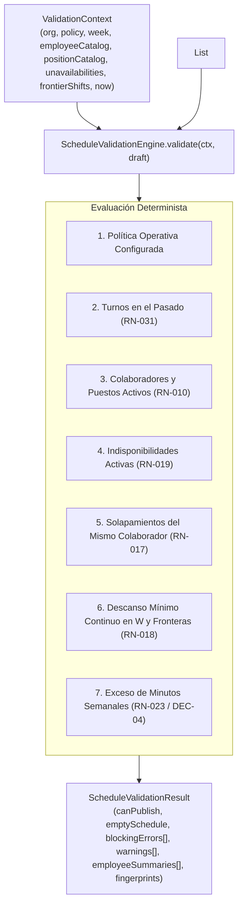
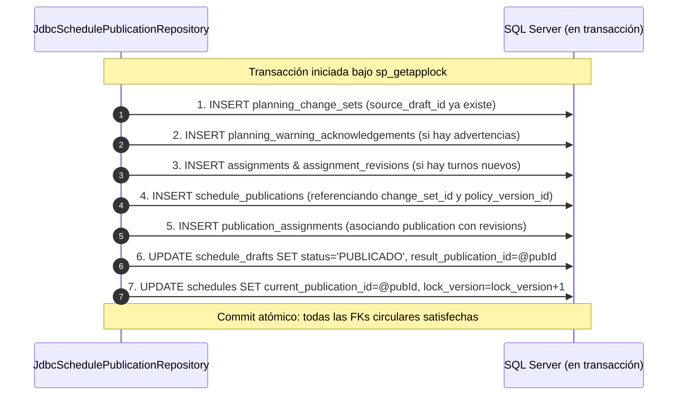
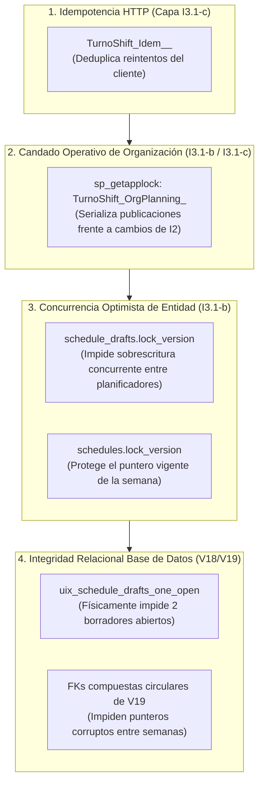
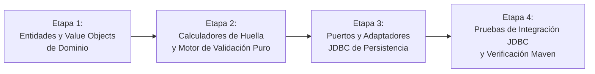

# 31 — Plan de Implementación I3.1-b: Dominio, Validación y Persistencia JDBC

## 1. Propósito, Alcance del Subincremento y Exclusiones

### 1.1. Propósito de `I3.1-b`
El subincremento **`I3.1-b — Dominio de Planificación, Motor de Validación y Persistencia JDBC`** implementa el núcleo funcional, matemático y de persistencia de datos para la planificación semanal de turnos en TurnoShift.

Construye sobre la base relacional ya instalada y verificada en `I3.1-a` (`V18__schedule_planning_tables.sql` y `V19__schedule_planning_circular_fks.sql`), proporcionando:
1. El **modelo de entidades y value objects inmutables** de planificación semanal.
2. El **motor determinista puro de validación de restricciones y advertencias** (`ScheduleValidationEngine`), incluyendo solapamientos, descanso mínimo en semana y fronteras adyacentes ($W-1 / W+1$), cruce con indisponibilidades, compatibilidad de puestos, atribución de minutos semanales y cálculo de huellas criptográficas SHA-256 (`validationFingerprint` y `warningFingerprint`).
3. Los **repositorios JDBC de acceso a datos** (`JdbcScheduleRepository`, `JdbcScheduleDraftRepository`, `JdbcSchedulePublicationRepository`) con consultas parametrizadas, aislamiento estricto por `organization_id`, soporte para control de concurrencia optimista (`lock_version`) y resolución del protocolo de escritura para las claves foráneas circulares.
4. El mecanismo de **candado transaccional exclusivo por organización** (`TurnoShift_OrgPlanning_<organizationId>`) vía `sp_getapplock`.

### 1.2. Delimitación Estricta de Alcance

| En el alcance de `I3.1-b` | Excluido de `I3.1-b` (Subincrementos posteriores) |
| :--- | :--- |
| **Entidades y Value Objects de dominio:** `Schedule`, `ScheduleDraft`, `DraftAssignment`, `Assignment`, `AssignmentRevision`, `SchedulePublication`, `PlanningChangeSet`, `PlanningWarningAcknowledgement`. | **Casos de uso de aplicación e idempotencia:** `CreateScheduleDraft`, `MutateDraftAssignment`, `PublishScheduleDraft`, etc. (pertenecen a `I3.1-c`). |
| **Motor puro de validación:** `ScheduleValidationEngine`, `ValidationFingerprintCalculator`, `WarningFingerprintCalculator`, resultados, errores bloqueantes y advertencias. | **Controladores HTTP y DTOs web:** `SchedulePlanningController`, `MyScheduleController` (pertenecen a `I3.1-c`). |
| **Puertos y adaptadores JDBC:** `ScheduleRepository`, `ScheduleDraftRepository`, `SchedulePublicationRepository`, y adaptadores `Jdbc*`. | **Modificaciones en módulos I2:** integración de `PublishedAssignmentCommitmentQueryPort` en I2.2 y adquisición de candado en mutaciones de I2 (pertenecen a `I3.1-c`). |
| **Pruebas unitarias de motor y huellas:** `ScheduleValidationEngineTest`, `ValidationFingerprintCalculatorTest`. | **Contrato OpenAPI:** actualización de `docs/api/openapi.yaml` (pertenece a `I3.1-d`). |
| **Pruebas de integración JDBC:** `JdbcScheduleRepositoryIT`, `JdbcScheduleDraftRepositoryIT`, `JdbcSchedulePublicationRepositoryIT`. | **Frontend:** pantallas F5 (`/app/planificacion`) y F6 (`/app/mi-horario`) (pertenecen a `F5` y `F6`). |

> [!IMPORTANT]
> **Aclaración de estado:** El incremento `I3` permanece **EN CURSO**. `I3.1-b` no completa `I3`, sino que prepara el dominio y la persistencia necesarios para la capa transaccional HTTP y los contratos web que se abordarán en `I3.1-c` e `I3.1-d`.

---

## 2. Entidades y Value Objects Inmutables del Dominio

Todas las clases de dominio residen en el paquete `com.turnoshift.schedule.domain`. Se implementan como `record` de Java 21 o clases finales inmutables con constructores compactos que garantizan invariantes de negocio desde la instanciación.



### 2.1. `Schedule` (Contenedor Semanal de Sede)
- **Definición:** `record Schedule(UUID id, UUID organizationId, UUID siteId, LocalDate weekStart, UUID currentPublicationId, long lockVersion, Instant createdAt, Instant updatedAt)`
- **Invariantes validadas en constructor:**
  - `id`, `organizationId`, `siteId`, `weekStart` no nulos.
  - `weekStart.getDayOfWeek() == DayOfWeek.MONDAY` (lunes canónico de la semana en la zona del tenant).
  - `lockVersion >= 0`.
- **Métodos auxiliares:**
  - `boolean isPublished()`: `currentPublicationId != null`.
  - `Schedule withCurrentPublication(UUID publicationId, Instant updatedAt)`: produce nueva instancia inmutable con versión incrementada.

### 2.2. `ScheduleDraft` y `DraftStatus`
- **Definición de estados (`DraftStatus`):**
  - `BORRADOR`: único estado activo y mutable.
  - `PUBLICADO`: estado terminal que requiere `resultPublicationId != null`.
  - `DESCARTADO`: estado terminal que requiere `resultPublicationId == null`.
- **Definición:** `record ScheduleDraft(UUID id, UUID organizationId, UUID scheduleId, UUID basePublicationId, DraftStatus status, UUID resultPublicationId, String changeReason, UUID createdByUserId, long lockVersion, Instant createdAt, Instant updatedAt, List<DraftAssignment> assignments)`
- **Invariantes validadas en constructor:**
  - `id`, `organizationId`, `scheduleId`, `status`, `createdByUserId` no nulos.
  - `lockVersion >= 0`.
  - Coherencia de estado:
    - Si `status == DraftStatus.PUBLICADO`, entonces `resultPublicationId != null`.
    - Si `status != DraftStatus.PUBLICADO`, entonces `resultPublicationId == null`.
  - Si `changeReason != null`, entonces `!changeReason.isBlank()`.
  - `assignments` se encapsula como `List.copyOf(...)` inmutable.
- **Métodos auxiliares:**
  - `boolean isEditable()`: `status == DraftStatus.BORRADOR`.

### 2.3. `DraftAssignment` (Línea de Turno del Borrador)
- **Definición:** `record DraftAssignment(UUID id, UUID organizationId, UUID scheduleId, UUID draftId, UUID assignmentId, UUID baseRevisionId, UUID employeeId, UUID positionId, TimeInterval timeInterval, Instant createdAt, Instant updatedAt)`
- **Invariantes validadas en constructor:**
  - `id`, `organizationId`, `scheduleId`, `draftId`, `employeeId`, `positionId`, `timeInterval` no nulos.
  - Coherencia de referencia previa: `(assignmentId == null && baseRevisionId == null) || (assignmentId != null && baseRevisionId != null)`.
  - Duración de turno: $15 \le \text{durationMinutes} \le 960$ (16 horas).
- **Métodos auxiliares:**
  - `Instant startsAt()`: delega a `timeInterval.startsAt()`.
  - `Instant endsAt()`: delega a `timeInterval.endsAt()`.
  - `int durationMinutes()`: `(int) Duration.between(startsAt(), endsAt()).toMinutes()`.
  - `boolean overlaps(DraftAssignment other)`: `this.timeInterval.overlaps(other.timeInterval())`.

### 2.4. `Assignment` y `AssignmentRevision` (Identidad y Versión Inmutable Publicada)
- **`Assignment`:** `record Assignment(UUID id, UUID organizationId, UUID scheduleId, Instant createdAt)`
- **`AssignmentRevision`:** `record AssignmentRevision(UUID id, UUID organizationId, UUID scheduleId, UUID assignmentId, int revisionNumber, UUID employeeId, UUID positionId, TimeInterval timeInterval, String employeeNameSnapshot, String positionNameSnapshot, UUID createdByUserId, Instant createdAt)`
  - Invariantes: `revisionNumber > 0`, snapshots no vacíos, duración entre 15 y 960 minutos.
  - Sin referencia a `shift_type_id` en `I3` (conforme a exclusión arquitectónica).

### 2.5. `SchedulePublication`, `PublicationOrigin` y `PublishedAssignmentRef`
- **`PublicationOrigin`:** enum `INICIAL`, `REVISION`, `INTERCAMBIO`.
- **`PublishedAssignmentRef`:** `record PublishedAssignmentRef(UUID assignmentId, UUID assignmentRevisionId)`
- **`SchedulePublication`:** `record SchedulePublication(UUID id, UUID organizationId, UUID scheduleId, int publicationNumber, UUID previousPublicationId, UUID policyVersionId, ZoneId timezoneIdSnapshot, PublicationOrigin origin, UUID changeSetId, Instant publishedAt, List<PublishedAssignmentRef> assignments)`
  - Invariantes:
    - `publicationNumber > 0`.
    - Si `publicationNumber == 1`, `previousPublicationId == null` y `origin == PublicationOrigin.INICIAL`.
    - Si `publicationNumber > 1`, `previousPublicationId != null` y `origin != PublicationOrigin.INICIAL`.
    - `assignments` encapsulada como lista inmutable (puede tener tamaño `0` en publicación vacía `DEC-03`).

### 2.6. `PlanningChangeSet` y `PlanningWarningAcknowledgement`
- **`PlanningChangeType`:** enum `PUBLICACION_BORRADOR`, `REVISION_PUBLICACION`, `APROBACION_INTERCAMBIO` (sin `ACTIVACION_POLITICA`).
- **`PlanningChangeSet`:** `record PlanningChangeSet(UUID id, UUID organizationId, UUID scheduleId, PlanningChangeType changeType, UUID actorUserId, UUID policyVersionId, UUID sourceDraftId, String reason, boolean emptyScheduleConfirmed, byte[] validationFingerprint, int validationSchemaVersion, UUID correlationId, Instant confirmedAt)`
  - Invariantes: si `emptyScheduleConfirmed == true`, `reason != null && !reason.isBlank()` (`DEC-03`). Si `changeType != APROBACION_INTERCAMBIO`, `sourceDraftId != null`.
- **`PlanningWarningAcknowledgement`:** `record PlanningWarningAcknowledgement(UUID id, UUID organizationId, UUID changeSetId, UUID employeeId, String warningCode, LocalDate periodStart, LocalDate periodEndExclusive, ZoneId timezoneIdSnapshot, int plannedMinutes, int thresholdMinutes, byte[] warningFingerprint, int contextSchemaVersion, String contextData, Instant createdAt)`
  - Invariantes: `plannedMinutes > thresholdMinutes` (`DEC-04`), `warningCode == "WEEKLY_PLANNED_MINUTES_EXCEEDED"`.

---

## 3. Motor Determinista de Validación de Restricciones (`ScheduleValidationEngine`)

### 3.1. Arquitectura y Principio de Pureza
El motor de validación es un **servicio de dominio puro** (`com.turnoshift.schedule.domain.validation.ScheduleValidationEngine`), libre de efectos secundarios, anotaciones de framework, inyecciones de base de datos o accesos de red. Recibe un contexto de datos inmutable y genera un diagnóstico determinista.



### 3.2. Clasificación Estricta: Errores Bloqueantes vs Advertencias Reconocibles

| Categoría | Código | Condición de Disparo | Efecto sobre `canPublish` |
| :--- | :--- | :--- | :---: |
| **BLOQUEANTE** | `POLICY_NOT_CONFIGURED` | `context.currentPolicy() == null`. | `false` |
| **BLOQUEANTE** | `PAST_SHIFT_MODIFICATION` | Turno nuevo con `startsAt <= now` o mutación de turno publicado que ya inició (`RN-031`). | `false` |
| **BLOQUEANTE** | `EMPLOYEE_INACTIVE` | Colaborador con `is_active = false`. | `false` |
| **BLOQUEANTE** | `POSITION_INACTIVE` | Puesto con `is_active = false`. | `false` |
| **BLOQUEANTE** | `POSITION_MISMATCH` | `assignment.positionId != employee.positionId` (**RN-010**: puesto principal único). | `false` |
| **BLOQUEANTE** | `EMPLOYEE_UNAVAILABLE` | Solapamiento con indisponibilidad activa (`cancelled_at IS NULL`) (**RN-019**). | `false` |
| **BLOQUEANTE** | `SHIFT_OVERLAP` | Dos turnos del mismo colaborador se solapan en la semana o contra fronteras $W-1 / W+1$ (**RN-017**). | `false` |
| **BLOQUEANTE** | `MINIMUM_REST_VIOLATION` | Descanso entre dos turnos consecutivos del colaborador es $< \text{minimumRestMinutes}$ (**RN-018**). | `false` |
| **ADVERTENCIA** | `WEEKLY_PLANNED_MINUTES_EXCEEDED` | Minutos acumulados del colaborador en la semana $W > \text{weeklyWarningMinutes}$ (**RN-023**). | **`true`** *(no bloquea; genera `warningFingerprint` para reconocimiento obligatorio)* |

### 3.3. Detalles Algorítmicos del Validador

#### 1. Delimitación Semanal y Cruce de Medianoche (`PROP-I3-01` y `PROP-I3-02`)
- La ventana semanal local $[T_{\text{start}}, T_{\text{end}})$ se calcula a partir de `weekStart` y la zona horaria del tenant:
  $$T_{\text{start}} = \text{weekStart.atStartOfDay(orgZone).toInstant()}$$
  $$T_{\text{end}} = \text{weekStart.plusDays(7).atStartOfDay(orgZone).toInstant()}$$
- Todo turno debe satisfacer $T_{\text{start}} \le \text{startsAt} < T_{\text{end}}$.
- Si un turno de domingo a las 22:00 local termina el lunes siguiente a las 06:00 local, **pertenece íntegramente a la semana $W$**.
- Su duración completa $\text{Duration.between(startsAt, endsAt)}$ se suma al total semanal del colaborador en la semana $W$.

#### 2. Validación de Fronteras ($W-1$ y $W+1$)
- **Frontera previa ($W-1$):** El contexto inyecta turnos publicados de la semana anterior que finalizaron en o después de $T_{\text{start}} - \text{minimumRestMinutes}$.
  - Se verifica solapamiento con cualquier turno del borrador en $W$.
  - Se verifica que el descanso entre el fin del turno de $W-1$ y el inicio del primer turno del colaborador en $W$ sea $\ge \text{minimumRestMinutes}$.
- **Frontera posterior ($W+1$):** El contexto inyecta turnos publicados de la semana posterior que inician antes de $T_{\text{end}} + \text{minimumRestMinutes} + 960\text{m}$.
  - Se verifica que el descanso entre el último turno del colaborador en $W$ (que puede cruzar medianoche y terminar el lunes de $W+1$) y el primer turno publicado de $W+1$ sea $\ge \text{minimumRestMinutes}$.

#### 3. Validación de Indisponibilidades Activas
- Se evalúa la condición de intersección semiabierta:
  $$\text{startsAt} < u.\text{endsAt} \land u.\text{startsAt} < \text{endsAt}$$
- Ante conflicto, se emite `EMPLOYEE_UNAVAILABLE` con:
  - `draftAssignmentId`, `employeeId`, `unavailabilityId`, `conflictStartsAt`, `conflictEndsAt`.
  - **Invariante de confidencialidad:** Jamás se incluye `restricted_note` (**RN-014**).

#### 4. Cálculo Determinista de Huellas Criptográficas SHA-256

##### A. `warningFingerprint` (Por cada colaborador con exceso de horas)
Para cada advertencia `WEEKLY_PLANNED_MINUTES_EXCEEDED`:
$$\text{canonicalWarning} = \text{"w1|" + orgId + "|" + employeeId + "|" + periodStart + "|" + periodEndExclusive + "|" + plannedMinutes + "|" + thresholdMinutes}$$
$$\text{warningFingerprint} = \text{SHA-256}(\text{canonicalWarning.getBytes(UTF-8)}) \rightarrow \text{64 chars hex}$$

##### B. `validationFingerprint` (Huella Global del Cuadrante)
Representa el estado unívoco de la previsualización evaluada. Se calcula ordenando canónicamente los elementos evaluados:
1. Prefijo: `"v1|" + organizationId + "|" + scheduleId + "|" + policyVersionId + "|" + draftLockVersion + "|"`
2. Asignaciones del borrador ordenadas por `(startsAt, endsAt, employeeId, positionId)`:
   `"shift:" + employeeId + ":" + positionId + ":" + startsAt + ":" + endsAt + ";"`
3. Turnos de frontera ordenados por `(startsAt, endsAt, employeeId)`:
   `"frontier:" + employeeId + ":" + startsAt + ":" + endsAt + ";"`
4. Advertencias ordenadas alfabéticamente por `warningFingerprint`:
   `"warn:" + warningFingerprint + ";"`
5. Resultado: `SHA-256(canonicalString.getBytes(UTF-8))` emitido como hexadecimal de 64 caracteres.

Cualquier mutación en turnos, reloj, política o indisponibilidades altera la huella, garantizando que una publicación no proceda si las condiciones cambiaron.

---

## 4. Persistencia JDBC y Estrategia ante Claves Foráneas Circulares

### 4.1. Interfaces de Repositorio (Puertos de Dominio)

Los repositorios se declaran como interfaces en `com.turnoshift.schedule.domain` e implementaciones en `com.turnoshift.schedule.infrastructure.persistence`:

```mermaid
classDiagram
    class ScheduleRepository {
        <<interface>>
        +findBySiteAndWeek(orgId, siteId, weekStart) Optional~Schedule~
        +findById(orgId, scheduleId) Optional~Schedule~
        +createSchedule(schedule) Schedule
        +updateCurrentPublication(orgId, scheduleId, pubId, expectedLockVersion) void
    }

    class ScheduleDraftRepository {
        <<interface>>
        +findOpenDraftBySchedule(orgId, scheduleId) Optional~ScheduleDraft~
        +findById(orgId, draftId) Optional~ScheduleDraft~
        +createDraft(draft) ScheduleDraft
        +updateDraftStatus(orgId, draftId, status, resultPubId, expectedLockVersion) void
        +updateDraftLockVersion(orgId, draftId, expectedLockVersion) void
        +findAssignmentsByDraftId(orgId, draftId) List~DraftAssignment~
        +insertAssignment(assignment) DraftAssignment
        +updateAssignment(assignment) void
        +deleteAssignment(orgId, draftId, assignmentId) void
        +deleteAssignmentsByDraftId(orgId, draftId) void
    }

    class SchedulePublicationRepository {
        <<interface>>
        +findById(orgId, pubId) Optional~SchedulePublication~
        +findCurrentPublication(orgId, scheduleId) Optional~SchedulePublication~
        +findPublicationHistory(orgId, scheduleId) List~SchedulePublication~
        +findNextPublicationNumber(orgId, scheduleId) int
        +findPublishedShiftsInInterval(orgId, siteId, from, to) List~PublishedShiftRecord~
        +createPublicationAtomic(publication, changeSet, acks, newAssignments, newRevisions, pubAssignments) SchedulePublication
    }

    class PlanningOperationalLockPort {
        <<interface>>
        +acquirePlanningLock(orgId) void
    }
```



### 4.2. Consultas SQL Necesarias y Aislamiento por `organization_id`

#### 1. `JdbcScheduleRepository`
- **`findBySiteAndWeek`:**
  ```sql
  SELECT id, organization_id, site_id, week_start, current_publication_id,
         lock_version, created_at, updated_at
  FROM schedules
  WHERE organization_id = ? AND site_id = ? AND week_start = ?;
  ```
- **`createSchedule`:** Usa `OUTPUT inserted.*` para capturar marcas de tiempo exactas del servidor.
- **`updateCurrentPublication`:**
  ```sql
  UPDATE schedules
  SET current_publication_id = ?,
      lock_version = lock_version + 1,
      updated_at = SYSUTCDATETIME()
  WHERE organization_id = ? AND id = ? AND lock_version = ?;
  ```

#### 2. `JdbcScheduleDraftRepository`
- **`findOpenDraftBySchedule`:**
  ```sql
  SELECT id, organization_id, schedule_id, base_publication_id, status,
         result_publication_id, change_reason, created_by_user_id,
         lock_version, created_at, updated_at
  FROM schedule_drafts
  WHERE organization_id = ? AND schedule_id = ? AND status = 'BORRADOR';
  ```
- **Carga de líneas:** `findAssignmentsByDraftId` une las líneas ordenadas cronológicamente `ORDER BY starts_at, employee_id`.
- **Mutación de líneas con avance de `lock_version`:** Toda adición, edición o remoción de una línea ejecuta en la misma transacción:
  ```sql
  UPDATE schedule_drafts
  SET lock_version = lock_version + 1,
      updated_at = SYSUTCDATETIME()
  WHERE organization_id = ? AND id = ? AND status = 'BORRADOR' AND lock_version = ?;
  ```
  Si actualiza 0 filas, se rechaza inmediatamente con `ScheduleConcurrentModificationException`.

#### 3. `JdbcSchedulePublicationRepository`
- **Carga de turnos de frontera:**
  ```sql
  SELECT a.id AS assignment_id, ar.id AS revision_id, ar.employee_id, ar.position_id,
         ar.starts_at, ar.ends_at, ar.employee_name_snapshot, ar.position_name_snapshot,
         s.id AS schedule_id, s.week_start
  FROM publication_assignments pa
  JOIN schedule_publications p
    ON pa.organization_id = p.organization_id AND pa.publication_id = p.id
  JOIN schedules s
    ON p.organization_id = s.organization_id AND p.schedule_id = s.id
  JOIN assignments a
    ON pa.organization_id = a.organization_id AND pa.assignment_id = a.id
  JOIN assignment_revisions ar
    ON pa.organization_id = ar.organization_id AND pa.assignment_revision_id = ar.id
  WHERE s.organization_id = ?
    AND s.site_id = ?
    AND s.current_publication_id = p.id
    AND ar.starts_at < ?
    AND ar.ends_at > ?
  ORDER BY ar.starts_at;
  ```

### 4.3. Estrategia ante las FKs Circulares de V19 (Secuencia Atómica de Escritura)

Las claves foráneas de `V19` (`fk_schedules_current_publication`, `fk_schedule_drafts_base_publication`, `fk_schedule_drafts_result_publication`) impiden registrar una publicación con IDs inexistentes o cruzados. El método `createPublicationAtomic` ejecuta la siguiente secuencia en una única transacción JDBC:



1. **Paso 1:** Inserción en `planning_change_sets`.
2. **Paso 2:** Inserción en `planning_warning_acknowledgements`.
3. **Paso 3:** Inserción en `assignments` y `assignment_revisions` (para turnos nuevos o modificados).
4. **Paso 4:** Inserción en `schedule_publications`.
5. **Paso 5:** Inserción en `publication_assignments` (0 filas si la semana fue publicada vacía conforme a `DEC-03`).
6. **Paso 6:** `UPDATE schedule_drafts` asignando `status = 'PUBLICADO'` y `result_publication_id = pubId` simultáneamente (satisface `chk_schedule_drafts_result_coherence` y `fk_schedule_drafts_result_publication`).
7. **Paso 7:** `UPDATE schedules` asignando `current_publication_id = pubId` (satisface `fk_schedules_current_publication`).

---

## 5. Estrategia de Concurrencia y Candado Transaccional por Organización

### 5.1. Candado `TurnoShift_OrgPlanning_<organizationId>`
Para impedir condiciones de carrera de tipo *Write Skew* entre publicaciones concurrentes y mutaciones operativas de otras áreas (desactivación de empleados, cambio de puestos, altas de indisponibilidades o cambio de política), se define el puerto `PlanningOperationalLockPort` implementado mediante `sp_getapplock`:

```java
public interface PlanningOperationalLockPort {
    void acquirePlanningLock(UUID organizationId);
}
```

- **Recurso:** `"TurnoShift_OrgPlanning_" + organizationId`
- **Modo:** `'Exclusive'`
- **Propietario:** `'Transaction'`
- **Timeout:** `10000` ms (10 segundos)
- **Implementación SQL:** Reutiliza el patrón probado en `JdbcPolicyRepository`:
  ```sql
  SET NOCOUNT ON;
  IF @@TRANCOUNT = 0 BEGIN TRANSACTION;
  DECLARE @res INT;
  EXEC @res = sp_getapplock
      @Resource = ?,
      @LockMode = 'Exclusive',
      @LockOwner = 'Transaction',
      @LockTimeout = 10000;
  SELECT @res;
  ```
  Si el resultado es `< 0`, se lanza `PlanningOperationBusyException` (traducible en HTTP a 503 con Problem Details).

### 5.2. Relación entre los Mecanismos de Concurrencia



1. **En edición de borrador:** Opera el control optimista `schedule_drafts.lock_version`. Cada adición/edición/borrado de línea exige `expectedLockVersion`.
2. **En publicación de cuadrante:** Se adquiere `TurnoShift_OrgPlanning_<organizationId>` para asegurar que el recálculo del `validationFingerprint`, la verificación de catálogos y la emisión de registros históricos se ejecuten en un entorno aislado sin mutaciones concurrentes.

---

## 6. Puertos de Consulta de Contexto hacia Módulos Existentes

Para que el motor de validación opere de manera pura y desacoplada de la base de datos, `I3.1-b` define los puertos de consulta de snapshots que el orquestador utilizará para armar el `ValidationContext`:

1. **`EmployeeSnapshotQueryPort`:**
   - Consulta estado (`is_active`), nombre y puesto principal (`position_id`) de los colaboradores asignados.
2. **`PositionSnapshotQueryPort`:**
   - Consulta estado (`is_active`) y nombre de los puestos referenciados.
3. **`UnavailabilitySnapshotQueryPort`:**
   - Consulta intervalos activos de indisponibilidad (`cancelled_at IS NULL`) que intersecten con la semana a evaluar.
4. **`PolicySnapshotQueryPort`:**
   - Consulta la versión activa de política operativa de la organización (`current_policy_version_id`).

---

## 7. Inventario de Clases a Crear en `I3.1-b`

### 7.1. Paquete `com.turnoshift.schedule.domain` (Modelo y Entidades)
1. `Schedule.java` (record inmutable)
2. `ScheduleDraft.java` (record inmutable)
3. `DraftStatus.java` (enum: `BORRADOR`, `PUBLICADO`, `DESCARTADO`)
4. `DraftAssignment.java` (record inmutable)
5. `Assignment.java` (record inmutable)
6. `AssignmentRevision.java` (record inmutable)
7. `SchedulePublication.java` (record inmutable)
8. `PublicationOrigin.java` (enum: `INICIAL`, `REVISION`, `INTERCAMBIO`)
9. `PublishedAssignmentRef.java` (record inmutable)
10. `PublishedShiftRecord.java` (record de proyección para consultas de turnos publicados)
11. `PlanningChangeSet.java` (record inmutable)
12. `PlanningChangeType.java` (enum: `PUBLICACION_BORRADOR`, `REVISION_PUBLICACION`, `APROBACION_INTERCAMBIO`)
13. `PlanningWarningAcknowledgement.java` (record inmutable)

### 7.2. Paquete `com.turnoshift.schedule.domain.validation` (Motor de Validación)
14. `ScheduleValidationEngine.java` (servicio de dominio puro)
15. `ValidationContext.java` (record con el contexto inmutable de evaluación)
16. `ScheduleValidationResult.java` (resultado integral de validación)
17. `ValidationBlockingError.java` (record de error bloqueante con código y metadatos)
18. `BlockingErrorCode.java` (enum: `POLICY_NOT_CONFIGURED`, `PAST_SHIFT_MODIFICATION`, `EMPLOYEE_INACTIVE`, `POSITION_INACTIVE`, `POSITION_MISMATCH`, `EMPLOYEE_UNAVAILABLE`, `SHIFT_OVERLAP`, `MINIMUM_REST_VIOLATION`)
19. `ValidationWarning.java` (record de advertencia operativa)
20. `WarningCode.java` (enum: `WEEKLY_PLANNED_MINUTES_EXCEEDED`)
21. `EmployeeWeeklySummary.java` (resumen de minutos por colaborador)
22. `ValidationFingerprintCalculator.java` (calculador determinista SHA-256 de huella de borrador)
23. `WarningFingerprintCalculator.java` (calculador determinista SHA-256 de huella de advertencia)

### 7.3. Paquete `com.turnoshift.schedule.domain.ports` (Puertos y Excepciones)
24. `ScheduleRepository.java` (puerto de persistencia de schedules)
25. `ScheduleDraftRepository.java` (puerto de persistencia de borradores y líneas)
26. `SchedulePublicationRepository.java` (puerto de publicaciones e histórico)
27. `PlanningOperationalLockPort.java` (puerto de candado exclusivo vía `sp_getapplock`)
28. `EmployeeSnapshotQueryPort.java` (puerto de consulta de colaboradores para validación)
29. `PositionSnapshotQueryPort.java` (puerto de consulta de puestos para validación)
30. `UnavailabilitySnapshotQueryPort.java` (puerto de consulta de indisponibilidades para validación)
31. `PolicySnapshotQueryPort.java` (puerto de consulta de política activa para validación)
32. `ScheduleDomainException.java` (excepción base de dominio)
33. `ScheduleConcurrentModificationException.java` (fallo de `lock_version`)
34. `ScheduleDataAccessException.java` (fallo técnico de acceso a datos)
35. `PlanningOperationBusyException.java` (timeout de `sp_getapplock`)

### 7.4. Paquete `com.turnoshift.schedule.infrastructure.persistence` (Adaptadores JDBC)
36. `JdbcScheduleRepository.java` (adaptador JDBC de `schedules`)
37. `JdbcScheduleDraftRepository.java` (adaptador JDBC de `schedule_drafts` y `draft_assignments`)
38. `JdbcSchedulePublicationRepository.java` (adaptador JDBC de publicaciones y cierre circular)
39. `JdbcPlanningOperationalLockAdapter.java` (adaptador de candado transaccional `sp_getapplock`)
40. `JdbcPlanningContextSnapshotAdapter.java` (adaptador que consulta empleados, puestos, indisponibilidades y política para validación)
41. `ScheduleInfrastructureConfiguration.java` (`@Configuration` registrando beans de infraestructura de planificación)

---

## 8. Diseño de la Suite de Pruebas de `I3.1-b`

### 8.1. Pruebas Unitarias del Motor (`ScheduleValidationEngineTest`)
- **Solapamientos de turnos (`SHIFT_OVERLAP`):**
  - Dos turnos del mismo empleado que intersectan en $W$.
  - Turno de $W$ que solapa con turno de domingo de $W-1$ que cruzó medianoche hacia el lunes.
  - Turno de domingo de $W$ que cruza medianoche y solapa con turno de lunes temprano de $W+1$.
- **Descanso mínimo continuo (`MINIMUM_REST_VIOLATION`):**
  - Descanso dentro de la semana menor a `minimumRestMinutes` (ej. 8h descanso cuando la política exige 11h).
  - Descanso exacto igual al límite (válido).
  - Descanso entre el fin del turno de $W-1$ y el inicio del primer turno de $W$ menor al límite.
  - Descanso entre el fin del turno de $W$ (que cruzó medianoche) y el primer turno de $W+1$ menor al límite.
- **Indisponibilidades activas (`EMPLOYEE_UNAVAILABLE`):**
  - Cruce total y cruce parcial con indisponibilidad activa.
  - Turno adyacente que toca el límite $[startsAt, endsAt)$ sin intersectar (válido).
  - Indisponibilidad cancelada (`cancelledAt != null`) no genera conflicto (válido).
  - Confirmación de que el error emitido no incluye `restricted_note`.
- **Catálogo de colaboradores y puestos:**
  - Empleado inactivo (`EMPLOYEE_INACTIVE`).
  - Puesto inactivo (`POSITION_INACTIVE`).
  - Discrepancia entre el puesto del turno y el puesto principal del colaborador (`POSITION_MISMATCH`).
- **Exceso de minutos semanales (`WEEKLY_PLANNED_MINUTES_EXCEEDED`):**
  - Suma de minutos menor o igual a `weeklyWarningMinutes` -> 0 advertencias, `canPublish == true`.
  - Suma de minutos mayor a `weeklyWarningMinutes` -> genera `ValidationWarning`, `warningFingerprint` no nulo, y `canPublish == true` (no bloquea).
  - Turno nocturno de domingo atribuido íntegramente a $W$.
- **Turnos en el pasado (`PAST_SHIFT_MODIFICATION`):**
  - Turno nuevo con `startsAt <= now` -> bloqueado.
  - Turno derivado de publicación previa ya iniciado con modificación horaria -> bloqueado.

### 8.2. Pruebas Unitarias de Huellas Criptográficas (`ValidationFingerprintCalculatorTest`)
- **Determinismo estricto:** Idénticos datos generan idéntico SHA-256 en llamadas repetidas.
- **Invarianza frente al orden de entrada:** Asignaciones suministradas en distinto orden producen exactamente la misma huella gracias a la normalización canónica previa.
- **Sensibilidad a cambios:** Modificar un minuto de inicio, un ID de empleado, la versión de política o el `draftLockVersion` altera la huella.

### 8.3. Pruebas de Integración JDBC (Testcontainers SQL Server)
- **`JdbcScheduleRepositoryIT`:** Creación, consulta por sede/semana, aislamiento multi-tenant y actualización de `current_publication_id` con avance de `lock_version`.
- **`JdbcScheduleDraftRepositoryIT`:** Creación de borrador, inserción de líneas, actualización optimista con `expectedLockVersion`, rechazo con `ScheduleConcurrentModificationException` ante versiones desfasadas y cascada al eliminar borrador.
- **`JdbcSchedulePublicationRepositoryIT`:**
  - Ejecución atómica de la secuencia de publicación en 7 pasos sin violar las FKs circulares de V19.
  - Publicación normal con turnos e histórico.
  - Publicación vacía (`DEC-03`) con 0 asignaciones y motivo obligatorio.
  - Consultas de turnos de frontera en ventana temporal.
- **`JdbcPlanningOperationalLockAdapterIT`:** Adquisición exclusiva del candado de planificación por organización y rechazo con timeout ante adquisición concurrente bloqueada.

---

## 9. Secuencia y Orden Exacto de Implementación de `I3.1-b`

La implementación se dividirá en 4 etapas secuenciales, ejecutando pruebas focalizadas al cierre de cada etapa:



1. **Etapa 1 — Entidades y Value Objects de Dominio:**
   - Crear las 13 clases del modelo inmutable en `com.turnoshift.schedule.domain`.
   - Crear excepciones de dominio en `com.turnoshift.schedule.domain.ports`.
2. **Etapa 2 — Motor de Validación y Calculadores de Huella:**
   - Implementar `WarningFingerprintCalculator` y `ValidationFingerprintCalculator`.
   - Implementar `ScheduleValidationEngine` con todas las reglas deterministas.
   - Crear y validar `ScheduleValidationEngineTest` y `ValidationFingerprintCalculatorTest`.
3. **Etapa 3 — Puertos y Adaptadores JDBC de Persistencia:**
   - Declarar las interfaces de repositorio en `com.turnoshift.schedule.domain.ports`.
   - Implementar `JdbcScheduleRepository`, `JdbcScheduleDraftRepository` y `JdbcSchedulePublicationRepository`.
   - Implementar `JdbcPlanningOperationalLockAdapter` con `sp_getapplock`.
   - Implementar `JdbcPlanningContextSnapshotAdapter` para alimentar el motor desde las tablas de I2.
   - Configurar beans en `ScheduleInfrastructureConfiguration`.
4. **Etapa 4 — Pruebas de Integración y Verificación Focalizada:**
   - Crear suites IT: `JdbcScheduleRepositoryIT`, `JdbcScheduleDraftRepositoryIT`, `JdbcSchedulePublicationRepositoryIT`.
   - Ejecutar el comando Maven focalizado final:
     ```powershell
     cd backend; $env:JAVA_HOME = 'C:\Users\juan9\.jdks\temurin-21.0.10'; .\mvnw.cmd test "-Dtest=ScheduleValidationEngineTest,ValidationFingerprintCalculatorTest,JdbcScheduleRepositoryIT,JdbcScheduleDraftRepositoryIT,JdbcSchedulePublicationRepositoryIT"
     ```
   - Actualizar la documentación de contexto (`STATE.md` y `CURRENT_TASK.md`).
