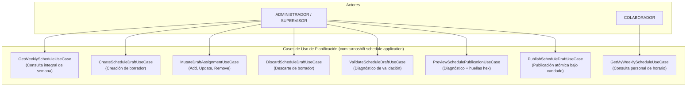
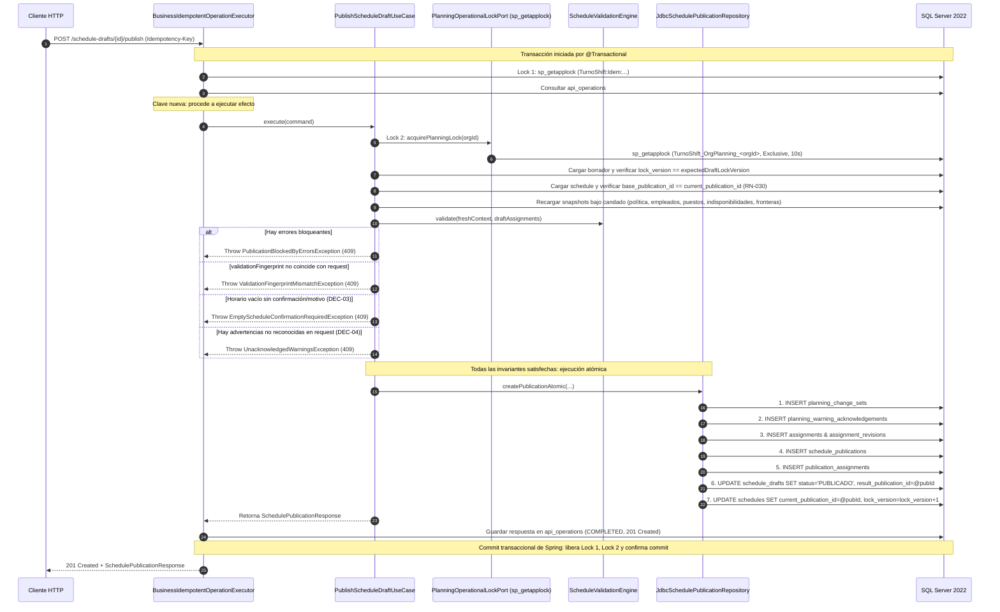
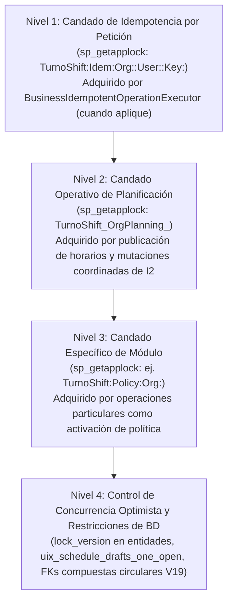
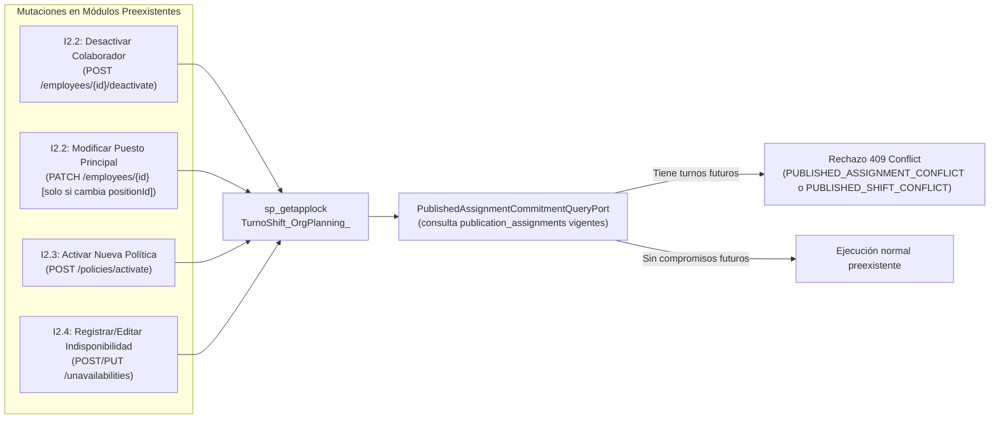
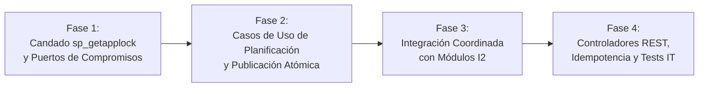

# 32 — Plan de Implementación I3.1-c: Casos de Uso, Idempotencia, Candado Operativo y API HTTP

## 1. Propósito, Alcance del Subincremento y Exclusiones

### 1.1. Propósito de `I3.1-c`
El subincremento **`I3.1-c — Casos de Uso Transaccionales, Idempotencia, Candado Operativo e Integración HTTP de Planificación`** implementa la capa de aplicación, la serialización transaccional distribuida y los puntos de entrada HTTP para la planificación semanal de turnos en TurnoShift.

Construye directamente sobre la infraestructura ya implementada y probada en `I3.1-a` (migraciones relacionales `V18` y `V19`) e `I3.1-b` (modelo de dominio inmutable, motor determinista `ScheduleValidationEngine` y repositorios JDBC), proporcionando:
1. Los **casos de uso de aplicación** para la gestión del ciclo de vida de horarios semanales y borradores (consulta de semana, creación de borrador, adición/edición/remoción de líneas, descarte, validación, previsualización y publicación atómica), así como la consulta personal para colaboradores (`GET /my/schedule`).
2. El mecanismo de **candado operativo por organización** `TurnoShift_OrgPlanning_<organizationId>` implementado con `sp_getapplock` en SQL Server, asegurando serialización estricta ante condiciones de carrera *Write Skew*.
3. La **integración coordinada con los módulos preexistentes de I2** (`I2.2` colaboradores, `I2.3` política e `I2.4` indisponibilidades) para proteger turnos publicados futuros frente a mutaciones incompatibles (**RN-010**, **RN-011**, **RN-013**).
4. El soporte de **idempotencia empresarial estricta** en todas las mutaciones mediante la integración con `BusinessIdempotentOperationExecutor` y la tabla `api_operations`.
5. Los **controladores REST** (`SchedulePlanningController` y `MyScheduleController`) con control de acceso por roles (RBAC), protección CSRF y respuestas Problem Details conforme a RFC 9457.

### 1.2. Delimitación Estricta de Alcance

| En el alcance de `I3.1-c` | Excluido de `I3.1-c` (Subincrementos posteriores) |
| :--- | :--- |
| **Casos de uso de aplicación:** `GetWeeklySchedule`, `CreateScheduleDraft`, `GetScheduleDraft`, `AddDraftAssignment`, `UpdateDraftAssignment`, `RemoveDraftAssignment`, `DiscardScheduleDraft`, `ValidateScheduleDraft`, `PreviewSchedulePublication`, `PublishScheduleDraft`, `GetMyWeeklySchedule`. | **Contrato OpenAPI v0.3.0-i3:** actualización formal de `docs/api/openapi.yaml` y `docs/api/README.md` (corresponde a `I3.1-d`). |
| **Candado operativo transaccional:** puerto `PlanningOperationalLockPort` y adaptador `JdbcPlanningOperationalLockAdapter` con `sp_getapplock` (`TurnoShift_OrgPlanning_<organizationId>`). | **Frontend F5 — Planificación Semanal:** pantalla `/app/planificacion`, matriz semanal, modales de asignación y publicación (corresponde a `F5`). |
| **Integración coordinada con I2:** puerto `PublishedAssignmentCommitmentQueryPort` y validación de compromisos futuros en mutaciones de I2.2, I2.3 e I2.4. | **Frontend F6 — Mi Horario:** pantalla `/app/mi-horario` para colaboradores (corresponde a `F6`). |
| **Idempotencia y controladores REST:** DTOs de request/response, integración con `BusinessIdempotentOperationExecutor`, controladores `SchedulePlanningController` y `MyScheduleController`. | **Intercambio de turnos y revisiones post-publicación:** solicitudes de cambio entre colaboradores y revisiones multi-publicación en caliente (corresponden a `I4`). |
| **Suite de pruebas:** unitarias por caso de uso, pruebas MockMvc de controladores y pruebas de integración HTTP/concurrencia sobre SQL Server real (Testcontainers). | **Múltiples sedes activas simultáneas:** habilitación comercial multi-sede (corresponde a evolución SaaS posterior). |

> [!IMPORTANT]
> **Aclaración de estado:** El incremento `I3` permanece **EN CURSO**. `I3.1-c` completa la funcionalidad del backend y su interfaz HTTP, dejando listo el sistema para la formalización del contrato OpenAPI en `I3.1-d` y la construcción de las interfaces de usuario en `F5` y `F6`.

---

## 2. Casos de Uso de Planificación Semanal

Los casos de uso residen en `com.turnoshift.schedule.application` y representan servicios de aplicación desacoplados de los controladores HTTP.



### 2.1. `GetWeeklyScheduleUseCase` (Consulta Integral de Semana)
- **Propósito:** Proporciona a los supervisores y administradores la vista consolidada de la semana para la sede activa.
- **Entrada:** `organizationId`, `siteId`, `weekStart` (validado como lunes canónico).
- **Lógica de orquestación:**
  1. Consulta el `Schedule` para `(organizationId, siteId, weekStart)` vía `ScheduleRepository.findBySiteAndWeek(...)`.
  2. Si existe y tiene `currentPublicationId != null`, consulta la publicación vigente (`SchedulePublicationRepository.findCurrentPublication`) junto con sus turnos publicados (`findPublishedShiftsInInterval`).
  3. Consulta si existe un borrador abierto (`ScheduleDraftRepository.findOpenDraftBySchedule`).
  4. Si existe borrador abierto, evalúa `isDraftOutdated = (draft.basePublicationId() != null && !draft.basePublicationId().equals(schedule.currentPublicationId()))` (**RN-030**).
  5. Consulta la versión activa de política operativa (`PlanningContextSnapshotPort.findActivePolicySnapshot`).
- **Salida:** `WeeklyScheduleStateView` conteniendo:
  - `schedule`: datos de cabecera (`id`, `weekStart`, `lockVersion`, etc.) o `null` si no se ha inicializado.
  - `currentPublication`: detalles de la publicación oficial con sus asignaciones o `null` si no está publicada.
  - `activeDraft`: borrador abierto con sus líneas y bandera `isOutdated` o `null` si no hay borrador abierto.
  - `currentPolicy`: versión de política operativa activa o `null` si no está configurada.

### 2.2. `CreateScheduleDraftUseCase` (Creación de Borrador Semanal)
- **Propósito:** Inicia un nuevo ciclo de planificación para una sede y semana.
- **Entrada:** `organizationId`, `siteId`, `actorUserId`, `weekStart`, `initializeFromCurrentPublication` (boolean).
- **Lógica de orquestación:**
  1. Verifica lunes canónico: si `weekStart.getDayOfWeek() != DayOfWeek.MONDAY` $\rightarrow$ `InvalidScheduleWeekStartException` (HTTP 400).
  2. Busca o crea el contenedor `Schedule` para `(organizationId, siteId, weekStart)` en la misma transacción:
     - Si no existe, invoca `ScheduleRepository.createSchedule(Schedule.initial(organizationId, siteId, weekStart))`.
  3. Verifica que no exista ya un borrador con `status = 'BORRADOR'` para ese `scheduleId`. Si existe $\rightarrow$ `DraftAlreadyExistsException` (HTTP 409).
  4. Si `initializeFromCurrentPublication == true` y el horario tiene `currentPublicationId != null`:
     - Carga los turnos publicados de la publicación vigente (`findPublishedShiftsInInterval`).
     - Construye líneas de borrador `DraftAssignment` copiando `employeeId`, `positionId` e intervalo, vinculando `assignmentId` y `baseRevisionId = revisionId` de la publicación base.
     - Crea el borrador con `basePublicationId = schedule.currentPublicationId()`.
  5. Si `initializeFromCurrentPublication == false` o no hay publicación previa:
     - Crea el borrador con `basePublicationId = null` y 0 asignaciones iniciales.
  6. Guarda el borrador vía `ScheduleDraftRepository.createDraft(draft)`.
- **Salida:** `ScheduleDraftView` recién creado con `lockVersion = 0`.

### 2.3. Casos de Uso de Mutación de Líneas de Borrador
Toda mutación de líneas requiere el `expectedDraftLockVersion` para prevenir sobreescrituras concurrentes.

#### A. `AddDraftAssignmentUseCase`
- **Entrada:** `organizationId`, `draftId`, `actorUserId`, `employeeId`, `positionId`, `startsAt`, `endsAt`, `expectedDraftLockVersion`.
- **Validaciones previas:**
  - `draft.isEditable()`: si `status != 'BORRADOR'` $\rightarrow$ `DraftNotEditableException` (HTTP 409).
  - Pertenencia a la semana (**PROP-I3-01**): `startsAt` debe ubicarse en $[T_{\text{start}}, T_{\text{end}})$ donde $T_{\text{start}} = \text{weekStart.atStartOfDay(orgZone)}$ y $T_{\text{end}} = T_{\text{start}} + 7\text{ días}$. Si no $\rightarrow$ `AssignmentOutsideWeekException` (HTTP 400).
  - Regla de turnos pasados (**RN-031**): al ser un turno nuevo (`assignmentId == null`), si `startsAt <= clock.instant()` $\rightarrow$ `PastShiftModificationProhibitedException` (HTTP 409).
  - Duración: $15 \le \text{Duration.between(startsAt, endsAt).toMinutes()} \le 960$ (validado por `ShiftInterval`).
- **Persistencia:** Invoca `ScheduleDraftRepository.insertAssignment(assignment, expectedDraftLockVersion)`.
  - Avanza `draft.lock_version` de forma atómica.
  - Si `rows == 0` $\rightarrow$ `ScheduleConcurrentModificationException` (HTTP 409).

#### B. `UpdateDraftAssignmentUseCase`
- **Entrada:** `organizationId`, `draftId`, `draftAssignmentId`, `actorUserId`, `employeeId`, `positionId`, `startsAt`, `endsAt`, `expectedDraftLockVersion`.
- **Validaciones previas:**
  - `draft.isEditable()` $\rightarrow$ si no, HTTP 409 `DRAFT_NOT_EDITABLE`.
  - Si la línea deriva de un turno publicado (`assignmentId != null`): consulta la publicación base. Si el turno publicado ya comenzó (`baseShift.startsAt() <= clock.instant()`), cualquier modificación en horario, empleado o puesto se rechaza con `PastShiftModificationProhibitedException` (**RN-031**, HTTP 409).
  - Pertenencia de `startsAt` a la semana del borrador.
- **Persistencia:** Invoca `ScheduleDraftRepository.updateAssignment(assignment, expectedDraftLockVersion)`.

#### C. `RemoveDraftAssignmentUseCase`
- **Entrada:** `organizationId`, `draftId`, `draftAssignmentId`, `actorUserId`, `expectedDraftLockVersion`.
- **Validaciones previas:**
  - Si la línea deriva de un turno publicado ya iniciado $\rightarrow$ se rechaza con `PastShiftModificationProhibitedException` (**RN-031**, HTTP 409).
- **Persistencia:** Invoca `ScheduleDraftRepository.deleteAssignment(organizationId, draftId, draftAssignmentId, expectedDraftLockVersion)`.

### 2.4. `DiscardScheduleDraftUseCase` (Descarte de Borrador)
- **Entrada:** `organizationId`, `draftId`, `actorUserId`, `expectedDraftLockVersion`.
- **Lógica:**
  - Verifica que el borrador esté en estado `BORRADOR`. Si ya está `PUBLICADO` o `DESCARTADO` $\rightarrow$ `DraftNotEditableException` (HTTP 409).
  - Invoca `ScheduleDraftRepository.updateDraftStatus(organizationId, draftId, DraftStatus.DESCARTADO, null, expectedDraftLockVersion)`.
  - La publicación vigente del horario no se ve afectada en absoluto.

### 2.5. `ValidateScheduleDraftUseCase` y `PreviewSchedulePublicationUseCase`
Ambos casos de uso son **consultas deterministas sin efectos secundarios**, pero difieren en el nivel de detalle requerido:
- **`ValidateScheduleDraftUseCase`:** Utilizado durante la edición interactiva del borrador para informar errores y advertencias en tiempo real.
- **`PreviewSchedulePublicationUseCase`:** Utilizado en el paso previo a la publicación. Ejecuta la misma evaluación pero emite adicionalmente el `validationFingerprint` en formato hexadecimal (64 caracteres) y cada `warningFingerprint` en hexadecimal, exigidos como token de consistencia para el comando `publish`.

**Lógica común de ejecución:**
1. Carga el borrador y sus asignaciones actuales.
2. Consulta el contenedor `Schedule` para conocer la sede y fecha de inicio de semana.
3. Carga los snapshots requeridos mediante `PlanningContextSnapshotPort`:
   - Política activa (`findActivePolicySnapshot`).
   - Empleados y puestos referenciados en el borrador (`findEmployeeSnapshots`, `findPositionSnapshots`).
   - Indisponibilidades activas en la ventana semanal (`findActiveUnavailabilities`).
   - Turnos de frontera de semanas adyacentes $W-1$ y $W+1$ (`findFrontierShifts`).
   - Publicación base si `draft.basePublicationId() != null` (`findBasePublicationSnapshot`).
4. Reconstruye el `ValidationContext`.
5. Ejecuta `ScheduleValidationEngine.validate(ctx, draft.assignments())`.
6. Retorna el resultado estructurado.

---

## 3. Flujo Transaccional de Publicación Atómica (`PublishScheduleDraftUseCase`)

El caso de uso `PublishScheduleDraftUseCase` representa la operación más crítica del módulo. Debe garantizar consistencia estricta, resolución de referencias circulares y protección frente a mutaciones concurrentes.



### 3.1. Pasos Rigurosos del Algoritmo de Publicación

1. **Adquisición del candado operativo de organización (Lock 2):**
   - Ejecuta `PlanningOperationalLockPort.acquirePlanningLock(organizationId)`.
   - Adquiere en modo exclusivo `TurnoShift_OrgPlanning_<organizationId>` con timeout de 10 segundos. Si expira $\rightarrow$ `PlanningOperationBusyException` (HTTP 503 con Problem Details).
2. **Comprobación de estado y versión optimista:**
   - Lee `ScheduleDraft` por ID. Si no existe $\rightarrow$ HTTP 404 `DRAFT_NOT_FOUND`.
   - Verifica `draft.status() == DraftStatus.BORRADOR`. Si no $\rightarrow$ HTTP 409 `DRAFT_NOT_EDITABLE`.
   - Comprueba `draft.lockVersion() == request.expectedDraftLockVersion()`. Si no $\rightarrow$ HTTP 409 `CONCURRENT_MODIFICATION`.
3. **Comprobación de obsolescencia de borrador (**RN-030**):**
   - Lee el `Schedule` asociado.
   - Comprueba que `draft.basePublicationId() == schedule.currentPublicationId()`.
   - Si otro usuario publicó una nueva versión del cuadrante mientras este borrador estaba abierto, el borrador queda obsoleto $\rightarrow$ rechaza con HTTP 409 `DRAFT_OUTDATED`.
4. **Recarga fresca de instantáneas operativas bajo el candado:**
   - Consulta `PlanningContextSnapshotPort` para obtener el estado actual de:
     - Versión activa de política operativa (`findActivePolicySnapshot`). Si es nula $\rightarrow$ HTTP 409 `POLICY_NOT_CONFIGURED`.
     - Catálogo de empleados y puestos asignados.
     - Indisponibilidades activas (`findActiveUnavailabilities`).
     - Turnos publicados de las semanas adyacentes $W-1$ y $W+1$.
     - Publicación base si aplica.
5. **Reconstrucción del `ValidationContext` y revalidación en caliente:**
   - Reconstruye `ValidationContext` determinista con `clock.instant()`.
   - Invoca `ScheduleValidationEngine.validate(context, draft.assignments())`.
6. **Verificaciones de aptitud para publicación:**
   - **A. Cero errores bloqueantes:** Si `!result.canPublish()` $\rightarrow$ rechaza con HTTP 409 `PUBLICATION_BLOCKED_BY_ERRORS` adjuntando la lista de errores RFC 9457.
   - **B. Coincidencia exacta de huella global (`validationFingerprint`):**
     - Compara el `result.validationFingerprintHex()` recalculado en caliente contra `request.validationFingerprint()` enviado por el cliente.
     - Si difieren (lo que indica que cambió una indisponibilidad, un empleado, un puesto, un turno de frontera o la versión de política desde que el planificador revisó la previsualización) $\rightarrow$ rechaza con HTTP 409 `VALIDATION_FINGERPRINT_MISMATCH`.
   - **C. Confirmación de cuadrante vacío (**DEC-03**):**
     - Si `result.emptySchedule() == true` ($0$ turnos en el borrador): exige que `request.confirmEmptySchedule() == true` y que `request.reason()` no sea nulo ni en blanco. Si falta alguno $\rightarrow$ rechaza con HTTP 409 `EMPTY_SCHEDULE_CONFIRMATION_REQUIRED`.
   - **D. Reconocimiento exhaustivo de advertencias (**DEC-04**):**
     - Si `result.warnings()` no está vacío: exige que para cada advertencia emitida (`WEEKLY_PLANNED_MINUTES_EXCEEDED`), su `warningFingerprintHex` esté presente en `request.acknowledgedWarningFingerprints()` y que `request.reason()` no esté en blanco.
     - Si alguna advertencia no fue reconocida $\rightarrow$ rechaza con HTTP 409 `UNACKNOWLEDGED_WARNINGS`.
7. **Construcción y persistencia atómica en 7 pasos:**
   - Prepara `PlanningChangeSet`, `PlanningWarningAcknowledgement` records, nuevas entidades `Assignment` y `AssignmentRevision`, y referencias de publicación.
   - Invoca `SchedulePublicationRepository.createPublicationAtomic(...)` pasando las versiones esperadas del borrador y del schedule.
   - El commit de Spring confirma la transacción y libera el candado `TurnoShift_OrgPlanning_<organizationId>` de SQL Server.

---

## 4. Estrategia de Idempotencia y Prevención de Deadlocks

### 4.1. Operaciones que Exigen `Idempotency-Key`
Todas las mutaciones de planificación requieren obligatoriamente la cabecera `Idempotency-Key` (UUID v4) y la cabecera `X-CSRF-TOKEN`:
- `POST /api/v1/schedules/week/drafts`
- `POST /api/v1/schedule-drafts/{draftId}/assignments`
- `PUT /api/v1/schedule-drafts/{draftId}/assignments/{draftAssignmentId}`
- `POST /api/v1/schedule-drafts/{draftId}/assignments/{draftAssignmentId}/remove` *(diseñado como comando POST con cuerpo JSON `{ "expectedDraftLockVersion": ... }` para integración simétrica con el ejecutor de idempotencia)*.
- `POST /api/v1/schedule-drafts/{draftId}/discard`
- `POST /api/v1/schedule-drafts/{draftId}/publish`

### 4.2. Comportamiento ante Reintentos
- **Misma clave e idéntica huella canónica:** `BusinessIdempotentOperationExecutor` recupera la respuesta serializada de `api_operations` y responde el código original con la cabecera `Idempotency-Replayed: true`.
- **Misma clave con diferente payload o parámetros:** Responde HTTP 409 `IDEMPOTENCY_KEY_REUSED`.
- **Clave expirada (> 24 horas):** Responde HTTP 409 `IDEMPOTENCY_KEY_EXPIRED`.

### 4.3. Jerarquía Global Anti-Deadlock

Para garantizar que múltiples transacciones concurrentes nunca colisionen en interbloqueo (*deadlock*), se define el orden global inmutable de adquisición de candados:



1. **Nivel 1 — Idempotencia (cuando aplique):**
   Candado por petición `TurnoShift:Idem:Org:<orgId>:User:<userId>:Key:<key>`, adquirido por `BusinessIdempotentOperationExecutor`.
2. **Nivel 2 — Candado Operativo de Planificación:**
   `TurnoShift_OrgPlanning_<organizationId>`, adquirido por `PublishScheduleDraftUseCase` y por las mutaciones de `I2` que coordinan compromisos de planificación (`DeactivateEmployeeUseCase`, `UpdateEmployeeUseCase` al cambiar puesto, `CreateUnavailabilityUseCase`, `UpdateUnavailabilityUseCase` y `ActivatePolicyUseCase`).
3. **Nivel 3 — Candado Específico de Módulo (si existe):**
   Candado exclusivo particular de cada módulo de aplicación, por ejemplo `TurnoShift:Policy:Org:<organizationId>` en `ActivatePolicyUseCase`.
4. **Nivel 4 — Concurrencia Optimista y Restricciones Relacionales:**
   Control de versión optimista (`lock_version` en `schedule_drafts`, `schedules`, `policies`, etc.) e integridad relacional de base de datos (`uix_schedule_drafts_one_open`, FKs compuestas circulares de `V19`).

> [!IMPORTANT]
> **Regla Global Anti-Deadlock:** Ninguna ruta, caso de uso u operación del sistema puede adquirir el candado de planificación `TurnoShift_OrgPlanning_<organizationId>` después de haber adquirido un candado específico de módulo (como el candado de política). El orden de adquisición entre módulos debe ser estrictamente monótono: primero el candado de planificación y posteriormente el candado específico del módulo. Esta disciplina de ordenamiento previene la formación de ciclos de espera circular entre transacciones concurrentes.

---

## 5. Integración Coordinada con Módulos Preexistentes de I2

Conforme a la decisión arquitectónica **`PROP-I3-03`**, el subincremento `I3.1-c` incorpora la protección de compromisos publicados frente a mutaciones en los módulos preexistentes de `I2`.

### 5.1. Puerto `PublishedAssignmentCommitmentQueryPort`

Se declara el puerto en `com.turnoshift.schedule.domain.ports` e implementa en `com.turnoshift.schedule.infrastructure.persistence`:

```java
public interface PublishedAssignmentCommitmentQueryPort {

    /**
     * Verifica si el colaborador tiene turnos asignados en publicaciones vigentes que finalicen en el futuro.
     */
    boolean hasFuturePublishedAssignmentsForEmployee(UUID organizationId, UUID employeeId, Instant from);

    /**
     * Verifica si el colaborador tiene turnos asignados en publicaciones vigentes con un puesto específico en el futuro.
     */
    boolean hasFuturePublishedAssignmentsForEmployeeAndPosition(
            UUID organizationId, UUID employeeId, UUID positionId, Instant from);

    /**
     * Encuentra turnos publicados vigentes del colaborador que intersecten con un intervalo temporal dado.
     */
    List<PublishedShiftRecord> findFuturePublishedAssignmentsOverlapping(
            UUID organizationId, UUID employeeId, Instant startsAt, Instant endsAt);
}
```

### 5.2. Mutaciones Afectadas en I2 y Reglas de Bloqueo



#### 1. Módulo `I2.2` — Desactivación y Reactivación de Colaborador (**RN-011**)
- **Punto de integración:** `DeactivateEmployeeUseCase` (previsualización y mutación).
- **Mutación real en `DeactivateEmployeeUseCase.execute(...)`:**
  1. Adquiere el candado de planificación `TurnoShift_OrgPlanning_<organizationId>`.
  2. Consulta `hasFuturePublishedAssignmentsForEmployee(orgId, employeeId, clock.instant())` mediante `PublishedAssignmentCommitmentQueryPort`.
  3. Si existen turnos publicados vigentes que terminan después de `now` $\rightarrow$ rechaza la desactivación con HTTP 409 `PUBLISHED_ASSIGNMENT_CONFLICT`:
     *"No se puede desactivar un colaborador con turnos publicados vigentes en el futuro. Debe modificarse o despublicarse primero el cuadrante afectado."*
  4. Si no existen turnos futuros, procede con la desactivación normal del colaborador.
- **Previsualización de desactivación en `DeactivateEmployeeUseCase.preview(UUID organizationId, UUID employeeId)`:**
  - La previsualización de desactivación se mantiene como `DeactivateEmployeeUseCase.preview(UUID organizationId, UUID employeeId)`.
  - Es una consulta de lectura que informa bloqueadores de compromisos publicados futuros.
  - No adquiere el candado exclusivo de planificación.
  - La mutación real permanece en `DeactivateEmployeeUseCase.execute(...)`, que sí adquiere el candado y rechaza la desactivación cuando existan compromisos publicados futuros.
- **Aclaración sobre reactivación (`ActivateEmployeeUseCase`):**
  - `ActivateEmployeeUseCase` **no necesita** adquirir el candado de planificación ni consultar compromisos publicados, dado que reactivar un colaborador inactivo no invalida ni entra en conflicto con ningún turno publicado preexistente.

#### 2. Módulo `I2.2` — Modificación de Colaborador y Puesto Principal (**RN-010**)
- **Punto de integración:** `UpdateEmployeeUseCase`.
- **Comportamiento:**
  - **Únicamente si la mutación modifica `positionId` (`newPositionId != currentPositionId`):**
    1. Adquiere el candado de planificación `TurnoShift_OrgPlanning_<organizationId>`.
    2. Consulta `hasFuturePublishedAssignmentsForEmployeeAndPosition(orgId, employeeId, currentPositionId, clock.instant())`.
    3. Si existen turnos futuros con el puesto anterior $\rightarrow$ rechaza con HTTP 409 `PUBLISHED_ASSIGNMENT_CONFLICT`:
       *"No se puede modificar el puesto principal de un colaborador que tiene turnos publicados vigentes asignados con dicho puesto."*
    4. Si no existen turnos futuros con el puesto anterior, procede con la actualización del colaborador.
  - **Si no se modifica `positionId`** (por ejemplo, solo se actualizan nombre, apellidos u otros datos no estructurales):
    - **No adquiere el candado de planificación** ni realiza la consulta de compromisos publicados, ejecutándose con la lógica estándar preexistente.

#### 3. Módulo `I2.4` — Registro o Edición de Indisponibilidad (**RN-013**)
- **Puntos de integración:** `CreateUnavailabilityUseCase` y `UpdateUnavailabilityUseCase`.
- **Comportamiento:**
  1. Adquieren el candado de planificación `TurnoShift_OrgPlanning_<organizationId>`.
  2. Consultan `findFuturePublishedAssignmentsOverlapping(orgId, employeeId, startsAt, endsAt)` mediante `PublishedAssignmentCommitmentQueryPort`.
  3. Si existen turnos publicados vigentes que intersectan con el intervalo de indisponibilidad y finalizan en el futuro $\rightarrow$ rechaza con HTTP 409 `PUBLISHED_SHIFT_CONFLICT`:
     *"La indisponibilidad solicitada entra en conflicto con turnos ya publicados del colaborador. Debe modificarse primero la planificación oficial."*
  4. Si no existen solapamientos con turnos publicados vigentes, prosiguen con las validaciones de negocio de indisponibilidad preexistentes.

#### 4. Módulo `I2.3` — Activación de Política Operativa
- **Punto de integración:** `ActivatePolicyUseCase`.
- **Comportamiento y jerarquía de candados:**
  1. Adquiere primero el candado de planificación `TurnoShift_OrgPlanning_<organizationId>`.
  2. Adquiere posteriormente su candado específico de política `TurnoShift:Policy:Org:<organizationId>` (vía `policyRepository.acquirePolicyLock`).
  3. Procede con la verificación de huella, inserción de versión de política y actualización atómica del puntero `current_policy_version_id`.
  4. Garantiza que ninguna publicación concurrentemente en curso tome una instantánea intermedia de política mientras se conmuta `current_policy_version_id`, respetando estrictamente el orden global (planificación antes de política) para prevenir interbloqueos.

> [!NOTE]
> **Preservación total de comportamiento previo:** Si el colaborador no tiene compromisos publicados futuros, o si la organización no ha publicado cuadrantes aún, todas las operaciones de I2.2, I2.3 e I2.4 se comportan de manera idéntica a su implementación original, preservando el 100% de los tests unitarios e IT existentes.

---

## 6. Especificación de la API HTTP

### 6.1. Endpoints de Planificación (`SchedulePlanningController`)
Ruta base: `/api/v1`
Roles autorizados: `ROLE_ADMINISTRADOR`, `ROLE_SUPERVISOR`.

| Método y Ruta | Seguridad / Idempotencia | Request Body | Códigos de Respuesta |
| :--- | :--- | :--- | :--- |
| `GET /schedules/week?weekStart=YYYY-MM-DD` | `Cookie` sesión | Ninguno | `200 OK` (`WeeklyScheduleStateResponse`), `400` (`VALIDATION_FAILED`), `401`, `403`. |
| `POST /schedules/week/drafts` | `Idempotency-Key` + CSRF | `CreateScheduleDraftRequest` (`weekStart`, `initializeFromCurrentPublication`) | `201 Created` (`ScheduleDraftResponse`), `400`, `401`, `403`, `409` (`DRAFT_ALREADY_EXISTS`), `503`. |
| `GET /schedule-drafts/{draftId}` | `Cookie` sesión | Ninguno | `200 OK` (`ScheduleDraftDetailResponse`), `401`, `403`, `404` (`DRAFT_NOT_FOUND`). |
| `POST /schedule-drafts/{draftId}/assignments` | `Idempotency-Key` + CSRF | `AddDraftAssignmentRequest` (`employeeId`, `positionId`, `startsAt`, `endsAt`, `expectedDraftLockVersion`) | `201 Created` (`ScheduleDraftDetailResponse`), `400`, `401`, `403`, `404`, `409` (`CONCURRENT_MODIFICATION`, `PAST_SHIFT_MODIFICATION_PROHIBITED`, `DRAFT_NOT_EDITABLE`), `503`. |
| `PUT /schedule-drafts/{draftId}/assignments/{draftAssignmentId}` | `Idempotency-Key` + CSRF | `UpdateDraftAssignmentRequest` (`employeeId`, `positionId`, `startsAt`, `endsAt`, `expectedDraftLockVersion`) | `200 OK` (`ScheduleDraftDetailResponse`), `400`, `401`, `403`, `404`, `409` (`CONCURRENT_MODIFICATION`, `PAST_SHIFT_MODIFICATION_PROHIBITED`), `503`. |
| `POST /schedule-drafts/{draftId}/assignments/{draftAssignmentId}/remove` | `Idempotency-Key` + CSRF | `RemoveDraftAssignmentRequest` (`expectedDraftLockVersion`) | `200 OK` (`ScheduleDraftDetailResponse`), `400`, `401`, `403`, `404`, `409` (`CONCURRENT_MODIFICATION`, `PAST_SHIFT_MODIFICATION_PROHIBITED`), `503`. |
| `POST /schedule-drafts/{draftId}/discard` | `Idempotency-Key` + CSRF | `DiscardDraftRequest` (`expectedDraftLockVersion`) | `200 OK` (`ScheduleDraftResponse`), `400`, `401`, `403`, `404`, `409` (`CONCURRENT_MODIFICATION`, `DRAFT_NOT_EDITABLE`), `503`. |
| `POST /schedule-drafts/{draftId}/validate` | Consulta `POST` (CSRF) | Ninguno | `200 OK` (`ScheduleValidationResponse`), `401`, `403`, `404`. |
| `POST /schedule-drafts/{draftId}/publication-preview` | Consulta `POST` (CSRF) | Ninguno | `200 OK` (`PublicationPreviewResponse`), `401`, `403`, `404`. |
| `POST /schedule-drafts/{draftId}/publish` | `Idempotency-Key` + CSRF | `PublishScheduleDraftRequest` (`expectedDraftLockVersion`, `validationFingerprint`, `confirmEmptySchedule`, `acknowledgedWarningFingerprints[]`, `reason`) | `201 Created` (`SchedulePublicationResponse`), `400`, `401`, `403`, `404`, `409` (`VALIDATION_FINGERPRINT_MISMATCH`, `PUBLICATION_BLOCKED_BY_ERRORS`, `UNACKNOWLEDGED_WARNINGS`, `EMPTY_SCHEDULE_CONFIRMATION_REQUIRED`, `DRAFT_OUTDATED`, `CONCURRENT_MODIFICATION`), `503`. |

### 6.2. Endpoint de Consulta Personal (`MyScheduleController`)
Ruta base: `/api/v1`
Roles autorizados: `ROLE_COLABORADOR` (y usuarios con `employeeId` vinculado en su identidad de sesión).

| Método y Ruta | Seguridad | Parámetros | Comportamiento y Aislamiento |
| :--- | :--- | :--- | :--- |
| `GET /my/schedule?weekStart=YYYY-MM-DD` | `Cookie` sesión | `weekStart` (lunes canónico) | Devuelve `MyWeeklyScheduleResponse`: `weekStart`, `weekEndExclusive`, `siteName`, `timezoneId`, `scheduleStatus` (`UNPUBLISHED`, `PUBLISHED`, `PUBLISHED_EMPTY`), `publicationNumber`, `publishedAt`, `totalPlannedMinutes`, y la lista de turnos `shifts[]` (`assignmentId`, `startsAt`, `endsAt`, `durationMinutes`, `positionName`). |

**Invariantes de Seguridad y Confidencialidad en `MyScheduleController`:**
1. Si el usuario autenticado carece de `employeeId` vinculado $\rightarrow$ responde HTTP 403 `EMPLOYEE_LINK_REQUIRED`.
2. El colaborador **solo ve sus propios turnos publicados** en publicaciones vigentes (`current_publication_id`).
3. Cero visibilidad de borradores (`schedule_drafts`), turnos de compañeros, notas privadas de indisponibilidad o motivos internos de cambio.

---

## 7. Inventario de Clases a Crear en `I3.1-c`

### 7.1. Paquete `com.turnoshift.schedule.application` (Casos de Uso)
1. `GetWeeklyScheduleUseCase.java`
2. `CreateScheduleDraftUseCase.java`
3. `GetScheduleDraftUseCase.java`
4. `AddDraftAssignmentUseCase.java`
5. `UpdateDraftAssignmentUseCase.java`
6. `RemoveDraftAssignmentUseCase.java`
7. `DiscardScheduleDraftUseCase.java`
8. `ValidateScheduleDraftUseCase.java`
9. `PreviewSchedulePublicationUseCase.java`
10. `PublishScheduleDraftUseCase.java`
11. `GetMyWeeklyScheduleUseCase.java`

### 7.2. Paquete `com.turnoshift.schedule.domain.ports` (Puertos y Excepciones)
12. `PlanningOperationalLockPort.java` (puerto de candado operativo de organización)
13. `PublishedAssignmentCommitmentQueryPort.java` (puerto para consulta de compromisos publicados desde I2)
14. `PlanningOperationBusyException.java` (excepción técnica de timeout de candado)
15. `DraftAlreadyExistsException.java`
16. `DraftNotEditableException.java`
17. `DraftOutdatedException.java`
18. `PublicationBlockedByErrorsException.java`
19. `ValidationFingerprintMismatchException.java`
20. `UnacknowledgedWarningsException.java`
21. `EmptyScheduleConfirmationRequiredException.java`
22. `PastShiftModificationProhibitedException.java`
23. `InvalidScheduleWeekStartException.java`
24. `AssignmentOutsideWeekException.java`
25. `EmployeeLinkRequiredException.java`
26. `PublishedAssignmentConflictException.java`

### 7.3. Paquete `com.turnoshift.schedule.infrastructure.persistence` (Adaptadores)
27. `JdbcPlanningOperationalLockAdapter.java` (implementación de `sp_getapplock`)
28. `JdbcPublishedAssignmentCommitmentAdapter.java` (implementación de consultas de compromisos para I2)

### 7.4. Paquete `com.turnoshift.schedule.infrastructure.web` y `.dto` (Controladores y DTOs)
29. `SchedulePlanningController.java`
30. `MyScheduleController.java`
31. `CreateScheduleDraftRequest.java`
32. `AddDraftAssignmentRequest.java`
33. `UpdateDraftAssignmentRequest.java`
34. `RemoveDraftAssignmentRequest.java`
35. `DiscardDraftRequest.java`
36. `PublishScheduleDraftRequest.java`
37. `WeeklyScheduleStateResponse.java`
38. `ScheduleDraftResponse.java`
39. `ScheduleDraftDetailResponse.java`
40. `ScheduleValidationResponse.java`
41. `PublicationPreviewResponse.java`
42. `SchedulePublicationResponse.java`
43. `MyWeeklyScheduleResponse.java`

### 7.5. Paquete `com.turnoshift.schedule.infrastructure.idempotency` (Comandos Idempotentes)
44. `CreateScheduleDraftIdempotentCommand.java`
45. `AddDraftAssignmentIdempotentCommand.java`
46. `UpdateDraftAssignmentIdempotentCommand.java`
47. `RemoveDraftAssignmentIdempotentCommand.java`
48. `DiscardScheduleDraftIdempotentCommand.java`
49. `PublishScheduleDraftIdempotentCommand.java`

---

## 8. Diseño de la Suite de Pruebas de `I3.1-c`

### 8.1. Pruebas Unitarias de Casos de Uso
- **`PublishScheduleDraftTest`:**
  - Publicación exitosa con turnos nuevos y generación de revisions #1.
  - Publicación exitosa de semana vacía confirmada con motivo (**DEC-03**).
  - Publicación exitosa con reconocimiento de advertencias por horas extras (**DEC-04**).
  - Rechazo con 409 `PUBLICATION_BLOCKED_BY_ERRORS` cuando el motor detecta errores bloqueantes.
  - Rechazo con 409 `VALIDATION_FINGERPRINT_MISMATCH` si los datos del contexto cambiaron.
  - Rechazo con 409 `DRAFT_OUTDATED` si `basePublicationId != schedule.currentPublicationId()`.
  - Rechazo con 409 `CONCURRENT_MODIFICATION` si `expectedDraftLockVersion` no coincide.
  - Rechazo con 409 `EMPTY_SCHEDULE_CONFIRMATION_REQUIRED` si el borrador está vacío y falta confirmación o motivo.
  - Rechazo con 409 `UNACKNOWLEDGED_WARNINGS` si hay advertencias sin reconocer.
  - Rechazo con 503 `SERVICE_UNAVAILABLE` si falla la adquisición de `sp_getapplock`.
- **`DraftMutationsUseCaseTest`:**
  - Adición, actualización y eliminación de asignaciones con avance de `lock_version`.
  - Rechazo de turnos pasados (**RN-031**).
  - Rechazo de asignaciones fuera de los límites de la semana.
- **`GetMyWeeklyScheduleTest`:**
  - Colaborador consulta su semana publicada.
  - Semana no publicada (`UNPUBLISHED`).
  - Semana publicada vacía (`PUBLISHED_EMPTY`).
  - Rechazo 403 `EMPLOYEE_LINK_REQUIRED` ante usuario sin colaborador vinculado.
- **`CoordinatedPlanningCommitmentTest`:**
  - `DeactivateEmployeeUseCase` bloqueado con HTTP 409 `PUBLISHED_ASSIGNMENT_CONFLICT` si el colaborador tiene turnos futuros.
  - `ActivateEmployeeUseCase` procede con éxito sin adquirir candado de planificación ni consultar compromisos.
  - `UpdateEmployeeUseCase` bloqueado con HTTP 409 únicamente cuando cambia `positionId` y tiene turnos futuros con el puesto anterior; procede sin adquirir el candado cuando no se modifica `positionId`.
  - `CreateUnavailabilityUseCase` y `UpdateUnavailabilityUseCase` bloqueados con HTTP 409 `PUBLISHED_SHIFT_CONFLICT` si solapan con turnos futuros publicados.
  - `ActivatePolicyUseCase` adquiere el candado de planificación antes de su candado específico de política.

### 8.2. Pruebas MockMvc de Controladores
- **`SchedulePlanningControllerTest`:**
  - Validación estructural de payloads (HTTP 400 `VALIDATION_FAILED`).
  - Verificación de RBAC: `ADMINISTRADOR` y `SUPERVISOR` permitidos; `COLABORADOR` devuelve 403; anónimo devuelve 401.
  - Verificación de obligatoriedad de `X-CSRF-TOKEN` en todas las mutaciones POST/PUT.
  - Verificación de obligatoriedad de `Idempotency-Key` en mutaciones.
- **`MyScheduleControllerTest`:**
  - `COLABORADOR` accede exitosamente a su horario.
  - Validación de parámetro `weekStart` (debe ser lunes canónico).

### 8.3. Pruebas de Integración HTTP y Concurrencia (Testcontainers SQL Server real)
- **`SchedulePlanningControllerIT`:**
  - Ciclo de vida completo vía HTTP: crear borrador $\rightarrow$ agregar turnos $\rightarrow$ preview $\rightarrow$ publish.
  - Deduplicación idempotente: reintento con misma clave devuelve replay con `Idempotency-Replayed: true`.
  - Reuso de clave con distinta huella responde 409 `IDEMPOTENCY_KEY_REUSED`.
  - Transición atómica de estados y comprobación física de registros en las 9 tablas de base de datos.
- **`SchedulePublishingConcurrencyIT`:**
  - Dos hilos intentan publicar concurrentemente el mismo borrador: uno tiene éxito (201) y el segundo es rechazado de forma determinista con 409 `DRAFT_NOT_EDITABLE` o 409 `CONCURRENT_MODIFICATION`.
  - Publicación concurrente con mutación en `I2`: el candado `TurnoShift_OrgPlanning_<organizationId>` serializa las operaciones sin *Write Skew*.
- **`PublishedCommitmentIntegrationIT`:**
  - Prueba de integración cruzada: tras publicar un horario para el colaborador E, un intento de `PATCH /api/v1/employees/{id}` para cambiar su puesto devuelve HTTP 409 `PUBLISHED_ASSIGNMENT_CONFLICT`.
  - Un intento de `POST /api/v1/employees/{id}/deactivate` devuelve HTTP 409 `PUBLISHED_ASSIGNMENT_CONFLICT`.
  - Un intento de `POST /api/v1/unavailabilities` solapado con el turno publicado devuelve HTTP 409 `PUBLISHED_SHIFT_CONFLICT`.

---

## 9. Secuencia y Orden Exacto de Implementación de `I3.1-c`

La implementación se dividirá en 4 fases secuenciales:



1. **Fase 1 — Candado Operativo y Puertos de Compromisos:**
   - Implementar `PlanningOperationalLockPort` y `JdbcPlanningOperationalLockAdapter` con `sp_getapplock`.
   - Implementar `PublishedAssignmentCommitmentQueryPort` y `JdbcPublishedAssignmentCommitmentAdapter`.
   - Crear excepciones de aplicación en `com.turnoshift.schedule.domain.ports`.
2. **Fase 2 — Casos de Uso de Planificación y Publicación Atómica:**
   - Implementar los 11 casos de uso de planificación en `com.turnoshift.schedule.application`.
   - Implementar los tests unitarios exhaustivos de casos de uso (`PublishScheduleDraftTest`, etc.).
3. **Fase 3 — Integración Coordinada con Módulos I2:**
   - Conectar `DeactivateEmployeeUseCase` de I2.2 con `PublishedAssignmentCommitmentQueryPort` y el candado de planificación.
   - Conectar `UpdateEmployeeUseCase` de I2.2 para adquirir el candado y verificar compromisos únicamente cuando cambie `positionId`.
   - Mantener `ActivateEmployeeUseCase` sin adquisición de candado ni chequeo de turnos publicados.
   - Conectar `CreateUnavailabilityUseCase` y `UpdateUnavailabilityUseCase` de I2.4 con la validación de turnos publicados y el candado operativo.
   - Conectar `ActivatePolicyUseCase` de I2.3 para adquirir el candado de planificación antes de su candado específico de política.
   - Validar que los tests preexistentes de I2 sigan pasando al 100%.
4. **Fase 4 — Controladores REST, Comandos Idempotentes y Pruebas IT:**
   - Implementar DTOs y comandos idempotentes (`*IdempotentCommand`).
   - Implementar `SchedulePlanningController` y `MyScheduleController` con `@ExceptionHandler` RFC 9457.
   - Crear suites de pruebas MockMvc e integración IT (`SchedulePlanningControllerTest`, `SchedulePlanningControllerIT`, `SchedulePublishingConcurrencyIT`, `PublishedCommitmentIntegrationIT`).
   - Ejecutar comando de verificación focalizado.
   - Actualizar documentación de contexto (`STATE.md` y `CURRENT_TASK.md`).
